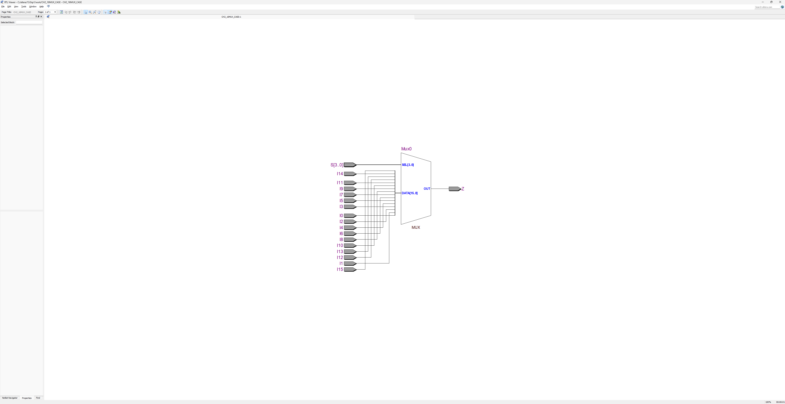
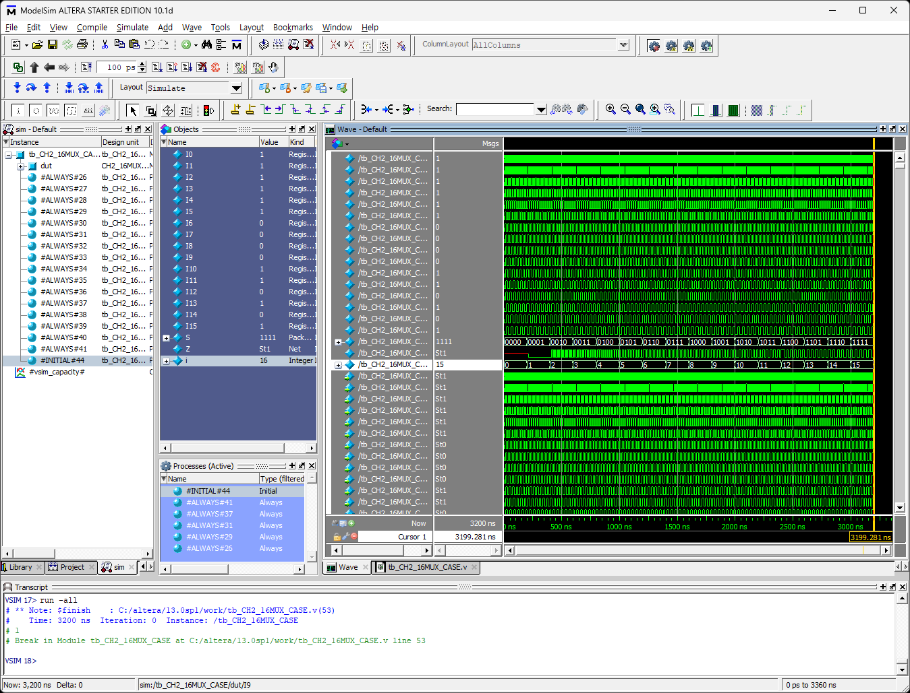
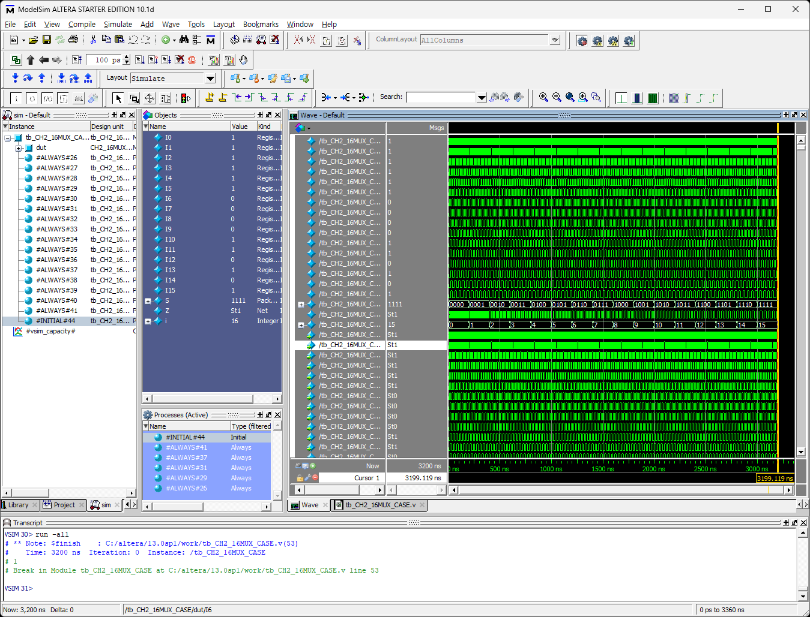

# CH2_16MUX_CASE 게이트 레벨 시뮬레이션 (ModelSim, Slow Model)

## 환경
- **Quartus**: 13.0sp1
- **Simulator**: ModelSim-Altera (ASE)
- **Simulation Mode**: Gate Level Simulation
- **Timing Model**: Slow Model
- **Target Device**: Cyclone II (`cycloneii_ver`)

시뮬레이션 파일들이 어디에 생성 되었는지 확인을 한다.

* C:\altera\13.0sp1\simulation\modelsim
* C:\altera\13.0sp1\work\simulation\modelsim
* C:\altera\13.0sp1\simulation\modelsim 에 파일들을 모아두면 아래 어려움이 없을 것이다.

## 파일 경로
| 구분 | 경로 |
|---|---|
| 소스/작업 디렉터리 | `C:\altera\13.0sp1\work` |
| 게이트레벨 넷리스트 | `C:\altera\13.0sp1\simulation\modelsim\CH2_16MUX_CASE.vo` |
| Slow SDF | `C:\altera\13.0sp1\simulation\modelsim\CH2_16MUX_CASE_v.sdo` |
| Fast SDF (참고) | `C:\altera\13.0sp1\simulation\modelsim\CH2_16MUX_CASE_v_fast.sdo` |
| 테스트벤치 | `C:\altera\13.0sp1\work\tb_CH2_16MUX_CASE.v` |

##  CH2_16MUX_CASE.v

```verilog
module CH2_16MUX_CASE (I0, I1, I2, I3, I4, I5, I6, I7,
                      I8, I9, I10, I11, I12, I13, I14, I15, S, Z);
    input  I0, I1, I2, I3, I4, I5, I6, I7;
    input  I8, I9, I10, I11, I12, I13, I14, I15;
    input  [3:0] S;
    output Z;
    reg    Z;

    always @(I0, I1, I2, I3, I4, I5, I6, I7,
             I8, I9, I10, I11, I12, I13, I14, I15, S) begin
        case (S)
            4'b0000: Z = I0;
            4'b0001: Z = I1;
            4'b0010: Z = I2;
            4'b0011: Z = I3;
            4'b0100: Z = I4;
            4'b0101: Z = I5;
            4'b0110: Z = I6;
            4'b0111: Z = I7;
            4'b1000: Z = I8;
            4'b1001: Z = I9;
            4'b1010: Z = I10;
            4'b1011: Z = I11;
            4'b1100: Z = I12;
            4'b1101: Z = I13;
            4'b1110: Z = I14;
            4'b1111: Z = I15;
            default: Z = I0;
        endcase
    end
endmodule
```


## 테스트벤치 (`tb_CH2_16MUX_CASE.v`)

`S`를 0~15까지 200ns씩 유지하고, `I0~I15`는 서로 다른 주기로 토글시켜 한 선택 구간에서 최소 10회 이상 파형 변화가 관찰되도록 구성.

```verilog
`timescale 1ns/1ps

module tb_CH2_16MUX_CASE;
    reg  I0, I1, I2, I3, I4, I5, I6, I7;
    reg  I8, I9, I10, I11, I12, I13, I14, I15;
    reg  [3:0] S;
    wire Z;

    integer i;

    CH2_16MUX_CASE dut (
        .I0(I0),   .I1(I1),   .I2(I2),   .I3(I3),
        .I4(I4),   .I5(I5),   .I6(I6),   .I7(I7),
        .I8(I8),   .I9(I9),   .I10(I10), .I11(I11),
        .I12(I12), .I13(I13), .I14(I14), .I15(I15),
        .S(S),     .Z(Z)
    );

    initial begin
        I0=0; I1=0; I2=0; I3=0; I4=0; I5=0; I6=0; I7=0;
        I8=0; I9=0; I10=0; I11=0; I12=0; I13=0; I14=0; I15=0;
        S = 4'b0000;
    end

    // I0~I15: 서로 다른 토글 주기 (10ns ~ 40ns)
    always #5  I0  = ~I0;
    always #6  I1  = ~I1;
    always #7  I2  = ~I2;
    always #8  I3  = ~I3;
    always #9  I4  = ~I4;
    always #10 I5  = ~I5;
    always #11 I6  = ~I6;
    always #12 I7  = ~I7;
    always #13 I8  = ~I8;
    always #14 I9  = ~I9;
    always #15 I10 = ~I10;
    always #16 I11 = ~I11;
    always #17 I12 = ~I12;
    always #18 I13 = ~I13;
    always #19 I14 = ~I14;
    always #20 I15 = ~I15;

    // S 선택 시간: 200ns씩 유지, 전체 3200ns
    initial begin
        $dumpfile("tb_CH2_16MUX_CASE.vcd");
        $dumpvars(0, tb_CH2_16MUX_CASE);

        for (i = 0; i < 16; i = i + 1) begin
            S = i[3:0];
            #200;
        end

        $finish;
    end
endmodule
```

* Quartus II에서 컴파일을 완료하여 코드에 문제가 없는지 확인하고, 필요한 파일들이 생성되는지 확인이 필요합니다.

C:\altera\13.0sp1\simulation\modelsim 폴더 아래

```
 C:\altera\13.0sp1\simulation\modelsim 디렉터리

2026-11-27  오전 07:09    <DIR>          .
2026-11-27  오전 06:38    <DIR>          ..
2026-11-27  오전 07:09               200 CH2_16MUX_CASE.sft
2026-11-27  오전 07:09            31,432 CH2_16MUX_CASE.vo
2026-11-27  오전 07:09            31,437 CH2_16MUX_CASE_fast.vo
2026-11-27  오전 07:09             1,809 CH2_16MUX_CASE_modelsim.xrf
2026-11-27  오전 07:09            11,126 CH2_16MUX_CASE_v.sdo
2026-11-27  오전 07:09            11,012 CH2_16MUX_CASE_v_fast.sdo
               6개 파일              87,016 바이트
```

## ModelSim 수행

Tool > Run Simulation Tool > Gate Level Simulation

Timing model : Slow Model 을 선택하고 "RUN"

## ModelSim 수행 절차 (성공 기준)

ModelSim Tcl 콘솔에서 아래 순서대로 실행.

### 1. 작업 디렉터리 이동 및 work 라이브러리 설정
```tcl
cd C:/altera/13.0sp1/work
if {[file exists work]} { vdel -lib work -all }
vlib work
vmap work work
```

### 2. 게이트레벨 넷리스트 및 테스트벤치 컴파일
```tcl
vlog C:/altera/13.0sp1/simulation/modelsim/CH2_16MUX_CASE.vo
vlog C:/altera/13.0sp1/work/tb_CH2_16MUX_CASE.v
```

### 3. Slow SDF 확인 및 복사
```tcl
glob C:/altera/13.0sp1/simulation/modelsim/*CH2_16MUX_CASE*.sdo
# 결과: CH2_16MUX_CASE_v.sdo (Slow), CH2_16MUX_CASE_v_fast.sdo (Fast)

file copy -force {C:/altera/13.0sp1/simulation/modelsim/CH2_16MUX_CASE_v.sdo} {C:/altera/13.0sp1/work/CH2_16MUX_CASE_v.sdo}
```

### 4. Gate Level Simulation 로드 (Slow Model)
```tcl
vsim -t 1ps -L altera_ver -L lpm_ver -L sgate_ver -L cycloneii_ver -sdfmax /tb_CH2_16MUX_CASE/dut=CH2_16MUX_CASE_v.sdo work.tb_CH2_16MUX_CASE
```

### 5. 파형 확인 및 실행
```tcl
add wave -r /*
run -all
```

## 전체 실행 스크립트 (`run_gate_sim.do`)

아래 내용을 `C:\altera\13.0sp1\work\run_gate_sim.do`로 저장 후 ModelSim에서 `do run_gate_sim.do`로 실행 가능.

```tcl
# CH2_16MUX_CASE Gate-Level Simulation (Cyclone II, Slow Model)

cd C:/altera/13.0sp1/work

# work 라이브러리 초기화
if {[file exists work]} { vdel -lib work -all }
vlib work
vmap work work

# 컴파일
vlog C:/altera/13.0sp1/simulation/modelsim/CH2_16MUX_CASE.vo
vlog C:/altera/13.0sp1/work/tb_CH2_16MUX_CASE.v

# Slow SDF 복사
file copy -force {C:/altera/13.0sp1/simulation/modelsim/CH2_16MUX_CASE_v.sdo} {C:/altera/13.0sp1/work/CH2_16MUX_CASE_v.sdo}

# 시뮬레이션 로드 (Cyclone II Slow Model)
vsim -t 1ps -L altera_ver -L lpm_ver -L sgate_ver -L cycloneii_ver -sdfmax /tb_CH2_16MUX_CASE/dut=CH2_16MUX_CASE_v.sdo work.tb_CH2_16MUX_CASE

# 파형 및 실행
add wave -r /*
run -all
```



### Finish Vsim 화면에서 "아니오"를 선택합니다. (시뮬레이션 결과는 Wave에 남아 있음.)

---

## Fast Model 사용 시

Quartus에서 **Fast Model**을 선택해 게이트레벨 파일을 생성하면 fast용 넷리스트/SDO가 만들어집니다. 하지만 ModelSim에서 사용하는 **TCL/스크립트도 fast 파일명으로 수정해야 합니다**. Quartus GUI 선택만으로 기존 ModelSim 명령이 자동으로 바뀌지 않습니다.

| 구분 | Slow Model | Fast Model |
|---|---|---|
| 넷리스트 | `CH2_16MUX_CASE.vo` | `CH2_16MUX_CASE_fast.vo` |
| SDF | `CH2_16MUX_CASE_v.sdo` | `CH2_16MUX_CASE_v_fast.sdo` |

### Fast Model용 ModelSim 명령

* Quartus II에서 컴파일을 완료하여 코드에 문제가 없는지 확인하고, 필요한 파일들이 생성되는지 확인이 필요합니다.

C:\altera\13.0sp1\simulation\modelsim 폴더 아래

```
 C:\altera\13.0sp1\simulation\modelsim 디렉터리

2026-11-27  오전 07:09    <DIR>          .
2026-11-27  오전 06:38    <DIR>          ..
2026-11-27  오전 07:09               200 CH2_16MUX_CASE.sft
2026-11-27  오전 07:09            31,432 CH2_16MUX_CASE.vo
2026-11-27  오전 07:09            31,437 CH2_16MUX_CASE_fast.vo
2026-11-27  오전 07:09             1,809 CH2_16MUX_CASE_modelsim.xrf
2026-11-27  오전 07:09            11,126 CH2_16MUX_CASE_v.sdo
2026-11-27  오전 07:09            11,012 CH2_16MUX_CASE_v_fast.sdo
               6개 파일              87,016 바이트
```

## ModelSim 수행

Tool > Run Simulation Tool > Gate Level Simulation

Timing model : Fast Model 을 선택하고 "RUN"

```tcl
cd C:/altera/13.0sp1/work
if {[file exists work]} { vdel -lib work -all }
vlib work
vmap work work

# fast 넷리스트 컴파일
vlog C:/altera/13.0sp1/simulation/modelsim/CH2_16MUX_CASE_fast.vo
vlog C:/altera/13.0sp1/work/tb_CH2_16MUX_CASE.v

# fast SDF 복사
file copy -force {C:/altera/13.0sp1/simulation/modelsim/CH2_16MUX_CASE_v_fast.sdo} {C:/altera/13.0sp1/work/CH2_16MUX_CASE_v_fast.sdo}

# fast SDF로 시뮬레이션 로드
vsim -t 1ps -L altera_ver -L lpm_ver -L sgate_ver -L cycloneii_ver -sdfmax /tb_CH2_16MUX_CASE/dut=CH2_16MUX_CASE_v_fast.sdo work.tb_CH2_16MUX_CASE

add wave -r /*
run -all
```



### Finish Vsim 화면에서 "아니오"를 선택합니다. (시뮬레이션 결과는 Wave에 남아 있음.)

---

**핵심:** `vlog` 대상 VO, `file copy` 대상 SDO, `vsim -sdfmax`의 SDF 파일명을 모두 fast용으로 변경해야 합니다. 디바이스 라이브러리(`-L cycloneii_ver`)는 동일 디바이스면 그대로 사용합니다.

## 주의사항 / 트러블슈팅

| 증상 | 원인 | 해결 |
|---|---|---|
| `Invalid argument. (errno = EINVAL)` / `Error loading design` | work 라이브러리 손상/매핑 문제 | `vdel -lib work -all`, `vlib work`, `vmap work work` 후 재컴파일 |
| `Failed to find SDF file` | SDO 파일명/경로 불일치, ModelSim Tcl에서 Windows `copy` 사용 | `glob`로 실제 파일명 확인, `file copy -force {...} {...}` 사용 |
| `Instantiation of 'cycloneii_lcell_comb' failed` | VO가 Cyclone II용인데 `cycloneive_ver` 로드 | `-L cycloneii_ver`로 변경 (디바이스 패밀리에 맞는 라이브러리 사용) |
| `SDF region not found` | DUT 인스턴스 경로 불일치 | TB 내 DUT 인스턴스명 확인 후 `-sdfmax /tb_.../<inst>=...sdo` 수정 |

## 확인 포인트
- `S`가 0~15까지 200ns 간격으로 변경되는지 확인.
- 각 `S` 구간에서 `Z`가 선택된 입력(`I0`~`I15`)을 따라가는지 확인.
- Slow Model SDF가 적용되어 게이트 지연이 파형에 반영되는지 확인.
- 총 시뮬레이션 시간: `16 × 200ns = 3200ns`.
