# 4. GETTING STARTED

<br>

---

<br>


이 장에서는 앞장에서 말한 시스템을 설계하는 순서를 이용하여 간단한 시스템을 설계하고,컴파일, 시뮬레이션, 하드웨어에 프로그래밍 하여 동작을 확인하는 방법에 대하여 설명하겠다.

시스템을 설계하고, 컴파일 하는 과정은 Altera사의 Quartus II 소프트웨어를 사용하여 진행하고, 시뮬레이션은 Mentor사의 ModelSim 소프트웨어를 이용하여 진행한다. 마지막으로 프로그래밍할 장비는 HBE-Combo III이다.

<br>

---

<br>

## 4.1. 설계 기획

설계하고자 하는 시스템은 RESET 신호가 있는 8비트 up counter이다. 이 8비트 카운터는RESETN과 CLK의 입력을 받아 COUNT_OUT이라는 8비트 출력 포트로 연산된 결과를 출력하도록 구성되어 있다.

RESETN의 신호가 0일 때 모든 데이터가 0으로 초기화되며, RESETN의 신호가 1일 때 시스템이 동작 한다. 카운터의 동작은 클럭의 Rising Edge일 때 동작하도록 구성되어 있다.

RESETN의 신호는 HBE-COMBO III 장비의 FPGA RESET핀과 연결하고, CLK는 장비의 버튼 스위치 SW1과 연결한다. 출력 COUNT_OUT은 LED1~8에 연결하여 출력 결과가 LED를 통해서 확인할 수 있도록 구성한다.Getting Started

<br>

---

<br>

## 4.2. Quartus II를 이용한 로직 설계 및 합성

### (1) 프로젝트 선언

Quartus II 프로그램을 이용하여 로직을 설계하기 위해서는 먼저 프로젝트 선언을 해주어야한다. 이것은 설계하는 로직에 대한 사항을 프로젝트 단위로 관리하도록 하는 것이다. 하나의프로젝트에는 설계파일, 핀 설정파일, 네트 리스트 파일, 타이밍 정보 파일, 네트 리스트 파일,프로그래밍 파일 등 로직을 설계하는 데에서 만들어지는 모든 파일들이 여기에 포함된다.

다음의 순서대로 설계할 프로젝트를 선언한다.

먼저 윈도우 XP의 시작 > 프로그램 > Altera > Quartus II 8.0 Web Edition > Quartus II8.0 Web Edition 메뉴를 선택하여 프로그램을 실행시킨다.

아래 그림과 같이 Quartus II 프로그램의 File > New Project 메뉴를 선택한다.

<br><br>

<p align="center"> 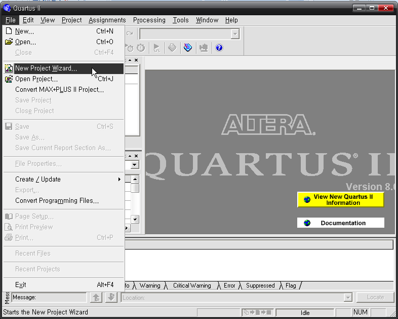 </p>

<br><br>

아래 그림과 같이 New Project 창에서 Next 버튼을 누른다.

<br><br>

<p align="center"> 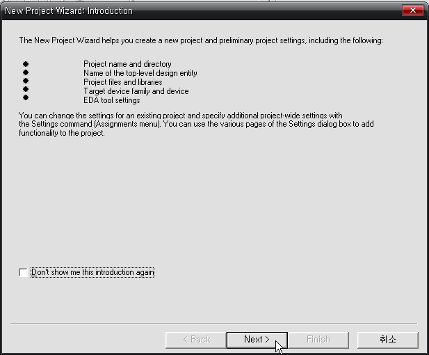 </p>

<br><br>

다음 그림과 같이 작업폴더와 프로젝트 이름을 선언한다.
   * Working Directory : E:\ WORK \ COUNT_8BIT
   * Project Name : COUNT_8BIT
   * Top-Level Entity Name : COUNT_8BIT

<br><br>

<p align="center"> 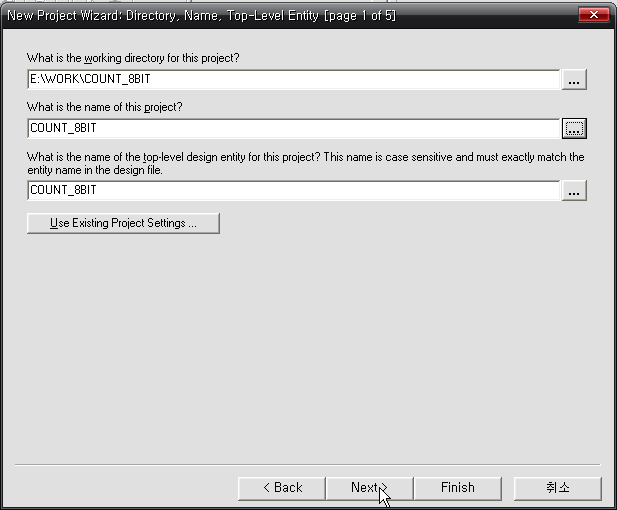 </p>

<br><br>

아래 그림은 프로젝트에 포함시킬 로직 파일을 추가하는 것인데, 아직 설계된 파일이없기 때문에 Next 버튼을 누른다.

<br><br>

<p align="center"> 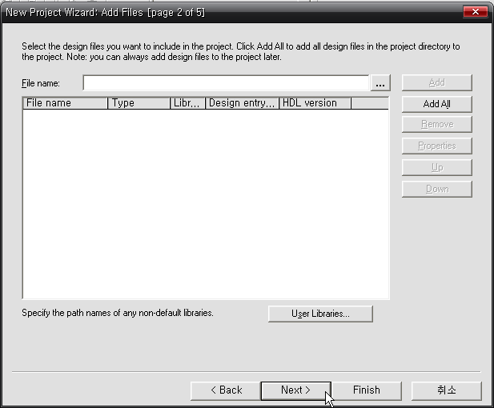 </p>

<br><br>

아래 그림은 디바이스를 설정하는 창이다 아래 그림과 같이 Device Family와 device를선택한다.
   * Device Family : Cyclone II
   * Device : EP2C70F672C8

<br><br>

<p align="center"> 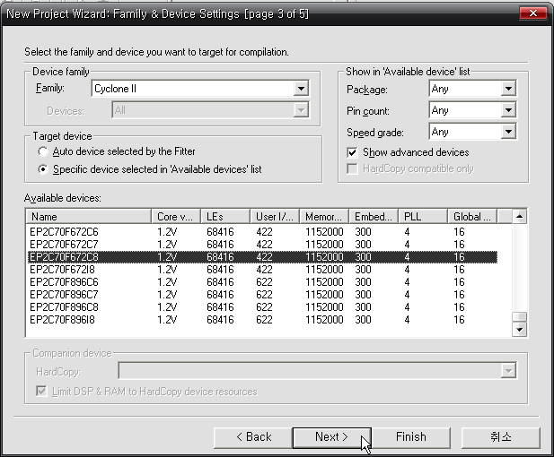 </p>

<br><br>

다음 그림은 EDA 툴을 설정하는 창이다. 이것은 Quartus II에서 사용하는 컴파일러와시뮬레이터가 아닌 더 좋은 EDA 벤더의 소프트웨어를 사용하고자 할 때 이곳에서설정할 수 있다.

<br><br>

<p align="center"> 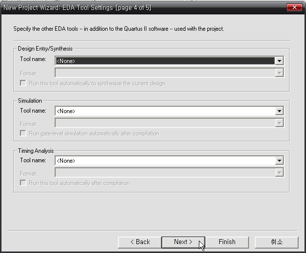 </p>

<br><br>

아래 그림과 같이 프로젝트 선언에 대한 요약을 확인하고, Finish 버튼을 눌러 프로젝트선언을 완료한다.

<br><br>

<p align="center"> 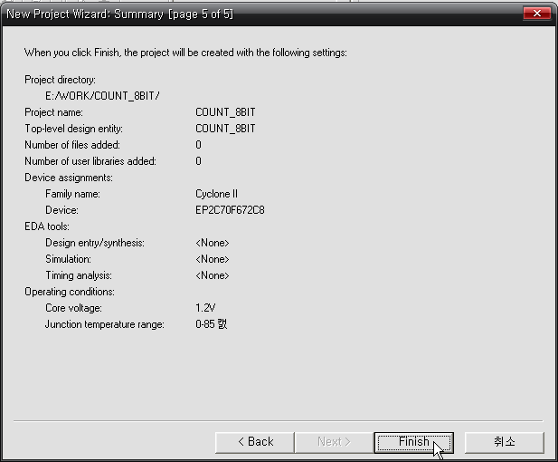 </p>

<br><br>

<br>

---

<br>


### (2) 로직 설계

앞에서 기획한 내용의 8비트 카운터를 설계하도록 하겠다.

다음의 순서대로 설계가 진행되어 프로젝트에 포함된다.

아래 그림과 같이 Quartus II 프로그램의 File > New 메뉴을 선택한다.

<br><br>

<p align="center"> 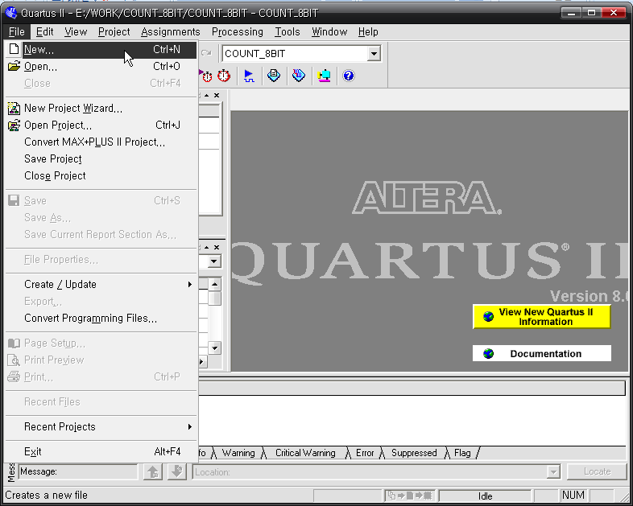 </p>

<br><br>

나타나는 New 창에서 아래 그림과 같이 VHDL File을 선택한다.

<br><br>

<p align="center"> 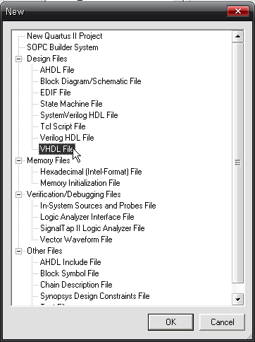 </p>

<br><br>

아래와 같이 VHDL로직을 설계하고, COUNT_8BIT.VHD라는 이름으로 저장한다. 저장하는폴더는 “E:\ WORK \ COUNT_8BIT” 이다.로직에 대한 설명은 넘기겠다. 다음 장의 CH2. 논리 회로에서 카운터 로직의 설명에비슷한 예제가 설계되어 있다.

```vhdl
--COUNT_8BIT.VHD

LIBRARY IEEE;
USE IEEE.STD_LOGIC_1164.ALL;
USE IEEE.STD_LOGIC_UNSIGNED.ALL;

ENTITY COUNT_8BIT IS
PORT (
  RESETN : IN STD_LOGIC;  -- RESET
  CLK : IN STD_LOGIC;      -- CLOCK BUTTON

  COUNT_OUT : OUT STD_LOGIC_VECTOR(7 DOWNTO 0)  -- LED OUTPUT
);
END COUNT_8BIT;

ARCHITECTURE HB OF COUNT_8BIT IS

SIGNAL CNT_8BIT : STD_LOGIC_VECTOR(7 DOWNTO 0);

BEGIN

PROCESS (RESETN, CLK)
BEGIN
  IF RESETN = '0' THEN
    CNT_8BIT <= (OTHERS => '0');
  ELSIF CLK'EVENT AND CLK = '1' THEN
    IF CNT_8BIT = "11111111" THEN
      CNT_8BIT <= (OTHERS => '0');
    ELSE
      CNT_8BIT <= CNT_8BIT + 1;
    END IF;
  END IF;
END PROCESS;

COUNT_OUT <= CNT_8BIT;

END HB;
```

위의 설계된 로직 파일을 저장하면 자동으로 프로젝트에 파일이 추가된다. 아래 그림과같이 Quartus II 프로그램의 Project > Add/Remove Files in Project 메뉴을 선택하여프로젝트에 COUNT_8BIT.VHD 파일이 추가되었는지를 확인한다.

<br><br>

<p align="center"> 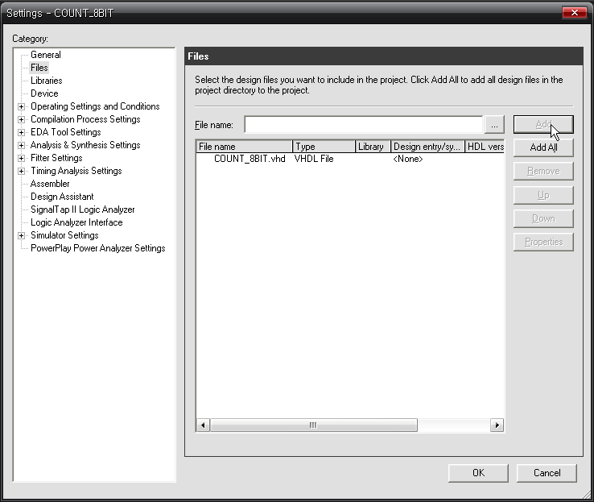 </p>

<br><br>

아래 그림과 같이 Processing > Start > Start Analysis & Elaboration 메뉴를 선택하여,설계된 로직의 문법 오류 검사를 수행한다. 오류가 있다면 수정한다.

<br><br>

<p align="center"> 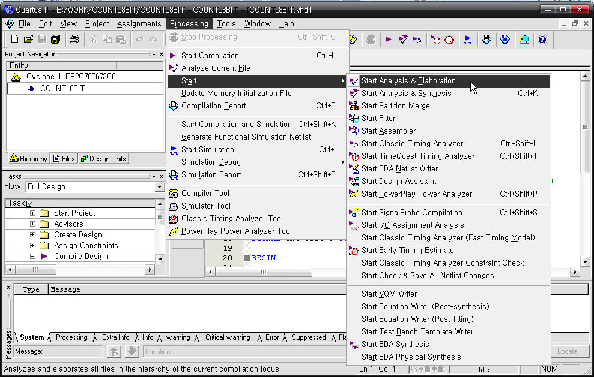 </p>

<br><br>

### (3) Assignment

Assignment는 프로젝트의 타겟이 되는 FPGA 디바이스와 설계된 로직에서 사용하는 입출력단자를 하드웨어와 연결하기 위하여 핀을 설정하는 것이다.

디바이스 설정은 처음 프로젝트 선언에서 하였지만, 아래 그림과 같이 Assignments >Device 메뉴를 선택하여 설정한 디바이스를 확인한다.

<br><br>

<p align="center"> 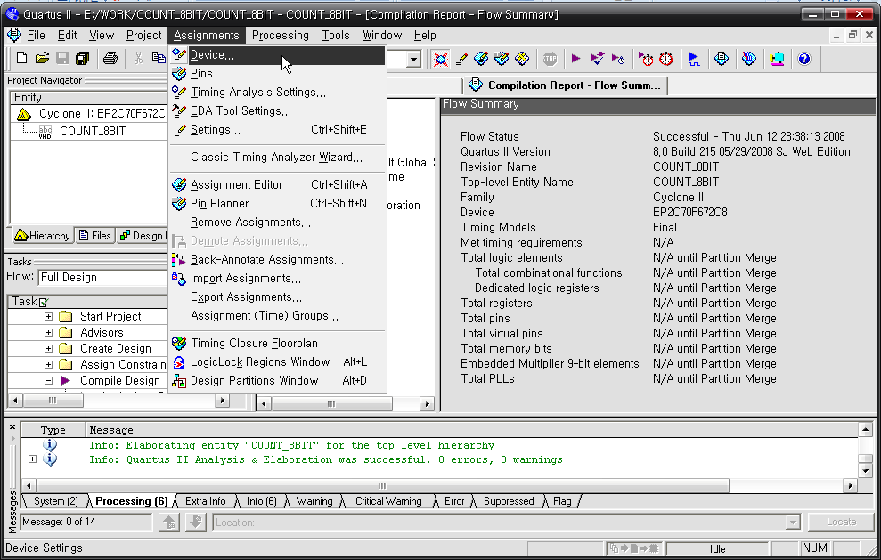 </p>

<br><br>

<br><br>

<p align="center"> 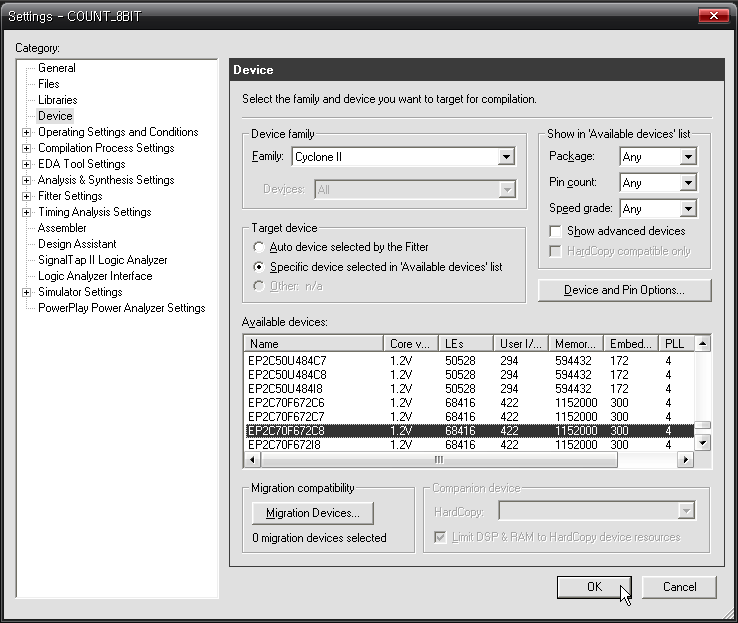 </p>

<br><br>

아래 그림과 같이 Assignment > Assignment Edition 메뉴를 선택 한 후, AssignmentEdition창에서 아래의 표와 같이 핀을 설정한다.

<br><br>

<p align="center"> 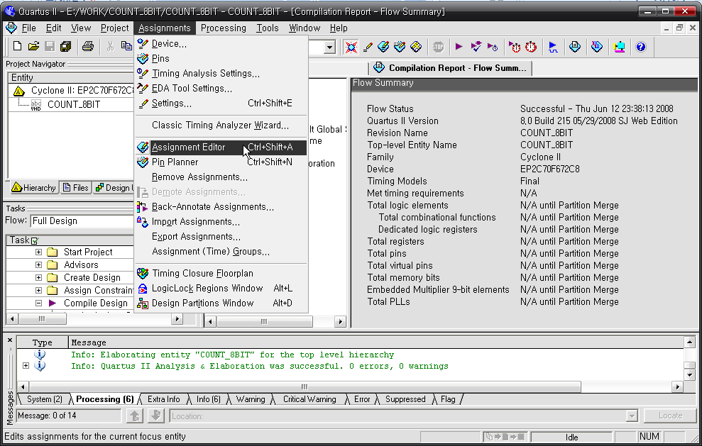 </p>

<br><br>

| 포트 이름 | 핀 번호 | 하드웨어 설명 | 포트 이름 | 핀 번호 | 하드웨어 설명 | 
|:-------:|:-------:|:-------:|:-------:|:-------:|:-------:|
| RESETN | N2 | FPGA_RESET | COUNT_OUT[4] | AF8 | LED4 | 
| CLK | V4 | SW1 | COUNT_OUT[3] | AF7 | LED5 | 
| COUNT_OUT[7] | AE11 | LED1 | COUNT_OUT[2] | AF6 | LED6 | 
| COUNT_OUT[6] | AE10 | LED2C | OUNT_OUT[1] | AF5 | LED7 | 
| COUNT_OUT[5] | AF9 | LED3C | OUNT_OUT[0] | B3 | LED8 | 

<br><br>

<p align="center"> 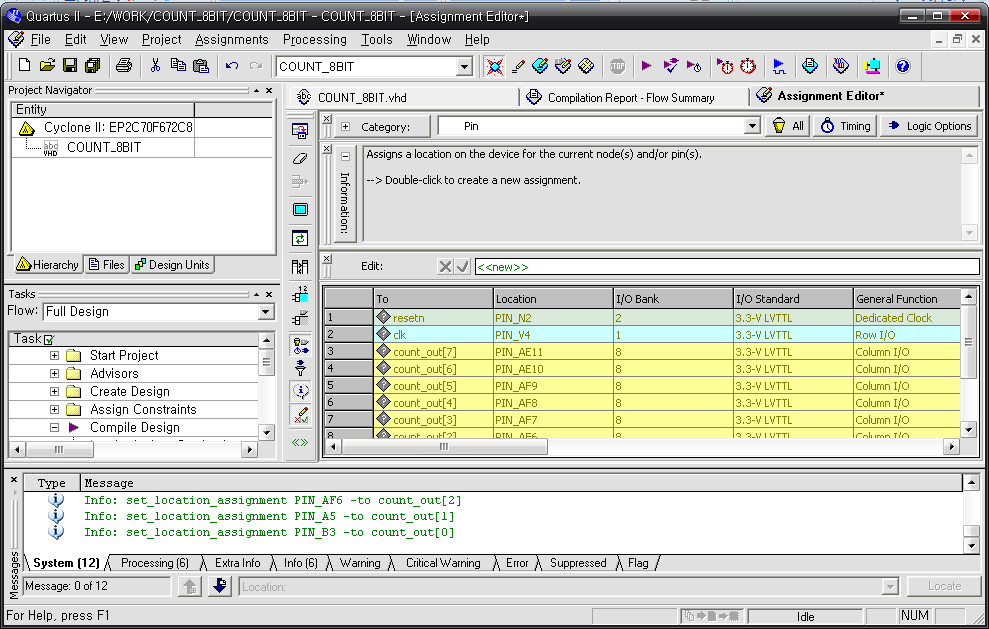 </p>

<br><br>

### (4) Compile

컴파일은 설계된 로직을 합성하여 FPGA에서 사용할 수 있도록 네트 리스트로 변경하는 과정을 수행하는 것이다. 이 때, 앞에서 설정한 디바이스와 핀 설정을 바탕으로 실제 타겟이 되는디바이스에 맞는 Place & Route 과정이 이루어 지며, 최종 목적인 프로그래밍 파일이 생성된다.

다음 그림과 같이 Processing > Start Compilation 메뉴를 선택하여 컴파일을 진행 시킨다.

<br><br>

<p align="center"> 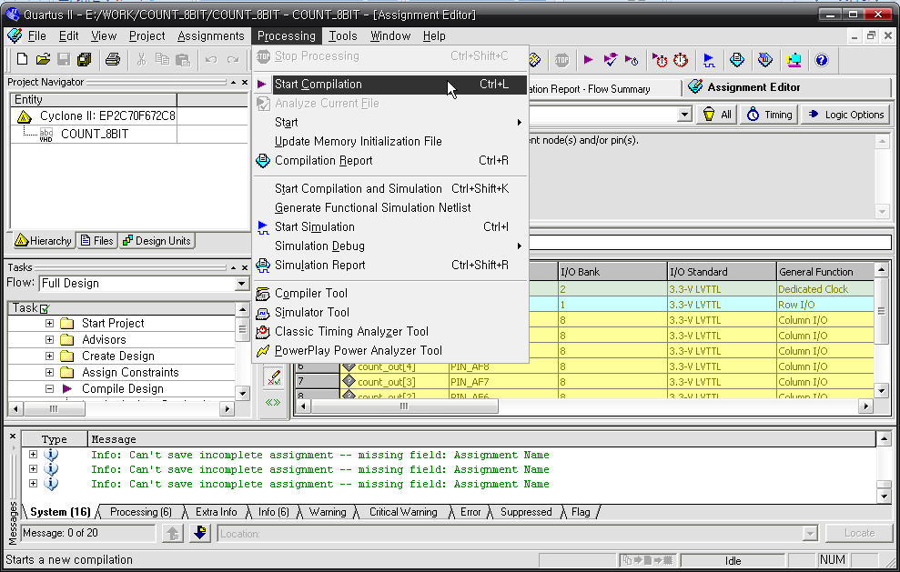 </p>

<br><br>

<br><br>

<p align="center">  </p>

<br><br>

컴파일이 완료가 되면 프로그램의 오른쪽 창에 나오는 Compilation Report를 통해서 컴파일한 결과 등을 확인할 수 있다. 이 창을 살펴보면 COUNT_8BIT 프로젝트는 Cyclone II Family의EP2C70F672 디바이스를 사용하며, 총 8개의 Logic Element를 사용하고, 입출력 핀의 수를 10개 사용하는 프로젝트라는 것을 알 수 있다. 물론 옆의 메뉴를 선택하여 세세한 항목도 확인할 수 있다.

<br>

---

<br>


## 4.3. ModelSim 소프트웨어를 이용한 시뮬레이션

이 절에서는 앞에서 설계한 8비트 카운터 로직을 소프트웨어적으로 검증하기 위하여 시뮬레이션 하는 방법을 설명하고 있다. 여기에서 사용하는 시뮬레이션 소프트웨어로 유명한ModelSim이다.시뮬레이션을 할 때에는 출력된 결과를 확인해 볼 수 있도록, 입력 신호의 데이터를 설정해주어야 하는데, 많이 사용하는 방법이 테스트 벤치 파일을 작성하여 시뮬레이션 하는 것이다.아래에 설계되어 있는 VHDL 파일이 이 8 비트 카운터를 시뮬레이션 하기 위한 테스트 벤치파일이다.

```vhdl
--TB_COUNT_8BIT.VHD

LIBRARY IEEE;
USE IEEE.STD_LOGIC_1164.ALL;
USE IEEE.STD_LOGIC_UNSIGNED.ALL;

ENTITY TB_COUNT_8BIT IS
END TB_COUNT_8BIT;

ARCHITECTURE HB OF TB_COUNT_8BIT IS

COMPONENT COUNT_8BIT
PORT (
  RESETN : IN STD_LOGIC;
  CLK : IN STD_LOGIC;

  COUNT_OUT : OUT STD_LOGIC_VECTOR(7 DOWNTO 0)
);
END COMPONENT;

SIGNAL RESETN : STD_LOGIC := '0';
SIGNAL CLK : STD_LOGIC := '0';
SIGNAL COUNT_OUT : STD_LOGIC_VECTOR(7 DOWNTO 0) := "00000000";

BEGIN

PROCESS
BEGIN
  WAIT FOR 10 NS;
CLK  <= NOT CLK;
END PROCESS;

RESETN <= '0', '1' AFTER 15NS, '0' AFTER 500NS, '1' AFTER 550NS;

U_COUNT_8BIT : COUNT_8BIT
PORT MAP (
  RESETN => RESETN,
  CLK => CLK,
  COUNT_OUT => COUNT_OUT
);

END HB;
```

위의 테스트 벤치 파일을 TB_COUNT_8BIT.VHD라는 이름으로 작업 폴더에 저장한다.ModelSim 소프트웨어를 이용하여 시뮬레이션 하는 방법에 대하여 아래에 설명되어 있다.zModelSim 소프트웨어를 실행시킨다.z프로그램을 실행시키면, 위의 환경설정에서 등록한 라이브러리가 등록이 되어 있는 것을확인할 수 있다.zModelSim 소프트웨어에서 시뮬레이션을 하기 위해서, 아래 그림과 같이 File > New >Project 메뉴를 선택하여 새로운 프로젝트를 선언한다.zCreate Project 창에서 아래 그림과 같이 Project Name과 작업 폴더를 지정한다.여기에서는 Quartus II에서 작업한 폴더를 지정하였다.zAdd items to the Project 창에서 아래 그림과 같이 프로젝트에 포함할 로직 파일(COUNT_8BIT.VHD)과 테스트 벤치 파일(TB_COUNT_8BIT.VHD)을 추가시킨다.z위에서 파일을 추가시키면 아래 그림과 같이 Workspace창에서 프로젝트에 선택한파일이 추가된 것을 확인할 수 있다.z추가한 파일을 검증하기 위하여 아래 그림과 같이 Compile > Compile All 메뉴를선택하여 추가한 파일에 대한 컴파일을 실행시킨다.z컴파일이 끝나면 아래 그림과 같이 Status와 메시지를 통해 컴파일의 성공을 확인할 수있다.z시뮬레이션을 하기 위하여 아래 그림과 같이 Simulate > Start Simulation 메뉴를선택한다.z위의 메뉴를 선택하면 Start Simulation 창이 나타나는데, 여기에서 아래 그림과 같이시뮬레이션 하려고 하는 파일을 선택하면 된다.Design 탭의 Work – tb_count_8bit를 선택하고, OK 버튼을 누른다.z아래 그림과 같이 View > Debug Windows > Wave 메뉴를 선택하여 Wave 창을 활성화시킨다.z아래 그림과 같이 Workspace의 sim 탭에서 tb_count_8bit를 마우스로 드래그하여 Wave창에 위치시킨다.z마우스로 Drag & Drop하여 tb_count_8bit를 끌어오면, 아래 그림과 같이 입/출력 신호가나타나는 것을 확인할 수 있다.z시뮬레이션 하는 입력 신호의 값은 테스트 벤치 파일(TB_COUNT_8BIT)에서 설정했기때문에, 아래 그림과 같이 Transcript 탭에서 선택하여 직접 “run 1us”를 type한다.(소문자로 입력해야 한다)이 명령어는 1us만큼 시뮬레이션 하라는 명령어이다. 실행 시키면 아래 그림과 같이wave 창에서 시뮬레이션의 결과를 확인해 볼 수 있다.처음에 나타나는 파형이 너무 커서 잘 안 보이는 경우가 있는데, 파형의 축소를 통해결과를 확인해야 한다.

## 4.4. HBE-Combo III를 이용한 동작 검증

이 장에서는 HBE-Combo III 장비를 통해서 위에서 설계한 8비트 카운터를 동작시켜보도록 하겠다.

### (1) 장비 설정

① 아래 그림과 같이 장비에 Power Cable을 연결한다.② 아래 그림과 같이 장비의 JTAG Port에 ByteBlaster II Cable 또는 USB Blaster II Cable을 연결한다.③ 전원 선 옆의 스위치를 조작하여, 장비의 전원을 켠다.

### (2) 프로그래밍 및 동작 확인

위와 같이 장비에 대한 준비를 끝마쳤다면, Quartus II에서 프로그래밍하여 동작을 확인해 보는 일만 남았다.①Quartus II 소프트웨어에서 아래 그림과 같이 Tools > Programmer 메뉴를 선택하여Quartus II의 Programmer를 실행시킨다.② 아래 그림과 같이 Hardware Setup 버튼을 클릭하여 FPGA에 프로그램 하는데 사용할 프로그래밍 케이블을 선택한다. 아무런 장치도 나타나지 않으면, Hardware Setup 창에서Add Hardware를 선택한다. 프로그래밍 케이블은 USB Port를 사용하는 USB Blaster와Parallel Port를 사용하는 ByteBlaster II를 선택하여 사용할 수 있다.③ 아래 그림과 같이 Programmer의 Start 버튼을 눌러 FPGA 디바이스로의 프로그래밍을진행한다.이 부분에서 Hardware Setup이 잘 설정되었는지, Mode가 JTAG으로 설정되었는지,Program/Configure이 체크 되었는지를 확인해야 한다.④ 프로그래밍이 끝나면 장비를 통해서 동작을 확인해 볼 수 있다.버튼 스위치를 눌러서 8비트 카운터의 동작을 확인해 보기 바란다.
