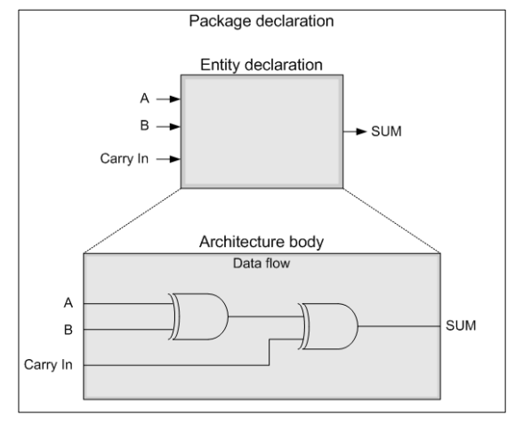

# 5. VHDL 구조 및 기초

## 5.1. 개요

VHDL 이란 VHSIC(Very High Speed Integrated Circuit) Hardware Description Language의 첫자를 딴 이름이다. 이것을 말 그대로 해석하면 매우 빠른 속도로 IC화 할 수 있는 하드웨어기술 언어라는 뜻으로, 하드웨어를 기술하는 언어 중 하나이다. 하드웨어를 기술한다는 의미는VHDL이라는 언어를 통해 회로를 표현한다는 것을 말한다. 이때까지의 많은 전자회로의 CAD툴을 통해 심볼 형태의 Schematic으로 회로를 표현하여 그림 형태로 회로를 구성하였지만, 이러한 설계 기술은 회로의 설계, 검증 및 유지 보수에 있어 여러 가지 문제점이 있다. 하드웨어기술 언어인 VHDL을 통해 회로 표현을 언어로 함으로써 보다 쉽고 간편하게 회로를 구성하고 표현할 수 있게 되었다. 이렇게 VHDL은 디지털 회로를 언어적으로 표현한 것이라 할 수있다. 이것은 부품들의 상호연결 관계를 일정한 문법에 의하여 기술하여 표현하는 설계 언어라는 것을 의미한다.

VHDL의 설계 방법은 Schematic과 그 밖의 HDL에 의한 설계와 달리 IEEE 표준으로 제정되어대부분의 CAD 업체가 이 표준 설계 방식을 따르고 있기 때문에, 설계자는 이 언어로 설계한로직을 타깃 디바이스의 벤더와 설계 툴에 변경하더라도 같이 사용할 수 있다.

## 5.2. VHDL의 구조

VHDL의 구조는 크게 라이브러리(LIBRARY), 엔티티(ENTITY)와 아키텍쳐(ARCHITECTURE)로 나눌 수 있다.


Library를 통해 VHDL구문의 사용 함수를 정의하고, entity를 통해 현재 사용 회로의 port를 선언한다. 마지막으로 Architecture를 통해서 현재 설계 파일의 동작을 설계한다. 이 같은 과정을통해 하나의 VHDL을 이용한 회로가 완성되고 사용자가 원하는 동작을 하게 된다.

아래 그림은 VHDL의 구조를 도식화 하여 나타낸 것이다.

<br><br>

<p align="center">  </p>

<br><br>

### (1) LIBRARY 선언

LIBRARY 선언 부는 PACKAGE 선언 부라고 할 수 있다. 이 부분의 역할은 VHDL에서 사용할라이브러리를 지정하는 것이다. 따라서 설계 시에 사용하는 VHDL구문의 예약어와 기호에 대한 지원을 위해 library를 선언해 주는 역할을 한다. 이러한 library의 선언은 설계자가 어떠한것을 설계하느냐에 따라서 라이브러리 선언 부에 해당되는 라이브러리를 찾아 선언해 주면된다. 보통 IEEE의 STD_LOGIC_1164라는 라이브러리를 기본으로 선언하여 사용한다. 라이브러리 선언은 기본으로 제공하는 라이브러리를 이용하여 설계하여도 되고 사용자가 만든 라이브러리를 이용하여 설계할 수도 있다.

LIBRARY는 아래와 같은 형식으로 선언된다. LIBRARY 이름과 그 LIBRARY에 포함되어 있는PACKAGE를 불러와 사용한다.

```
LIBRARY [라이브러리 이름];
USE [라이브러리 이름].[패키지 이름].[내용];
```

아래는 이 LIBRARY를 선언한 것인데, VHDL에서 가장 많이 사용되는 IEEE 라이브러리와 이 라이브러리에 속해 있는 PACKAGE를 선언한 예를 보여주고 있다.

```
LIBRARY IEEE;
USE IEEE.STD_LOGIC_1164.ALL;
USE IEEE.STD_LOGIC_UNSIGNED.ALL;
```

### (2) ENTITY문에서의 포트 선언

ENTITY 선언은 설계한 로직의 외부적 인터페이스를 정의하는 것이다. 외부에서 VHDL을 볼때 연결되는 단자(포트)라고 생각하면 된다. 이러한 ENTITY에서 선언된 포트는 FPGA의 I/O 핀을 통해 연결되는 포트가 된다. 회로에는 VHDL로 설계된 로직에는 하나의 ENTITY 선언만이존재하는 반면에 표현 방법에 따라 여러 개의 아키텍처 문이 존재할 수 있다. 만일 다수의 아키텍처를 갖는 ENTITY 가있을 경우 구성(configuration) 에 의하여 그 연결관계(entity-architecture mapping)를 설정해 주어야 한다.

ENTITY는 아래와 같은 형식으로 선언된다. ENTITY 이름과 ENTITY에 포함된 포트 리스트를 불러와 사용할 수 있다.

```
ENTITY [엔티티 이름] IS
PORT ( [포트 리스트]
[포트 이름] : [모드] [데이터 형];
);
END [엔티티 이름]
```

위의 형식에서처럼 포트 리스트는 포트 이름과 모드, 데이터 형으로 구성된다.

포트 이름은 말 그대로 입출력 단자에 대한 이름 이다. 나중에 알아보기 쉽도록 특징을 갖는이름으로 지정하는 것이 좋다.

모드는 선언한 포트를 입력으로 사용할 것인지, 출력으로 사용할 것인지 등을 설정하는 것이다. 모드는 IN, OUT, INOUT등으로 선언할 수 있으며 각각의 특징은 아래에 설명하고 있다.

* in : 신호가 해당 설계 파일의 ENTITY로 입력되는 경우에 사용된다. in 모드는 클럭 입력,제어 입력(load, reset, enable)등 단 방향 데이터 입력에 주로 쓰인다.
* out : 해당 설계 파일의 ENTITY에서 신호가 출력되는 경우에 사용된다. out 모드는포트를 읽어 들이지 않는다고 간주하기 때문에, 피드백(feedback)을 허용하지 않는다. out모드는 카운트 출력과 같은 곳에 사용한다.
* inout : 신호가 해당 설계 파일의 ENTITY로 입·출력되는 경우에 사용한다. 즉 양방향성포트에서 사용이 된다. 이때는 다수의 소스로부터 업데이트가 가능하다. inout은 내부피드백을 허용하고, 다른 모든 모드를 대치할 수 있다. 다시 말해서 in, out, buffer 모드를inout 모드로 바꾸어 사용할 수 있다. 모든 포트를 inout 모드로 선언해도 되지만, 이렇게하면 코드의 가독성을 떨어뜨려서 신호원을 알아보기 힘들게 된다. inout 모드는 DMA제어기의 데이터 버스와 같은 양방향 신호에 사용하는 것이 좋다.
* buffer : 출력 기능에서 신호를 해당 설계 파일의 ENTITY 내에서 다시 읽는 기능을추가한 것이다. 다시 말해 출력을 내부에서 다시 사용할 수 있도록 port를 선언할 때사용한다. 이때 업데이트 하는 소스는 하나로 제한된다. 이 모드에서 피드백을허용한다는 점을 제외하면 out 모드와 비슷하다. buffer 모드는 ENTITY 외부에서는 포트구동을 허용하지 않으므로 양방향 포트로는 사용될 수 없다.

아래에 이 ENTITY문의 예가 있다. COUNT_8BIT라는 프로젝트 이름을 갖고 있는 이 로직은,RESETN과 CLK이라는 포트는 STD_LOGIC의 형을 갖고 있는 입력 포트이고, COUNT_OUT은 8비트의 STD_LOGIC 데이터형을 갖고 있는 출력 포트라는 것을 확인할 수 있다.

```vhdl
ENTITY COUNT_8BIT IS
PORT(
RESETN : IN STD_LOGIC;
CLK : IN STD_LOGIC;
COUNT_OUT : OUT STD_LOGIC_VECTOR(7 DOWNTO 0)
);
END COUNT_8BIT;
```

### (3) ARCHITECTURE 문에서의 로직 설계

ENTITY가 외부의 신호와 연결되는 port를 선언한 구문이라면, Architecture는 이러한 port를통해 입력되는 신호를 사용자가 제어하여 외부로 출력해 주는 역할을 한다. 다시 말해 Entity에서 겉 모습을 정의하고 Architecture에서 설계내용을 정의하게 된다. 아키텍처 문(architecture body)는 병행문(concurrent statement)의 성격을 갖고 있다. 병행문은 다른 PLD언어 또는 네트리스트와 같은 의미로서 디자인 내에서 문장이 놓인 위치에 상관없다. 다시 말해 다른 프로그래밍 언어에서는 문장이 놓인 순서대로 실행 되지만, VHDL은 병행 처리되는구간도 있다. 신호(signal)들에 의하여 각 문장에 값이 전달되며 신호로 값의 할당을 ‘<=’ 표시를 통해 할 수 있다.이 ARCHITECTURE 문은 아래와 같은 형식으로 사용된다.ARCHITECTURE [아키텍처이름] OF [엔티티 이름] IN[선언문]BEGIN[회로의 내부 동작 표현]END [아키텍처_이름];위의 형식에서 선언문의 위치에서는 ARCHITECTURE 문에서 사용할 신호(SIGNAL), 상수(CONSTANT)와 자료형(DATA TYPE)등을 선언한다. 또, 이 위치에서 다른 서브 프로젝트와 연동을 위한 COMPONENT도 선언한다.ARCHITECTURE와 BEGIN 사이에서 선언되는 신호를 내부신호(internal signal)이라 부르며, 모드(mode)로서 "inout"의 특징을 갖는다. 따라서 mode는 별도로 지정을 하지 않는다.회로의 내부 동작 표현의 위치에서는 PROCESS문, 병행문이 사용되어 회로가 구성된다. VHDL에서 하드웨어 기술 언어가 가지는 가장 큰 특징 중 하나는 동시 처리되는 병행문이다. 이는일반 프로그래밍 언어에서만 존재하는 순차문과는 상당한 차이가 있는 처리 방식이다.ARCHITECTURE 문 내부에 서술되는 합성 가능한 VHDL 문장은 PROCESS문의 내부를 제외하고는 병행처리를 하며, 대표적인 것으로 with select문과 when else문이 있다. PROCESS문 자체는 병행 처리문이나 process 내부의 문장들은 예외적으로 순차처리 하게 하여 복잡한 알고리즘의 구현을 편리하게 하고 있다.하나의 병행 처리문은 하나의 PROCESS문으로 설계할 수 있다. PROCESS문은 동작적 표현으로하드웨어 시스템을 모듈 별로 기술하는데 편리하다. 대개 시스템은 하드웨어를 모듈단위로 구성하고 있고, 각 모듈은 병행처리를 하면서 서로간의 통신을 통해 관계를 유지한다. 이러한 모듈 단위의 병행처리를 개별 PROCESS로 볼 수 있다. PROCESS문은 시스템의 각 모듈의 병행처리를 담당하지만 PROCESS문의 내부는 순차처리를 하게 하며 복잡한 알고리즘의 구현을 쉽게 할 뿐만 아니라, PROCESS간의 통신을 원활히 하고 있다.이 PROCESS문은 아래와 같은 형식으로 사용된다.[레이블 :] PROCESS([감지신호 리스트])[선언문]BEGIN[순차문]END PROCESS [프로세서 레이블];PROCESS문에서 레이블은 프로세서를 위해서 지정할 수 있으며 반드시 해야 할 작업은 아니다. PROCESS문은 감지 신호 리스트(Sensitivity list)에서 있는 신호에 변화(event)가 발생하면수행이 시작된다. 이러한 감지 리스트의 위치는 PROCESS 선언 다음에 와도 되고, begin 하위에 wait문을 두어서 사용하여도 된다.VHDL의 회로 내부를 동작을 설계하는 방법은 크게 순차문(Sequential Statement)에 의한 구성과 병행문(Concurrent Statement)에 의한 구성 방법으로 구분할 수 있다.순차문은 문장이 하나씩 차례로 수행되는 구문으로 동작적 기술로 표현된다. PROCESS문의 내부에 기술된 회로의 경우 순차적으로 한 문장씩 수행된다. 예를 들어 IF문과 같은 조건문과CASE문이 이 순차문에 포함됩니다.병행문은 문장이 동시에 수행되는 구문이다. PROCESS문의 내부는 순차문으로 구성되지만,PROCESS문 자체는 병행문이다. 여러 개의 PROCESS문이 있을 경우에는 동시에 수행된다.PROCESS문과 조건적 병행처리문(WHEN 조건 ELSE), 선택적 병행처리문(WITH 수식 SELECT)이이에 속한다. 자료흐름적 기술을 위해서 병행문이 사용되고, COMPONENT문은 구조적 기술을위해서 사용된다.아래의 예제는 이 ARCHITECTURE문을 보여주고 있다. 여기에서 사용한 PROCESS문은 RESETN과 CLK의 신호의 변화가 있을 때만 수행된다.ARCHITECTURE HB OF COUNT_8BIT ISSIGNAL CNT_8BIT : STD_LOGIC_VECTOR(7 DOWNTO 0);BEGINPROCESS(RESETN, CLK)BEGINIF RESETN = '0' THENCNT_8BIT <= (OTHERS => '0');ELSIF CLK'EVENT AND CLK = '1' THENIF CNT_8BIT = "11111111" THENCNT_8BIT <= (OTHERS => '0');ELSECNT_8BIT <= CNT_8BIT + 1;END IF;END IF;END PROCESS;COUNT_OUT <= CNT_8BIT;END HB;

## 5.3. 객체와 연산자

### (1) 객체

VHDL에서 값을 가질 수 있는 모든 것을 객체라 하고 이러한 객체는 자료형(data type)를 갖는다. 그 종류로는 신호(signal), 상수(constant), 변수(variable)의 3가지 종류의 객체가 있다. 이것은 각각 다른 특징을 갖고 표현되므로 잘 선택해서 사용하여야 한다.객체는 아래와 같이 선언되어 사용된다.SIGNAL CARRY : STD_LOGIC;이것을 분석하면,  신호 carry는 ‘0’ 또는 ‘1’을 값으로 갖는 자료형 "std_logic"으로 선언되었다는 것을 의미한다.‰ SignalSignal은 VHDL 합성 할 때 선(Wire)으로 연결이 되며, 각 심볼에 연결되어 사용하는 외적 변수이다. Signal에서 값을 대입하기 위해서는 ‘<=’’의 기호를 사용하고, 초기에 값을 지정해 주기 위해서는 ‘:=’’의 기호를 사용한다. 아래 예제에 Signal의 선언 방법과 값의 대입 방법이 설명되어 있다.SIGNAL    SIG : STD_LOGIC;-- sig 를 std_logic 로 선언SIGNAL    COUNT1 : STD_LOGIC_VECTOR(3 DOWNTO 0);  -- 내림차순-- count1 을 4bit 내림차순으로 선언SIGNAL    COUNT2 : STD_LOGIC_VECTOR(0 TO 3);  -- 올림차순-- count2 를 4bit 올림차순으로 선언SIGNAL    TEMP : STD_LOGIC_VECTOR(3 DOWNTO 0) := "0101";-- temp 를 4bit 로 선언하고 초기값 “0101”을 대입SIG <= ‘1’;  -- SIG 에 ‘1’ 대입COUNT1 <= “1101” –- 4bit 변수 COUNT1 에 “1101” 대입COUNT2 <= (OTHERS => ‘0’); -- 4bit 변수 COUNT2 의 모든 값을 ‘0’으로 대입‰ VariableVHDL에서 사용하는 variable 변수는 PROCESS문 내에서만 사용하는 내적 변수로서 중간 연산단계에 주로 이용을 한다. 이러한 variable 변수의 값의 전달은 “:=’’을 사용하여 값을 대입하게 된다. 또한 PROCESS문 내에서의 값을 전달 시점은 signal 변수는 PROCESS문이 끝난 시점에 값이 전달되는 반면, variable 변수는 값의 전달이 선언된 지점에서 바로 전달이 값의 대입이 이루어진다. 아래 예제에 Variable의 선언방법과 값의 대입방법이 설명되어 있다.VARIABLE TEMP1, TEMP2 : STD_LOGIC;-- variable 이름을 temp1, temp2 로 하고 bit 단위로 선언TEMP1 := '1;-- :=는 ‘1’ 이라는 값이 대입됨을 표시TEMP2 := A OR B;-- a, b 는 signal 이고, temp2 는 variable 이다.‰ signal 및 variable 사용 예LIBRARY IEEE;USE IEEE.STD_LOGIC_1164.ALL;USE IEEE.NUMERIC_STD.ALL;ENTITY LATCH_MULT ISPORT(EN1, EN2, EN3 : IN STD_LOGIC;A1, A2, A3     : IN STD_LOGIC;B2, B3          : IN STD_LOGIC;C2, C3          : IN STD_LOGIC;Y1, Y2, Y3    : OUT STD_LOGICEND LATCH_MULT;ARCHITECTURE HB OF LATCH_MULT ISSIGNAL M2 : STD_LOGIC;  -- SIGNAL DECLARATIONBEGINPROCESS(EN1, EN2, EN3, A1, A2, A3, B2, B3, C2, C3)VARIABLE M3 : STD_LOGIC;   -- VARIABLE DECLARATIONBEGIN-- SIGNAL ASSIGNMENTIF EN1 = '1' THENY1 <= A1;END IF;-- TWO LATCHIF EN2 = '1' THENM2 <= A2 NAND B2;Y2 <= M2 NOR C2;END IF;-- VARIABLE ASSIGNMENTIF EN3 = '1' THENM3 := A3 NAND B3;Y3 <= M3 NOR C3;END IF;END PROCESS;END HB;‰ ConstantConstant는 초기에 선언한 상수의 값을 유지하는데 사용하며, 선언된 초기값을 바꿀 수 없는고정된 값을 갖는다. 선언 방식은 다른 객체의 선언 방식과 유사하며 대입 기호는 variable와마찬가지로 ‘:=’를 사용하여 대입을 한다.아래 예제에 Constant의 선언방법과 값의 대입방법이 설명되어 있다.CONSTANT SIZE : INTEGER RANGE 0 TO 127 := 56;-- SIZE 는 0~127 범위의 INTEGER 형이고, 56 의 값을 갖음CONSTANT REG : STD_LOGIC_VECTOR(3 DOWNTO 0) := “1100”;-- REG 는 4 비트의 STD_LOGIC 형이고 “1100”의 값을 갖음A <= SIZE;-- A 신호에 SIZE 값(56)을 대입B <= REG;-- B 신호에 REG 신호(“1100”) 대입‰ 객체 비교객체형signalvariableconstant사용 조건신호의 선언변수의 선언상수의 선언변경변경 가능변경 가능변경 불가능변경 시점Signal 파형이 인가시점Process문내부에서는process문이끝난 시점에서 값이 변화Process문내부에서만값이유효,내부 연산 후 그값은 무효변경 불가능선언 장소architecturepackageentityprocessfunctionprocedurearchitecturepackageentityprocessfunctionprocedure

### (3) 연산자

VHDL에서 사용되는 연산자는 연속으로 사용할 경우 우선 순위에 따라 연산 순서가 결정된다.또한 괄호 안의 연산자를 우선시한다. 연산자에는 논리 연산자, 관계 연산자, 산술 연산자, 순환 연산자, 부호 연산자 등이 있다. 특히 논리 연산자는 두 피 연산자의 자료형이 같아야 하며,and 등의 논리 연산자의 우선 순위가 가장 낮지만, not의 연산자는 우선 순위가 높다. and나or 연산자는 결합법칙이 성립되나, 여러 논리 연산자를 함께 사용할 경우나 nand 혹은 nor을연속해서 사용할 경우 결합법칙이 성립되지 않으므로 괄호를 사용하고 결합순서에 주의 해야한다.‰ 논리 연산자논리 연산자는 논리 조합을 만드는데 사용하며, bit, Boolean, bit_vector를 지원한다. 논리 연산자의 종류에는 or, and, nor, nand, xor, xnor 등이 있다.아래 예제는 논리 연산자를 이용하여 설계한 ARCHITECTURE문이다.ARCHITECTURE HB OF LOGIC_OPER ISSIGNAL Z,X,Y: BIT_VECTOR(3 DOWNTO 0);SIGNAL A,B,C,D : STD_LOGIC;SIGNAL E,F,G,H : BOOLEAN;BEGINZ <= X AND Y;D <= (A AND B) AND C;E <= (F NAND G) XOR H;END HB;‰ 관계 연산자관계 연산자는 비교함수를 만드는데 사용되며, 대부분의 자료형을 지원한다. 아래 표는 관계연산자의 종류를 나타낸 것이다.연산자의미같음같지 않음왼쪽의 값이 작음왼쪽의 값이 작거나 같음왼쪽의 값이 큼왼쪽의 값이 크거나 같음아래의 예는 관계 연산자가 VHDL 구문에서 어떻게 이용되고 있는지 설명되어 있다.VARIABLE NUM1: REAL := 100.0;VARIABLE NUM2: STD_LOGIC_VECTOR(3 DOWNTO 0) := “0000”;VARIABLE NUM3, NUM4: STD_LOGIC_VECTOR(2 DOWNTO 0);NUM1 /= 350;-- NUM1 과 350 는 같지 않음NUM1 = 100;-- NUM1 과 100 은 같음NUM2 /= “1000”;  -- NUM2 와 오른쪽과 같지 않음NUM1 > 45.54;    -- NUM1 은 45.54 보다 큼NUM2 < “1000”;   -- NUM2 는 오른쪽 보다 작음‰ 산술 연산자산술 연산자는 정수와 실수 등의 숫자형만 지원 가능하며, 다른 자료형의 경우 IEEE에서 지원하는 NUMERIC_STD 패키지를 이용하여야 한다. 아래 표는 산술 연산자의 종류를 나타내고 있다.연산자의미덧셈(addition)뺄셈(subtraction)곱셈(multiplication)나눗셈(division)mod모듈(module)rem나머지(remainder)abs절대값(absolute value)제곱(exponentiation)아래 예제는 산술 연산자가 VHDL 구문에서 어떻게 사용되고 있는지 설명되어 있다.Y1 <= A + B;-- A 더하기 BY2 <= A - B;-- A 빼기 BY3 <= A * B;-- A 곱하기 BY4 <= A MOD B;-- A 를 B 로 나눈 모듈Y5 <= A REM B;-- A 를 B 로 나눈 나머지Y6 <= ABS A;-- A 의 절대값‰ 연결 연산자연결 연산자는 ‘&’의 기호를 사용하며, 원하는 새로운 형태의 1차원 배열을 만드는데 편리한기능을 제공한다. 아래 예제에서 이 연결 연산자를 사용하는 것을 보여주고 있다.LIBRARY IEEE;USE IEEE.STD_LOGIC_1164.ALL;ENTITY CON_OPER ISPORT(A,B     : IN STD_LOGIC_VECTOR(2 DOWNTO 0);Y       : OUT STD_LOGIC_VECTOR(7 DOWNTO 0));END CON_OPER;ARCHITECTURE HB OF CON_OPER ISCONSTANT C  : STD_LOGIC_VECTOR(1 DOWNTO 0) := "11";BEGINPROCESS(A,B)BEGINY <= A & B & C;END PROCESS;END HB;이 예제에서 입력신호 A에 “011”이 입력되고, 입력신호 B에 “110”이 입력된다고 가정하면, 상수 C는 초기 값이 “11”로 선언 되어 있으므로 출력 포트 Y에는 “01111011”이 출력된다.‰ 연산자의 우선 순위연산자가 연속으로 있을 경우 다음의 표와 같이 우선순위가 결정되고, 괄호가 있을 경우 괄호안의 연산자부터 수행한다.구분종류우선순위논리 연산자(logical operator)and Logical ANDor Logical ORnand Logical NANDnor Logical NORxor Logical Exclusive OR관계 연산자(relational operator)= Equal/= Not Equal< Less Than or Equal<= Less Than or Equal> Greater Than or Equal>= Greater Than or Equal연결 연산자(concatenation operator)& Concatenation산술 연산자(Arithmetic operator)+ Addition- Subtraction부호 연산자(Sign operator)+ Unary Plus- Unary minus산술 연산자(Arithmetic operator)* multiplication/ Divisionmod Modulationrem Remember기타 연산자** Exponentiationabs Absolute Valuenot Complement

## 5.4. VHDL 기본 문법

이 절에서는 VHDL에서 가장 많이 사용하는 IF문과 CASE문에 대하여 설명하고 있다.

### (1) IF 문

IF 문은 어떤 조건에 의하여 그 조건이 만족하면 구문에 속한 내용대로 실행시키는 구문이다.아래의 예제는 이 IF문을 사용하여 구성한 예이다.--EXAM_IF.VHDENTITY EXAM_IF ISPORT(A, B, SE: IN BIT;Q: OUT BIT);END EXAM_IF;ARCHITECTURE HB OF EXAM_IF ISBEGINPROCESS(A,B,SEL)BEGINIF SEL = '1' THENQ <= A AND B;ELSEQ <= A OR B;END IF;END PROCESS;END HB;이 회로는 MUX회로를 구성한 것이다. 12~19라인은 합성의 과정은 if문의 조건(sel = ‘1’)을 검사하여, 참이면 그 구문에 속한 내용(a and b)을 실행하여 출력 변수인 q에 전달하고, 거짓이면 다른 내용(a or b)를 수행하여 q에 전달하도록 하는 구문이다. 이 라인에서 설계된 내용은21라인의 병행처리문인 WHEN ELSE문으로 바꾸어 사용할 수 있다.이 회로를 논리 회로로 구성해 보면 아래와 같이 구성되는 것을 확인할 수 있다.또, 아래와 같이 조건적 병행처리 문을 사용하여 아래와 같이 설계할 수도 있다. 합성의 결과는 같다.--EXAM_IF1.VHDENTITY EXAM_IF1 ISPORT(A, B, SE: IN BIT;Q: OUT BIT);END EXAM_IF1;ARCHITECTURE HB OF EXAM_IF1 ISBEGINQ <= (A AND B) WHEN SEL = '1' ELSE (A OR B);END HB;IF문에서 else문을 제외하였을 때에는 조건이 거짓일 경우에 수행되어야 하는 구문이 없기 때문에 과거의 출력 값을 그대로 유지하게 된다. 조건이 거짓이리 때의 출력은 과거의 출력 값을 갖고 있어야 하기 때문에 합성하는 과정에서 기억소자가 구성된다.자주 사용되는 기억소자에는 래치(Latch)와 플립플롭(Flip-Flop)이 있다. 이 두 기억소자의 구별은 간단하게 할 수 있다. If의 조건이 레벨 트리거(Level Trigger)에 의해 출력이 변화되는 것이래치로 구성되고, if의 조건이 신호의 상승 또는 하강(Rising edge or Falling edge)에 의해 출력이 변화되면 플립플롭으로 구성된다.아래의 예제는 이 래치와 플립플롭을 구성한 예제이다.--EXAM_MEM.VHDENTITY EXAM_MEM ISPORT(D, CLK: IN BIT;Q1, Q2: OUT BIT);END EXAM_MEM;ARCHITECTURE HB OF EXAM_MEM ISBEGIN-- LATCHPROCESS(CLK, D)BEGINIF CLK = '1' THENQ1 <= D;END IF;END PROCESS;-- FLIP-FLOPPROCESS(CLK)BEGINIF CLK'EVENT AND CLK = '1' THENQ2 <= D;END IF;END PROCESS;END HB;12~18라인의 PROCESS문이 래치를 구성한 부분이고, 20~26라인의 PROCESS문이 플립플롭을구성한 부분이다.첫 번째 process문을 살펴 보면, process문의 감지 신호를 clk와 d의 신호 전체인 것을 볼 수있다. 즉, clk 또는 d의 신호가 변화할 때, clk 신호의 값이 1이면 d의 값을 q1에 전달하고, clk신호의 값이 1이 아니면 q1의 값이 계속 유지되는 레벨 트리거로 동작을 합니다. 바로 래치를구성한 것이다.두 번째 process문의 감지 신호는 첫 번째 process문과 다르게 clk 신호만 감지한다. 다음의 if문 조건에서 “clk’event and clk = ‘1’”이라는 기술은 clk의 신호가 ‘1’로 변화하는 순간 즉 clk의Rising Edge를 나타내는 표현이다. Falling edge(‘0’으로 변화하는 순간)은 “clk’event and clk =‘0’” 이렇게 기술 할 수 있다. 다시 살펴 보면, q2의 값은 clk의 Rising Edge의 순간에만 d값이전달되고, 그 외에는 과거의 값이 유지됩니다. 플립플롭이 구성된 것이다.

### (2) CASE 문

CASE 문은 수식의 값이 when의 값과 일치하면 그 문장을 수행하고, 그렇지 않으면 다음의when 값을 비교하여 그 문자의 수행 여부를 결정한다.아래는 이 CASE문에 대한 예제이다.-- EXAM_CASE.VHDENTITY EXAM_CASE ISPORT(A, B, C, D : IN BIT;SEL     : IN BIT_VECTOR(1 DOWNTO 0);Q       : OUT BIT);END EXAM_CASE;ARCHITECTURE HB OF EXAM_CASE ISBEGINPROCESS(SEL, A, B, C, D)BEGINCASE SEL ISWHEN "00" => Q <= A;WHEN "01" => Q <= B;WHEN "10" => Q <= C;WHEN OTHERS => Q <= D;END CASE;END PROCESS;END HB;sel의 신호 값에 의하여 MUX의 입력단자(a, b, c, d)의 값이 출력 q로 연결된다. CASE 문에서others를 사용하지 않을 때에는 수식의 모든 경우의 값이 when에서 나열되어야 한다.위에서 설계한 로직을 논리 회로로 표현하면 아래와 같다.위의 예제는 아래와 같이 선택적 병행처리 문을 사용하여 설계할 수도 있다. 합성의 결과는같다.-- EXAM_CASE1.VHDENTITY EXAM_CASE1 ISPORT(A, B, C, D : IN BIT;SEL     : IN BIT_VECTOR(1 DOWNTO 0);Q       : OUT BIT);END EXAM_CASE1;ARCHITECTURE HB OF EXAM_CASE1 ISBEGINWITH SEL SELECTQ <= A WHEN "00",B WHEN "01",C WHEN "01",D WHEN OTHERS;END HB;

## 5.5. 구조적 표현

사용자에 의해서 설계되는 로직의 크기가 점점 커짐에 따라서, 하나의 파일에 시스템에 포함되는 모든 로직을 구현하기가 어려워졌다. 시스템의 구성에 대한 분석을 쉽게 할 수 있고, 전에 사용되었던 로직을 재사용하는 방법으로 패키지와 component 문이 사용된다.

### (1) 패키지(PACKAGE)

LIBRARY는 VHDL로 설계된 파일이 컴파일 되면서 생성되는 각각의 설계단위(design unit)를저장하여 필요할 때, 공유할 수 있도록 하는 VHDL을 지원하는 호스트 환경의 저장 장소이다.VHDL 문장이 컴파일에 의해 합성될 때 합성된 문장은 지정된 라이브러리에 저장된다. 만약,라이브러리가 지정되어 있지 않으면 WORK LIBRARY에 저장된다. WORK LIBRARY는 현재 실행중인 작업 내용을 저장하는 곳으로, VHDL 사용자가 작업하고 있는 현재의 LIBRARY를 말한다.VHDL에서 가장 많이 사용하는 LIBRARY는 std_logic_1164와 std_logic_arith, std_logic_unsigned등과 같은 PACKAGE가 저장되어 있는 LIBRARY이다..PACKAGE는 자료형(type), 함수(function), 프로시져(procedure) 등을 한 장소에 모아 선언한 것이다. PACKAGE는 LIBRARY에 저장되어 있으며, VHDL 문장에서는 USE 구문으로 불러와 사용한다. PACKAGE를 사용하기 위해서는 PACKAGE나 LIBRARY 내부에서 선언 및 정의되어 있는 것을 사용할 수 있도록 경로를 지정하여 주어야 한다. LIBRARY는 자동으로 경로가 지정되는 것이 아니므로, 아래와 같이 library 구문을 사용하여 경로를 지정하고, 그 다음으로 use 구문으로 package의 경로를 지정해 준다.PACKAGE는 PACKAGE 선언(package declaration)과 PACKAGE 문(pakage body)로 나누어진다.PACKAGE 선언의 역할은 COMPONENT, 자료형(data type), 부프로그램(procedure, function) 등과 같이 서로 공유하는 선언들을 모아 두기 위해 사용하는 것이며, 이러한 선언은 use 구문을사용하여 외부에서 사용할 수 있다.PACKAGE 문은 PACKAGE 선언에서 선언한 부 프로그램의 구체적 내용이 들어 있고, PACKAGE선언에서 제시된 상수에 대하여 완전한 상수 선언을 하는 데 사용된다. 따라서 PACKAGE 선언은 오직 하나의 PACKAGE 문에만 연결된다. 이 부분이 ENTITY 선언과 PACKAGE 선언의 차이점이다.패키지 파일의 구성은 아래와 같다..-- PACKAGE 선언PACKAGE [패키지 이름] IS[선언문]END [패키지 이름]-- PACKAGE 문PACKAGE BODY [패키지 이름] IS[문장]END [패키지 이름];아래 예제는 위의 패키지 형식으로 선언한 예를 나타내고 있습니다.-- OVER.VHDLIBRARY IEEE;USE IEEE.STD_LOGIC_1164.ALL;PACKAGE OVER ISTYPE INT_UNSI IS RECORDINT : INTEGER RANGE 0 TO 10;UNSI: UNSIGNED(4 DOWNTO 0);END RECORD;FUNCTION "+" (A,B : INT_UNSI) RETURN INT_UNSI;END OVER;PACKAGE BODY OVER ISFUNCTION "+" (A,B : INT_UNSI) RETURN INT_UNSI ISVARIABLE Y : INT_UNSI;BEGINY.INT := A.INT + B.INT;Y.UNSI := A.UNSI + B.UNSI;RETURN Y;END "+";END OVER;실제 패키지를 사용하기 위해서는 아래와 같은 형식으로 패키지를 불러올 수 있다.LIBRARY [라이브러리 이름];USE [라이브러리 이름].[패키지 이름].[내용];만일 사용하려는 패키지가 현재 작업 폴더(working directory)에 있다면 다음과 같이 use 구문만 사용하여도 패키지를 사용할 수가 있습니다.USE WORK.[패키지 이름].[내용];아래는 실제 패키지를 사용한 예입니다.LIBRARY BASE_LIB;USE BASE_LIB.SAMPLE.ALL;ENTITY AND_BODY ISPORT(X, Y: IN THREE_LEVEL_LOGIC:Z: OUT THREE_LEVEL_LOGIC);END AND_BODY;ARCHITECTURE HB OF AND_BODY ISBEGINPROCESS(X, Y)BEGINZ <= X AND Y;     --  "AND" PACKAGE USEEND PROCESS;END HB;

### (2) COMPONENT 문

COMPONENT 문은 이전에 설계한 ENTITY를 COMPONENT 로 간주하여 구조적으로 설계한다.구조적으로 표현하기 위해서 먼저 사용하려고 하는 COMPONENT를 선언하고 PORT MAP을통하여 COMPONENT를 사례화한다.‰ COMPONENT 선언(Component Declaration)VHDL문에서 이전에 설계되었던 로직을 불러오기 위해서는 아키텍처 문의 선언과 begin 사이에 COMPONENT의 선언이 필요하다. COMPONENT 선언의 형식은 ENTITY의 선언과 거의 유사하다.아래에서 이 COMPONENT 선언의 형식과 실제 선언하는 예를 보여주고 있습니다.COMPONENT [식별어]PORT([포트이름]);END COMPONENT;COMPONENT AND_2  -- 2 INPUT AND GATEPORT(A, B : IN STD_LOGIC;Y : OUT STD_LOGICEND COMPONENT;‰ COMPONENT 사례화 문(Component Instantiation Statement)COMPONENT 선언에서 선언된 COMPONENT를 사용하여 실제로 로직의 포트와 신호를 연결하는 구문이다.아래에서 이 COMPONENT 사례화 문의 형식이다.[레이블] : [COMPONENT 식별어]PORT MAP([결합리스트]);아래의 COMPONENT 문에 대한 예제로, 로직은 2입력 AND게이트와 2입력 OR 게이트를COMPONENT로 불러와 설계한 로직이다. A와 B의 AND 연산한 결과 값과 C를 OR 연산하여Y에 출력하는 예제이다.--AND_OR.VHDUSE WORK.COMPONENT_SET;ENTITY AND_OR ISPORT(A, B, C : IN BIT;Y : OUT BITEND AND_OR;ARCHITECTURE STRUCTURAL OF AND_OR ISCOMPONENT AND_2PORT(A, B : IN STD_LOGIC;   Y : OUT STD_LOGIC);END COMPONENT;COMPONENT OR_2PORT(A, B : IN STD_LOGIC;   Y : OUT STD_LOGIC);END COMPONENT;SIGNAL TEMP : BIT;--- COMPONENT INSTANTITION STATEMENTSBEGINANDG : AND_2 PORT MAP(A, B, TEMP);ORG   : OR_2 PORT MAP(TEMP, C, Y);END STRUCTURAL;위의 예제를 논리 회로를 이용해서 아래와 같이 구현 할 수 있다.
