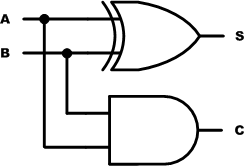
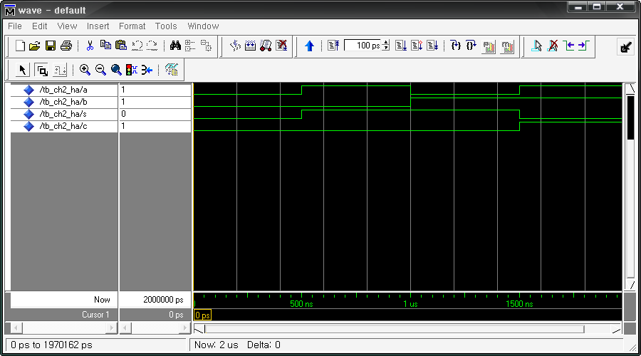
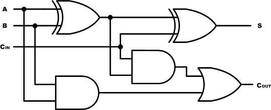
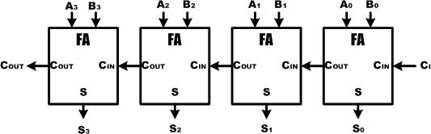
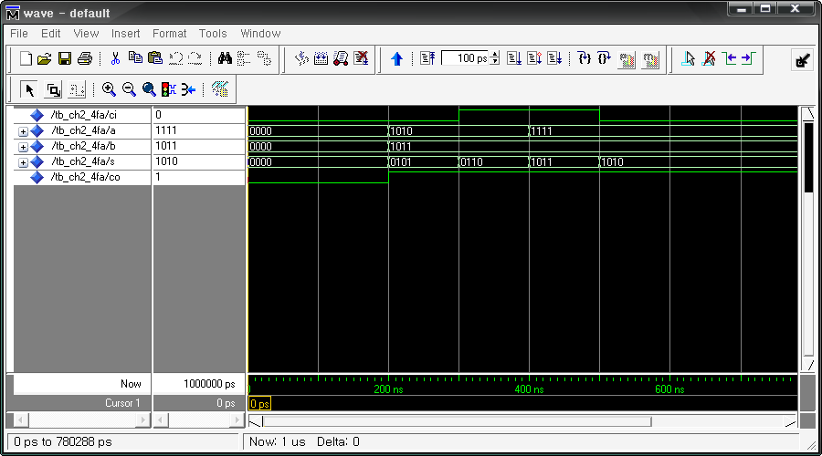
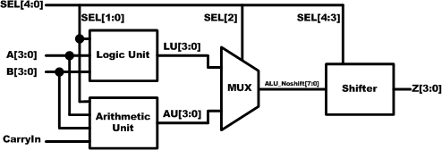

# 7. 연산 회로

## 7.1. 개요

디지털 시스템에서는 2진 형태의 수를 이용하여 다양한 산술 동작을 수행한다. 이 장에서는기본적인 산술 연산을 수행하는데 필요한 기초 이론과 그것을 바탕으로 하는 간단한 연산 회로를 설계하는 방법을 설명하고 있다.

## 7.2. 연산

### (1) 2진수 덧셈

2진수의 덧셈은 10진수의 덧셈과 하는 방법이 같다. 10진수의 덧셈에서 각 자릿수의 값을 더해서 하위 자릿수(1의 자리)에서 계산한 결과가 9 이상이 되면 상위 자릿수(10의 자리)로 1자리 올림을 한다.

아래와 같이 315 + 427의 예를 들어 보면

```
  153
+ 264
-----
  417
```

위의 덧셈에서 1의 자리 계산에서 결과가 7이므로 자리 올림이 발생하지 않고, 10의 자리 계산에서 결과 값이 11이 되므로 자리 올림이 발생하여, 100의 자리 계산에 그 영향을 미치게된다.

2진수 덧셈도 10진수 덧셈과 다르지 않다. 10진수에서는 9이상이 될 때 자리올림이 발생 하지만, 2진수에서는 1이상이 될 때 자리올림이 발생한다는 점만 유념하면 된다.

2진수 덧셈에서는 아래 4가지 경우만 일어난다.

<br>

0<sub>2</sub> + 0<sub>2</sub> = 0<sub>2</sub>

0<sub>2</sub> + 1<sub>2</sub> = 1<sub>2</sub>

1<sub>2</sub> + 1<sub>2</sub> = 10<sub>2</sub> = 0<sub>2</sub>, 자리올림

1<sub>2</sub> + 1<sub>2</sub> + 1<sub>2</sub> = 11<sub>2</sub> = 1<sub>2</sub>, 자리올림

<br>

1+1+1의 경우에는 두 비트가 1이고, 앞에서 자리 올림이 발생하였을 때 일어난다. 다음의 몇가지 예를 통해서 이를 확인할 수 있다.

```
    1 1₂              1 0 1₂
+   1 0₂          +   1 1 1₂
---------         -----------
  1 0 1₂            1 1 0 0₂
```

모든 디지털 시스템에서 실제 덧셈을 수행하는 회로는 한 번에 2개의 2진수만을 처리하기 때문에, 동시에 2개 이상의 덧셈을 고려하지 않아도 된다. 이 덧셈은 디지털 시스템에서 가장중요한 산술 연산이다. 대부분의 디지털 시스템에서 실행되는 뺄셈, 곱셈, 나눗셈 등의 연산이실제적으로 덧셈만을 이용하여 수행되기 때문이다.

### (2) 2진수 곱셈

2진수의 곱셈도 10진수의 곱셈과 같은 방법으로 한다. 자릿수가 0이나 1이어서 다른 자릿수없이 0과 1의 곱하기만 하면 되기 때문에 더 간단하게 할 수 있다.

111₂ X 101₂의 계산을 예로 들어 아래와 같이 계산을 해 보았다.

```
          1 1 1 ₂
X         1 0 1 ₂
-----------------------------------------
          1 1 1     = 111₂ X 001₂
        0 0 0       = 111₂ X 000₂
      1 1 1         = 111₂ X 100₂
-----------------------------------------
    1 0 0 0 1 1 ₂    = 11100₂ + 00000₂ + 00111₂
```

곱셈의 절차는 10진수와 같다. 아랫자리에서부터 차례로 계산하고, 마지막에 모든 계산 결과를 더하면 된다.

### (3) 2진수 나눗셈

2진수의 나눗셈 역시 10진수의 나눗셈과 방법이 같다. 제수가 0이나 1의 두 가지 경우만 있는 피제수에 몇 번 대입되는가만 검사하면 되기 때문에 더 간단하다.

1100₂ / 100₂ 의 예를 들어 아래와 같이 계산해 보았다.

```
                      1  1₂
             -----------------------
1   0   0₂   |  1  1  0  0₂
                1  0  0     = 100₂ X 10₂
----------------------------------------
                0  1  0  0   = 1100₂ – 1000₂
                   1  0  0   = 100₂  X 1₂
----------------------------------------
                         0₂  = 100₂  – 100₂

```

### (4) 16진수 연산

16진수는 기계어 컴퓨터 프로그래밍과 컴퓨터 메모리와 관련하여 많이 사용된다. 이런 작업을할 때에는 16진수의 연산을 수행해야 할 필요가 있다.

16진수의 연산도 2진수 때와 마찬가지로 10진수의 연산과 같은 방법을 사용한다. 16진 연산에서 기준이 되는 자릿수는 10진수의 9 대신 F라는 점과 먼저 10진 방식으로 더하고 그 결과가16보다 크거나 같으면 16을 빼고 자리 올림하고, 16보다 작으면 16진 자릿수로 표현한다는점만 주의하면 된다.

아래의 예제를 통해서 이를 확인할 수 있다.

```
   2 3 ₁₆        4 8 ₁₆
+  4 9 ₁₆     +  7 C ₁₆
-------       -------
   6 C ₁₆        C 4 ₁₆
```

<br>

---

<br>

## 7.3. 산술 회로

### (1) 반가산기(Half Adder)

가산기는 두 개 이상의 수를 입력하여 이들의 합을 출력으로 나타내는 논리 회로를 말한다.
반가산기는 두 개의 입력 비트(A, B)를 더하여 합(S)과 자리 올림 수(C)를 산출하는 논리 회로인데,
아래는 반가산기의 진리표를 나타낸 것이다.

<div align="center">
  
| A | B | S | C | 
|:----:|:----:|:----:|:----:|
| 0 | 0 | 0 | 0 |  
| 0 | 1 | 1 | 0 |  
| 1 | 0 | 1 | 0 |  
| 1 | 1 | 0 | 1 |  

</div>

반 가산기는 아래 그림과 같이 논리 회로로 구현할 수 있다.

<br><br>

<p align="center">  </p>

<br><br>

또, 아래와 같이 VHDL을 이용하여 반가산기를 구현할 수 있다.

```vhdl
-- CH2_HA.VHD
ENTITY CH2_HA IS
PORT(
  A, B : IN BIT;
  S, C : OUT BIT
);
END CH2_HA;

ARCHITECTURE HB OF CH2_HA IS
BEGIN

PROCESS(A, B)
BEGIN
  IF A = B THEN
    S <= '0';
  ELSE
    S <= '1';
  END IF;
END PROCESS;

PROCESS(A, B)
BEGIN
  IF A = '1' AND B = '1' THEN
    C <= '1';
  ELSE
    C <= '0';
  END IF;
END PROCESS;

END HB;
```

위의 로직에서 13 ~ 20라인은 A와 B입력 변수의 합(S)를 구하는 블록이고, 22~29라인은 A와 B의 합에서 발생하는 캐리(C)를 구하는 블록이다.

아래는 이 예제를 시뮬레이션 하기 위한 테스트 벤치 파일과 ModelSim으로 시뮬레이션 한결과이다.

```vhdl
-- TB_CH2_HA.VHD

LIBRARY IEEE;
USE IEEE.STD_LOGIC_1164.ALL;
USE IEEE.STD_LOGIC_UNSIGNED.ALL;

ENTITY TB_CH2_HA IS
END TB_CH2_HA;

ARCHITECTURE HB OF TB_CH2_HA IS

    COMPONENT CH2_HA
        PORT (
            A, B : IN  BIT;
            S, C : OUT BIT
        );
    END COMPONENT;

    SIGNAL A, B : BIT := '0';
    SIGNAL S, C : BIT := '0';

BEGIN

    A <= '0', '1' AFTER 500 NS, '0' AFTER 1000 NS, '1' AFTER 1500 NS;
    B <= '0', '1' AFTER 1000 NS;

    U_CH2_HA : CH2_HA PORT MAP (
        A => A,
        B => B,
        S => S,
        C => C
    );

END HB;
```

이 테스트 벤치 파일에서 24~25라인은 CH2_HA 로직의 입력 신호를 제공하기 위한 A와 B의데이터를 생성하고 있다. 24라인은 A의 데이터를 생성하는 것으로 초기 값은 0이 출력되고,시간이 500ns가 될 때에는 1이 출력된다. 또, 시간이 1000ns와 1500ns가 되는 시점에서 각각0과 1의 데이터가 출력된다. 25라인의 B 데이터는 초기값으로 0이 출력되고 1000ns가 될 때1이 출력되도록 기술되어 있다.

<br><br>

<p align="center">  </p>

<br><br>

위의 시뮬레이션 결과에서 반가산기의 진리표에서 처럼 A와 B의 연산 결과가 S에 연산하였을때 Carry가 발생하면 그 Carry는 C에 출력되는 것을 확인할 수 있다.

위의 예제를 HBE-Combo III에서 동작시키기 위해서 아래와 같은 핀 설정을 해 주어야 한다.

입력 A, B는 각각 Button Switch의 SW1, SW2에 연결하고, 출력 결과 S와 C는 각각 LED1과LED2에 핀 설정하여 결과를 장비에서 확인할 수 있도록 한다.

<div align="center">
  
| 포트 이름 | 핀 번호 | 하드웨어 설명 | 포트 이름 | 핀 번호 | 하드웨어 설명 | 
|:-------:|:-------:|:-------:|:-------:|:-------:|:-------:|
| A | V4 | SW1 | S | AE11 | LED1 | 
| B | V3 | SW2 | C | AE10 | LED2 | 

</div>

핀 설정 후 컴파일 한다.HBE-Combo III 장비에 다운로딩 하고, 위의 진리표와 같이 결과가 나타나는지를 확인해 본다.

<br>

---

<br>

### (2) 전가산기(Full Adder)

전가산기는 2개의 입력 비트와 자리올림의 입력 비트(Carry in : CIN)를 합하여 합과 자리올림(Carry Out : COUT)을 출력시키는 논리 회로이다. 간단하게 반가산기의 입력에 자리올림 입력비트를 추가 시켰다고 생각하면 된다.

아래 표는 전가산기에 대한 진리표이다.

<div align="center">
  
| A | B | Cin | S | Cout |
|:----:|:----:|:----:|:----:|:----:|
| 0 | 0 | 0 | 0 | 0 |
| 0 | 0 | 1 | 1 | 0 |
| 0 | 1 | 0 | 1 | 0 |
| 0 | 1 | 1 | 0 | 1 |
| 1 | 0 | 0 | 1 | 0 |
| 1 | 0 | 1 | 0 | 1 |
| 1 | 1 | 0 | 0 | 1 |
| 1 | 1 | 0 | 1 | 1 |

</div>

이 전가산기를 아래와 같이 논리 회로로 구성할 수 있다.

<br><br>

<p align="center">  </p>

<br><br>

또, 아래와 같이 VHDL로 전가산기를 구현할 수 있다. 위의 논리 회로를 잘 살펴 보면 두 개의 반가산기가 결합되어 있는 것을 확인 할 수 있다. 아래 VHDL 회로는 앞에 설계한 반가산기를 COMPONENT문으로 선언하도록 구성되어 있다.

```vhdl
-- CH2_FA.VHD

ENTITY CH2_FA IS
    PORT(
        A, B, CIN : IN  BIT;
        S, COUT   : OUT BIT
    );
END CH2_FA;

ARCHITECTURE HB OF CH2_FA IS

    COMPONENT CH2_HA IS
        PORT(
            A, B : IN  BIT;
            S, C : OUT BIT
        );
    END COMPONENT;

    SIGNAL REG_C1, REG_C2 : BIT;
    SIGNAL REG_SUM : BIT;

BEGIN

    U1_HA : CH2_HA PORT MAP(
        A => A,
        B => B,
        S => REG_SUM,
        C => REG_C1
    );

    U2_HA : CH2_HA PORT MAP(
        A => CIN,
        B => REG_SUM,
        S => S,
        C => REG_C2
    );

    COUT <= REG_C1 OR REG_C2;

END HB;
```

VHDL로 설계된 전가산기는 논리 회로로 설계된 것과 비교하면 쉽게 이해할 수 있다.설계 후 컴파일 할 때에는, 프로젝트에 CH2_HA.VHD을 포함하도록 해야 한다.(파일을 같은 프로젝트 폴더에 복사 해 두거나, 프로그램의 Project > Add/Remove File에CH2_HA.VHD 파일을 포함시킨다.)아래는 이 예제를 시뮬레이션 하기 위한 테스트 벤치 파일과 ModelSim으로 시뮬레이션 한결과이다.

```vhdl
-- TB_CH2_FA.VHD

LIBRARY IEEE;
USE IEEE.STD_LOGIC_1164.ALL;
USE IEEE.STD_LOGIC_UNSIGNED.ALL;

ENTITY TB_CH2_FA IS
END TB_CH2_FA;

ARCHITECTURE HB OF TB_CH2_FA IS

    COMPONENT CH2_FA
        PORT (
            A, B, CIN : IN  BIT;
            S, COUT   : OUT BIT
        );
    END COMPONENT;

    SIGNAL A, B   : BIT := '0';
    SIGNAL CIN    : BIT := '0';
    SIGNAL S, COUT : BIT := '0';

BEGIN

    A <= '0', '1' AFTER 200 NS,   '0' AFTER 400 NS,  '1' AFTER 600 NS,
         '0' AFTER 800 NS,  '1' AFTER 1000 NS, '0' AFTER 1200 NS, '1' AFTER 1400 NS;
    B <= '0', '1' AFTER 400 NS, '0' AFTER 800 NS, '1' AFTER 1200 NS;
    CIN <= '0', '1' AFTER 800 NS;

    U_CH2_FA : CH2_FA PORT MAP (
        A    => A,
        B    => B,
        CIN  => CIN,
        S    => S,
        COUT => COUT
    );

END HB;
```

위의 예제를 HBE-Combo III에서 동작시키기 위해서 아래와 같은 핀 설정을 해 주어야 한다.입력 A, B, CIN는 각각 Button Switch의 SW1, SW2, SW3에 연결하고, 출력 결과 S와 COUT는각각 LED1과 LED2에 핀 설정하여 결과를 장비에서 확인할 수 있도록 한다.포트 이름핀 번호하드웨어 설명포트 이름핀 번호하드웨어 설명AV4SW1SAE11LED1BV3SW2COUTAE10LED2CINV2SW3핀 설정 후 컴파일 한다.HBE-Combo III 장비에 다운로딩 하고, 위의 진리표와 같이 결과가 나타나는지를 확인해 본다.

<br>

---

<br>

### (3) 병렬 2진 가산기

위의 전가산기가 1비트의 연산을 할 수 있는 가산기인데, 이 전가산기의 Carry IN과 CarryOUT을 연결하여 여러 비트의 병렬 2진 가산기를 설계할 수 있다.

아래는 4비트 병렬 2진 가산기의 설계 예를 블록으로 나타낸 그림이다.


<br><br>

<p align="center">  </p>

<br><br>

전가산기를 VHDL로 설계할 때에 반가산기를 COMPONENT문으로 불러와서 설계하는 방법으로 4개의 전가산기를 불러와 4비트 병렬 2진 가산기를 설계할 수도 있지만, VHDL의 구문으로아래와 같이 간단하게 설계할 수 있다.

```vhdl
-- CH2_4FA.VHD

LIBRARY IEEE;
USE IEEE.STD_LOGIC_1164.ALL;
USE IEEE.STD_LOGIC_UNSIGNED.ALL;

ENTITY CH2_4FA IS
    PORT(
        CI : IN  STD_LOGIC;
        A, B : IN  STD_LOGIC_VECTOR(3 DOWNTO 0);
        S  : OUT STD_LOGIC_VECTOR(3 DOWNTO 0);
        CO : OUT STD_LOGIC
    );
END CH2_4FA;

ARCHITECTURE HB OF CH2_4FA IS
    SIGNAL REG : STD_LOGIC_VECTOR(4 DOWNTO 0);

BEGIN
    REG <= (('0' & A) + ('0' & B)) + ("0000" & CI);
    S  <= REG(3 DOWNTO 0);
    CO <= REG(4);
END HB;
```

VHDL에서는 다 비트의 연산의 경우 자리올림이 발생하면  하위 비트에서 상위 비트로 이 자리 올림을 더해준다. 이것은 위 로직의 22라인에서 구현되었다. A, B, 그리고 CIN를 연산이 가능하도록 5비트 변수를 더한 값을 5비트 변수인 REG에 저장하라고 구현되어있는데, 여기에서연산한 결과가 REG(3 DOWNTO 0) 변수에 저장되고, 자리올림의 값이 REG(4) 변수에 저장된다.그래서 24~25라인에 이것을 구분하여 출력하도록 구현하였다.아래는 이 예제를 시뮬레이션 하기 위한 테스트 벤치 파일과 ModelSim으로 시뮬레이션 한결과이다.

```vhdl
-- TB_CH2_4FA.VHD

LIBRARY IEEE;
USE IEEE.STD_LOGIC_1164.ALL;
USE IEEE.STD_LOGIC_UNSIGNED.ALL;

ENTITY TB_CH2_4FA IS
END TB_CH2_4FA;

ARCHITECTURE HB OF TB_CH2_4FA IS

    COMPONENT CH2_4FA
        PORT (
            CI : IN  STD_LOGIC;
            A, B : IN  STD_LOGIC_VECTOR(3 DOWNTO 0);
            S  : OUT STD_LOGIC_VECTOR(3 DOWNTO 0);
            CO : OUT STD_LOGIC
        );
    END COMPONENT;

    SIGNAL CI : STD_LOGIC := '0';
    SIGNAL A, B : STD_LOGIC_VECTOR(3 DOWNTO 0) := "0000";
    SIGNAL S  : STD_LOGIC_VECTOR(3 DOWNTO 0) := "0000";
    SIGNAL CO : STD_LOGIC := '0';

BEGIN

    A  <= "0000", "1010" AFTER 200 NS, "1111" AFTER 400 NS;
    B  <= "0000", "1011" AFTER 200 NS;
    CI <= '0', '1' AFTER 300 NS, '0' AFTER 500 NS;

    U_CH2_4FA : CH2_4FA PORT MAP (
        CI => CI,
        A  => A,
        B  => B,
        S  => S,
        CO => CO
    );

END HB;
```

이 테스트 벤치에서 시뮬레이션 하기 위한 CH2_4FA 로직의 입력 신호로 임의의 데이터를 전달하도록 구성되어 있다.

<br><br>

<p align="center">  </p>

<br><br>

위의 시뮬레이션에서 CI와 A와 B의 연산 결과를 S에서 확인 할 수 있다. 연산 결과에서 Carry가 발생하였을 경우에는 CO에 표시된다.

위의 예제를 HBE-Combo III에서 동작시키기 위해서 아래와 같은 핀 설정을 해 주어야 한다.

입력 A, B, CI 는 각각 BUS Switch 의 BUS SW1 ~ 4, BUS SW5 ~ 8 과 Button SW1 에 연결하고,출력 결과 S 와 CO 는 각각 LED2~5 와 LED1 에 핀 설정하여 결과를 장비에서 확인할 수있도록 한다.

| 포트 이름 | 핀 번호 | 하드웨어 설명 | 포트 이름 | 핀 번호 | 하드웨어 설명 | 
|:-------:|:-------:|:-------:|:-------:|:-------:|:-------:|
| A[3] | T6 | BUS SW1 | B[0] | V5 | BUS SW8 | 
| A[2] | V1 | BUS SW2 | CI | V4 |SW1 |
| A[1] | U7 | BUS SW3 | S[3] | AE10 | LED2 | 
| A[0] | U6 | BUS SW4 | S[2] | AF9 | LED3 | 
| B[3] | U5 | BUS SW5 | S[1] | AF8 | LED4 |
| B[2] | U4 | BUS SW6 | S[0] |AF7 | LED5 |
| B[1] | V6 | BUS SW7 | CO | AE11 | LED1 |

핀 설정 후 컴파일 한다.

HBE-Combo III 장비에 다운로딩 하고, 그 결과를 확인해 본다.

<br>

---

<br>

### (4) ALU 설계

ALU(Arithmetic Logic Unit)는 데이터간의 수학적, 논리적 연산을 수행하는 모델이다. ALU는 데이터를 저장하는 레지스터, 신호선 연결(멀티플렉서 또는 버스)과 함께 Datapath의 3대 요소중 하나이다. 단자 A와 B로 입력되는 데이터를 선택한 연산으로 변화하여 단자 Z로 출력하게되는데 연산의 종류는 제어신호 S에 의해 결정된다.

아래 그림은 이 ALU의 블록도이다.

<br><br>

<p align="center">  </p>

<br><br>

아래 표는 ALU의 기능에 대한 사항을 표로 나타낸 것이다.

| S4 | S3 | S2 | S1 | S0 | Cin | 동작 | 기능 | 관련장치 |
|:--:|:--:|:--:|:--:|:--:|:--:|------|------|----------|
| 0 | 0 | 0 | 0 | 0 | 0 | Z <= A | 전달 A | 산술 |
| 0 | 0 | 0 | 0 | 0 | 1 | Z <= A + 1 | 증가 A | 산술 |
| 0 | 0 | 0 | 0 | 1 | 0 | Z <= A + B | 덧셈 | 산술 |
| 0 | 0 | 0 | 0 | 1 | 1 | Z <= A + B + 1 | 캐리 더하기(A+B+Cin) | 산술 |
| 0 | 0 | 0 | 1 | 0 | 0 | Z <= A + /B | 1의 보수 더하기 | 산술 |
| 0 | 0 | 0 | 1 | 0 | 1 | Z <= A + /B + 1 | 뺄셈(A-B) | 산술 |
| 0 | 0 | 0 | 1 | 1 | 0 | Z <= A - 1 | 감소 A | 산술 |
| 0 | 0 | 0 | 1 | 1 | 1 | Z <= A | 전달 A | 산술 |
| 0 | 0 | 1 | 0 | 0 | - | Z <= A AND B | AND | 논리 |
| 0 | 0 | 1 | 0 | 1 | - | Z <= A OR B | OR | 논리 |
| 0 | 0 | 1 | 1 | 0 | - | Z <= A XOR B | XOR | 논리 |
| 0 | 0 | 1 | 1 | 1 | - | Z <= /A | A의 부정(NOT) | 논리 |
| 0 | 0 | - | - | - | - | Z <= A | 전달(무이동) | 쉬프터 |
| 0 | 1 | - | - | - | - | Z <= shl A | 좌측 이동 A | 쉬프터 |
| 1 | 0 | - | - | - | - | Z <= shr A | 우측 이동 A | 쉬프터 |
| 1 | 1 | - | - | - | - | Z <= 0 | 전달 0(클리어) | 쉬프터 |

아래의 예제는 위에서 설명한 ALU를 VHDL로 구성한 것이다.

```vhdl
-- CH2_ALU.VHD

LIBRARY IEEE;
USE IEEE.STD_LOGIC_1164.ALL;
USE IEEE.STD_LOGIC_UNSIGNED.ALL;
USE IEEE.NUMERIC_STD.ALL;

ENTITY CH2_ALU IS
    PORT(
        SEL      : IN  STD_LOGIC_VECTOR(4 DOWNTO 0);  -- SELECT
        CARRYIN  : IN  STD_LOGIC;                     -- CARRY
        A, B     : IN  STD_LOGIC_VECTOR(3 DOWNTO 0);  -- DATA IN
        Z        : OUT STD_LOGIC_VECTOR(3 DOWNTO 0)   -- DATA OUT
    );
END CH2_ALU;

ARCHITECTURE HB OF CH2_ALU IS

BEGIN

    PROCESS (SEL, A, B, CARRYIN)
        VARIABLE SEL_ARITH   : STD_LOGIC_VECTOR(2 DOWNTO 0);
        VARIABLE LOGICUNIT   : STD_LOGIC_VECTOR(3 DOWNTO 0);
        VARIABLE ARITHUNIT   : STD_LOGIC_VECTOR(3 DOWNTO 0);
        VARIABLE ALU_NOSHIFT : STD_LOGIC_VECTOR(3 DOWNTO 0);

    BEGIN
        SEL_ARITH := SEL(1 DOWNTO 0) & CARRYIN;

        CASE SEL_ARITH IS
            WHEN "000" => ARITHUNIT := A;
            WHEN "001" => ARITHUNIT := A + '1';
            WHEN "010" => ARITHUNIT := A + B;
            WHEN "011" => ARITHUNIT := A + B + '1';
            WHEN "100" => ARITHUNIT := A + (NOT B);
            WHEN "101" => ARITHUNIT := A - B;
            WHEN "110" => ARITHUNIT := A - '1';
            WHEN "111" => ARITHUNIT := A;
            WHEN OTHERS => ARITHUNIT := (OTHERS => 'X');
        END CASE;

        CASE SEL(1 DOWNTO 0) IS
            WHEN "00" => LOGICUNIT := A AND B;
            WHEN "01" => LOGICUNIT := A OR B;
            WHEN "10" => LOGICUNIT := A XOR B;
            WHEN "11" => LOGICUNIT := (NOT A);
            WHEN OTHERS => LOGICUNIT := (OTHERS => 'X');
        END CASE;

        IF (SEL(2) = '1') THEN
            ALU_NOSHIFT := LOGICUNIT;
        ELSE
            ALU_NOSHIFT := ARITHUNIT;
        END IF;

        CASE SEL(4 DOWNTO 3) IS
            WHEN "00" => Z <= ALU_NOSHIFT;                        -- NO SHIFT
            WHEN "01" => Z <= ALU_NOSHIFT(2 DOWNTO 0) & '0';      -- LEFT SHIFT
            WHEN "10" => Z <= '0' & ALU_NOSHIFT(3 DOWNTO 1);      -- RIGHT SHIFT
            WHEN "11" => Z <= (OTHERS => '0');
            WHEN OTHERS => Z <= (OTHERS => 'X');
        END CASE;

    END PROCESS;

END HB;
```

위의 로직은 복잡하게 보이지만, 위의 블록도와 ALU 기능 표에 나와 있는 기능을 구현한 내용이다. 그러므로 로직을 블록도와 기능표와 함께 분석하면 쉽게 이해할 수 있다.

* 26 ~ 38라인은 산술 장치를 설계한 구문이고, SEL[1:0]과 Carry 연산에 대한 결과는 ARITHUNIT이라는 변수에 저장된다.
* 40 ~ 46라인은 논리 장치를 설계한 구문이고, SEL[1:0]에 이에 대한결과는 LOGICUNIT이라는 변수에 저장된다.
* 산술 장치의 결과와 논리 장치의 결과는 SEL[2]에 의해 선택되어ALU_NOSHIFT라는변수에저장된다.
* 54 ~ 60라인에는SEL[4:3]에의해ALU_NOSHIFT에 저장되어 있는 결과를 바로 출력 단자에 전달 Shift 연산을 수행한 결과를 전달하도록 구현되어 있다.

위의 예제를 HBE-Combo III에서 동작시키기 위해서 아래와 같은 핀 설정을 해 주어야 한다.

* 입력 A, B, CI 는 각각
* BUS Switch 의 BUS SW1 ~ 4, BUS SW5 ~ 8 과
* Button SW1 에 연결하고,출력 결과
* S 와 CO 는 각각 LED2 ~ 5 와 LED1 에 핀 설정하여 결과를 장비에서 확인할 수있도록 한다.

| 포트 이름 | 핀 번호 | 하드웨어 설명 | 포트 이름 | 핀 번호 | 하드웨어 설명 | 
|:-------:|:-------:|:-------:|:-------:|:-------:|:-------:|
| SEL[4] | T6 | BUS SW1 |  B[3] | W3 | SW5 | 
| SEL[3] | V1 | BUS SW2 | B[2] | W2| SW6 | 
| SEL[2] | U7 | BUS SW3|  B[1] | W1 | SW7 | 
| SEL[1] | U6 | BUS SW4|  B[0] | V7 | SW8 | 
| SEL[0] | U5 | BUS SW5 | CARRYIN | Y4 | SW9 | 
| A[3] | V4 | SW1 | Z[3] | AE11 | LED1 | 
| A[2] | V3 | SW2 | Z[2] | AE10 | LED2 | 
| A[1] | V2 | SW3 | Z[1] | AF9 | LED3 | 
| A[0] | W4 | SW4 | Z[0] | AF8 | LED4 | 

핀 설정 후 컴파일 한다.

HBE-Combo III 장비에 다운로딩 하고, 그 결과를 확인해 본다.

예를 들어 먼저 A+B의 연산 결과를 출력하기 위해서 SEL을 00001로 설정하고 A와 B에 데이터를 입력 시키면 그 결과를 확인해 볼 수 있다.  다를 예로 A AND B의 연산 결과를 출력하기 위해서는 SEL을 00100으로 설정해야 한다.
