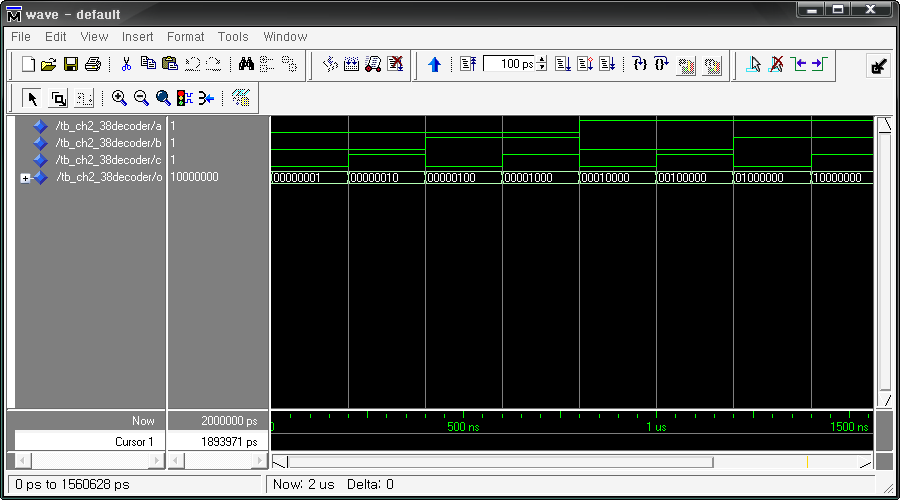
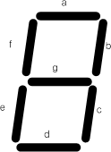

# 8. 조합 논리 회로

## 8.1. 개요

조합 논리 회로는 논리곱(AND), 논리합(OR), 논리 부정(NOT)의 세가지 기본 회로를 조합하여구성한 논리 회로로, 출력이 입력에 의해 결정되는 논리 회로를 말합니다. 이 회로는 논리 게이트로만 구성되며, 플립플롭과 같은 기억소자는 포함되지 않습니다.

이 장에서는 조합 논리 회로를 소개 하면서, HBE-Combo III 장비를 통한 동작의 확인을 할 수있도록 구성되어 있습니다.

## 8.2. 디코더, 인코더 설계

### (1) 디코더

디코더는 해독기라고도 한다. 이것은 임의의 입력 번호에 대응하는 출력만을 활성화시키는 논리 회로로, N 비트 2진 입력 신호를 M개(M=2N)의 출력 신호로 변환시키는 동작을 수행한다.

입력 조합에 대해서 M개의 출력 단자 중에서 1개만 High의 값이 출력되고, 나머지의 출력 단자에서는 Low의 값이 출력된다. 대부분의 디코더는 Low 상태를 이루도록 설계되어 있고, 선택된 출력 단자가 Low이면 다른 모든 단자는 High가 된다.

많이 사용되는 디코더로 3선-8선 디코더라 불리는 것이 있는데, 이것은 3개의 입력선과 8개의출력선을 갖고 있는 디코더를 말한다.

아래 표는 이 3선 8선 디코더의 진리표를 나타내고 있다.

<div align="center">
    
| C | B | A | O7 | O6 | O5 | O4 | O3 | O2 | O1 | O0 | 
|:---:|:---:|:---:|:---:|:---:|:---:|:---:|:---:|:---:|:---:|:---:|
| 0 | 0 | 0 | 0 | 0 | 0 | 0 | 0 | 0 | 0 | 1 | 
| 0 | 0 | 1 | 0 | 0 | 0 | 0 | 0 | 0 | 1 | 0 | 
| 0 | 1 | 0 | 0 | 0 | 0 | 0 | 0 | 1 | 0 | 0 | 
| 0 | 1 | 1 | 0 | 0 | 0 | 0 | 1 | 0 | 0 | 0 | 
| 1 | 0 | 0 | 0 | 0 | 0 | 1 | 0 | 0 | 0 | 0 | 
| 1 | 0 | 1 | 0 | 0 | 1 | 0 | 0 | 0 | 0 | 0 | 
| 1 | 1 | 0 | 0 | 1 | 0 | 0 | 0 | 0 | 0 | 0 | 
| 1 | 1 | 1 | 1 | 0 | 0 | 0 | 0 | 0 | 0 | 0 | 

</div>

위의 3선 – 8선 디코더는 VHDL로 아래와 같이 설계할 수 있다.

```vhdl
-- CH2_38DECODER.VHD

LIBRARY IEEE;
USE IEEE.STD_LOGIC_1164.ALL;

ENTITY CH2_38DECODER IS
    PORT(
        A, B, C : IN  STD_LOGIC;
        O       : OUT STD_LOGIC_VECTOR(7 DOWNTO 0)
    );
END CH2_38DECODER;

ARCHITECTURE HB OF CH2_38DECODER IS
    SIGNAL REG : STD_LOGIC_VECTOR(2 DOWNTO 0);

BEGIN
    REG <= A & B & C;

    PROCESS(REG)
    BEGIN
        CASE REG IS
            WHEN "000" => O <= "00000001";
            WHEN "001" => O <= "00000010";
            WHEN "010" => O <= "00000100";
            WHEN "011" => O <= "00001000";
            WHEN "100" => O <= "00010000";
            WHEN "101" => O <= "00100000";
            WHEN "110" => O <= "01000000";
            WHEN "111" => O <= "10000000";
            WHEN OTHERS => NULL;
        END CASE;
    END PROCESS;
END HB;
```

위의 예제에서 19 라인의 “REG <= A & B & C;”의 구문은 입력 단자인 A, B, C의 각 1비트 포트를 합쳐서 REG라는 3비트 버스 라인에 연결시켜주는 구문이다. 23라인의 CASE 문을 통해서데이터를 쉽게 비교할 수 있도록 이렇게 구성 하였다.

23 ~ 33라인의 CASE 문에 3선-8선 디코더의 동작 상황이 설계되어 있다. 이 구문에서 위에서의 진리표 내용이 그대로 사용되었다. 이렇게 디코더의 내용은 조건문을 통해서 쉽게 설계할수 있다.

아래는 이 예제를 시뮬레이션 하기 위한 테스트 벤치 파일과 ModelSim으로 시뮬레이션 한결과이다.

```vhdl
-- TB_CH2_38DECODER.VHD

LIBRARY IEEE;
USE IEEE.STD_LOGIC_1164.ALL;
USE IEEE.STD_LOGIC_UNSIGNED.ALL;

ENTITY TB_CH2_38DECODER IS
END TB_CH2_38DECODER;

ARCHITECTURE HB OF TB_CH2_38DECODER IS

    COMPONENT CH2_38DECODER
        PORT (
            A, B, C : IN  STD_LOGIC;
            O       : OUT STD_LOGIC_VECTOR(7 DOWNTO 0)
        );
    END COMPONENT;

    SIGNAL A, B, C : STD_LOGIC := '0';
    SIGNAL O       : STD_LOGIC_VECTOR(7 DOWNTO 0) := "00000000";

BEGIN

    A <= '0', '1' AFTER 800 NS;
    B <= '0', '1' AFTER 400 NS, '0' AFTER 800 NS, '1' AFTER 1200 NS;
    C <= '0', '1' AFTER 200 NS,  '0' AFTER 400 NS, '1' AFTER 600 NS,
         '0' AFTER 800 NS, '1' AFTER 1000 NS, '0' AFTER 1200 NS, '1' AFTER 1400 NS;

    U_CH2_38DECODER : CH2_38DECODER PORT MAP (
        A => A,
        B => B,
        C => C,
        O => O
    );

END HB;
```

이 테스트 벤치파일은 3선-8선 디코더의 모든 입력 조건을 CH2_38DECODER에 전달하도록24~27라인에 구현되어 있다.

<br><br>

<p align="center">  </p>

<br><br>


위의 예제를 HBE-Combo III에서 동작시키기 위해서 아래와 같은 핀 설정을 해 주어야 한다.

입력 A, B, C는 각각 Button Switch의 SW1, SW2, SW3에 연결하고, 출력 결과는 8개의 LED에핀 설정하여 결과를 장비에서 확인할 수 있도록 한다.

<div align="center">
    
| 포트 이름 | 핀 번호 | 하드웨어 설명 | 포트 이름 | 핀 번호 | 하드웨어 설명 | 
|:-------:|:-------:|:-------:|:-------:|:-------:|:-------:|
| A | V4 | SW1 | O[4] | AF7 | LED4 | 
| B | V3 | SW2 | O[3] | AF8 | LED5 | 
| C | V2 | SW3 | O[2] | AF9 | LED6 | 
| O[7] | B3 | LED1 |  O[1] | AE10 | LED7  | 
| O[6] | AF5 | LED2 | O[0] | AE11L | ED8 | 
| O[5] | AF6 | LED3 | | | | 

</div>

핀 설정 후 컴파일 한다.

HBE-Combo III 장비에 다운로딩 하고, 위의 진리표와 같이 결과가 나타나는지를 확인해 본다.

### (2) 인코더

디코더는 특정 코드를 검출, 인식, 식별한다고 할 수 있다. 인코더는 이러한 디코더의 기능을반대로 하는 논리 회로를 말한다. 인코더는 여러 개의 입력 선을 갖고 이 중 하나가 주어진시간에 동작되고, 동작되는 입력에 따라서 N비트의 출력 코드가 생성된다.

예를 들어 3선-8선 디코더는 3비트의 입력 코드를 받아들여, 그 코드에 대한 8개의 출력 선중 하나에 High 값을 출력시킨다. 8선-3선 디코더는 이와 반대의 기능을 한다. 즉, 8개의 입력선을 받아 들여 입력 동작에 따라 3비트의 입력 코드를 생성한다.

아래 진리표는 8선-3선 인코더에 대한 진리표이다.

<div align="center">
    
| A0 | A1 | A2 | A3 | A4 | A5 | A6 | A7 | O2 | O1 | O0 |
|:--:|:--:|:--:|:--:|:--:|:--:|:--:|:--:|:--:|:--:|:--:|
| 1 | 0 | 0 | 0 | 0 | 0 | 0 | 0 | 0 | 0 | 0 |
| 0 | 1 | 0 | 0 | 0 | 0 | 0 | 0 | 0 | 0 | 1 |
| 0 | 0 | 1 | 0 | 0 | 0 | 0 | 0 | 0 | 1 | 0 |
| 0 | 0 | 0 | 1 | 0 | 0 | 0 | 0 | 0 | 1 | 1 |
| 0 | 0 | 0 | 0 | 1 | 0 | 0 | 0 | 1 | 0 | 0 |
| 0 | 0 | 0 | 0 | 0 | 1 | 0 | 0 | 1 | 0 | 1 |
| 0 | 0 | 0 | 0 | 0 | 0 | 1 | 0 | 1 | 1 | 0 |
| 0 | 0 | 0 | 0 | 0 | 0 | 0 | 1 | 1 | 1 | 1 |

</div>

위의 8선 – 3선 인코더는 VHDL로 아래와 같이 설계할 수 있다.

```vhdl
-- CH2_83ENCODER.VHD

LIBRARY IEEE;
USE IEEE.STD_LOGIC_1164.ALL;

ENTITY CH2_83ENCODER IS
    PORT(
        A : IN  STD_LOGIC_VECTOR(7 DOWNTO 0);
        O : OUT STD_LOGIC_VECTOR(2 DOWNTO 0)
    );
END CH2_83ENCODER;

ARCHITECTURE HB OF CH2_83ENCODER IS

BEGIN
    PROCESS(A)
    BEGIN
        CASE A IS
            WHEN "00000001" => O <= "000";
            WHEN "00000010" => O <= "001";
            WHEN "00000100" => O <= "010";
            WHEN "00001000" => O <= "011";
            WHEN "00010000" => O <= "100";
            WHEN "00100000" => O <= "101";
            WHEN "01000000" => O <= "110";
            WHEN "10000000" => O <= "111";
            WHEN OTHERS => NULL;
        END CASE;
    END PROCESS;
END HB;
```

위의 로직에서 8선-3선 인코더의 진리표의 내용이 19 ~ 29라인의 CASE 문에 그대로 표시 되어있다.

디코더에서도 마찬가지이지만, 디코더와 인코더는 이렇게 VHDL의 CASE문을 사용하여 쉽게표현할 수 있다. 물론 IF문으로 설계할 수도 있다.

IF문으로 설계 할 때에는 CASE문의 부분을 아래와 같이 바꾸어 주면 된다.

```vhdl
PROCESS(A)
BEGIN
    IF A = "00000001" THEN O <= "000";
    ELSIF A = "00000010" THEN O <= "001";
    ELSIF A = "00000100" THEN O <= "010";
    ELSIF A = "00001000" THEN O <= "011";
    ELSIF A = "00010000" THEN O <= "100";
    ELSIF A = "00100000" THEN O <= "101";
    ELSIF A = "01000000" THEN O <= "110";
    ELSIF A = "10000000" THEN O <= "111";
    ELSE NULL;
    END IF;
END PROCESS;
```

아래는 이 예제를 시뮬레이션 하기 위한 테스트 벤치 파일과 ModelSim으로 시뮬레이션 한결과이다.

```vhdl
-- TB_CH2_83ENCODER.VHD

LIBRARY IEEE;
USE IEEE.STD_LOGIC_1164.ALL;
USE IEEE.STD_LOGIC_UNSIGNED.ALL;

ENTITY TB_CH2_83ENCODER IS
END TB_CH2_83ENCODER;

ARCHITECTURE HB OF TB_CH2_83ENCODER IS

    COMPONENT CH2_83ENCODER
        PORT (
            A : IN  STD_LOGIC_VECTOR(7 DOWNTO 0);
            O : OUT STD_LOGIC_VECTOR(2 DOWNTO 0)
        );
    END COMPONENT;

    SIGNAL A : STD_LOGIC_VECTOR(7 DOWNTO 0) := "00000000";
    SIGNAL O : STD_LOGIC_VECTOR(2 DOWNTO 0) := "000";

BEGIN

    A <= "10000000", "01000000" AFTER 100 NS, "00100000" AFTER 200 NS,
         "00010000" AFTER 300 NS, "00001000" AFTER 400 NS,
         "00000100" AFTER 500 NS, "00000010" AFTER 600 NS,
         "00000001" AFTER 700 NS;

    U_CH2_83ENCODER : CH2_83ENCODER PORT MAP (
        A => A,
        O => O
    );

END HB;
```

<br><br>

<p align="center">  </p>

<br><br>

위의 로직을 HBE-Combo III에서 동작시키기 위해서는 아래 표와 같이 핀 설정을 해 주어야한다.

A의 입력은 BUS Switch의 8개 입력을 사용하였고, 출력은 LED 3개를 사용하여 결과를 확인할수 있도록 핀을 설정한다.

| 포트 이름 | 핀 번호 | 하드웨어 설명 | | 포트 이름 | 핀 번호 | 하드웨어 설명 |
|-----------|--------|---------------|-|-----------|--------|---------------|
| A[7] | T6 | BUS SW0 | | O[2] | AF9  | LED1 |
| A[6] | V1 | BUS SW1 | | O[1] | AE10 | LED2 |
| A[5] | U7 | BUS SW2 | | O[0] | AE11 | LED3 |
| A[4] | U6 | BUS SW3 | |          |       |      |
| A[3] | U5 | BUS SW4 | |          |       |      |
| A[2] | U4 | BUS SW5 | |          |       |      |
| A[1] | V6 | BUS SW6 | |          |       |      |
| A[0] | V5 | BUS SW7 | |          |       |      |

핀 설정 후 컴파일 한다.

HBE-Combo III 장비에 다운로딩 하고, 위의 진리표와 같이 결과가 나타나는지를 확인해 본다.

## 8.3. 7-Segment 디코더 설계

7-Segment는 숫자나 문자를 display해 줄 수 있는 최소의 장치이다.

그 중 7-Segment 디코더는 4비트 BCD 입력에 대하여 7-Segment에 10진수를 display하기 위한 데이터로 변경하는 논리 회로이다. 이 7-Segment 디코더는 TTL에서는 7446 또는 7447이사용된다. 단, 결과값이 역으로 나오기 때문에 HBE-Combo III 장비에서 사용하기 위해서는7446과 7447의 출력에 인버터를 붙이는 회로로 설계하여야 한다.

아래에 4bit BCD 입력에 대한 7-Segment 디코더 출력 결과의 진리표와 이 출력 결과를 7-Segment에 연결하였을 때의 결과가 표시되어 있다.

<div align="center">
    
<table>
  <tr>
    <td style="vertical-align:middle; padding:0 16px 0 0;">
      
    </td>
    <td>
  
  <table>
    <thead>
      <tr>
        <th rowspan="2">10진수</th>
        <th colspan="4">4bit BCD</th>
        <th colspan="7">7-Segment Decoder</th>
      </tr>
      <tr>
        <th>D</th><th>C</th><th>B</th><th>A</th>
        <th>a</th><th>b</th><th>c</th><th>d</th><th>e</th><th>f</th><th>g</th>
      </tr>
    </thead>
    <tbody>
      <tr><td>0</td><td>0</td><td>0</td><td>0</td><td>0</td><td>1</td><td>1</td><td>1</td><td>1</td><td>1</td><td>1</td><td>0</td></tr>
      <tr><td>1</td><td>0</td><td>0</td><td>0</td><td>1</td><td>0</td><td>1</td><td>1</td><td>0</td><td>0</td><td>0</td><td>0</td></tr>
      <tr><td>2</td><td>0</td><td>0</td><td>1</td><td>0</td><td>1</td><td>1</td><td>0</td><td>1</td><td>1</td><td>0</td><td>1</td></tr>
      <tr><td>3</td><td>0</td><td>0</td><td>1</td><td>1</td><td>1</td><td>1</td><td>1</td><td>1</td><td>0</td><td>0</td><td>1</td></tr>
      <tr><td>4</td><td>0</td><td>1</td><td>0</td><td>0</td><td>0</td><td>1</td><td>1</td><td>0</td><td>0</td><td>1</td><td>1</td></tr>
      <tr><td>5</td><td>0</td><td>1</td><td>0</td><td>1</td><td>1</td><td>0</td><td>1</td><td>1</td><td>0</td><td>1</td><td>1</td></tr>
      <tr><td>6</td><td>0</td><td>1</td><td>1</td><td>0</td><td>1</td><td>0</td><td>1</td><td>1</td><td>1</td><td>1</td><td>1</td></tr>
      <tr><td>7</td><td>0</td><td>1</td><td>1</td><td>1</td><td>1</td><td>1</td><td>1</td><td>0</td><td>0</td><td>0</td><td>0</td></tr>
      <tr><td>8</td><td>1</td><td>0</td><td>0</td><td>0</td><td>1</td><td>1</td><td>1</td><td>1</td><td>1</td><td>1</td><td>1</td></tr>
      <tr><td>9</td><td>1</td><td>0</td><td>0</td><td>1</td><td>1</td><td>1</td><td>1</td><td>1</td><td>0</td><td>1</td><td>1</td></tr>
    </tbody>
  </table>
    </td>
  </tr>
</table>

</div>
    


이 7-Segment 디코더는 VHDL을 이용하여 아래와 같이 설계할 수 있다.

```vhdl
-- CH2_SEG_DECODER.VHD

LIBRARY IEEE;
USE IEEE.STD_LOGIC_1164.ALL;

ENTITY CH2_SEG_DECODER IS
    PORT(
        BCD              : IN  STD_LOGIC_VECTOR(3 DOWNTO 0);
        a, b, c, d, e, f, g : OUT STD_LOGIC
    );
END CH2_SEG_DECODER;

ARCHITECTURE HB OF CH2_SEG_DECODER IS
    SIGNAL DECODE : STD_LOGIC_VECTOR(6 DOWNTO 0);

BEGIN
    PROCESS(BCD)
    BEGIN
        CASE BCD IS
            WHEN "0000" => DECODE <= "1111110";  -- 0
            WHEN "0001" => DECODE <= "0110000";  -- 1
            WHEN "0010" => DECODE <= "1101101";  -- 2
            WHEN "0011" => DECODE <= "1111001";  -- 3
            WHEN "0100" => DECODE <= "0110011";  -- 4
            WHEN "0101" => DECODE <= "1011011";  -- 5
            WHEN "0110" => DECODE <= "1011111";  -- 6
            WHEN "0111" => DECODE <= "1110000";  -- 7
            WHEN "1000" => DECODE <= "1111111";  -- 8
            WHEN "1001" => DECODE <= "1111011";  -- 9
            WHEN OTHERS => NULL;
        END CASE;
    END PROCESS;

    a <= DECODE(6);
    b <= DECODE(5);
    c <= DECODE(4);
    d <= DECODE(3);
    e <= DECODE(2);
    f <= DECODE(1);
    g <= DECODE(0);
END HB;
```

아래는 이 예제를 시뮬레이션 하기 위한 테스트 벤치 파일과 ModelSim으로 시뮬레이션 한결과이다.

```vhdl
-- TB_CH2_SEG_DECODER.VHD

LIBRARY IEEE;
USE IEEE.STD_LOGIC_1164.ALL;
USE IEEE.STD_LOGIC_UNSIGNED.ALL;

ENTITY TB_CH2_SEG_DECODER IS
END TB_CH2_SEG_DECODER;

ARCHITECTURE HB OF TB_CH2_SEG_DECODER IS

    COMPONENT CH2_SEG_DECODER
        PORT (
            BCD              : IN  STD_LOGIC_VECTOR(3 DOWNTO 0);
            a, b, c, d, e, f, g : OUT STD_LOGIC
        );
    END COMPONENT;

    SIGNAL BCD : STD_LOGIC_VECTOR(3 DOWNTO 0) := "0000";
    SIGNAL A, B, C, D : STD_LOGIC;
    SIGNAL E, F, G    : STD_LOGIC;

BEGIN

    BCD <= "0000", "0001" AFTER 100 NS, "0010" AFTER 200 NS,
           "0011" AFTER 300 NS, "0100" AFTER 400 NS, "0101" AFTER 500 NS,
           "0110" AFTER 600 NS, "0111" AFTER 700 NS, "1000" AFTER 800 NS,
           "1001" AFTER 900 NS;

    U_CH2_SEG_DECODER : CH2_SEG_DECODER PORT MAP (
        BCD => BCD,
        A   => A,
        B   => B,
        C   => C,
        D   => D,
        E   => E,
        F   => F,
        G   => G
    );

END HB;
```

이 테스트 벤치 파일에서 25~27라인은 CH2_SEG_DECODER의 BCD 입력에 주어야 할 데이터를 생성하는 블록이 구현되어 있다.위의 로직을 HBE-Combo III에서 동작시키기 위해서는 아래 표와 같이 핀 설정을 해 주어야한다. BCD의 입력은 BUS Switch의 4개 입력을 사용하였고, 출력은 7-Segment를 사용하여 결과를 확인할 수 있도록 핀을 설정한다.

| 포트 이름 | 핀 번호 | 하드웨어 설명 | | 포트 이름 | 핀 번호 | 하드웨어 설명 |
|-----------|--------|---------------|-|-----------|--------|---------------|
| BCD[3] | T6 | BUS SW0 | | SEG_A | M3 | 7-SEG a |
| BCD[2] | V1 | BUS SW1 | | SEG_B | M2 | 7-SEG b |
| BCD[1] | U7 | BUS SW2 | | SEG_C | L7 | 7-SEG c |
| BCD[0] | U6 | BUS SW3 | | SEG_D | L6 | 7-SEG d |
|          |        |               | | SEG_E | L4 | 7-SEG e |
|          |        |               | | SEG_F | P6 | 7-SEG f |
|          |        |               | | SEG_G | P4 | 7-SEG g |

핀 설정 후 컴파일 한다.  

HBE-Combo III 장비에 다운로딩 하고, BUS Switch에 변화를 주었을때 진리표와 같이 7-Segment에 결과가 나타나는지를 확인해 본다.

## 8.4. MUX, DEMUX 설계

### (1) MUX (Multiplexer)

멀티플렉서 또는 데이터 선택기(data selector)는 여러 개의 데이터 입력을 받아 그 중 하나를선택하여 출력하는 논리 회로이다. 출력할 데이터의 입력 단자는 선택 입력 신호에 의해 제어된다.N개의 입력 데이터 중 하나를 선택하고, 선택된 자료를 하나의 출력 채널에 전송하는 장치가멀티플렉서이다. 예를 들어 2입력 멀티플렉서는 2개의 입력과 입력 신호를 선택하기 위한 선택 입력 신호 그리고 선택된 입력 신호가 출력되는 1개의 출력으로 구성된다. 아래는 이 2입력 멀티플렉서를 블록으로 구성한 그림이다.2입력 멀티플렉서의 동작은 아래의 진리표와 같이 정의할 수 있다.SOutput0Z = I0Z= I1그리고, VHDL을 이용해서 2입력 멀티플렉서를 설계하면 다음과 같다.

```vhdl
-- CH2_2MUX.VHD

LIBRARY IEEE;
USE IEEE.STD_LOGIC_1164.ALL;

ENTITY CH2_2MUX IS
    PORT(
        I0, I1, S : IN  STD_LOGIC;
        Z         : OUT STD_LOGIC
    );
END CH2_2MUX;

ARCHITECTURE HB OF CH2_2MUX IS

BEGIN
    PROCESS(I0, I1, S)
    BEGIN
        CASE S IS
            WHEN '0' => Z <= I0;
            WHEN '1' => Z <= I1;
            WHEN OTHERS => NULL;
        END CASE;
    END PROCESS;
END HB;
```

아래는 이 예제를 시뮬레이션 하기 위한 테스트 벤치 파일과 ModelSim으로 시뮬레이션 한결과이다.

```vhdl
-- TB_CH2_2MUX.VHD

LIBRARY IEEE;
USE IEEE.STD_LOGIC_1164.ALL;
USE IEEE.STD_LOGIC_UNSIGNED.ALL;

ENTITY TB_CH2_2MUX IS
END TB_CH2_2MUX;

ARCHITECTURE HB OF TB_CH2_2MUX IS

    COMPONENT CH2_2MUX
        PORT (
            I0, I1, S : IN  STD_LOGIC;
            Z         : OUT STD_LOGIC
        );
    END COMPONENT;

    SIGNAL I0, I1, S : STD_LOGIC := '0';
    SIGNAL Z         : STD_LOGIC := '0';

BEGIN

    PROCESS
    BEGIN
        WAIT FOR 10 NS;
        I0 <= NOT I0;
    END PROCESS;

    PROCESS
    BEGIN
        WAIT FOR 20 NS;
        I1 <= NOT I1;
    END PROCESS;

    S <= '0', '1' AFTER 200 NS;

    U_CH2_2MUX : CH2_2MUX PORT MAP (
        I0 => I0,
        I1 => I1,
        S  => S,
        Z  => Z
    );

END HB;
```

이 테스트 벤치 파일에서 I0과 I1에 다른 데이터가 출력되는 것을 보여주기 위해서 10ns의 주기로 반전되는 데이터를 출력하는 I0와 20ns의 주기로 반전되는 데이터를 출력하는 I1을25~35라인에서 구현하였다.아래의 시뮬레이션에서 S의 값이 0일 때와 1일 때 각각 어떤 데이터가 Z에 출력되는지를 확인해 보자.위의 로직을 HBE-Combo III에서 동작시키기 위해서는 아래 표와 같이 핀 설정을 해 주어야한다.입력 데이터 I0, I1은 SW1과 SW2로 핀 설정하고, 선택 신호 입력 S는 SW3으로 설정한다. 그리고, 그 결과는 LED1을 통해서 확인하도록 핀 설정한다.포트 이름핀 번호하드웨어 설명포트 이름핀 번호하드웨어 설명I0V4SW1SV2SW3I1V3SW2ZAE11LED1핀 설정 후 컴파일 한다.HBE-Combo III 장비에 다운로딩 하고, BUS Switch에 변화를 주었을 때 진리표와 같이 결과가나타나는지를 확인해 본다.위의 2입력 멀티플렉서와 동일한 개념으로 4입력 멀티플렉서를 설계 할 수 있다. 4입력 멀티플렉서는 2개의 선택 신호 입력의 조합에 따라 입력 단자가 선택적으로 전송된다는 것만 생각하면 된다.아래는 4입력 멀티플렉서를 블록으로 나타낸 그림과 이것의 동작을 나타내는 진리표이다.S1S0Output00Z = I00Z = I10Z = I2Z = I3위의 진리표의 결과를 보고 아래와 같이 4입력 멀티플렉서를 설계해 보자.

```vhdl
-- CH2_4MUX.VHD

LIBRARY IEEE;
USE IEEE.STD_LOGIC_1164.ALL;

ENTITY CH2_4MUX IS
    PORT(
        I : IN  STD_LOGIC_VECTOR(3 DOWNTO 0);
        S : IN  STD_LOGIC_VECTOR(1 DOWNTO 0);
        Z : OUT STD_LOGIC
    );
END CH2_4MUX;

ARCHITECTURE HB OF CH2_4MUX IS

BEGIN
    PROCESS(I, S)
    BEGIN
        CASE S IS
            WHEN "00" => Z <= I(0);
            WHEN "01" => Z <= I(1);
            WHEN "10" => Z <= I(2);
            WHEN "11" => Z <= I(3);
            WHEN OTHERS => NULL;
        END CASE;
    END PROCESS;
END HB;
```

위의 2입력 멀티플렉서와 입력 신호와 선택 입력 신호의 개수만 바뀌었다는 것을 확인해 할수 있다.아래는 이 예제를 시뮬레이션 하기 위한 테스트 벤치 파일과 ModelSim으로 시뮬레이션 한결과이다.

```
-- TB_CH2_4MUX.VHD

LIBRARY IEEE;
USE IEEE.STD_LOGIC_1164.ALL;
USE IEEE.STD_LOGIC_UNSIGNED.ALL;

ENTITY TB_CH2_4MUX IS
END TB_CH2_4MUX;

ARCHITECTURE HB OF TB_CH2_4MUX IS

    COMPONENT CH2_4MUX
        PORT (
            I : IN  STD_LOGIC_VECTOR(3 DOWNTO 0);
            S : IN  STD_LOGIC_VECTOR(1 DOWNTO 0);
            Z : OUT STD_LOGIC
        );
    END COMPONENT;

    SIGNAL I : STD_LOGIC_VECTOR(3 DOWNTO 0) := "0000";
    SIGNAL S : STD_LOGIC_VECTOR(1 DOWNTO 0) := "00";
    SIGNAL Z : STD_LOGIC := '0';

BEGIN

    I <= "0000", "0001" AFTER 100 NS, "0011" AFTER 200 NS,
         "0100" AFTER 300 NS, "0101" AFTER 400 NS, "0110" AFTER 500 NS,
         "0111" AFTER 600 NS, "1000" AFTER 700 NS, "1001" AFTER 800 NS;
    S <= "00", "01" AFTER 150 NS, "10" AFTER 450 NS, "11" AFTER 650 NS;

    U_CH2_4MUX : CH2_4MUX PORT MAP (
        I => I,
        S => S,
        Z => Z
    );

END HB;
```

26~28라인은 I에 임의의 데이터를 생성하기 위한 부분이고, 30라인은 선택 신호 S의 데이터를생성하는 부분이다.아래의 시뮬레이션 결과에서 S의 선택 데이터 입력에 대하여 I가 선택되어 선택된 I[ ]에 해당하는 데이터가 Z로 출력되는 것을 확인할 수 있다.위의 로직을 HBE-Combo III에서 동작시키기 위해서는 아래 표와 같이 핀 설정을 해 주어야한다.입력 데이터 I은 각각 SW1~SW4로 핀 설정하고, 선택 신호 입력 S는 BUS SW0~BUS SW1로설정한다. 그리고, 그 결과 Z는 LED1을 통해서 확인하도록 핀 설정한다.

| 포트 이름 | 핀 번호 | 하드웨어 설명 | | 포트 이름 | 핀 번호 | 하드웨어 설명 |
|-----------|--------|---------------|-|-----------|--------|---------------|
| I[0] | V4 | BUS SW1 | | S[1] | V6 | BUS SW2 |
| I[1] | V3 | BUS SW2 | | S[0] | V5 | BUS SW1 |
| I[2] | V2 | BUS SW3 | | Z    | AE11 | LED1 |
| I[3] | W4 | BUS SW4 | |          |       |      |

핀 설정 후 컴파일 한다.

HBE-Combo III 장비에 다운로딩 하고, BUS Switch에 변화를 주었을 때 진리표와 같이 결과가나타나는지를 확인해 본다.

### (2) DEMUX (Demultiplexer)

멀티플렉서는 여러 개의 입력을 받아 들여 그 중 하나를 출력으로 전송한다. 디멀티플렉서는이와 반대로 동작해서 하나의 입력을 받아들여 여러 개의 출력으로 분배한다. 다시 말해서 하나의 입력을 받아 들여 선택 신호 입력에 따라서 여러 개의 출력 중 1개를 선택하여 입력 받은 신호를 출력하는 것이 이 디멀티플렉서이다.예를 들어 1선-8선 디멀티플렉서의 경우 하나의 입력 선을 8개의 출력 선으로 분배하는 기능을 하는 논리 회로이다. 입력 선을 I, 선택 신호 입력 선을 S, 출력 선을 O라 할 때, 선택 신호입력 선에 따라서 출력 선 중 하나에 I의 값이 전달된다. 1선-8선 디멀티플렉서에서 S2, S1, S0의 값의 “000”이라면, 출력선의 O0에 I의 값이 전달되고, 선택 신호 입력 선 S의 값에 따라서출력 선인 O 중 하나에 I가 연결되도록 하는 것이다.아래 표는 1선-8선 디멀티플렉서의 동작을 나타내는 진리표이다.Select CodeOutputS2S1S0O7O6O5O4O3O2O1O00000000000I00000000I00000000I0000000I00000000I0000000I0000000I000000I1선-8선 디멀티플렉서는 아래와 같이 VHDL로 설계된다.

```vhdl
-- CH2_18DEMUX.VHD

LIBRARY IEEE;
USE IEEE.STD_LOGIC_1164.ALL;

ENTITY CH2_18DEMUX IS
    PORT(
        I : IN  STD_LOGIC;
        S : IN  STD_LOGIC_VECTOR(2 DOWNTO 0);
        O : OUT STD_LOGIC_VECTOR(7 DOWNTO 0)
    );
END CH2_18DEMUX;

ARCHITECTURE HB OF CH2_18DEMUX IS

BEGIN
    O(0) <= I WHEN S = "000" ELSE '0';
    O(1) <= I WHEN S = "001" ELSE '0';
    O(2) <= I WHEN S = "010" ELSE '0';
    O(3) <= I WHEN S = "011" ELSE '0';
    O(4) <= I WHEN S = "100" ELSE '0';
    O(5) <= I WHEN S = "101" ELSE '0';
    O(6) <= I WHEN S = "110" ELSE '0';
    O(7) <= I WHEN S = "111" ELSE '0';

END HB;
```

아래는 이 예제를 시뮬레이션 하기 위한 테스트 벤치 파일과 ModelSim으로 시뮬레이션 한결과이다.

```vhdl
-- TB_CH2_18DEMUX.VHD

LIBRARY IEEE;
USE IEEE.STD_LOGIC_1164.ALL;
USE IEEE.STD_LOGIC_UNSIGNED.ALL;

ENTITY TB_CH2_18DEMUX IS
END TB_CH2_18DEMUX;

ARCHITECTURE HB OF TB_CH2_18DEMUX IS

    COMPONENT CH2_18DEMUX
        PORT (
            I : IN  STD_LOGIC;
            S : IN  STD_LOGIC_VECTOR(2 DOWNTO 0);
            O : OUT STD_LOGIC_VECTOR(7 DOWNTO 0)
        );
    END COMPONENT;

    SIGNAL I : STD_LOGIC := '0';
    SIGNAL S : STD_LOGIC_VECTOR(2 DOWNTO 0) := "000";
    SIGNAL O : STD_LOGIC_VECTOR(7 DOWNTO 0) := "00000000";

BEGIN

    PROCESS
    BEGIN
        WAIT FOR 10 NS;
        I <= NOT I;
    END PROCESS;

    S <= "000", "001" AFTER 100 NS, "010" AFTER 200 NS,
         "011" AFTER 300 NS, "100" AFTER 400 NS, "101" AFTER 500 NS,
         "110" AFTER 600 NS, "111" AFTER 700 NS;

    U_CH2_18DEMUX : CH2_18DEMUX PORT MAP (
        I => I,
        S => S,
        O => O
    );

END HB;
```

26~30라인은 임의의 데이터 I를 생성하기 위한 부분이고, 32~33라인은 선택 신호 S의 데이터를 생성하는 부분이다.아래의 시뮬레이션 결과에서 S의 선택 데이터 입력에 대하여 I의 데이터가 선택된 O[ ]의 데이터에 전송되는 것을 확인 할 수 있다.위의 로직을 HBE-Combo III에서 동작시키기 위해서는 아래 표와 같이 핀 설정을 해 주어야한다.입력 데이터 I은 각각 SW1 로 핀 설정하고, 선택 신호 입력 S는 BUS SW0~BUS SW2로 설정한다. 그리고, 그 결과 O는 LED1~8을 통해서 확인할 수 있도록 핀 설정한다.

| 포트 이름 | 핀 번호 | 하드웨어 설명 | | 포트 이름 | 핀 번호 | 하드웨어 설명 |
|-----------|--------|---------------|-|-----------|--------|---------------|
| I    | V4 | SW1     | | O[7] | B3   | LED1 |
| S[2] | U4 | BUS SW1 | | O[6] | AF5  | LED2 |
| S[1] | V6 | BUS SW2 | | O[5] | AF6  | LED3 |
| S[0] | V5 | BUS SW3 | | O[4] | AF7  | LED4 |
|          |        |           | | O[3] | AF8  | LED5 |
|          |        |           | | O[2] | AF9  | LED6 |
|          |        |           | | O[1] | AE10 | LED7 |
|          |        |           | | O[0] | AE11 | LED8 |

핀 설정 후 컴파일 한다.

HBE-Combo III 장비에 다운로딩 하고, BUS Switch에 변화를 주었을 때 진리표와 같이 결과가나타나는지를 확인해 본다.

## 8.5. 크기 비교기

크기 비교기는 조합 논리 회로에서 많이 사용되며, 2개의 2진 입력의 크기를 비교하여 출력을발생시키는 논리 회로이다.아래는 4비트 크기 비교기인 TTL 7485의 논리 기호와 진리표이다.  A와 B단자는 데이터의 입력 단자이고, O는 비교한 결과를 나타내는 출력 단자이다. I는 비트 확장을 위한 단자로 8비트의 크기 비교를 할 때, 7485의 출력 결과를 I 단자에 연결하여 크기 비교를 할 수 있다.COMPARING INPUTIA>BIA=BIA<BOA>BOA=BOA<BA > BXXX00A = BXXX00A < BXXX00A = B0000A = B0000A = B0000A = B0000A = B0000이 4비트 비교기는 VHDL로 아래와 같이 설계할 수 있다.

```vhdl
-- CH2_4COMPARE.VHD

LIBRARY IEEE;
USE IEEE.STD_LOGIC_1164.ALL;

ENTITY CH2_4COMPARE IS
    PORT(
        A : IN  STD_LOGIC_VECTOR(3 DOWNTO 0);
        B : IN  STD_LOGIC_VECTOR(3 DOWNTO 0);
        O : OUT STD_LOGIC_VECTOR(2 DOWNTO 0)
    );
END CH2_4COMPARE;

ARCHITECTURE HB OF CH2_4COMPARE IS

BEGIN
    O(2) <= '1' WHEN A > B ELSE '0';  -- A>B
    O(1) <= '1' WHEN A = B ELSE '0';  -- A=B
    O(0) <= '1' WHEN A < B ELSE '0';  -- A<B
END HB;
```

아래 표는 위에서 VHDL로 설계한 4비트 비교기의 진리표이다.COMPARING INPUTOA>BOA=BOA<BA > B00A = B00A < B00TTL 7485와 비교해서 I의 비트 확장을 위한 단자가 빠져있는데, VHDL에서 비트의 확장은 숫자 값만 바꾸어 주면 되기 때문에 이 부분을 제외하였다.위의 VHDL 로직에서 입력 단자로 선언한 A와 B의 STD_LOGIC_VECTOR를 아래와 같이 수정하면 8비트 비교기가 된다.A : IN STD_LOGIC_VECTOR(7 DOWNTO 0);B : IN STD_LOGIC_VECTOR(7 DOWNTO 0);아래는 4비트 비교기를 시뮬레이션 하기 위한 테스트 벤치 파일과 ModelSim으로 시뮬레이션한 결과이다.

```vhdl
-- TB_CH2_4COMPARE.VHD

LIBRARY IEEE;
USE IEEE.STD_LOGIC_1164.ALL;
USE IEEE.STD_LOGIC_UNSIGNED.ALL;

ENTITY TB_CH2_4COMPARE IS
END TB_CH2_4COMPARE;

ARCHITECTURE HB OF TB_CH2_4COMPARE IS

    COMPONENT CH2_4COMPARE
        PORT (
            A : IN  STD_LOGIC_VECTOR(3 DOWNTO 0);
            B : IN  STD_LOGIC_VECTOR(3 DOWNTO 0);
            O : OUT STD_LOGIC_VECTOR(2 DOWNTO 0)
        );
    END COMPONENT;

    SIGNAL A : STD_LOGIC_VECTOR(3 DOWNTO 0) := "0000";
    SIGNAL B : STD_LOGIC_VECTOR(3 DOWNTO 0) := "0000";
    SIGNAL O : STD_LOGIC_VECTOR(2 DOWNTO 0) := "000";

BEGIN

    A <= "1010", "1100" AFTER 200 NS;
    B <= "0011", "1010" AFTER 100 NS, "1101" AFTER 300 NS;

    U_CH2_4COMPARE : CH2_4COMPARE PORT MAP (
        A => A,
        B => B,
        O => O
    );

END HB;
```
A 와 B 의 값을 비교하였을 때의 결과가 아래의 시뮬레이션 결과에서 나타나고 있다.위의 4비트 비교기를 HBE-Combo III에서 동작시키기 위해서는 아래 표와 같이 핀 설정을 해주어야 한다.입력 데이터 A와 B는 각각 BUS SW1~4, BUS SW5~8로 핀 설정하고, 출력 결과는 LED1~3을통해 확인할 수 있도록 핀을 설정한다.

| 포트 이름 | 핀 번호 | 하드웨어 설명 | | 포트 이름 | 핀 번호 | 하드웨어 설명 |
|-----------|--------|---------------|-|-----------|--------|---------------|
| A[3] | T6 | BUS SW1 | | B[1] | V6 | BUS SW7 |
| A[2] | V1 | BUS SW2 | | B[0] | V5 | BUS SW8 |
| A[1] | U7 | BUS SW3 | | O[2] | AE11 | LED1 |
| A[0] | U6 | BUS SW4 | | O[1] | AE10 | LED2 |
| B[3] | U5 | BUS SW5 | | O[0] | AF9  | LED3 |
| B[2] | U4 | BUS SW6 | |          |       |      |

핀 설정 후 컴파일 한다.

HBE-Combo III 장비에 다운로딩 하고, BUS Switch에 변화를 주었을 때 진리표와 같이 결과가나타나는지를 확인해 본다.

## 8.6. 코드 변환기

코드 변환기는 2진 코드를 다른 형태의 2진 코드로 변환시키는 논리 회로이다. 앞에서 설계한7-Segment 디코더의 경우 BCD의 입력 값을 7-Segment 데이터로 변환시켰기 때문에 코드 변환기라 할 수 있다.코드 변환기의 예로 BCD-2진 변환기에 대해 설명하겠다.아래 그림은 이 BCD-2진 변환기의 블록도이다.D1, C1, B1, A1은 10의 자릿수이고, D0, C0, B0, A0는 1의 자릿수를 나타낸다.각 수를 그 크기에 대한 2 진수로 변환한 후, 전체 수를 더한 값이 최종 출력 결과가 된다.아래 표는 이 각 수에 대한 2진수를 표기한 것이다. 값은 각 자릿수의 값이 1일 때를 기준으로 표시되었다.BCD입력변환10 진수변환 2 진수BIN6BIN5BIN4BIN3BIN2BIN1BIN0A0000000B0000000C0000000D0000000A100000B100000C100000D100000예를 들어 십진수 72의 두 자리 수를 2진수로 변환시킨다고 가정하겠다.십진수 72는 십의 자릿수 7과 일의 자릿수 2로 구분된다. 위에서 설명한 형식에 맞도록 구성한다면, 먼저 7과 2를 각각 BCD 코드로 변환한다. 7은 D1, C1, B1, A1에 각각 “0111”의 값을 갖게 되고, 2는 D0, C0, B0, A0에 각각 “0010”의 값을 갖는다.위의 진리표와 대입하면,7210 = C1 + B1 + A1 + B0 = 01010002 + 00101002 + 00010102 + 00000102 = 10010002이런 결과가 나타난다.위의 BCD-2진 변환기는 VHDL로 아래와 같이 설계할 수 있다. ONE와 TEN의 입력 포트는 각각 1의 자릿수와 10의 자릿수를 나타내고, 변환한 값을 BIN을 통해서 출력으로 내보낸다.

```vhdl
-- CH2_BCDCONVERTER.VHD

LIBRARY IEEE;
USE IEEE.STD_LOGIC_1164.ALL;
USE IEEE.STD_LOGIC_UNSIGNED.ALL;

ENTITY CH2_BCDCONVERTER IS
    PORT(
        ONE : IN  STD_LOGIC_VECTOR(3 DOWNTO 0);
        TEN : IN  STD_LOGIC_VECTOR(3 DOWNTO 0);
        BIN : OUT STD_LOGIC_VECTOR(6 DOWNTO 0)
    );
END CH2_BCDCONVERTER;

ARCHITECTURE HB OF CH2_BCDCONVERTER IS
    SIGNAL REG1 : STD_LOGIC_VECTOR(7 DOWNTO 0);
    SIGNAL REG2 : STD_LOGIC_VECTOR(7 DOWNTO 0);
    SIGNAL REG3 : STD_LOGIC_VECTOR(7 DOWNTO 0);
    SIGNAL REG4 : STD_LOGIC_VECTOR(7 DOWNTO 0);
    SIGNAL REG5 : STD_LOGIC_VECTOR(7 DOWNTO 0);
    SIGNAL REG6 : STD_LOGIC_VECTOR(7 DOWNTO 0);
    SIGNAL REG7 : STD_LOGIC_VECTOR(7 DOWNTO 0);
    SIGNAL REG8 : STD_LOGIC_VECTOR(7 DOWNTO 0);
    SIGNAL SUM  : STD_LOGIC_VECTOR(7 DOWNTO 0);

BEGIN

    -- BINARY CHANGE
    REG1 <= "00000001" WHEN ONE(0) = '1' ELSE "00000000";
    REG2 <= "00000010" WHEN ONE(1) = '1' ELSE "00000000";
    REG3 <= "00000100" WHEN ONE(2) = '1' ELSE "00000000";
    REG4 <= "00001000" WHEN ONE(3) = '1' ELSE "00000000";
    REG5 <= "00001010" WHEN TEN(0) = '1' ELSE "00000000";
    REG6 <= "00010100" WHEN TEN(1) = '1' ELSE "00000000";
    REG7 <= "00101000" WHEN TEN(2) = '1' ELSE "00000000";
    REG8 <= "01010000" WHEN TEN(3) = '1' ELSE "00000000";

    -- SUM
    SUM <= REG1 + REG2 + REG3 + REG4 + REG5 + REG6 + REG7 + REG8;

    -- OUTPUT
    BIN <= SUM(6 DOWNTO 0);

END HB;
```
아래는 이 예제를 시뮬레이션 하기 위한 테스트 벤치 파일과 ModelSim으로 시뮬레이션 한결과이다.

```vhdl
-- TB_CH2_BCDCONVERTER.VHD

LIBRARY IEEE;
USE IEEE.STD_LOGIC_1164.ALL;
USE IEEE.STD_LOGIC_UNSIGNED.ALL;

ENTITY TB_CH2_BCDCONVERTER IS
END TB_CH2_BCDCONVERTER;

ARCHITECTURE HB OF TB_CH2_BCDCONVERTER IS

    COMPONENT CH2_BCDCONVERTER
        PORT (
            ONE : IN  STD_LOGIC_VECTOR(3 DOWNTO 0);
            TEN : IN  STD_LOGIC_VECTOR(3 DOWNTO 0);
            BIN : OUT STD_LOGIC_VECTOR(6 DOWNTO 0)
        );
    END COMPONENT;

    SIGNAL ONE : STD_LOGIC_VECTOR(3 DOWNTO 0) := "0000";
    SIGNAL TEN : STD_LOGIC_VECTOR(3 DOWNTO 0) := "0000";
    SIGNAL BIN : STD_LOGIC_VECTOR(6 DOWNTO 0) := "0000000";

BEGIN

    ONE <= "1001", "0010" AFTER 200 NS;
    TEN <= "0011", "0111" AFTER 200 NS;

    U_CH2_BCDCONVERTER : CH2_BCDCONVERTER PORT MAP (
        ONE => ONE,
        TEN => TEN,
        BIN => BIN
    );

END HB;
```

위의ONE과 TEN의 데이터를 넣었을 때의 2진 데이터 출력 결과를 BIN에서 확인할 수 있다.위의 로직을 HBE-Combo III에서 동작시키기 위해서는 아래 표와 같이 핀 설정을 해 주어야한다.입력 데이터 TEN과 ONE는 각각 BUS SW1~4, BUS SW5~8로 핀 설정하고, 출력 결과는LED1~7을 통해 확인할 수 있도록 핀을 설정한다.

| 포트 이름 | 핀 번호 | 하드웨어 설명 | | 포트 이름 | 핀 번호 | 하드웨어 설명 |
|-----------|--------|---------------|-|-----------|--------|---------------|
| TEN[3] | T6 | BUS SW1 | | BIN[6] | AE10 | LED1 |
| TEN[2] | V1 | BUS SW2 | | BIN[5] | AF9  | LED2 |
| TEN[1] | U7 | BUS SW3 | | BIN[4] | AF8  | LED3 |
| TEN[0] | U6 | BUS SW4 | | BIN[3] | AF7  | LED4 |
| ONE[3] | U5 | BUS SW5 | | BIN[2] | AF6  | LED5 |
| ONE[2] | U4 | BUS SW6 | | BIN[1] | AF5  | LED6 |
| ONE[1] | V6 | BUS SW7 | | BIN[0] | B3   | LED7 |
| ONE[0] | V5 | BUS SW8 | |          |       |      |

핀 설정 후 컴파일 한다.

HBE-Combo III 장비에 다운로딩 하고, BUS Switch에 변화를 주었을 때 LED에 진리표와 같이결과가 나타나는지를 확인해 본다.참고로, 위의 로직이 BCD-2진 변환기의 진리표를 그대로 적용시켜 설계하였다고 한다면,VHDL의 연산 기능을 이용하여 쉽게 설계할 수 있다.위에서 제시하였던 숫자의 예인 72(10)는 10의 자릿수 7과 1의 자릿수 2로 나누어 지는데, 이것은 아래와 같은 수식으로 나타낼 수 있다. 아주 기본적인 내용이다.7210 = 7 X 10 + 27210는 BCD 체계로 변환하면 0111 00102으로 나타낼 수 있다. 이것을 위의 식과 대응해서7210 = 01112 X 10102 + 00102 = 10010002로 나타낼 수 있다.아래의 VHDL로직은 위에서 설명한 방법으로 로직을 설계하였다.

```vhdl
-- CH2_BCD_CONV2.VHD

LIBRARY IEEE;
USE IEEE.STD_LOGIC_1164.ALL;

ENTITY CH2_BCD_CONV2 IS
    PORT(
        ONE, TEN : IN  INTEGER RANGE 0 TO 9;
        BIN      : OUT INTEGER RANGE 0 TO 99
    );
END CH2_BCD_CONV2;

ARCHITECTURE HB OF CH2_BCD_CONV2 IS
    SIGNAL REG : INTEGER RANGE 0 TO 90;

BEGIN
    REG <= TEN * 10;
    BIN <= REG + ONE;
END HB;
```

6 ~ 11라인의 ENTITY문에서 입출력 포트의 데이터 형이 STD_LOGIC의 형태가 아닌 INTEGER의형태를 띄우지만, 하드웨어를 구성하는 방법에서는 모두 BUS VECTOR의 형태로 변환된다.VHDL에서 INTEGER 형태의 변수가 STD_LOGIC 형태의 변수와 바로 대응할 수 있는 것은 아니지만, 하드웨어로 구성되는 부분에서는 BUS VECTOR로 변경되어 핀 설정 등을 할 수 있게되는 것이다.예를 들어 9라인의 BIN 변수는 VHDL 구문에서는 INTEGER RANGE 0 TO 99로 선언되었지만,실제 하드웨어에서는 BIN[6..0]의 형태로 7비트 VECTOR로 핀 설정을 할 수 있게 된다.설계한 파일을 시뮬레이션과 장비에 다운로딩하여 같은 결과가 나오는지를 확인해 보자.
