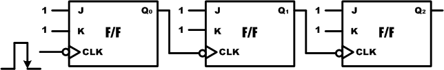
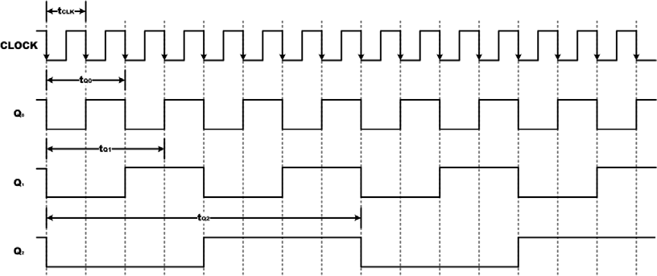
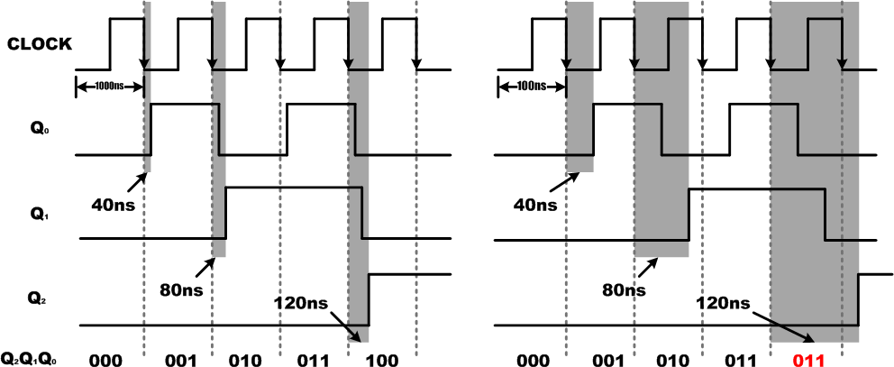
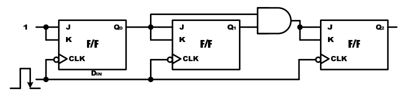
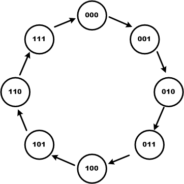
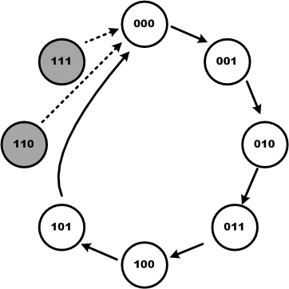

# 10. 카운터

## 10.1. 개요

일반적으로 카운터는 입력 펄스에 따라 미리 정해진 순서대로 상태 전이가 진행되는 레지스터를 말한다. 0, 1, 2, 3, 4, 5, … 처럼 숫자를 차례대로 세는 것을 카운터라 한다. 여기에서 0~9의 숫자가 반복되면 10진 카운터라고 부른다. 이 카운터는 시스템을 설계하는데 중요하다. 시스템에 필요한 주파수를 생성하는 부분에서도 이 카운터가 사용되고, 데이터의 흐름을 나타내는 곳에서도 카운터가 사용된다.  이 절에서는 이 카운터에 대한 기본 개념을 설명하고 있다.

## 10.2. 비동기식 카운터

아래에서 설계한 카운터는 “9.4 주파수 분할과 카운터”에서 설명한 논리 회로이다. 이것은 3비트 2진 카운터라고도 한다.

<br><br>

<p align="center">  </p>

<p align="center">  </p>

<br><br>

위의 동작을 다시 한번 설명해 보면 다음과 같다.

   * ① 3개의 J-K 플립플롭의 J와 K 입력 단자에는 모두 High의 값이 연결되어 있다.
   * ② 클럭의 입력은 플립플롭 Q0의 CLK 단자에만 연결이 된다. 그러므로 Q0의 결과는 클럭의Falling Edge때마다 반전된다.
   * ③ 플립플롭 Q0의 출력 결과는 플립플롭 Q1의 CLK 단자에 연결된다. 그래서 Q0의 출력이 1에서 0으로 변할 때마다 플립플롭 Q1의 결과는 반전될 것이다. 마찬가지로 Q1의 값이 1에서 0으로 변할 때마다 플립플롭 Q2의 결과는 반전될 것이다.
   * ④ 플립플롭의 출력 Q2, Q1, Q0의 값이 2진수를 나타낸다고 가정하면, 위의 출력 파형은 클럭이 발생할 때마다 000에서 111까지 연속적인 2진수 계수 값을 나타내는 것을 알 수있다.
   * ⑤ 이 플립플롭의 값이 111이고, 다시 클럭이 발생하면 플립플롭 Q0의 값은 1에서 0으로바뀐다. 이것은 플립플롭 Q1의 값을 1에서 0으로 바뀌게 하며, Q2의 값도 1에서 0으로바뀌게 한다. 즉 카운터의 값이 111에서 000으로 바뀐다. 그리고, 다시 클럭이 발생하면카운터는 새로운 계수의 시작될 것이다.

위와 같이 각각의 플립플롭의 출력이 다음 플립플롭의 CLK 입력으로 인가되는 형태의 카운터를 비동기식 카운터(asynchronous counter)라고 한다. 그 이유는 모든 플립플롭이 클럭 입력과 정확하기 동기되어 변하지 않기 때문이며, 클럭에 동기되어 변하는 플립플롭은 오직 Q0뿐이다.

모든 논리 회로에서는 회로 내에서 동작을 처리하기 위한 전달 지연이 생긴다. 기술이 발전됨에 따라 이 전달 지연 시간이 수 ns(10-9초)로 상당히 빨라 졌지만, 완전히 없어지지는 않았다. 플립플롭도 마찬가지로 보통 5 ~ 20ns정도의 전달 지연 시간을 갖고 있다. 위의 파형에서는 지연시간을 표시하지 않았지만, 실제로 하드웨어에서는 이 지연시간이 발생하며, 빠른 속도를 요하는 시스템의 경우 이러한 지연시간 때문에 오동작을 일으킬 수 있다. 이러한 카운터를보통 리플 카운터(ripple counter)라고 하며, 비동기식 카운터와 같은 의미로 사용된다.

리플 카운터는 주어진 계수 동작을 하기 위해 최소한의 회로 소자로 구성할 수 있기 때문에가장 간단한 2진 카운터의 형태이다. 하지만 이 카운터의 기본적인 동작 원리인 각각의 플립플롭은 앞 단의 플립플롭의 출력 값이 변화할 때 동작한다는 부분에서 문제가 생길 수 있다.먼저 플립플롭의 전달 지연 시간을 td라고 하고, 여러 개의 플립플롭이 사용되는 리플 카운터를 설계하였다고 하였을 때, 첫 번째 플립플롭에서의 지연 시간은 td만큼 걸린다. 하지만, 점점플립플롭의 단계를 지날수록 즉 N번째의 플립플롭에서는 N x td의 지연시간이 걸리기 때문에문제가 될 수 있다.

HBE-Combo III 장비를 이용한 실험에서는 클럭의 주기가 매우 느리기 때문에 위의 문제가발생하지 않는다.

3비트 리플 카운터가 설계되었고, 플립플롭의 지연시간은 40ns, 클럭의 주기를 1000ns라고 가정하면 아래의 왼쪽 그림과 같은 결과를 확인할 수 있다. 최대 지연시간인 120ns는 클럭 주기의 1000ns에 비해 상당히 작기 때문에 리플 카운터의 동작에 영향을 미치지 않기 때문에 문제가 되지 않는다.

하지만 높은 주파수의 클럭이 인가 된다면 아래의 오른쪽 그림과 같이 큰 문제가 될 수 있다.오른쪽 그림은 클럭 주기가 100ns일 때이며 이때의 동작을 살펴보면, 지연시간 때문에 5번째클럭에서 원하는 동작이 되지 않는 것을 확인할 수 있다.


<br><br>

<p align="center">  </p>

<br><br>

## 10.3.  동기식 카운터

리플카운터의 문제점은 플립플롭의 전달 지연이 누적된다는 것이며, 이것은 플립플롭에서 모든 상태가 입력 펄스에 동기되어 동시에 변하지 않는다는 것을 말한다. 이러한 문제점은 모든플립플롭이 입력 클럭 펄스에 의해서 동시에 동작되는 동기식 카운터(synchronous counter)또는 병렬 카운터(parallel counter)를 사용해서 해결 할 수 있다.

모든 플립플롭에 입력 펄스가 인가되기 때문에, 각 플립플롭의 클럭 펄스에 의하여 반전되거나 현 상태를 유지하기 위한 다른 제어 방법이 사용되어야 한다. 아래 그림은 이것을 설계한논리 회로로 3비트 동기식 카운터의 논리 회로이다.

<br><br>

<p align="center">  </p>

<br><br>

위의 회로를 설명하면 다음과 같다.

   * ①모든 플립플롭의 CLK입력은 같이 연결되어 있어서 클럭은 각 플립플롭에 동시에 인가된다.
   * ②제일 하위 비트는 Q0 플립플롭의 J와 K 입력 단자에만 High의 값이 고정되어 있고,다른 플립플롭에는 적절한 조합으로 구동된다.
   * ③동기식 카운터는 비동기식 카운터보다 많은 회로 소자가 사용된다.위의 회로는 아래의 표와 같이 동작된다.

<div align="center">
  
| Count | Q2 | Q1 | Q0 |
|:---:|:---:|:---:|:---:|
| 0 | 0 | 0 | 0 |
| 1 | 0 | 0 | 1 |
| 2 | 0 | 1 | 0 |
| 3 | 0 | 1 | 1 |
| 4 | 1 | 0 | 0 |
| 5 | 1 | 0 | 1 |
| 6 | 1 | 1 | 0 |
| 7 | 1 | 1 | 1 |
| 0 | 0 | 0 | 0 |
| 1 | 0 | 0 | 1 |
| … | … | … | … |


</div>
  
아래의 예제는 위의 논리 회로를 VHDL로 구현한 것이다.

```vhdl
-- CH2_SYNC_3CNT.VHD
LIBRARY IEEE;
USE IEEE.STD_LOGIC_1164.ALL;

ENTITY CH2_SYNC_3CNT IS
    PORT (
        CLK : IN     STD_LOGIC;
        Q   : BUFFER STD_LOGIC_VECTOR(3 DOWNTO 0)
    );
END CH2_SYNC_3CNT;

ARCHITECTURE HB OF CH2_SYNC_3CNT IS
BEGIN
    PROCESS (CLK)
    BEGIN
        IF CLK'EVENT AND CLK = '0' THEN
            IF Q(0) = '0' THEN
                Q(0) <= '1';
            ELSE
                Q(0) <= '0';
            END IF;
        END IF;
    END PROCESS;

    PROCESS (CLK)
    BEGIN
        IF CLK'EVENT AND CLK = '0' THEN
            IF Q(0) = '1' THEN
                IF Q(1) = '0' THEN
                    Q(1) <= '1';
                ELSE
                    Q(1) <= '0';
                END IF;
            END IF;
        END IF;
    END PROCESS;

    PROCESS (CLK)
    BEGIN
        IF CLK'EVENT AND CLK = '0' THEN
            IF Q(1 DOWNTO 0) = "11" THEN
                IF Q(2) = '0' THEN
                    Q(2) <= '1';
                ELSE
                    Q(2) <= '0';
                END IF;
            END IF;
        END IF;
    END PROCESS;
END HB;
```

위의 VHDL로직은 논리 회로를 그대로 옮긴 것이기 때문에 둘을 비교하면 쉽게 이해할 수 있을 것이다.

VHDL로직에서는 더 쉽게 이 3비트 동기식 카운터를 설계할 수 있다. 아래의 VHDL로직이 간단하게 설계된 3비트 동기식 카운터이다. 이 로직에서는 출력의 결과를 쉽게 보도록 하기 위해서 Q의 출력과 7-Segment의 출력을 할 수 있도록 하는 디코더 로직(8.3. 7-Segment 디코더설계 참고)이 추가되어 있다.

```vhdl
-- CH2_SYNC_3CNT2.VHD
LIBRARY IEEE;
USE IEEE.STD_LOGIC_1164.ALL;
USE IEEE.STD_LOGIC_UNSIGNED.ALL;

ENTITY CH2_SYNC_3CNT2 IS
    PORT (
        RESETN : IN  STD_LOGIC;
        CLK    : IN  STD_LOGIC;
        Q      : OUT STD_LOGIC_VECTOR(2 DOWNTO 0);
        SEG    : OUT STD_LOGIC_VECTOR(6 DOWNTO 0)
    );
END CH2_SYNC_3CNT2;

ARCHITECTURE HB OF CH2_SYNC_3CNT2 IS
    SIGNAL REG : STD_LOGIC_VECTOR(2 DOWNTO 0);
BEGIN
    PROCESS (RESETN, CLK)
    BEGIN
        IF RESETN = '0' THEN
            REG <= "000";
        ELSIF CLK'EVENT AND CLK = '0' THEN
            IF REG >= "111" THEN
                REG <= "000";
            ELSE
                REG <= REG + 1;
            END IF;
        END IF;
    END PROCESS;

    Q <= REG;

    PROCESS (REG)
    BEGIN
        CASE REG IS
            WHEN "000" => SEG <= "1111110";  -- 0
            WHEN "001" => SEG <= "0110000";  -- 1
            WHEN "010" => SEG <= "1101101";  -- 2
            WHEN "011" => SEG <= "1111001";  -- 3
            WHEN "100" => SEG <= "0110011";  -- 4
            WHEN "101" => SEG <= "1011011";  -- 5
            WHEN "110" => SEG <= "1011111";  -- 6
            WHEN "111" => SEG <= "1110000";  -- 7
            WHEN OTHERS => NULL;
        END CASE;
    END PROCESS;
END HB;
```

27 ~ 31라인의 카운트 구문을 동작시키기 위해서, 다른 VHDL로직에서 사용되지 않았던 5라인에서 STD_LOGIC_UNSIGNED 라이브러리를 추가로 호출하였다. 이 라이브러리에는 SIGNAL 변수와 SIGNAL 변수의 연산, SIGNAL 변수와 INTEGER 변수의 연산 등에 대한 정의가 되어 있다.37~50라인에 7-Segment 디코더의 로직이 설계되어, 연산 결과를 직관적으로 알아 볼 수 있도록 하였다.아래는 이 예제를 시뮬레이션 하기 위한 테스트 벤치 파일과 ModelSim으로 시뮬레이션 한결과이다.

```vhdl
-- TB_CH2_SYNC_3CNT2.VHD
LIBRARY IEEE;
USE IEEE.STD_LOGIC_1164.ALL;
USE IEEE.STD_LOGIC_UNSIGNED.ALL;

ENTITY TB_CH2_SYNC_3CNT2 IS
END TB_CH2_SYNC_3CNT2;

ARCHITECTURE HB OF TB_CH2_SYNC_3CNT2 IS
    COMPONENT CH2_SYNC_3CNT2
        PORT (
            RESETN : IN  STD_LOGIC;
            CLK    : IN  STD_LOGIC;
            Q      : OUT STD_LOGIC_VECTOR(2 DOWNTO 0);
            SEG    : OUT STD_LOGIC_VECTOR(6 DOWNTO 0)
        );
    END COMPONENT;

    SIGNAL RESETN : STD_LOGIC := '0';
    SIGNAL CLK    : STD_LOGIC := '0';
    SIGNAL Q      : STD_LOGIC_VECTOR(2 DOWNTO 0) := "000";
    SIGNAL SEG    : STD_LOGIC_VECTOR(6 DOWNTO 0) := "0000000";
BEGIN
    RESETN <= '0', '1' AFTER 10 NS;

    PROCESS
    BEGIN
        WAIT FOR 50 NS;
        CLK <= NOT CLK;
    END PROCESS;

    U_CH2_SYNC_3CNT2 : CH2_SYNC_3CNT2
        PORT MAP (
            RESETN => RESETN,
            CLK    => CLK,
            Q      => Q,
            SEG    => SEG
        );
END HB;
```

아래의 시뮬레이션 결과에서 클럭이 발생하였을 때, 출력 Q에 대한 카운트가 발생하며, 이것을 디코딩 하여 7-Segment에 출력되는 데이터로 변환하는 것을 확인할 수 있다.위의 로직을 HBE-Combo III에서 동작시키기 위해서는 아래 표와 같이 핀 설정을 해 주어야한다.입력 데이터 CLK에는 Button SW1을 설정하고, 출력 결과를 나타내는 Q에는 각각 LED1~4을통해 확인할 수 있도록 핀을 설정한다.

<div align="center">
  
| 포트 이름 | 핀 번호 | 하드웨어 설명 | 포트 이름 | 핀 번호 | 하드웨어 설명 |
|:---:|:---:|:---:|:---:|:---:|:---:|
| RESETN | C5 | FPGA_RESET | SEG[6] | M3 | SEG_a |
| CLK | V4 | SW1 | SEG[5] | M2 | SEG_b |
| Q[2] | AE11 | LED1 | SEG[4] | L7 | SEG_c |
| Q[1] | AE10 | LED2 | SEG[3] | L6 | SEG_d |
| Q[0] | AF9 | LED3 | SEG[2] | L4 | SEG_e |
|  |  |  | SEG[1] | P6 | SEG_f |
|  |  |  | SEG[0] | P4 | SEG_g |

</div>
  
핀 설정 후 컴파일 한다.HBE-Combo III 장비에 다운로딩 하고, 그 결과를 확인해 보자. 그리고, 두 가지 방법으로 설계된 3비트 동기식 카운터의 결과를 비교해 보자.

## 10.4. MOD-N 카운터

다음은 3비트 카운터의 데이터 값의 변화를 나타내는 상태 천이도를 그린 그림이다. 이 상태천이도를 통해서 3비트 카운터의 데이터 값의 변화를 쉽게 이해 할 수 있다.

<br><br>

<p align="center">  </p>

<br><br>

이 3비트 카운터는 8개의 다른 상태를 갖는다. 카운트의 순서에 있는 논리 상태의 수를 모드(MOD) 수라고 하는데, 8개의 논리 상태를 갖고 있기 때문에 MOD-8 카운터라고 한다. 이것이가장 일반적으로 사용하는 방법이고, 사용자에 의해서 MOD의 수를 변경할 수 있다.

3비트 카운터의 회로 상태 천이도에서 아래 그림과 같이 101의 데이터 상태에서 110의 데이터 상태로 변경하지 않고, 바로 000로 바뀌는 회로를 설계한다고 하였을 때, 이 회로는 6개의논리 상태를 갖고 있기 때문에 MOD-6 카운터라고 말한다.

<br><br>

<p align="center">  </p>

<br><br>

위의 상태 천이도에서 110과 111의 상태일 때 000로 값을 변경하는 상태를 그린 이유는 논리회로에 전원이 들어오는 순간에 플립플롭들이 임의의 상태에 있을 수 있으므로 위와 같은110과 111의 상태가 발생할 수 있기 때문이다. 그래서 이와 같은 보정 회로가 추가되어야 한다.

아래의 VHDL예제는 위의 MOD-6 카운터가 구현된 것이다.

```vhdl
-- CH2_MOD6_CNT.VHD
LIBRARY IEEE;
USE IEEE.STD_LOGIC_1164.ALL;
USE IEEE.STD_LOGIC_UNSIGNED.ALL;

ENTITY CH2_MOD6_CNT IS
    PORT (
        RESETN : IN  STD_LOGIC;
        CLK    : IN  STD_LOGIC;
        Q      : OUT STD_LOGIC_VECTOR(2 DOWNTO 0);
        SEG    : OUT STD_LOGIC_VECTOR(6 DOWNTO 0)
    );
END CH2_MOD6_CNT;

ARCHITECTURE HB OF CH2_MOD6_CNT IS
    SIGNAL REG : STD_LOGIC_VECTOR(2 DOWNTO 0);
BEGIN
    PROCESS (RESETN, CLK)
    BEGIN
        IF RESETN = '0' THEN
            REG <= "000";
        ELSIF CLK'EVENT AND CLK = '0' THEN
            IF REG >= "101" THEN
                REG <= "000";
            ELSE
                REG <= REG + 1;
            END IF;
        END IF;
    END PROCESS;

    Q <= REG;

    PROCESS (REG)
    BEGIN
        CASE REG IS
            WHEN "000" => SEG <= "1111110";  -- 0
            WHEN "001" => SEG <= "0110000";  -- 1
            WHEN "010" => SEG <= "1101101";  -- 2
            WHEN "011" => SEG <= "1111001";  -- 3
            WHEN "100" => SEG <= "0110011";  -- 4
            WHEN "101" => SEG <= "1011011";  -- 5
            WHEN "110" => SEG <= "1011111";  -- 6
            WHEN "111" => SEG <= "1110000";  -- 7
            WHEN OTHERS => NULL;
        END CASE;
    END PROCESS;
END HB;
```

앞에서 설계한 CH2_SYNC_3CNT2.VHD 파일과 거의 같지만, MOD-6 카운터를 구현하기 위해서 22 ~ 33 라인의 PROCESS문에서 IF문을 사용하여 REG의 값이 101이면 000의 값으로 변경되도록 구성한 부분이 차이가 있다. 이 구문에서 101일 때 000으로 바뀌어 MOD-6 카운터가아닌 MOD-5 카운터로 설계되었다고 생각할 지 모르겠지만, SIGNAL 변수는 값의 업데이트가그 PROCESS문이 끝나는 시점에 이루어지는 것을 다시 한번 생각해 보면 그렇지 않다는 것을알 수 있을 것이다. 37~50라인에 7-Segment 디코더 로직이 구현되어 있다.아래는 이 예제를 시뮬레이션 하기 위한 테스트 벤치 파일과 ModelSim으로 시뮬레이션 한결과이다.

```vhdl
-- TB_CH2_MOD6_CNT.VHD
LIBRARY IEEE;
USE IEEE.STD_LOGIC_1164.ALL;
USE IEEE.STD_LOGIC_UNSIGNED.ALL;

ENTITY TB_CH2_MOD6_CNT IS
END TB_CH2_MOD6_CNT;

ARCHITECTURE HB OF TB_CH2_MOD6_CNT IS
    COMPONENT CH2_MOD6_CNT
        PORT (
            RESETN : IN  STD_LOGIC;
            CLK    : IN  STD_LOGIC;
            Q      : OUT STD_LOGIC_VECTOR(2 DOWNTO 0);
            SEG    : OUT STD_LOGIC_VECTOR(6 DOWNTO 0)
        );
    END COMPONENT;

    SIGNAL RESETN : STD_LOGIC := '0';
    SIGNAL CLK    : STD_LOGIC := '0';
    SIGNAL Q      : STD_LOGIC_VECTOR(2 DOWNTO 0) := "000";
    SIGNAL SEG    : STD_LOGIC_VECTOR(6 DOWNTO 0) := "0000000";
BEGIN
    RESETN <= '0', '1' AFTER 10 NS;

    PROCESS
    BEGIN
        WAIT FOR 50 NS;
        CLK <= NOT CLK;
    END PROCESS;

    U_CH2_MOD6_CNT : CH2_MOD6_CNT
        PORT MAP (
            RESETN => RESETN,
            CLK    => CLK,
            Q      => Q,
            SEG    => SEG
        );
END HB;
```

아래의 시뮬레이션 결과에서 클럭이 발생하였을 때, 출력 Q에 대한 카운트가 발생하고, Q의값이 101이고 다음 클럭이 발생하였을 때 Q값이 110으로 변하지 않고 다시 000으로 바뀌어카운트되는 것을 확인할 수 있다.위의 로직을 HBE-Combo III에서 동작시키기 위해서는 아래 표와 같이 핀 설정을 해 주어야한다. 입력 데이터 CLK에는 Button SW1을 설정하고, 출력 결과를 나타내는 Q에는 각각LED1 ~ 4을 통해 확인할 수 있도록 핀을 설정한다.

<div align="center">
  
| 포트 이름 | 핀 번호 | 하드웨어 설명 | 포트 이름 | 핀 번호 | 하드웨어 설명 |
|:---:|:---:|:---:|:---:|:---:|:---:|
| RESETN | C5 | FPGA_RESET | SEG[6] | M3 | SEG_a |
| CLK | V4 | SW1 | SEG[5] | M2 | SEG_b |
| Q[2] | AE11 | LED1 | SEG[4] | L7 | SEG_c |
| Q[1] | AE10 | LED2 | SEG[3] | L6 | SEG_d |
| Q[0] | AF9 | LED3 | SEG[2] | L4 | SEG_e |
|  |  |  | SEG[1] | P6 | SEG_f |
|  |  |  | SEG[0] | P4 | SEG_g |

</div>
  
핀 설정 후 컴파일 한다. 

HBE-Combo III 장비에 다운로딩 하고, 그 결과를 확인해 보자.

BCD 카운터는 0 ~ 9까지의 10개의 논리 상태를 갖고 있는 카운터이다. 그렇기 때문에 이 BCD카운터를 MOD-10 카운터라고 할 수 있다.
