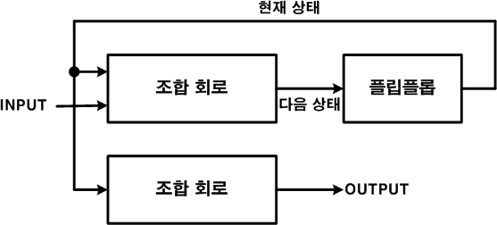
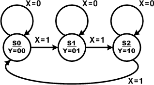

# 12. 스테이트 머신(STATE MACHINE)

## 12.1.  개요

스테이트 머신은 외부 입력과 시스템 클럭에 의해 State(상태)가 바뀌게 되고, State에 의존되어 출력 값이 결정된다. 스테이트 머신은 Moore Machine과 Mealy Machine으로 구분한다.

이 장에서는 이 스테이트 머신에 대하여 설명하고 있다.

## 12.2. Moore Machine

Moore Machine은 현재의 상태에 의해 출력이 결정되는 스테이트 머신을 말한다. 따라서, 데이터의 입력은 State를 바꾸는 데에만 사용되고, 결과에 영향을 미치지 않는데, 결과는 State에의해서 결정된다.

이 Moore Machine은 아래 블록도와 같이 시스템이 구성된다.

<br><br>

<p align="center">  </p>

<br><br>

아래의 상태도는 Moore Machine의 방법으로 각 State가 바뀌고, 그에 따라 데이터가 출력하는 것을 설명하는 그림이다.

<br><br>

<p align="center">  </p>

<br><br>

이 스테이트 머신은 State가 각각 S0, S1, S2일 때, 데이터의 입력에 따라서 X의 값이 0이면현재 상태를 유지하고, X의 값이 1이면 S0에서 S1으로, S1에서 S2로, 그리고 S2에서는 다시S1으로 각각 State가 변경되는 것을 확인 할 수 있다. 그리고 각 상태일 때 S0상태에서는 Y에00의 데이터가 출력되고, S1 상태에서는 Y에 01의 데이터가, S2의 상태에서는 Y에 10의 데이터가 각각 출력되도록 구성된다.

아래의 로직은 위의 상태도에 나타나있는 스테이트 머신을 VHDL로 구현한 것이다.

```vhdl
-- CH2_MOORE.VHD

LIBRARY IEEE;
USE IEEE.STD_LOGIC_1164.ALL;

ENTITY CH2_MOORE IS
    PORT(
        X : IN  STD_LOGIC;
        Y : OUT STD_LOGIC_VECTOR(1 DOWNTO 0)
    );
END CH2_MOORE;

ARCHITECTURE HB OF CH2_MOORE IS
    TYPE STATE_TYPE IS (S0, S1, S2);
    SIGNAL STATE, NEXTSTATE : STATE_TYPE;

BEGIN
    PROCESS(X)
    BEGIN
        IF X'EVENT AND X = '1' THEN
            CASE STATE IS
                WHEN S0     => NEXTSTATE <= S1;
                WHEN S1     => NEXTSTATE <= S2;
                WHEN S2     => NEXTSTATE <= S0;
                WHEN OTHERS => NEXTSTATE <= S0;
            END CASE;
        END IF;
    END PROCESS;

    STATE <= NEXTSTATE;

    PROCESS(STATE)
    BEGIN
        CASE STATE IS
            WHEN S0     => Y <= "00";
            WHEN S1     => Y <= "01";
            WHEN S2     => Y <= "10";
            WHEN OTHERS => Y <= "11";
        END CASE;
    END PROCESS;

END HB;
```

15 ~ 16라인에서 STATE_TYPE이라는 데이터 형이 S0, S1, S2의 소자를 갖고 있다고 선언하고,STATE와 NEXTSTATE변수를 이 STATE_TYPE으로 선언하였다.

20 ~ 34라인의 PROCESS문은 X 데이터의 입력이 있을 때, 상태를 변화하기 위한 구문이다.

38 ~ 50 라인의 PROCESS문은 각 상태일 때, Y에 출력하는 것을 보여주고 있다.

아래는 이 예제를 시뮬레이션 하기 위한 테스트 벤치 파일과 ModelSim으로 시뮬레이션 한결과이다.

```
-- TB_CH2_MOORE.VHD

LIBRARY IEEE;
USE IEEE.STD_LOGIC_1164.ALL;
USE IEEE.STD_LOGIC_UNSIGNED.ALL;

ENTITY TB_CH2_MOORE IS
END TB_CH2_MOORE;

ARCHITECTURE HB OF TB_CH2_MOORE IS

    COMPONENT CH2_MOORE
        PORT (
            X : IN  STD_LOGIC;
            Y : OUT STD_LOGIC_VECTOR(1 DOWNTO 0)
        );
    END COMPONENT;

    SIGNAL X : STD_LOGIC := '0';
    SIGNAL Y : STD_LOGIC_VECTOR(1 DOWNTO 0) := "00";

BEGIN

    PROCESS
    BEGIN
        WAIT FOR 50 NS;
        X <= NOT X;
    END PROCESS;

    U_CH2_MOORE : CH2_MOORE PORT MAP (
        X => X,
        Y => Y
    );

END HB;
```

아래의 시뮬레이션의 결과에서 X가 1로 바뀔 때마다 STATE가 바뀌어 나타나는 Y의 출력 결과를 확인할 수 있다.


위의 로직을 HBE-Combo III에서 동작시키기 위해서는 아래 표와 같이 핀 설정을 해 주어야한다.

입력 데이터 X는 Button SW1으로 설정하고, 출력 결과 Y는 LED1~2을 설정하여 결과를 LED를 통해서 확인할 수 있도록 한다.

| 포트 이름 | 핀 번호 | 하드웨어 설명 | | 포트 이름 | 핀 번호 | 하드웨어 설명 |
|-----------|--------|---------------|-|-----------|--------|---------------|
| X    | V4  | SW1     | | Y[0] | AE10 | LED2 |
|      |     |         | | Y[1] | AE11 | LED1 |

핀 설정 후 컴파일 한다.

HBE-Combo III 장비에 다운로딩 하고, 동작을 살펴보며 위의 스테이트 머신에 대해 이해해 보자.

## 12.3. Mealy Machine

Mealy Machine은 Moore Machine이 State에 의해서 출력이 결정되는 것에 반하여, 현재 상태와 입력 조건에 의해서 State도 변경되고, 출력 데이터도 생성된다.

아래의 블록도는 이 Mealy Machine을 구성하는 시스템에 대해서 나타내는 것인데, MooreMachine에 비해서 INPUT이 출력 데이터를 생성하는 조합논리회로에도 연결되어 있음을 유의하여야 한다.

이 Mealy Machine을 상태도로 그리면 아래 그림과 같다.

이 스테이트 머신은 S0과 S1의 상태를 갖고 있고, S0의 상태일 때 X=0이면 Y에 00의 데이터를 출력하고, X=1이면 Y에 10 데이터를 출력하면서, State가 S0에서 S1로 바뀐다. S1의 상태일때, X=0이면 Y에 00의 데이터를 출력하고, X=1이면 y에 01데이터를 출력하면서 State가 S1에서 S0으로 바뀌는 구조를 갖고 있다.

아래의 로직은 위의 상태도를 VHDL로 구현한 것이다.

```
-- CH2_MEALY.VHD

LIBRARY IEEE;
USE IEEE.STD_LOGIC_1164.ALL;

ENTITY CH2_MEALY IS
    PORT(
        X : IN  STD_LOGIC;
        Y : OUT STD_LOGIC_VECTOR(1 DOWNTO 0)
    );
END CH2_MEALY;

ARCHITECTURE HB OF CH2_MEALY IS
    TYPE STATE_TYPE IS (S0, S1);
    SIGNAL STATE, NEXTSTATE : STATE_TYPE;

BEGIN
    PROCESS(X)
    BEGIN
        IF X'EVENT AND X = '1' THEN
            CASE STATE IS
                WHEN S0     => NEXTSTATE <= S1;
                WHEN S1     => NEXTSTATE <= S0;
                WHEN OTHERS => NEXTSTATE <= S0;
            END CASE;
        END IF;
    END PROCESS;

    STATE <= NEXTSTATE;

    PROCESS(STATE, X)
    BEGIN
        IF    STATE = S0 AND X = '1' THEN Y <= "10";
        ELSIF STATE = S1 AND X = '1' THEN Y <= "01";
        ELSE  Y <= "00";
        END IF;
    END PROCESS;

END HB;
```

15 ~ 16라인에서 STATE_TYPE이라는 데이터 형이 S0, S1의 소자를 갖고 있다고 선언하고, STATE와 NEXTSTATE변수를 이 STATE_TYPE으로 선언하였다.

20 ~ 32라인의 PROCESS문은 X 데이터의 입력이 있을 때, 상태를 변화하기 위한 구문이다.

36 ~ 45 라인의 PROCESS문은 각 상태일 때, X의 값에 의해서 Y에 데이터가 출력하는 것이 설계되어 있다.

아래는 이 예제를 시뮬레이션 하기 위한 테스트 벤치 파일과 ModelSim으로 시뮬레이션 한결과이다.

```
-- TB_CH2_MEALY.VHD

LIBRARY IEEE;
USE IEEE.STD_LOGIC_1164.ALL;
USE IEEE.STD_LOGIC_UNSIGNED.ALL;

ENTITY TB_CH2_MEALY IS
END TB_CH2_MEALY;

ARCHITECTURE HB OF TB_CH2_MEALY IS

    COMPONENT CH2_MEALY
        PORT (
            X : IN  STD_LOGIC;
            Y : OUT STD_LOGIC_VECTOR(1 DOWNTO 0)
        );
    END COMPONENT;

    SIGNAL X : STD_LOGIC := '0';
    SIGNAL Y : STD_LOGIC_VECTOR(1 DOWNTO 0) := "00";

BEGIN

    PROCESS
    BEGIN
        WAIT FOR 50 NS;
        X <= NOT X;
    END PROCESS;

    U_CH2_MEALY : CH2_MEALY PORT MAP (
        X => X,
        Y => Y
    );

END HB;
```

아래의 시뮬레이션의 결과에서 X가 1로 바뀔 때마다 STATE가 바뀌고, X=0일 때 STATE에 따른값이 Y에 출력되고, X=0일 때에는 Y에 00이 출력 되는 것을 확인 할 수 있다.

위의 로직을 HBE-Combo III에서 동작시키기 위해서는 아래 표와 같이 핀 설정을 해 주어야한다.

입력 데이터 X는 Button SW1으로 설정하고, 출력 결과 Y는 LED1~2을 설정하여 결과를 LED를 통해서 확인할 수 있도록 한다.

| 포트 이름 | 핀 번호 | 하드웨어 설명 | | 포트 이름 | 핀 번호 | 하드웨어 설명 |
|-----------|--------|---------------|-|-----------|--------|---------------|
| X    | V4  | SW1     | | Y[0] | AE10 | LED2 |
|          |        |               | | Y[1] | AE11 | LED1 |

핀 설정 후 컴파일 한다.

HBE-Combo III 장비에 다운로딩 하고, 동작을 살펴보며 위의 스테이트 머신에 대해 이해해 보자.
