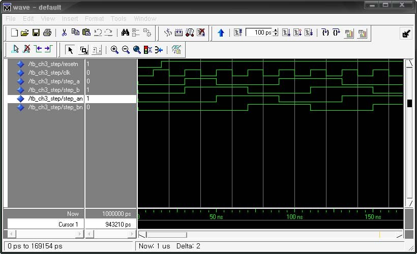
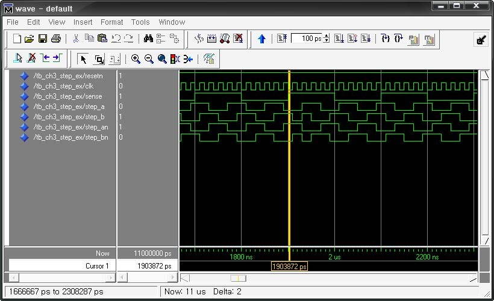

# 15. STEP MOTOR 제어

## 15.1.  개요

스텝 모터는 입력 펄스 수에 대응하여 일정 각도씩 움직이는 모터를 말한다. 입력 펄스 수와모터의 회전각도가 완전히 비례하기 때문에 회전각도를 정확하게 제어할 수 있다는 특징이있다. 그렇기 때문에 산업용 로봇의 관절 기구와 같은 부분에 주로 채택이 되어 사용된다. 또,입력 펄스 수에 비례한 만큼만 회전하기 때문에 DC 모터와 달리 위치의 피드백이 불필요하며,자기 지지 토크가 형성되기 때문에 브레이크 기구가 없어도 자체의 위치 결정 능력을 가지고있다는 특징을 같고 있다.

이 스텝 모터의 제어는 여자 방식에 따라 세가지 방식으로 제어가 가능하다. 이 방식은 1상여자, 2상 여자, 1-2상 여자 방식이 있고, 이 중 1-2 여자 방식은 고-분해능의 이점을 갖고 있다. 아래 표는 모터를 제어하기 위한 데이터의 흐름을 표로 보여주고 있다. 각각의 데이터 라인에 아래의 데이터를 순차적으로 인가하여 모터를 회전 시킬 수 있다. 또, 아래 데이터의 순서를 반대로 주는 것으로 스텝 모터의 회전 방향을 바꿀 수 있다.

<div align="center">
  
<table>
  <tr>
    <td style="padding-right:20px;">
      <table>
        <tr><th colspan="6">1상 여자</th></tr>
        <tr><th>클럭</th><th>A</th><th>B</th><th>/A</th><th>/B</th><th>주기</th></tr>
        <tr><td>1</td><td>1</td><td>0</td><td>0</td><td>0</td><td>1</td></tr>
        <tr><td>2</td><td>0</td><td>1</td><td>0</td><td>0</td><td>1</td></tr>
        <tr><td>3</td><td>0</td><td>0</td><td>1</td><td>0</td><td>1</td></tr>
        <tr><td>4</td><td>0</td><td>0</td><td>0</td><td>1</td><td>1</td></tr>
        <tr><td>5</td><td>1</td><td>0</td><td>0</td><td>0</td><td>2</td></tr>
        <tr><td>6</td><td>0</td><td>1</td><td>0</td><td>0</td><td>2</td></tr>
        <tr><td>7</td><td>0</td><td>0</td><td>1</td><td>0</td><td>2</td></tr>
        <tr><td>8</td><td>0</td><td>0</td><td>0</td><td>1</td><td>2</td></tr>        
        <tr><td>8</td><td>1</td><td>0</td><td>0</td><td>0</td><td>3</td></tr>        
      </table>
    </td>
    <td style="padding-right:20px;">
      <table>
        <tr><th colspan="6">2상 여자</th></tr>
        <tr><th>클럭</th><th>A</th><th>B</th><th>/A</th><th>/B</th><th>주기</th></tr>
        <tr><td>1</td><td>1</td><td>1</td><td>0</td><td>0</td><td>1</td></tr>
        <tr><td>2</td><td>0</td><td>1</td><td>1</td><td>0</td><td>1</td></tr>
        <tr><td>3</td><td>0</td><td>0</td><td>1</td><td>1</td><td>1</td></tr>
        <tr><td>4</td><td>1</td><td>0</td><td>0</td><td>1</td><td>1</td></tr>
        <tr><td>5</td><td>1</td><td>1</td><td>0</td><td>0</td><td>2</td></tr>
        <tr><td>6</td><td>0</td><td>1</td><td>1</td><td>0</td><td>2</td></tr>
        <tr><td>7</td><td>0</td><td>0</td><td>1</td><td>1</td><td>2</td></tr>
        <tr><td>8</td><td>1</td><td>0</td><td>0</td><td>1</td><td>2</td></tr>        
        <tr><td>8</td><td>1</td><td>1</td><td>0</td><td>0</td><td>3</td></tr>        
      </table>
    </td>
    </td>
    <td>
      <table>
        <tr><th colspan="6">1-2상 여자</th></tr>
        <tr><th>클럭</th><th>A</th><th>B</th><th>/A</th><th>/B</th><th>주기</th></tr>
        <tr><td>1</td><td>1</td><td>0</td><td>0</td><td>0</td><td>1</td></tr>
        <tr><td>2</td><td>1</td><td>1</td><td>0</td><td>0</td><td>1</td></tr>
        <tr><td>3</td><td>0</td><td>1</td><td>0</td><td>0</td><td>1</td></tr>
        <tr><td>4</td><td>0</td><td>1</td><td>1</td><td>0</td><td>1</td></tr>
        <tr><td>5</td><td>0</td><td>0</td><td>1</td><td>0</td><td>1</td></tr>
        <tr><td>6</td><td>0</td><td>0</td><td>1</td><td>1</td><td>1</td></tr>
        <tr><td>7</td><td>0</td><td>0</td><td>0</td><td>1</td><td>1</td></tr>
        <tr><td>8</td><td>1</td><td>0</td><td>0</td><td>1</td><td>1</td></tr>        
        <tr><td>8</td><td>1</td><td>0</td><td>0</td><td>0</td><td>2</td></tr>        
      </table>
    </td>
  </tr>
</table>

</div>

## 15.2.  기본 제어

아래의 로직은 100Hz의 클럭 입력을 받아 스텝 모터를 회전시키는 VHDL 예제이다.

```vhdl
-- CH3_STEP.VHD

LIBRARY IEEE;
USE IEEE.STD_LOGIC_1164.ALL;

ENTITY CH3_STEP IS
    PORT(
        RESETN             : IN  STD_LOGIC;
        CLK                : IN  STD_LOGIC;
        STEP_A, STEP_B     : OUT STD_LOGIC;
        STEP_AN, STEP_BN   : OUT STD_LOGIC
    );
END CH3_STEP;

ARCHITECTURE HB OF CH3_STEP IS
    SIGNAL REG : STD_LOGIC_VECTOR(3 DOWNTO 0);
    SIGNAL CNT : INTEGER RANGE 0 TO 3;

BEGIN
    PROCESS(RESETN, CLK)
    BEGIN
        IF RESETN = '0' THEN
            CNT <= 0;
            REG <= "0000";
        ELSIF CLK'EVENT AND CLK = '1' THEN
            IF CNT = 3 THEN
                CNT <= 0;
            ELSE
                CNT <= CNT + 1;
            END IF;

            CASE CNT IS
                WHEN 0 => REG <= "1100";
                WHEN 1 => REG <= "0110";
                WHEN 2 => REG <= "0011";
                WHEN 3 => REG <= "1001";
            END CASE;
        END IF;
    END PROCESS;

    STEP_A  <= REG(3);
    STEP_B  <= REG(2);
    STEP_AN <= REG(1);
    STEP_BN <= REG(0);
END HB;
```

22 ~ 41라인에 클럭의 입력을 받아 CNT를 카운트하고, 그 카운트한 값을 비교하여 REG의 변수에 2상 여자 방식의 데이터를 전달하는 회로가 구성되어 있다. 이 REG 데이터는 43 ~ 46라인에서 스텝 모터의 제어 신호로 출력된다.

이 예제는 아래와 같이 테스트 벤치 파일을 작성하여 시뮬레이션 할 수 있다.

```vhdl
-- TB_CH3_STEP.VHD

LIBRARY IEEE;
USE IEEE.STD_LOGIC_1164.ALL;
USE IEEE.STD_LOGIC_UNSIGNED.ALL;

ENTITY TB_CH3_STEP IS
END TB_CH3_STEP;

ARCHITECTURE HB OF TB_CH3_STEP IS

    COMPONENT CH3_STEP
        PORT(
            RESETN           : IN  STD_LOGIC;
            CLK              : IN  STD_LOGIC;
            STEP_A, STEP_B   : OUT STD_LOGIC;
            STEP_AN, STEP_BN : OUT STD_LOGIC
        );
    END COMPONENT;

    SIGNAL RESETN  : STD_LOGIC := '0';
    SIGNAL CLK     : STD_LOGIC := '0';
    SIGNAL STEP_A  : STD_LOGIC := '0';
    SIGNAL STEP_B  : STD_LOGIC := '0';
    SIGNAL STEP_AN : STD_LOGIC := '0';
    SIGNAL STEP_BN : STD_LOGIC := '0';

BEGIN

    PROCESS
    BEGIN
        WAIT FOR 10 NS;
        CLK <= NOT CLK;
    END PROCESS;

    RESETN <= '0', '1' AFTER 15 NS;

    U_CH3_STEP : CH3_STEP PORT MAP (
        RESETN  => RESETN,
        CLK     => CLK,
        STEP_A  => STEP_A,
        STEP_B  => STEP_B,
        STEP_AN => STEP_AN,
        STEP_BN => STEP_BN
    );

END HB;
```

이 테스트 벤치 파일은 30 ~ 36라인에 시뮬레이션 하기 위해서 필요한 RESETN과 CLK의 신호를 생성하도록 구성되어 있다.

<br><br>

<p align="center">  </p>

<br><br>


위의 로직을 HBE-Combo III에서 동작시키기 위해서는 아래 표와 같이 핀 설정을 해 주어야한다.

위의 로직에서 사용된 RESETN과 CLK의 입력은 장비의 FPGA_RESET 단자와 CLK입력을 선택한다. FPGA_RESET는 다른 버튼 스위치와는 다르게 버튼을 눌렀을 때 0의 값이 입력되고, 기본상태에서는 1의 값이 입력된다. , 출력은 Motor의 4개의 데이터 라인에 연결해 준다.

<div align="center">
  
| 포트 이름 | 핀 번호 | 하드웨어 설명 | | 포트 이름 | 핀 번호 | 하드웨어 설명 |
|-----------|--------|---------------|-|-----------|--------|---------------|
| RESETN | C5 | FPGA_RESET | | STEP_B  | AB24 | STEPMOTOR B |
| CLK | N2 | CLK1 | | STEP_AN | Y26 | STEPMOTOR /A |
| STEP_A | A23 | STEPMOTOR A | | STEP_BN | AB23 | STEPMOTOR /B |

</div>

핀 설정 후 컴파일 한다.

먼저 HBE-Combo III 장비에서 클럭의 입력은 100Hz로 설정하고, 위에서 생성된 프로그래밍파일을 다운로딩 하여 그 동작을 살펴보자.

## 15.3.  응용 제어

HBE-Combo III 장비에는 Step Motor의 회전 수를 검출하기 위하여 포토 센서가 구성되어 있다.아래의 로직은 이 회전 수를 검출하여 10회전이 되면 스텝 모터의 회전 방향을 반대로 돌리는 VHDL 예제이다.

```vhdl
-- CH3_STEP_EX.VHD

LIBRARY IEEE;
USE IEEE.STD_LOGIC_1164.ALL;

ENTITY CH3_STEP_EX IS
    PORT(
        RESETN             : IN  STD_LOGIC;
        CLK                : IN  STD_LOGIC;
        SENSE              : IN  STD_LOGIC;
        STEP_A, STEP_B     : OUT STD_LOGIC;
        STEP_AN, STEP_BN   : OUT STD_LOGIC
    );
END CH3_STEP_EX;

ARCHITECTURE HB OF CH3_STEP_EX IS
    SIGNAL REG         : STD_LOGIC_VECTOR(3 DOWNTO 0);
    SIGNAL CNT         : INTEGER RANGE 0 TO 3;
    SIGNAL CNT_SENSE   : INTEGER RANGE 0 TO 9;
    SIGNAL TMP_SENSE   : STD_LOGIC;
    SIGNAL DIRECTION   : STD_LOGIC;

BEGIN

    -- SENSE LATCH (클릭 감지 / 방향 전환)
    PROCESS(RESETN, CLK)
    BEGIN
        IF RESETN = '0' THEN
            TMP_SENSE <= '0';
            DIRECTION <= '0';
        ELSIF CLK'EVENT AND CLK = '1' THEN
            TMP_SENSE <= SENSE;
            IF TMP_SENSE = '0' AND SENSE = '1' THEN
                IF CNT_SENSE >= 9 THEN
                    CNT_SENSE <= 0;
                    DIRECTION <= NOT DIRECTION;
                ELSE
                    CNT_SENSE <= CNT_SENSE + 1;
                END IF;
            END IF;
        END IF;
    END PROCESS;

    -- STEP SEQUENCE
    PROCESS(RESETN, CLK)
    BEGIN
        IF RESETN = '0' THEN
            CNT <= 0;
        ELSIF CLK'EVENT AND CLK = '1' THEN
            IF CNT = 3 THEN
                CNT <= 0;
            ELSE
                CNT <= CNT + 1;
            END IF;

            IF DIRECTION = '0' THEN
                CASE CNT IS
                    WHEN 0 => REG <= "1100";
                    WHEN 1 => REG <= "0110";
                    WHEN 2 => REG <= "0011";
                    WHEN 3 => REG <= "1001";
                END CASE;
            ELSE
                CASE CNT IS
                    WHEN 0 => REG <= "1001";
                    WHEN 1 => REG <= "0011";
                    WHEN 2 => REG <= "0110";
                    WHEN 3 => REG <= "1100";
                END CASE;
            END IF;
        END IF;
    END PROCESS;

    STEP_A  <= REG(3);
    STEP_B  <= REG(2);
    STEP_AN <= REG(1);
    STEP_BN <= REG(0);
END HB;
```

위의 로직에서 26 ~ 44라인은 포토 센서로부터 데이터 SENSE를 받아서 회전 수를 카운트하는PROCESS 문이다. 32 ~ 34라인이 SENSE의 데이터의 Rising Edge상태일 때를 나타내기 위해 사용하는 구문으로 SIGNAL 변수의 값의 업데이트가 PROCESS 문이 끝나는 시점에서 이루어지는 것을 이용한다. 34 ~ 41의 카운트 블록이 SENSE의 값이 0~9까지 총 10회 들어오면DIRECTION이라는 변수를 현재 값의 반대로 바꾸는 블록이다. 이 DIRECTION이 스텝 모터의회전의 방향을 나타내는 구문이다.

46 ~ 73라인은 스텝모터로 보낼 데이터를 생성하는 블록인데, DIRECTION의 값에 따라서 스텝모터에 전달하는 데이터의 순서가 바뀌어 있는 것을 확인 할 수 있다.이 예제는 아래와 같이 테스트 벤치 파일을 작성하여 시뮬레이션 할 수 있다.

```vhdl
-- TB_CH3_STEP_EX.VHD

LIBRARY IEEE;
USE IEEE.STD_LOGIC_1164.ALL;
USE IEEE.STD_LOGIC_UNSIGNED.ALL;

ENTITY TB_CH3_STEP_EX IS
END TB_CH3_STEP_EX;

ARCHITECTURE HB OF TB_CH3_STEP_EX IS

    COMPONENT CH3_STEP_EX
        PORT(
            RESETN             : IN  STD_LOGIC;
            CLK                : IN  STD_LOGIC;
            SENSE              : IN  STD_LOGIC;
            STEP_A, STEP_B     : OUT STD_LOGIC;
            STEP_AN, STEP_BN   : OUT STD_LOGIC
        );
    END COMPONENT;

    SIGNAL RESETN   : STD_LOGIC := '0';
    SIGNAL CLK      : STD_LOGIC := '0';
    SIGNAL SENSE    : STD_LOGIC := '0';
    SIGNAL STEP_A   : STD_LOGIC := '0';
    SIGNAL STEP_B   : STD_LOGIC := '0';
    SIGNAL STEP_AN  : STD_LOGIC := '0';
    SIGNAL STEP_BN  : STD_LOGIC := '0';

BEGIN

    PROCESS
    BEGIN
        WAIT FOR 10 NS;
        CLK <= NOT CLK;
    END PROCESS;

    RESETN <= '0', '1' AFTER 15 NS;

    PROCESS
    BEGIN
        WAIT FOR 100 NS;
        SENSE <= NOT SENSE;
    END PROCESS;

    U_CH3_STEP_EX : CH3_STEP_EX PORT MAP (
        RESETN   => RESETN,
        CLK      => CLK,
        SENSE    => SENSE,
        STEP_A   => STEP_A,
        STEP_B   => STEP_B,
        STEP_AN  => STEP_AN,
        STEP_BN  => STEP_BN
    );

END HB;
```

이 테스트 벤치 파일은 이전의 TB_CH3_STEP.VHD 파일과 거의 같다. 다만 포토 센서의 입력에해당하는 SENSE의 값을 생성하기 위하여 40 ~ 44라인에 임의로 200NS 주기의 SENSE 파형을발생시키도록 구성하였다. 실제 동작에서의 데이터와는 약간 다르다.

아래 그림은 이 테스트 벤치 파일을 ModelSim에서 시뮬레이션 하였을 때의 결과 파형이다.

그림에서 커서바가 위치한 부분이 SENSE의 신호가 10번 발생하고, 11번째 발생하였을 때의시점이다. STEP_A, STEP_B, STEP_AN, STEP_BN의 데이터 흐름을 살펴보면 이 순간을 기점으로데이터가 반대로 흐르는 것을 확인할 수 있다.

<br><br>

<p align="center">  </p>

<br><br>

위의 로직을 HBE-Combo III에서 동작시키기 위해서는 아래 표와 같이 핀 설정을 해 주어야한다.

위의 로직에서 사용된 RESETN과 CLK의 입력은 장비의 FPGA_RESET 단자와 CLK입력을 선택한다. FPGA_RESET는 다른 버튼 스위치와는 다르게 버튼을 눌렀을 때 0의 값이 입력되고, 기본상태에서는 1의 값이 입력된다. , 출력은 Motor의 4개의 데이터 라인에 연결해 준다.

<div align="center">
  
| 포트 이름 | 핀 번호 | 하드웨어 설명 | | 포트 이름 | 핀 번호 | 하드웨어 설명 |
|-----------|--------|---------------|-|-----------|--------|---------------|
| RESETN | C5 | FPGA_RESET | | STEP_AN | Y26 | STEPMOTOR /A |
| CLK | N2 | CLK1 | | STEP_BN | AB23 | STEPMOTOR /B |
| STEP_A | A23 | STEPMOTOR A | | SENSE  | AA26 | MOTOR_SENSOR |
| STEP_B | AB24 | STEPMOTOR B | |         |       |              |

</div>

핀 설정 후 컴파일 한다.먼저 HBE-Combo III 장비에서 클럭의 입력은 100Hz로 설정하고, 위에서 생성된 프로그래밍파일을 다운로딩 하여 그 동작을 살펴보자.
