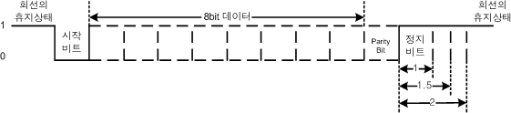
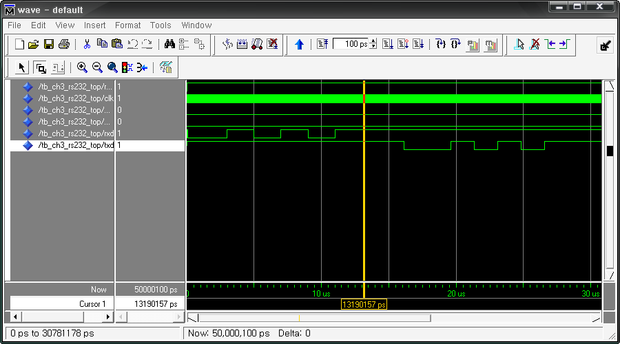

# 18. RS-232 제어

## 18.1.  개요

UART(Universal Asynchronous Receiver and Transmitter)는 비동기 통신의 스펙을 정의한 것이다.  흔히 말하는 RS-232C는 데이터 전송 방법을 말한다. RS-232C의 방법으로 PC와 PC, PC와장비 또는 장비와 장비를 연결하는 데는 TxD와 RxD, GND의 세 라인의 연결만이 필요하다.

시리얼 통신의 속도를 나타내는 baud rate는 1 초당 전송되는 단위 신호의 수를 나타낸다.RS-232C 인터페이스에서는 이 baud rate와 전송 속도(bps: bit per second)가 일치하기 때문에단위로서 baud 또는 bps가 사용된다.

아래 그림은 일반적인 RS-232C 통신의 데이터 흐름을 나타낸 것이다.

<br><br>

<p align="center">  </p>

<br><br>


회선에서 데이터가 흐르지 않는 휴지기에는 데이터가 ‘1’의 값을 유지한다. 데이터 통신이 시작 될 때 시작 비트로 1 비트가 ‘0’의 값을 가지며, 이후의 값은 8비트의 실제 데이터가 전송된다. 데이터의 전송 후에 Parity bit가 전송 되는데, 이 parity bit는 옵션으로 사용 여부와ODD, EVEN parity bit를 사용할 것인지를 설정하여 사용할 수 있다. Parity bit까지의 데이터 전송 후에는 정지 비트로 ‘1’의 값을 1 비트 또는 2비트까지 유지시켜 주는 것으로 1 프레임의데이터 전송을 마친다. 전송이 끝난 후에는 ‘1’의 값을 유지해 주어야 한다. 이 흐름의 방식은RxD와 TxD가 동일하게 이루어 진다.

## 18.2.  기본 제어

아래 RS232 제어 예제는 UART를 통해 시리얼 통신을 실험하는 예제이다. 여기에서는 컴퓨터와 장비간의 시리얼 통신 실험을 위해 케이블을 연결하고 Windows에 있는 하이퍼 터미널을통해 통신 실험을 확인할 수 있다. 이 예제는 장비의 클럭을 분주하여 컴퓨터의 전송 속도와일치 시켜 주는 작업을 하고, 컴퓨터에서 오는 문자 또는 문장을 FPGA에서 받아 다시 컴퓨터로 보내 주는 작업을 한다. 따라서 하이퍼 터미널을 통해 입력된 문자 코드를 전송하면 케이블을 통해 FPGA로 전달이 되고 이 전달된 값을 다시 컴퓨터로 전송을 하여 하이퍼 터미널 창에 표시된다.

이 로직은 TOP PROJECT로 CH3_RS232_TOP가 설계되어 있으며, RS232 통신을 위한CH3_RS232로직을 COMPONENT로 사용한다.

10MHz의 클럭의 입력을 받아, RS232C의 통신속도로 115,200bps를 사용하고 있다. 따라서하이퍼 터미널의 전송 속도는 115,200bps로 설정해야 한다. 장비의 클럭과 전송속도는 로직을수정해야 설정을 달리 할 수 있습니다.

```vhdl
-- CH3_RS232_TOP.VHD
LIBRARY IEEE;
USE IEEE.STD_LOGIC_1164.ALL;
USE IEEE.STD_LOGIC_UNSIGNED.ALL;

ENTITY CH3_RS232_TOP IS
    PORT (
        RESETN      : IN  STD_LOGIC;
        CLK         : IN  STD_LOGIC;
        PARITY_EN   : IN  STD_LOGIC;
        PARITY_MODE : IN  STD_LOGIC;
        RXD         : IN  STD_LOGIC;
        TXD         : OUT STD_LOGIC
    );
END CH3_RS232_TOP;

ARCHITECTURE HB OF CH3_RS232_TOP IS
    COMPONENT CH3_RS232
        PORT (
            RESETN        : IN  STD_LOGIC;
            CLK           : IN  STD_LOGIC;
            PARITY_EN     : IN  STD_LOGIC;
            PARITY_MODE   : IN  STD_LOGIC;
            RXD           : IN  STD_LOGIC;
            TXD           : OUT STD_LOGIC;
            RXD_EN        : OUT STD_LOGIC;
            TXD_EN        : IN  STD_LOGIC;
            UART_DATA_IN  : OUT STD_LOGIC_VECTOR(7 DOWNTO 0);
            UART_DATA_OUT : IN  STD_LOGIC_VECTOR(7 DOWNTO 0)
        );
    END COMPONENT;

    SIGNAL RXD_EN        : STD_LOGIC;
    SIGNAL TXD_EN        : STD_LOGIC;
    SIGNAL UART_DATA_IN  : STD_LOGIC_VECTOR(7 DOWNTO 0);
    SIGNAL UART_DATA_OUT : STD_LOGIC_VECTOR(7 DOWNTO 0);
    SIGNAL REG_RXD_EN    : STD_LOGIC_VECTOR(7 DOWNTO 0);
    SIGNAL REG_DATA_IN0  : STD_LOGIC_VECTOR(7 DOWNTO 0);
    SIGNAL REG_DATA_IN1  : STD_LOGIC_VECTOR(7 DOWNTO 0);
    SIGNAL REG_DATA_IN2  : STD_LOGIC_VECTOR(7 DOWNTO 0);
    SIGNAL REG_DATA_IN3  : STD_LOGIC_VECTOR(7 DOWNTO 0);
    SIGNAL REG_DATA_IN4  : STD_LOGIC_VECTOR(7 DOWNTO 0);
    SIGNAL REG_DATA_IN5  : STD_LOGIC_VECTOR(7 DOWNTO 0);
    SIGNAL REG_DATA_IN6  : STD_LOGIC_VECTOR(7 DOWNTO 0);
    SIGNAL REG_DATA_IN7  : STD_LOGIC_VECTOR(7 DOWNTO 0);
BEGIN
    U_RS_232 : CH3_RS232
        PORT MAP (
            RESETN        => RESETN,
            CLK           => CLK,
            PARITY_EN     => PARITY_EN,
            PARITY_MODE   => PARITY_MODE,
            RXD           => RXD,
            TXD           => TXD,
            RXD_EN        => RXD_EN,
            TXD_EN        => TXD_EN,
            UART_DATA_IN  => UART_DATA_IN,
            UART_DATA_OUT => UART_DATA_OUT
        );

    PROCESS (RESETN, CLK)
    BEGIN
        IF RESETN = '0' THEN
            REG_RXD_EN <= (OTHERS => '0');
        ELSIF CLK'EVENT AND CLK = '1' THEN
            REG_RXD_EN <= REG_RXD_EN(6 DOWNTO 0) & RXD_EN;
        END IF;
    END PROCESS;

    TXD_EN <= REG_RXD_EN(7);

    PROCESS (RESETN, CLK)
    BEGIN
        IF RESETN = '0' THEN
            REG_DATA_IN0 <= (OTHERS => '0');
            REG_DATA_IN1 <= (OTHERS => '0');
            REG_DATA_IN2 <= (OTHERS => '0');
            REG_DATA_IN3 <= (OTHERS => '0');
            REG_DATA_IN4 <= (OTHERS => '0');
            REG_DATA_IN5 <= (OTHERS => '0');
            REG_DATA_IN6 <= (OTHERS => '0');
            REG_DATA_IN7 <= (OTHERS => '0');
        ELSIF CLK'EVENT AND CLK = '1' THEN
            REG_DATA_IN0 <= UART_DATA_IN;
            REG_DATA_IN1 <= REG_DATA_IN0;
            REG_DATA_IN2 <= REG_DATA_IN1;
            REG_DATA_IN3 <= REG_DATA_IN2;
            REG_DATA_IN4 <= REG_DATA_IN3;
            REG_DATA_IN5 <= REG_DATA_IN4;
            REG_DATA_IN6 <= REG_DATA_IN5;
            REG_DATA_IN7 <= REG_DATA_IN6;
        END IF;
    END PROCESS;

    UART_DATA_OUT <= REG_DATA_IN7;
END HB;
```

위의 로직은 RS232 방식으로 시리얼 통신을 위한 예제의 TOP PROJECT 파일이다.

7 ~ 18라인에 외부에서 RESETN의 입력과 10MHz의 클럭의 입력을 받고, RXD와 출력인 TXD 단자를 통해서 시리얼 통신 할 수 있도록 입출력 단자가 선언되었다.

22 ~ 38라인은 실제 RXD로 들어온 데이터를 8비트의 병렬 데이터로 만들고, 8비트의 병렬 데이터를 1비트씩 TXD에 출력하는 CH3_RS232 로직을 COMPONENT로 선언하는 블록이다.57~72라인에서 이 COMPONENT와 TOP PROJECT가 PORT MAP으로 연결되어 있다.

74~108라인은 이 예제가 RXD로 받은 데이터를 TXD로 전송하는 로직이기 때문에, RXD의 1바이트 수신 완료의 신호인 RXD_EN의 신호와 이 때 받은 8비트의 RXD 데이터를 일정 시간 지연 후, TXD_EN으로 전달시키는 부분이다. 시프트 레지스터가 설계되어, RXD_EN의 신호가 8클럭 후 TXD_EN의 신호로 전송되도록 구성되어 있다. 이것은 여러 데이터가 연속적으로 들어왔을 때, RXD로 받은 데이터를 TXD로 바로 전달하지 못하는 경우가 있는데, 이런 통신이 끊어지는 현상을 막는 버퍼의 역할을 하도록 구성되어 있다.

```vhdl
-- CH3_RS232.VHD
LIBRARY IEEE;
USE IEEE.STD_LOGIC_1164.ALL;
USE IEEE.STD_LOGIC_UNSIGNED.ALL;

ENTITY CH3_RS232 IS
    PORT (
        RESETN        : IN  STD_LOGIC;
        CLK           : IN  STD_LOGIC;
        PARITY_EN     : IN  STD_LOGIC;
        PARITY_MODE   : IN  STD_LOGIC;
        RXD           : IN  STD_LOGIC;
        TXD           : OUT STD_LOGIC;
        RXD_EN        : OUT STD_LOGIC;
        TXD_EN        : IN  STD_LOGIC;
        UART_DATA_IN  : OUT STD_LOGIC_VECTOR(7 DOWNTO 0);
        UART_DATA_OUT : IN  STD_LOGIC_VECTOR(7 DOWNTO 0)
    );
END CH3_RS232;

ARCHITECTURE HB OF CH3_RS232 IS
    CONSTANT BIT_RATE      : STD_LOGIC_VECTOR(7 DOWNTO 0) := "01010110";  -- 10M / 115200 = 86
    CONSTANT BIT_RATE_HALF : STD_LOGIC_VECTOR(7 DOWNTO 0) := "00101011";  -- 43

    TYPE RX_STATE IS (RX_IDLE, RX_START, DATA_RX, RX_PARITY, RX_STOP);
    SIGNAL RX_ROUTINE : RX_STATE;

    TYPE TX_STATE IS (TX_IDLE, TX_START, DATA_TX, TX_PARITY, TX_STOP);
    SIGNAL TX_ROUTINE : TX_STATE;

    SIGNAL RX_BIT_ADD       : STD_LOGIC_VECTOR(7 DOWNTO 0);
    SIGNAL CNT_RX_BIT_RATE  : STD_LOGIC_VECTOR(7 DOWNTO 0);
    SIGNAL CNT_RX_DATA      : STD_LOGIC_VECTOR(2 DOWNTO 0);
    SIGNAL CNT_TX_BIT_RATE  : STD_LOGIC_VECTOR(7 DOWNTO 0);
    SIGNAL CNT_TX_DATA      : STD_LOGIC_VECTOR(2 DOWNTO 0);
    SIGNAL RX_DATA          : STD_LOGIC_VECTOR(7 DOWNTO 0);
    SIGNAL TX_DATA          : STD_LOGIC_VECTOR(7 DOWNTO 0);
    SIGNAL REG_RXD          : STD_LOGIC_VECTOR(15 DOWNTO 0);
    SIGNAL TX_PARITY_CHK    : STD_LOGIC;
BEGIN
    PROCESS (RESETN, CLK)
    BEGIN
        IF RESETN = '0' THEN
            REG_RXD <= (OTHERS => '0');
        ELSIF CLK'EVENT AND CLK = '1' THEN
            REG_RXD <= RXD & REG_RXD(15 DOWNTO 1);
        END IF;
    END PROCESS;

    PROCESS (RESETN, CLK)
    BEGIN
        IF RESETN = '0' THEN
            RX_BIT_ADD <= (OTHERS => '0');
        ELSIF CLK'EVENT AND CLK = '1' THEN
            IF RX_ROUTINE = DATA_RX THEN
                IF CNT_RX_BIT_RATE = BIT_RATE THEN
                    RX_BIT_ADD <= (OTHERS => '0');
                ELSE
                    RX_BIT_ADD <= RX_BIT_ADD + REG_RXD(0);
                END IF;
            ELSE
                RX_BIT_ADD <= (OTHERS => '0');
            END IF;
        END IF;
    END PROCESS;

    PROCESS (RESETN, CLK)
    BEGIN
        IF RESETN = '0' THEN
            RX_ROUTINE <= RX_IDLE;
        ELSIF CLK'EVENT AND CLK = '1' THEN
            CASE RX_ROUTINE IS
                WHEN RX_IDLE =>
                    IF REG_RXD = "0000000000000000" THEN
                        RX_ROUTINE <= RX_START;
                    END IF;
                WHEN RX_START =>
                    IF CNT_RX_BIT_RATE = BIT_RATE THEN
                        RX_ROUTINE <= DATA_RX;
                    ELSIF CNT_RX_BIT_RATE = BIT_RATE_HALF THEN
                        IF REG_RXD(0) = '1' THEN
                            RX_ROUTINE <= RX_IDLE;
                        END IF;
                    END IF;
                WHEN DATA_RX =>
                    IF CNT_RX_DATA = "111" THEN
                        IF CNT_RX_BIT_RATE = BIT_RATE THEN
                            IF PARITY_EN = '1' THEN
                                RX_ROUTINE <= RX_PARITY;
                            ELSE
                                RX_ROUTINE <= RX_STOP;
                            END IF;
                        END IF;
                    END IF;
                WHEN RX_PARITY =>
                    IF CNT_RX_BIT_RATE = BIT_RATE THEN
                        RX_ROUTINE <= RX_STOP;
                    END IF;
                WHEN RX_STOP =>
                    IF CNT_RX_BIT_RATE(5 DOWNTO 0) = BIT_RATE(7 DOWNTO 2) THEN
                        RX_ROUTINE <= RX_IDLE;
                    END IF;
            END CASE;
        END IF;
    END PROCESS;

    PROCESS (RESETN, CLK)
    BEGIN
        IF RESETN = '0' THEN
            CNT_RX_BIT_RATE <= (OTHERS => '0');
        ELSIF CLK'EVENT AND CLK = '1' THEN
            IF RX_ROUTINE = RX_IDLE THEN
                CNT_RX_BIT_RATE <= (OTHERS => '0');
            ELSIF CNT_RX_BIT_RATE = BIT_RATE THEN
                CNT_RX_BIT_RATE <= (OTHERS => '0');
            ELSE
                CNT_RX_BIT_RATE <= CNT_RX_BIT_RATE + '1';
            END IF;
        END IF;
    END PROCESS;

    PROCESS (RESETN, CLK)
    BEGIN
        IF RESETN = '0' THEN
            CNT_RX_DATA <= (OTHERS => '0');
        ELSIF CLK'EVENT AND CLK = '1' THEN
            IF RX_ROUTINE = DATA_RX THEN
                IF CNT_RX_BIT_RATE = BIT_RATE THEN
                    IF CNT_RX_DATA = "111" THEN
                        CNT_RX_DATA <= (OTHERS => '0');
                    ELSE
                        CNT_RX_DATA <= CNT_RX_DATA + '1';
                    END IF;
                END IF;
            ELSE
                CNT_RX_DATA <= (OTHERS => '0');
            END IF;
        END IF;
    END PROCESS;

    PROCESS (RESETN, CLK)
    BEGIN
        IF RESETN = '0' THEN
            RX_DATA <= (OTHERS => '0');
        ELSIF CLK'EVENT AND CLK = '1' THEN
            IF RX_ROUTINE = DATA_RX THEN
                IF CNT_RX_BIT_RATE = BIT_RATE - 1 THEN
                    IF RX_BIT_ADD >= BIT_RATE_HALF THEN
                        RX_DATA <= '1' & RX_DATA(7 DOWNTO 1);
                    ELSE
                        RX_DATA <= '0' & RX_DATA(7 DOWNTO 1);
                    END IF;
                END IF;
            ELSIF RX_ROUTINE = RX_IDLE THEN
                RX_DATA <= (OTHERS => '0');
            END IF;
        END IF;
    END PROCESS;

    PROCESS (RESETN, CLK)
    BEGIN
        IF RESETN = '0' THEN
            RXD_EN <= '0';
        ELSIF CLK'EVENT AND CLK = '1' THEN
            IF RX_ROUTINE = RX_STOP THEN
                IF CNT_RX_BIT_RATE >= 10 THEN
                    RXD_EN <= '1';
                ELSE
                    RXD_EN <= '0';
                END IF;
            ELSE
                RXD_EN <= '0';
            END IF;
        END IF;
    END PROCESS;

    PROCESS (RESETN, CLK)
    BEGIN
        IF RESETN = '0' THEN
            UART_DATA_IN <= (OTHERS => '0');
        ELSIF CLK'EVENT AND CLK = '1' THEN
            IF RX_ROUTINE = RX_STOP THEN
                UART_DATA_IN <= RX_DATA;
            END IF;
        END IF;
    END PROCESS;

    PROCESS (RESETN, CLK)
    BEGIN
        IF RESETN = '0' THEN
            TX_ROUTINE <= TX_IDLE;
        ELSIF CLK'EVENT AND CLK = '1' THEN
            CASE TX_ROUTINE IS
                WHEN TX_IDLE =>
                    IF TXD_EN = '1' THEN
                        TX_ROUTINE <= TX_START;
                    END IF;
                WHEN TX_START =>
                    IF CNT_TX_BIT_RATE = BIT_RATE THEN
                        TX_ROUTINE <= DATA_TX;
                    END IF;
                WHEN DATA_TX =>
                    IF CNT_TX_DATA = "111" THEN
                        IF CNT_TX_BIT_RATE = BIT_RATE THEN
                            IF PARITY_EN = '1' THEN
                                TX_ROUTINE <= TX_PARITY;
                            ELSE
                                TX_ROUTINE <= TX_STOP;
                            END IF;
                        END IF;
                    END IF;
                WHEN TX_PARITY =>
                    IF CNT_TX_BIT_RATE = BIT_RATE THEN
                        TX_ROUTINE <= TX_STOP;
                    END IF;
                WHEN TX_STOP =>
                    IF CNT_TX_BIT_RATE = BIT_RATE - 10 THEN
                        TX_ROUTINE <= TX_IDLE;
                    END IF;
                WHEN OTHERS =>
                    TX_ROUTINE <= TX_IDLE;
            END CASE;
        END IF;
    END PROCESS;

    PROCESS (RESETN, CLK)
    BEGIN
        IF RESETN = '0' THEN
            CNT_TX_BIT_RATE <= (OTHERS => '0');
        ELSIF CLK'EVENT AND CLK = '1' THEN
            IF TX_ROUTINE = TX_IDLE THEN
                CNT_TX_BIT_RATE <= (OTHERS => '0');
            ELSIF CNT_TX_BIT_RATE = BIT_RATE THEN
                CNT_TX_BIT_RATE <= (OTHERS => '0');
            ELSE
                CNT_TX_BIT_RATE <= CNT_TX_BIT_RATE + '1';
            END IF;
        END IF;
    END PROCESS;

    PROCESS (RESETN, CLK)
    BEGIN
        IF RESETN = '0' THEN
            CNT_TX_DATA <= (OTHERS => '0');
        ELSIF CLK'EVENT AND CLK = '1' THEN
            IF TX_ROUTINE = DATA_TX THEN
                IF CNT_TX_BIT_RATE = BIT_RATE THEN
                    IF CNT_TX_DATA = "111" THEN
                        CNT_TX_DATA <= (OTHERS => '0');
                    ELSE
                        CNT_TX_DATA <= CNT_TX_DATA + '1';
                    END IF;
                END IF;
            ELSE
                CNT_TX_DATA <= (OTHERS => '0');
            END IF;
        END IF;
    END PROCESS;

    PROCESS (RESETN, CLK)
    BEGIN
        IF RESETN = '0' THEN
            TX_DATA <= (OTHERS => '0');
        ELSIF CLK'EVENT AND CLK = '1' THEN
            IF TX_ROUTINE = TX_IDLE THEN
                IF TXD_EN = '1' THEN
                    TX_DATA <= UART_DATA_OUT;
                END IF;
            END IF;
        END IF;
    END PROCESS;

    PROCESS (RESETN, CLK)
    BEGIN
        IF RESETN = '0' THEN
            TX_PARITY_CHK <= '0';
        ELSIF CLK'EVENT AND CLK = '1' THEN
            IF TX_ROUTINE = TX_IDLE THEN
                IF TXD_EN = '1' THEN
                    TX_PARITY_CHK <= UART_DATA_OUT(7) XOR UART_DATA_OUT(6) XOR
                                     UART_DATA_OUT(5) XOR UART_DATA_OUT(4) XOR
                                     UART_DATA_OUT(3) XOR UART_DATA_OUT(2) XOR
                                     UART_DATA_OUT(1) XOR UART_DATA_OUT(0) XOR
                                     PARITY_MODE;
                END IF;
            END IF;
        END IF;
    END PROCESS;

    PROCESS (RESETN, CLK)
    BEGIN
        IF RESETN = '0' THEN
            TXD <= '1';
        ELSIF CLK'EVENT AND CLK = '1' THEN
            CASE TX_ROUTINE IS
                WHEN TX_IDLE =>
                    TXD <= '1';
                WHEN TX_START =>
                    TXD <= '0';
                WHEN DATA_TX =>
                    IF CNT_TX_DATA = "000" THEN
                        TXD <= TX_DATA(0);
                    ELSIF CNT_TX_DATA = "001" THEN
                        TXD <= TX_DATA(1);
                    ELSIF CNT_TX_DATA = "010" THEN
                        TXD <= TX_DATA(2);
                    ELSIF CNT_TX_DATA = "011" THEN
                        TXD <= TX_DATA(3);
                    ELSIF CNT_TX_DATA = "100" THEN
                        TXD <= TX_DATA(4);
                    ELSIF CNT_TX_DATA = "101" THEN
                        TXD <= TX_DATA(5);
                    ELSIF CNT_TX_DATA = "110" THEN
                        TXD <= TX_DATA(6);
                    ELSIF CNT_TX_DATA = "111" THEN
                        TXD <= TX_DATA(7);
                    ELSE
                        TXD <= '1';
                    END IF;
                WHEN TX_PARITY =>
                    TXD <= TX_PARITY_CHK;
                WHEN TX_STOP =>
                    TXD <= '1';
                WHEN OTHERS =>
                    TXD <= '1';
            END CASE;
        END IF;
    END PROCESS;
END HB;
```

위의 로직에서 86 ~ 198라인은 RXD의 데이터 입력을 받아 8비트의 데이터로 변환시키는 송신블록이 설계되어 있고, 200 ~ 340라인은 외부에서 받은 8비트의 데이터 입력을 TXD로 1비트데이터씩 전송시키는 수신 블록이 설계되어 있다.

먼저 27 ~ 28라인은 시리얼 통신의 BAUD RATE를 설정하기 위한 한계 카운트 값을 설정하는부분이다. 10MHz의 클럭입력을 받아 115200BPS의 속도를 생성하기 위하여 계산한 결과이다.

30 ~ 34라인은 RXD와 TXD의 통신의 흐름을 스테이트 머신으로 구성한 부분이다. 각각 IDEL,START BIT, DATA, PARITY, STOP BIT의 상태로 구성되어 있다.

RXD 수신 블록에서 52~77라인은 START BIT를 검출하기 위한 블록이다.

79~117라인은 RXD 블록의 스테이트 머신을 동작시키는 블록으로, 위에서 검출한 STARTBIT(클럭이 16번일 때까지 RXD의 값이 0일 때)을 감지하는 블록이다. 노이즈에 의해 잠깐RXD의 신호가 0으로 떨어질 수 있기 때문에 일정구간을 연속적으로 0이 들어올 때까지를 감지하도록 구성되어 있다. 시리얼 통신에서 1비트를 받는 속도가 115200BPS인데, 이것은10MHz의 클럭으로는 87번 카운트해야 같은 속도가 나온다. 그래서 카운트 값이 87번을 초과하지 않는 범위 최대 절반 값인 44번을 카운트 할 때까지 RXD의 값이 0으로 유지되면 STARTBIT인 것으로 인정하고 DATA를 받아들이는 상태로 넘어가게 된다. DATA RX 상태에서 8개의데이터를 받은 후, PARITY 비트 체크 입력이 들어올 때는 PARITY BIT 상태로 아니면 RX의STOP 상태로 변경하도록 구성되어 있다. STOP 상태일 때 일정 구간 동안 1의 값이 유지되면다시 IDEL 상태로 바뀌어 RXD의 입력을 기다리는 상태로 돌아간다.

119 ~ 132라인은 10MHz의 클럭을 카운트하여 115200BPS의 속도를 만드는 블록이다.

134 ~ 151라인은 RXD 수신 블록이 DATA RX상태일 때, 8비트의 데이터를 받기 위해 이 값을카운트하는 블록이고, 153 ~ 170라인은 PARITY BIT를 체크하는 블록이다. 172 ~ 187라인은 RXD의수신이 종료되면 RXD_EN에 1의 값을 출력하는 블록이다.

200 ~ 235라인은 TXD 송신 블록에서 스테이트 머신을 동작시키기 위한 블록이다. 이 TXD 송신블록은 IDLE상태에서 TXD_EN의 신호를 받아 동작한다. 그리고, 115200BPS의 속도에 맞춰서START BIT, DATA TX상태로 넘어간다. PARITY 비트 ENABLE에 따라 TX PARITY 상태로 넘어가거나 STOP 상태로 넘어간다. 그리고, 일정 시간 후에 IDEL 상태로 넘어가도록 설계되어 있다.

238 ~ 251라인에서TXD의 115200 BPS의 속도를 계산하도록 CNT_TX_BIT_RATE를 카운트시킨다.

253 ~ 270라인에서는 DATA TX상태에서 8개의 데이터를 전송하기 위한 TXD 데이터의 개수를카운트한다.

272 ~ 283라인에서 TXD_EN의 신호가 1일 때 외부에서 들어온 8비트 TXD 전송 데이터의 값을TX_DATA 는 변수에 저장시키고, 285 ~ 300라인은 TXD 데이터의 PARITY 비트를 생성하는 블록이다.

302 ~ 340라인에서 TXD 전송 블록의 각 상태일 때 실제 UART에 TXD에 데이터를 전송하는 블록이다.

아래 테스트 벤치 파일이 이 예제를 시뮬레이션을 하기 위해서 예제에서 필요로 하는 입력신호를 생성하기 위한 것이다.

```vhdl
-- TB_CH3_RS232_TOP.VHD
LIBRARY IEEE;
USE IEEE.STD_LOGIC_1164.ALL;
USE IEEE.STD_LOGIC_UNSIGNED.ALL;

ENTITY TB_CH3_RS232_TOP IS
END TB_CH3_RS232_TOP;

ARCHITECTURE HB OF TB_CH3_RS232_TOP IS
    COMPONENT CH3_RS232_TOP
        PORT (
            RESETN      : IN  STD_LOGIC;
            CLK         : IN  STD_LOGIC;
            PARITY_EN   : IN  STD_LOGIC;
            PARITY_MODE : IN  STD_LOGIC;
            RXD         : IN  STD_LOGIC;
            TXD         : OUT STD_LOGIC
        );
    END COMPONENT;

    SIGNAL RESETN      : STD_LOGIC := '0';
    SIGNAL CLK         : STD_LOGIC := '0';
    SIGNAL PARITY_EN   : STD_LOGIC := '0';
    SIGNAL PARITY_MODE : STD_LOGIC := '0';
    SIGNAL RXD         : STD_LOGIC := '0';
    SIGNAL TXD         : STD_LOGIC := '0';
BEGIN
    PROCESS
    BEGIN
        WAIT FOR 10 NS;
        CLK <= NOT CLK;
    END PROCESS;

    RESETN      <= '0', '1' AFTER 15 NS;
    PARITY_EN   <= '0';
    PARITY_MODE <= '0';
    RXD         <= '1', '0' AFTER 100 NS, '1' AFTER 3000 NS, '0' AFTER 5000 NS,
                   '1' AFTER 7000 NS, '0' AFTER 9000 NS, '1' AFTER 11000 NS;

    U_CH3_RS232_TOP : CH3_RS232_TOP
        PORT MAP (
            RESETN      => RESETN,
            CLK         => CLK,
            PARITY_EN   => PARITY_EN,
            PARITY_MODE => PARITY_MODE,
            RXD         => RXD,
            TXD         => TXD
        );
END HB;
```

이 테스트 벤치 파일은 34~46라인에서 CH3_RS232_TOP의 입력 신호인 RESETN과 CLK, RXD신호를 생성하는 블록이 구현되어 있다.

45 ~ 46라인은 PC에서 전송하는 RXD 신호를 생성하는 구문으로, 임의의 데이터를 생성하도록구성되어 있다.

아래 그림은 ModelSim 소프트웨어로 시뮬레이션 한 결과를 나타낸다. RXD로 입력받은 데이터를 그 대로 TXD로 출력하는 것을 보여준다.

<br><br>

<p align="center">  </p>

<br><br>

이 예제를 HBE-Combo III에서 동작시키기 위해서는 아래 표와 같이 핀 설정을 해 주어야 한다.

위의 로직에서 사용된 RESETN과 CLK의 입력은 각각 FPGA_RESET과 CLK의 입력을 설정하고,RXD와 TXD는 UART의 핀에 연결하고, PARITY_EN과 PARITY_MODE는 각각 딥 스위치에 연결한다.

<div align="center">
    
| 포트 이름 | 핀 번호 | 하드웨어 설명 | 포트 이름 | 핀 번호 | 하드웨어 설명 |
|---|---|---|---|---|---|
| RESETN | C5 | FPGA_RESET | PARITY_EN | V5 | BUS SW2 |
| CLK | N2 | CLK1 | RXD | H3 | UART RXD |
| PARITY_MODE | V6 | BUS SW1 | TXD | F7 | UART TXD |

</div>
    
핀 설정 후 컴파일 한다.먼저 HBE-Combo III 장비에서 클럭의 입력은 100Hz로 설정하고, 위에서 생성된 프로그래밍파일을 다운로딩 하여 그 동작을 살펴보자.  통신 프로그램에서 키보드를 눌러 임의의 데이터를 송신하고, 송신한 데이터와 같은 데이터가 수신되는지를 확인해 보자.
