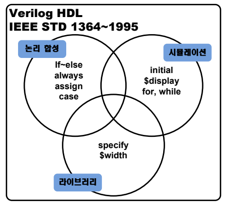

# 5. Verilog HDL 구조 및 기초

## 5.1. 개요

Verilog HDL은 하드웨어 기술 언어(Hardware Description Language)이다. 이 언어는 컴퓨터 나컴퓨터의 부품과 같은 디지털 시스템의 기능 또는 회로를 표현할 수 있도록 개발되었다. C 언어, FORTRAN 등의 소프트웨어 프로그래밍 언어와 다르게 하드웨어 표현에 적합한 언어 요소들을 가지며, 따라서 디지털 하드웨어를 여러 계층레벨에서 표현하고 검증할 수 있도록 개발된 언어이다.

HDL 자체는 어떤 새로운 개념이 아니라 이전부터 연구 및 실용화 된 것이다. 워크 스테이션,퍼스널 컴퓨터의 가격이 많이 싸지고, 고성능화 등으로, 대규모 회로를 빠른 시간 내에 설계할수 있다는 이유로 현재 널리 사용되고 있다.

반도체 기술의 향상으로 사용자들이 성능이 좋고, 가격이 저렴한 상품을 요구하게 되어서, 주요부품인 IC보다 대규모화 할 수 있었다. 대규모 설계를 하는데 회로도를 이용한 설계는 한계가 있으므로, 보다 효율적인 설계 방법이 필요하게 되었다. 이 방법이 HDL로 설계하는 것이다.하드웨어 기술언어를 이용하여 설계하면, 복잡한 논리식으로부터 설계자를 해방시키고, 설계기간을 단축시킬 수 있으며 또한 설계를 쉽게 변경 할 수 있다.

HDL의 장점으로는 아래와 같이 크게 2가지로 볼 수 있다.

* 설계의 효율성
  * 논리식에서 카르노맵을 이용한 게이트 수를 줄일 필요 없이 논리식에서 바로 회로를 생성하여 설계의 시간을 단축할 수 있다. 또한 HDL를 이용하여 반도체 회사에서 만든 IC뿐만이 아니라 없는 IC를 설계할 수 있다.

* 검증 정밀도의 향상
  * HDL을 이용하면 입력을 주어 출력을 관측 및 비교하기가 쉽고 설계 도중 테스트를 할 수 있다. 테스트를 위한 설계 대상에 접속할 주변회로를 HDL로 설계하고 이것을 시뮬레이션 모델로 하여 테스트로 사용하면 보다 정확한 설계를 할 수 있다.

Verilog HDL은 일반적으로 사용되는 C언어와 같은 프로그래밍 언어와 같은 원리에 기초를 두고 있으며 하드웨어적인 특징을 추가하여 표현 능력을 향상시켰다. Verilog는 광범위한 기술능력을 가져 시스템 수준에서부터 트랜지스터 스위치에 이르기까지 하드웨어의 동작 또는 구조를 기술을 할 수 있으며, 시뮬레이션 등을 위해서 여러 레벨의 표현을 혼합해서 사용할 수있다. Verilog HDL은 여러 계층의 설계 표현이 가능하며, 설계과정의 여러 단계에서 다른 목적으로 사용될 수 있다. 최상위 수준에서 확률 함수 성능 모델링이 가능하며, 행위 수준 모델링을 통해 시스템 기능을 모델링할 수 있다는 특징을 갖고 있다.

## 5.2. Verilog HDL

Verilog HDL의 구문은 논리 합성용과 시뮬레이션용, Library용 구문으로 구분할 수 있다.

논리 합성용 구문은 if~else문, assign문, always문 등 대부분 게이트 수준 합성을 지원하는 구문들이고, 시뮬레이션용 구문은 initial 문, $display문, for, while문과 같이 시뮬레이션을 위한테스트벤치의 작성에 사용되는 구문들로 논리 합성이 지원되지 않는다. 라이브러리용 구문은논리 합성에 사용되는 셀 라이브러리의 표현에 사용되는 구문으로 셀의 기능, 지연, 핀 정보등을 표현하는데 사용된다.

따라서, 실제 시스템 설계에서는 RTL 수준의 합성이 지원되는 논리 합성용 구문들을 사용하여야 한다.

<br><br>

<p align="center">  </p>

<br><br>

Verilog HDL은 module을 설정함으로써 디지털 시스템을 설계한다. 대체로 하나의 시스템을설계하는데 1개의 모듈로 구성하지만, 이것이 필요 조건은 아니다. 여러 모듈이 동시에 실행될 수도 있지만, 대체로 테스트 데이터와 하드웨어 모델 모두를 갖고 있는 1개의 최상의 모듈에서 다른 모듈을 호출하는 방법으로 구성된다.

## 5.3. 기본 구조

Verilog HDL은 module을 기본 단위로 하여 구성된다. 모듈은 간단한 게이트에서부터 마이크로프로세서와 같은 복잡한 시스템을 구현할 수 있다. 모듈은 행위 수준 모델과 구조적 모델로표현할 수 있는데, 행위 수준 모델에서는 if문과 assignment문과 같은 전통적인 프로그래밍 언어 구조를 사용한 디지털 시스템 또는 모듈을 설계하고, 구조적 표현에서는 서브 모듈의 계층적 연결을 사용하여 디지털 시스템 또는 모듈을 설계한다.

먼저, Verilog HDL은 대소문자를 구별하고, 각 문단의 끝은 세미콜론( ; )으로 끝을 낸다는 것을주의하여야 한다.

이 모듈은 아래와 같은 구조를 갖고 있다.

```verilog
module module_name(port list);
  port declarations

  data type declarations

  circuit functionality

  timing specifications

end module
```

위의 구조에서 timing specifications 구문은 시뮬레이션 하는 테스트벤치 파일에서만 사용된다.

module_name은 모듈에 붙이는 이름을 말하며, port list는 이 모듈에서 사용하는 포트 이름의리스트를 말한다. 이 부분의 예를 들면 아래와 같다.

```verilog
module Adder(A, B, Cin, Sum, Cout);
```

위의 예에서 Adder와 Compare이 module_name이고, ( )에 있는 A, B, Cin, Sum, Cout등이 Portlist를 말한다.

Port declarations 구문은 포트 리스트에 나열된 포트명의 타입을 결정하는 부분이다. 즉, 입력 포트인지, 출력 포트인지 아니면 입출력 포트인지를 설정한다.

포트를 설정하는 방법은 아래와 같다.

```verilog
  <Port type> <port name>;

EX)   input [3:0] A, B;
      input Cin;
      output [3:0] Sum;
      output Cout;
```

위에서 Port type에 input, output, inout을 선언하여 포트 리스트에 있는 각 포트명의 타입을선언하고, port name에서 포트 리스트에 있는 해당 포트명을 선언해 주면 된다.

Data type declarations 구문에서는 모듈에서 사용할 변수를 선언해 주는 블록으로, 모듈에서사용할 변수의 data형을 선언한다. data형은 아래와 같이 선언하여 사용한다.

```verilog
  <data type> <data name>;

EX) reg alu_reg;
    reg [7:0] alu_reg;

    wire adder_out;
    wire [3:0] adder_out;
```

가장 많이 사용되는 data형은 위의 예와 같이 register(reg)와 wire(wire)이다.

각각에 대하여 간단하게 설명하면 reg는 latch 또는 flip-flop을 나타내는 레지스터의 data형으로 일시적으로 데이터를 저장하는 변수를 의미한다. 이것은 하드웨어 레지스터를 의미하지는않고, always문이나 initial문 등에서 사용되는 data형이다.

Wire 는 배선(net)이라 할 수 있다. 이 data 형은 값의 저장은 불가능하며, 주로 assign 문에서사용된다.

circuit functionality 구문은 실제 시스템이 설계되는 블록으로 initial 구문, always 문, 그리고assignment 문이나 서브 모듈의 호출에 의해서 구성된다.

```verilog
EX)always @(posedge clk)
 begin
  if (cnt >= 4) cnt = 0;
  else cnt = cnt + 1;
 end

assignment adder_out = reg_a + reg_b;
```

## 5.4. 어휘 규정

Verilog HDL의 어휘 규정은 C++언어와 매우 가까우며 아래와 같은 특징을 갖고 있다.

* 주석은 // 으로 표시되며 /*와 */에 의하여 여러 줄의 주석처리도 할 수 있다.
* module 과 같은 키워드는 모두 소문자로 사용해야 한다.
* 여백은 빈칸(space), 탭(tab), 줄 바꿈 등을 포함한다. 이들 문자는 다른 어휘토큰과 분리하기 위해 사용되는 경우를 제외하고는 무시된다. 그러나 여백(blank)와 탭은 문자열에서중요하게 취급된다.

데이터 값은 아래의 형식에 따라 사용된다.

```verilog
549         // 32bit decimal number
‘h 8AF9     // hex number
‘o 7460     // octal number
8ab        // hex 포맷은 앞에 ‘h 가 사용되어야 하기 때문에 오류

4’b11    // 4 비트 2 진수 0011
5’D3       // 5 비트 decimal 3
3’b10x     // 3 비트 2 진수 10x   x 는 unknown
8’hz       // 8 비트 hexadecimal z, z 는 high impedance
```

## 5.5. Data type

### (1) 물리적 데이터형

Verilog HDL의 주요 목적은 디지털 하드웨어를 모델링 하는데 있다. 여기에 사용하는 기본적인 data형은 register(reg)와 wire(wire)의 모델링이다.

reg 는 variable data 형으로 특징은 아래와 같다.
   * latch 또는 flip-flop 과 같은 register 의 역할.
   * 일시적으로 데이터를 저장하는 변수를 의미함.
   * 하드웨어 레지스터를 의미하지는 않음.
   * Always, initial 문 등에서 사용됨.

wire 는 net data 형으로 아래와 같은 특징을 갖고 있다.
   * entity 와 각 게이트 구조사이의 물리적 연결의 역할.
   * 값 저장이 불가능.
   * assign 문에서 사용됨.

reg 와 wire data 형은 아래의 값만을 가지며, 이에 의해서 각 상태가 표현된다.

| data 값 | 의 미 | 
|:-------:|:-------:|
| 0 | logical zero or false | 
| 1 | logical one or true| 
| x | Unknown logical value | 
| z | High impedance of tristate gate | 

reg 변수에서 시뮬레이션이 시작할 때, x로 초기화 된다. wire 변수에서 x값은 다른 어떤 것과도 연결이 되지 않았음을 의미한다.

아래의 예와 같이 Data type declaration 구문에서 Register또는 wire의 사이즈를 설정할 수 있다.

```
EX) reg [7:0] A, B;
    wire [3:0] Dataout;
    reg [0:3] C;
```

위의 예에서 A와 B는 8비트 형태의 register라고 선언되어 있다. C도 4비트의 register 변수인데 비트의 확장 순서에 유의해야 한다. Dataout은 4비트의 폭을 갖는 wire 변수로 선언되었다.

Register와 wire의 비트는 [<start bit> : <end bit>]로 표현된다. 각각의 변수에 아래와 같이그 데이터의 값을 전달해 줄 수 있다.

```
EX)Initial begin : int1
 A = 8’b00111010;
 B = { A[3:0] , 4’b1100 };
End
```

위의 예에서 B는 상위 4비트에는 A의 하위 4비트의 값이 저장되며, B의 하위 4비트에는“1100”의 값이 전달되도록 구성되어 있다. 이렇게 해서 B에는 “10101100”의 값이 전달된다.

위와 같이 { }는 두 개 이상의 값을 콤마(,)를 이용해서 합칠 때 사용한다. 이것은 아래의 형태로 표현할 수 있다.

```
    {repetition_number{exp1, exp2, …, expn}}

EX) C = {2{4’b1100}} ; // C = 8’b11001100
```

### (2) 추상 데이터형

Register 또는 wire외에 Verilog HDL로 회로를 설계하는 데에서 다른 변수도 사용되는데,integer 변수는 수의 카운트를 하는데 사용된다. reg변수는 unsigned형태로 구성되는데,integer변수는 signed의 32비트 integer로 설정되는 것에 유의해야 한다. 이것은 뺄셈 연산에서 중요한 부분이다.

Integer 변수는 Data type declaration 구문에서 아래와 같이 선언되어 사용된다.

```
integer Count;  // simple signed 32-bit integer
integer K[63:0];  // an array of 64 integers
```

## 5.6. 연산자

### (1) 2 진 산술 연산자

2진 산술 연산자는 2개의 피연산자를 연산한다. Register와 wire와 같은 피연산자는 unsigned로 연산이 되지만, integer 피연산자는 signed로 연산이 된다. 만약 피연산자의 값이unknown(‘x’)로 설정되었다면, 그 결과는 알 수 없다.

| Operator | 명칭 | 비고 | 
|:-----:|:-----:|:-----:|
| + | Addition |  | 
| - | Subtraction |  | 
| * | Multiplication |  | 
| / | Division | 0 으로 나누면 unkown(‘x’)의 값이 출력된다. | 
| % |  Modulus |  | 

### (2) 관계 연산자

관계 연산자는 두 개의 피연산자를 비교하여 TRUE(‘1’)이나 FALSE(‘0)과 같은 논리 값을 반환해준다. 피연산자의 값이 unknown(‘x’)로 설정이라면, 그 관계를 나타내기가 애매하기 때문에,그 결과는 unknown으로 출력된다.

| Operator | 명칭 | 비고 | 
|:-----:|:-----:|:-----:|
| > |  Greater than |  | 
| >= | Greater than or equal|  | 
| < | Less than |  | 
| <= | Less than or equal |  | 
| == | 논리적으로 같음 |  | 
| != | 논리적으로 같지 않음 |  | 

### (3) 논리 연산자

논리 연산자는 논리 피연산자를 연산하여, TRUE(‘1’)이나 FALSE(‘0)과 같은 논리 값을 반환해준다. 일반적으로 if문이나 while문에서 사용된다. Boolean 연산자와 논리 연산자를 혼동하지 않도록 주의해야 한다. 예를 들어 !는 논리적으로 NOT을 의미하지만, Boolean 연산자에서는 ~이NOT을 의미한다. 논리 연산에서 !(5==6)은 TRUE의 값을 갖으며, Boolean 연산에서 ~{1,0,1,1}은 “0100”의 값을 갖는다는 것을 유의해야 한다.

| Operator | 명칭 | 비고 |
|:-----:|:-----:|:-----:|
| `~` | Logical negation |  |
| `&&` | Logical AND |  |
| `\|\|` | Logical OR |  |

### (4) 비트 연산자

비트 연산자는 피연산자 또는 피연산자의 비트값을 연산한다. 예를 들어 A & B는 A와 B의 각각의 bit를 대응하여 AND한다.

여기에서 Unknown(‘x’)의 연산은 예외적인 값을 갖는다. 예를 들어 FALSE와 x의 AND연산은 x의 값을 갖지만, TRUE와 x의 OR연산은 TRUE의 값을 갖는다.

| Operator | 명칭 | 비고 | 
|:-----:|:-----:|:-----:|
| `~` | Bitwise negation |  | 
| `&` | Bitwise AND |  | 
| `|` | Bitwise OR | | 
| `^` | Bitwise XOR | | 
| `~&` | Bitwise NAND | | 
| `~|` | Bitwise NOR |  | 
| `~^ or ^~` | NOT XOR |  | 

### (5) 그 밖의 연산자

Operator명칭비고{ , }연결2 개 이상의 콤마(,)로 나누어진 값을 하나로 합친다.EX) {3’b010, 2’b01} = {5’b10101}Shift left왼쪽으로 이동시키며, 빈 공간은 Zero 로 채운다.Shift rightConditional조건에 따라 두 값 중 하나의 값을 전달한다.EX) A = (B > C) ? D : E;(B>C)의 비교 결과가 참이면 D의 값이 A에 전달되고, 거짓이면 E의 값이 A에 전달된다.

### (6) 연산자 우선순위

아래 표는 Verilog HDL 연산자의 우선 순위를 나타낸 것이다.연 산 자우선순위+ - ! ~ (unary)우선 순위 높음* / %+ - (binary)<< >>< <= > >=== !=&  ~&^  ~^  ^~|  ~|?:(조건 연산자)우선 순위 낮음위의 표에서 동일 행에 있는 연산자들은 동일한 우선순위를 가지며, 행들은 우선순위가 낮아지는 순서로 나열 되어있다. 예를 들어 *, / 와 %는 같은 우선순위이며, +, - 연산자 보다 높은우선순위를 갖는다. 동일 우선순위를 갖는 연산자가 두 개 이상 나열된 경우에는, 조건 연산자(? :)를 제외한 모든 연산자들은 왼쪽에서 오른쪽의 순서로 연산된다. 예를 들어 A+B-C를 연산하는 경우, A+B가 먼저 계산된 후 그 결과에서 C를 빼는 연산이 수행된다. 만약 우선순위가다른 연산자가 두 개 이상 포함된 경우에는, 당연히 우선순위가 높은 연산자가 먼저 계산된다.예를 들어, A+B/C를 연산하는 경우, B/C가 먼저 계산된 후 그 결과값이 A에 더해진다. 연산자의 우선순위를 지정하기 위해서는 괄호를 적절하게 사용하는 것이 좋다.

## 5.7. 게이트 수준 모델링

Verilog HDL은 gate와 스위치와 같은 기본적인 소자들이 정의되어 있다. 이것들은 설계하는과정에서 거의 사용되지 않지만, ASIC/FPGA의 셀 단위로 모델링되는 post synthesis 과정이나게이트 레벨로 시뮬레이션하는 과정에서 사용된다.

### (1) 게이트 primitive

회로 모델링에 사용할 수 있는 논리 게이트 소자는 and, nand, or, nor, xor, xnor 등이 있으며,아래와 같은 방법으로 사용된다.EX)Primitive_gate_name  [ instance_name ] (output, input1, … );and U1(out, in1);or U2(out, in1, in2, in3, in4);기본 논리 게이트 소자의 포트 연결은 순서에 의한 연결 방법만 사용할 수 있으며, 이름에 의한 연결 방법은 사용할 수 없다. 포트의 연결 순서는 반드시 출력 포트가 처음에 오며, 입력신호들은 임의의 순서로 나열하면 된다.아래의 표는 기본 논리 게이트 소자들의 진리표를 나타낸 것이다.and0xz000000xxx0xxxz0xxxor0xz00xxxxxxzXxxxor0xz00xx0xxxxxxxzXxxxnand0xz00xxxxxxzxxxnor0xz00xx0000xx0xxzX0xxxnor0xz00xx0xxxxxxxzXxxx

### (2) buf 와 not 게이트 primitive

buf 게이트 소자는 디지털 버퍼이며 not 게이트 소자는 인버터이다. 여기에서 디지털 버퍼는입력된 값이 그대로 출력 값으로 전달되는 것을 말하며, 인버터는 입력된 값의 반대 값이 출력되는 것을 말한다. 단, 여기에서 unknown(‘x’)의 값은 변하지 않고 출력되며, highimpedance(‘z’)의 값은 unknown의 값으로 출력된다.이들 게이트 소자는 하나의 입력과 하나 또는 그 이상의 출력을 갖는다. 포트 연결은 출력 포트를 먼저 연결하고, 그 뒤에 입력 포트를 연결한다.아래가 이 buf 와 not 게이트 소자를 사용하는 예이다.EX)buf U1(out1, out2, in);not U2(out,in);위의 예에서 buf 게이트는 두 개의 출력(out1, out2)와 하나의 입력(in)을 갖도록 설계되었다.아래의 표는 buf와 not 게이트의 진리표이다.xornotz0000xxxxzxzx

### (3) 3 state 버퍼 게이트 primitive

Bufif0, bufif1, notif0, notif1는 3 state driver를 모델링하는 논리 게이트 소자이며, 출력은 0, 1,z이 될 수 있다. 3상태 버퍼 게이트에서는 하나의 출력과 하나의 데이터 입력, 그리고 제어 입력을 갖는다.데이터 입력값과 제어 입력값의 일부 조합에 대해 이들 게이트 소자의 출력은 특정값에 대한우선권 없이 두 값 중에서 어느 값이라도 출력될 수 있다.이 3 state 버트 게이트 소자는 아래와 같이 선언되어 사용된다.EX)bufif0 bf0(out0, in, control);bufif1 buf1(out1, in, control);아래의 표는 3 state 버퍼 게이트의 진리표를 나타낸 것으로 표에서 L과 H의 출력결과가 있는데, 여기에서 L은 게이트 출력이 0 또는 z가 될 수 있는 경우를 나타내며, H는 게이트 출력이1또는 z가 될 수 있는 경우를 나타낸다.bufif0Control signalData0xz00zLLzHHxxzxxzxzxxbufif1Control signalData0xz0z0LLzHHxzxxxzzxxxnotif0Control signalData0xz0zHH0zLLxxzxxzxzxxnotif1Control signalData0xz0zHHz0LLxzxxxzzxxx

## 5.8. 행위 수준 모델링

Verilog HDL의 추상적인 모델은 행위 수준 모델, RTL 모델, 구조적 모델로 나눌 수 있다.먼저 행위 수준 모델은 논리의 행위가 모델화된 상위 수준의 모델링이고, RTL 모델은 레지스터 레벨이 모델화된 모델링이다. 구조적 모델은 레지스터 레벨과 게이트 레벨 이 두 가지 모두가 모델화된 모델링이다.

### (1) Procedural 블록

Verilog HDL의 behavioral 코드는 procedure block의 안에 있지만, 그 표현이 때때로procedure 블록의 외부에서 이루어 질 수 있다.Verilog HDL에서 procedural 블록은 initial과 always 문으로 사용된다.먼저 initial문은 타임 0일 때, 한번 이루어지는 초기화 블록이다. 여기에서 타임 0라는 것은 로직의 처음 시작 할 때를 나타낸다.always 문은 이 always 라는 이름이 말하는 것과 같이 항상 반복되어 수행되는 문이다.아래에 이 initial 문과 always 문이 사용되는 예가 표시되어 있다.EX)initial        //초기 지정beginclk = 0;reset = 0;enable = 0;data = 0;endalways @(posedge clk)  // clk 의 rising edge 에서 항상 이루어짐beginif (reset == 1)   // reset 의 값이 1 일 때 수행 , if (reset) 과 같음q <= 0;elseq <= d;endProcedural 블록 안에서는 register(reg)로 선언된 변수만 값을 받을 수 있다는 것에 주의해야한다. Wire 로 선언된 변수에는 그 값을 받을 수 없다.아래에 직접 사용하는 예를 들어보았다.EX)wire clk, reset;reg enable, data;initialbeginclk = 0;       // wire 로 선언되어 있기 때문에 컴파일시 오류가 발생reset = 0;     // wire 로 선언되어 있기 때문에 컴파일시 오류가 발생enable = 0;   // register 로 선언되어 있기 때문에 정상적인 동작을 함.data = 0;     // register 로 선언되어 있기 때문에 정상적인 동작을 함.endProcedural 블록은 항상 begin 으로 시작해서 end 로 끝나는 것을 유의해야 한다.Procedural 블록은 타임 0의 상태에서 활성화가 되며, sensitive의 레벨 변화하는 것을 감지하여 procedure가 실행된다.always @(d, enable)if (enable) q = d;위의 예제에서 always 문은 외부의 다른 신호의 변화에는 동작을 하지 않지만, d 와 enable 의값의 레벨 변화에 따라 동작을 한다.Procedural 블록을 사용해서 아래와 같이 조합논리 회로를 설계할 수 있다.EX)module adder(a, b, sum, carry);input a, b;output sum, carry;reg sum, carry;always @(a, b)begin{carry, sum} = a + b;endendmodule위의 예제는 1비트 adder가 설계된 것으로 a와 b의 값의 레벨의 변하면 always 블록이 실행되어 a와 b를 더한 값을 carry와 sum에 저장하도록 되어 있다. a, b, sum과 carry는 모두 1비트의 변수이고, a와 b를 더한 값은 오버플로어 즉 캐리가 발생하는데, 이 캐리를 받아 들이기위해서 { carry, sum } 구문이 사용되었다.위의 1 비트 예제에서 뿐만 아니라 아래와 같이 버스의 연산에서도 사용될 수 있다.EX)module adder4(a, b, sum, carry);input [3:0] a, b;output [3:0] sum;output carry;reg [3:0] sum;reg carry;always @(a, b)begin{carry, sum} = a + b;endendmodule

### (2) if ~ else 문

Verilog HDL은 initial이나 always에서 사용되는 많은 제어문을 갖고 있다. 이 제어문은 대부분C언어와 유사한 구조를 갖고 있다. 크게 다른 부분은 C언어에서 { } 괄호로 사용되었던 부분이Verilog HDL에서는 begin과 end를 사용한다는 점이 다르다. Verilog HDL에서 { }괄호는 bit배열의 연결에서 사용한다.if ~ else 문은 아래와 같은 구조로 사용된다.if (condition) statements;if (condition) statements;else statements;EX)if (condition) statements;else if (condition) statements;………..…………else statements;// simple if 문if (enable) q <= d;// 그 외의 경우가 있는 경우if (reset == 1’b1) q <= 0;else q <= 1;// 여러 개의 조건이 있는 if ~ else if 문if (reset = 1’b0) counter <= 4’b0000;else if (enable == 1’b1 && up_en = 1’b1) counter <= counter + 1’b1;else if (enable == 1’b1 && down_en = 1’b1) counter <= counter - 1’b1;else counter <= counter;

### (3) case 문

case문은 case의 연속된 값을 비교하고, 그 case 조건에 맞았을 때 해당하는 구문 또는 구문들을 실행한다. case문은 단독 또는 다중의 구문을 지원하며, 다중 구문으로 구성되었을 때에는 키워드 begin ~ end를 사용해야 한다.case 문은 아래와 같은 구조를 갖고 있다.case ( <expression> )<case1> : <statement><case1> : <statement>default : <statement>endcaseEX)module mux(a, b, c, d, sel, y);input a, b, c, d;input [1:0] sel;output y;reg buff;wire y;always @(a, b, c, d, sel)case(sel)0 : buff = a;1 : buff = b;2 : buff = c;3 : buff = d;default : buff = 0;endcaseassign y = buff;endmodule위의 예제는 4 x 2 MUX를 설계한 것이다. a, b, c, d의 4개의 입력을 sel의 값에 의해 y에 연결할 것인지를 결정하는 구조가 설계되어 있다. 여기에서 설계된 always문은 a, b, c, d, sel의 값이 변할 때 마다 always 문이 수행되며, sel의 값에 따라서 buff 변수에 a, b, c, d가 연결되어출력하도록 설계 되어 있다. 이 buff 변수에 저장된 값은 always문 밖에서 y에 전달한다.

### (4) Named Block

begin의 키워드 후에 : block_name 의 방법으로 각 블록의 이름을 정할 수 있다. 이것은 후에 블록의 특징을 인식하기 쉽게 해준다.아래는 위에서 설계한 1 비트 adder 에 블록의 이름을 설정하였다.EX)module adder(a, b, sum, carry);input a, b;output sum, carry;reg sum, carry;always @(a, b)begin : adder_block{carry, sum} = a + b;endendmodule

### (5) 연속 할당 문

앞의 예제에서 always 블록 밖에서 y 에 buff 의 데이터를 전달하는데, assign 문을 사용하였다.이 assign 문을 연속 할당문이라고 하고, 이것은 net(wire)의 데이터에만 연결이 된다. 이것은구조적으로 실제 연결이 된다.아래는 연속 할당문의 특징이다.Tri-state buffer 를 모델링하여 사용할 수 있다.조합 논리를 모델링하여 사용할 수 있다.Procedural 블록(always 블록과 initial 블록)의 외부에서 사용한다.연속 할당문의 왼쪽에는 반드시 net(wire) 형 변수가 위치해야 한다.이 연속 할당문은 아래와 같은 구조로 사용된다.EX)assign <net> = <expression>;module adder(a, b, sum, carry);input a, b;output sum, carry;assign {carry, sum} = a + b;endmodulemodule tri_buf(a, b, enable)input a, enable;output b;assign b = (enable) ? a : 1’bz;endmodule위의 예제는 각각 1 비트 adder 와 tri-state 버퍼가 설계되었다.1비트 adder에서 a와 b의 더한 값을 carry와 sum에 전달하였다. 앞에서 설명하였었지만,{ carry, sum }은 carry와 sum의 데이터를 결합시키는 것을 의미한다.Tri-state 버퍼에서 ( ) ? : 구문이 사용되었다 b = (enable) ? a : 1’bz; 에서 enable의 값이 1일때에는 a의 값이 b에 전달되며, enable의 값이 0일 때에는 1’bz의 값이 b에 전달된다.
