# 6. 논리 게이트 설계

<br><br>

---

<br><br>

## 6.1. 개요

논리 게이트는 논리 회로를 설계하는데 있어서 가장 기본이 되는 것이다. 디지털 회로를 설계하다가 보면 자주 들을 수 있는 AND와 OR, NOT 게이트 등이 논리 게이트에 포함되어 있다.

시스템은 이런 하나 하나의 논리 게이트가 조합되어서 구성된다.

물론 시스템을 설계할 때 기본 논리 게이트를 조합하는 방법으로 구성하지 않고 어느 정도구성된 블록을 통해서 시스템이 구성되지만, 그 기본이 되는 논리 게이트의 특성을 알아 둘필요가 있다.

이 장에서는 이러한 기본 논리 게이트에 대한 설명으로 구성되어 있다.

<br><br>

---

<br><br>

## 6.2. AND, OR, NOT 연산

<br><br>

---

<br><br>

### (1) AND 게이트

AND 연산은 1(High)과 0(Low) 사이의 일반 곱셈과 같이 수행된다.

아래 그림은 2입력 AND 게이트의 논리 기호이다. AND 게이트의 출력은 논리 입력의 곱과 같다. AND 게이트는 모든 입력이 High일 때만, 출력이 High가 되는 회로이다. 입력 중 하나라도Low이면 Low값이 출력된다.

<br><br>

<p align="center"> 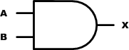 </p>

<br><br>

<div align="center">
  
| A | B | X = AB | 
|:----:|:----:|:----:|
| 0 | 0 | 0 | 
| 0 | 1 | 0 | 
| 1 | 0 | 0 | 
| 1 | 1 | 1 | 

</div>

아래는 2입력 AND 게이트에 임의의 파형을 입력하였을 때의 결과를 나타내는 그림이다.

<br><br>

<p align="center"> 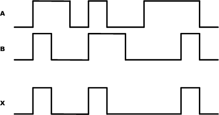 </p>

<br><br>

아래의 Verilog HDL 로직은 2입력 AND 게이트를 설계한 것이다.

```verilog
// CH2_AND2.V

module CH2_AND2(
  A, B,
  X
);

input A, B;
output X;

assign X = A & B;

endmodule
```

아래는 위의 로직을 시뮬레이션 하기 위한 테스트 벤치 파일이다. 테스트 벤치 파일은ModelSim등의 소프트웨어에서 시뮬레이션 하기 위해서 입력 신호를 설정해 주는 파일이다.이 테스트 벤치 파일은 하드웨어적으로 설정되지 않는다. 시뮬레이션만을 위한 파일이다.

```verilog
// CH2_AND2_TB.V

`timescale 10ns / 1ps

module TestBench;

// input
reg A, B;

//output
wire X;

// Instantiate the U1
CH2_AND2 U1(
  A,B,
  X
);

// Specify input stimulus
initial begin
    A <= 0; B <= 0;
#10 A <= 1; B <= 0;
#10 A <= 0; B <= 1;
#10 A <= 1; B <= 1;
end

endmodule
```

```verilog
 1  // CH2_AND2_TB.V
 2
 3  `timescale 10ns / 1ps
 4
 5  module TestBench;
 6
 7  // input
 8  reg A, B;
 9
10  //output
11  wire X;
12
13  // Instantiate the U1
14  CH2_AND2 U1(
15    A,B,
16    X
17  );
18
19  // Specify input stimulus
20  initial begin
21      A <= 0; B <= 0;
22
23  #10 A <= 1; B <= 0;
24
25  #10 A <= 0; B <= 1;
26
27  #10 A <= 1; B <= 1;
28
29  end
30
31  endmodule
```

이 테스트 벤치 파일은 먼저 3라인에서 시뮬레이션 할 시간 지연을 위한 기준 값을 정의하는분이다. 시뮬레이션 값을 입력해 주는 부분에서 “#10”과 같은 시간 지연 값을 적는데, 여기에서의 10은 timescale에서 정의한 기준 시간이 10번 지난 값을 의미한다. timescal에서 / 뒤의1ps의 값은 값의 해상도를 나타낸다.

13~17라인에서 앞에서 설계한 CH2_AND2 로직의 입출력 포트를 테스트 벤치 파일의 입 출력포트와 연결하는 구문이다.

19~29라인은 실제 값의 변화를 나타내는 구문이다.

21라인에서 초기 값은 A와 B가 0으로 설정되고, 23라인에서 #10이 되는 지연 후에(앞에서 선언한 timescale의 값이 10번되는 때, 여기에서는 100ns) A와 B의 값이 각각 1과 0으로 바뀐다.25라인과 27라인도 같은 방법으로 값이 바뀐다.

아래 그림은 위에서 작성한 테스트 벤치 파일을 ModelSim 소프트웨어에서 시뮬레이션 한 결과이다. ModelSim을 이용한 시뮬레이션 하는 방법은 “CH1.기초”의 “1.3 ModelSim을 이용한시뮬레이션” 편을 참고하기 바란다.

<br><br>

<p align="center"> 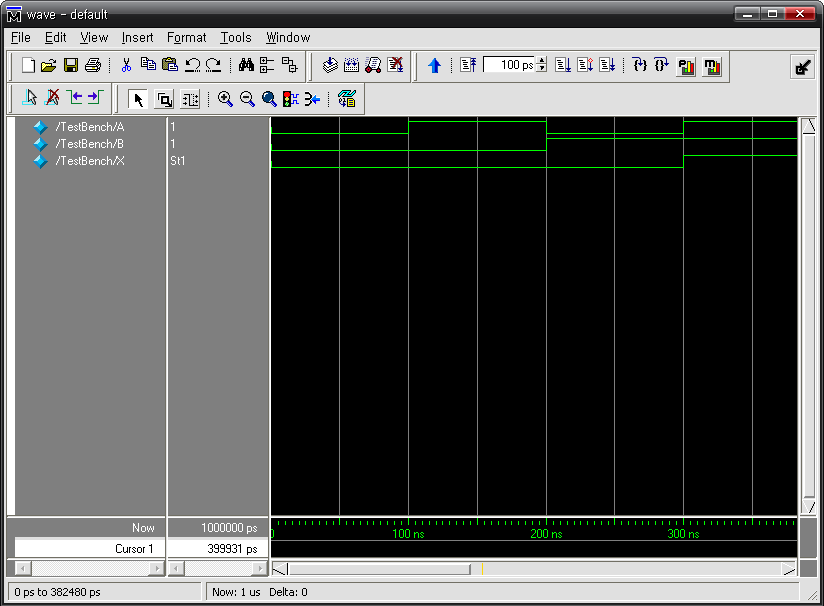 </p>

<br><br>

위의 예제를 HBE-Combo III 에서 동작시키기 위해서 아래와 같은 핀 설정을 해 주어야 한다.입력 A, B는 각각 Button Switch의 SW1, SW2에 연결하고, 출력 결과 X는 LED1에 핀 설정하여결과를 장비에서 확인할 수 있도록 한다.

<div align="center">
  
| 포트 이름 | 핀 번호 | 하드웨어 설명 | 포트 이름 | 핀 번호 | 하드웨어 설명 | 
|:-------:|:-------:|:-------:|:-------:|:-------:|:-------:|
| A | V4 | SW1 | X | AE11 | LED1 | 
| B | V3 | SW2 | | | | 

</div>
  
핀 설정 후 컴파일 한다.

HBE-Combo III 장비에 다운로딩 하고, 위의 진리표와 같이 결과가 나타나는지를 확인해 본다.

<br><br>

---

<br><br>

### (2) OR 게이트

OR 연산은 입력 중 어느 하나라도 1이 되면 결과가 1이 되는 연산이다. 

아래 그림은 2입력 OR 게이트의 논리 기호이다. OR 게이트의 출력은 논리 입력의 OR 연산을수행한다. OR 게이트는 입력 중 어느 하나라도 High일 때, 출력이 High가 되는 회로이다. 입력이 모두 Low이어야 Low값이 출력된다.


<br><br>

<p align="center"> 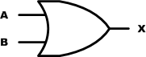 </p>

<br><br>

<div align="center">

| A | B | X = A + B | 
|:----:|:----:|:----:|
| 0 | 0 | 0 | 
| 0 | 1 | 1 | 
| 1 | 0 | 1 | 
| 1 | 1 | 1 | 

</div>

아래는 2 입력 OR 게이트에 임의의 파형을 입력하였을 때의 결과를 나타내는 그림이다.

<br><br>

<p align="center"> 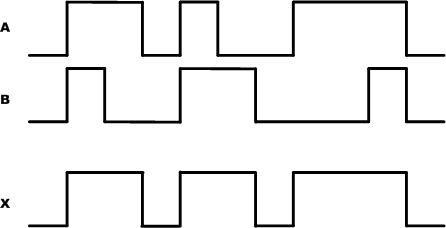 </p>

<br><br>

아래의 VERILOG HDL 로직은 2입력 OR 게이트를 설계한 것이다

```verilog
.// CH2_OR2.Vm

odule CH2_OR2(
  A, B,
  X
);

input A, B;
output X;

assign X = A | B;

endmodule
```

```verilog
1:  // CH2_OR2.v
2:
3:  module CH2_OR2(
4:    A, B,
5:    X
6:  );
7:
8:  input A, B;
9:  output X;
10:
11: assign X = A | B;
12:
13: endmodule
```

아래는 이 예제를 시뮬레이션 하기 위한 테스트 벤치 파일과 ModelSim으로 시뮬레이션 한결과이다.

```verilog
// CH2_OR2_TB.V

`timescale 10ns / 1ps

module TestBench;

// input
reg A, B;

//output
wire X;

// Instantiate the U1
CH2_OR2 U1(
A,   B,
X
);

// Specify input stimulus
initial begin
      A <= 0;B <= 0;

#10    A <= 1;  B <= 0;

#10    A <= 0;  B <= 1;

#10    A <= 1;  B <= 1;

end

endmodule
```

```verilog
1:  // CH2_OR2_TB.V
2:
3:  `timescale 10ns / 1ps
4:
5:  module TestBench;
6:
7: // input
8: reg A, B;
9:
10: //output
11: wire X;
12:
13: // Instantiate the U1
14: CH2_OR2 U1(
15: A,   B,
16: X
17: );
18:
19: // Specify input stimulus
20: initial begin
21:       A <= 0;B <= 0;
22:
23: #10    A <= 1;  B <= 0;
24:
25: #10    A <= 0;  B <= 1;
26:
27: #10    A <= 1;  B <= 1;
28:
29: end
30:
31: endmodule
```

<br><br>

<p align="center"> 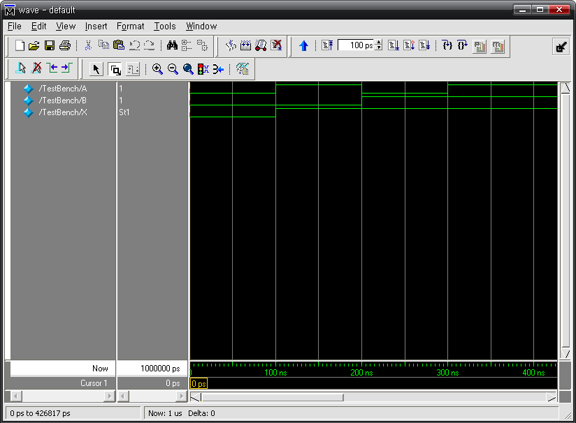 </p>

<br><br>

위의 예제를 HBE-Combo III에서 동작시키기 위해서 아래와 같은 핀 설정을 해 주어야 한다.

입력 A, B는 각각 Button Switch의 SW1, SW2에 연결하고, 출력 결과 X는 LED1에 핀 설정하여결과를 장비에서 확인할 수 있도록 한다.

<div align="center">
  
| 포트 이름 | 핀 번호 | 하드웨어 설명 | 포트 이름 | 핀 번호 | 하드웨어 설명 | 
|:-----:|:-----:|:-----:|:-----:|:-----:|:-----:|
| A | V4 | SW1 | X | AE11 | LED1 | 
| B | V3 | SW2 |  |  |  | 

</div>

핀 설정 후 컴파일 한다.

HBE-Combo III 장비에 다운로딩 하고, 위의 진리표와 같이 결과가 나타나는지를 확인해 본다.

<br><br>

---

<br><br>

### (3) NOT 게이트

NOT 연산은 입력 논리 값의 반대가 출력되는 연산이다. 출력 값을 입력 값의 역 또는 보수라고 말할 수도 있다.

아래 그림은 NOT 게이트의 논리 기호로 인버터(inverter)라고 부르기도 한다. 이 회로는 항상1개의 입력을 가지고 있으며, 출력은 입력 논리 값의 반대 값을 가지게 된다. 즉 High의 값이입력되면, Low의 값이 출력되기 된다.

<br><br>

<p align="center"> 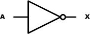 </p>

<br><br>

<div align="center">

| A | X = /A(not A) | 
|:----:|:----:|
| 0 | 0 |
| 0 | 1 |

</div>

아래는 NOT 게이트에 임의의 파형을 입력하였을 때의 결과를 나타내는 그림이다.

<br><br>

<p align="center"> 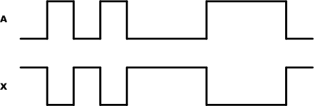 </p>

<br><br>

NOT 게이트는 VERILOG HDL 문법에서 아래와 같이 구현할 수 있다.

```verilog
// CH2_NOT.V

module CH2_NOT(
  A,
  X
);

input A;
output X;

assign X = ~ A;

endmodule
```

```verilog
1:  // CH2_NOT.V
2:
3:
4:  module CH2_NOT(
5:    A,
6:    X
7:  );
8:
9:
10: input A;
11: output X;
12:
13:
14: assign X = ~ A;
15:
16:
17: endmodule
```

아래는 이 예제를 시뮬레이션 하기 위한 테스트 벤치 파일과 ModelSim으로 시뮬레이션 한결과이다.

```verilog
// CH2_NOT_TB.V
`timescale 10ns / 1ps

module TestBench;

// input
reg A;

//output
wire X;

// Instantiate the U1CH2_NOT U1(
A,
X
);

// Specify input stimulus
initial begin
  A <= 0;

#10A <= 1;

#10A <= 0;

#10A <= 1;

end

endmodule
```

```verilog
1:  // CH2_NOT_TB.V
2:
3:  `timescale 10ns / 1ps
4:
5:  module TestBench;
6:
7:  // input
8:  reg A;
9:
10: //output
11: wire X;
12:
13: // Instantiate the U1
14: CH2_NOT U1(
15: A,
16: X
17: );
18:
19: // Specify input stimulus
10: initial begin
21:   A <= 0;
22:
23: #10A <= 1;
24:
25: #10A <= 0;
26:
27: #10A <= 1;
28:
29: end
30:
31: endmodule
```

<br><br>

<p align="center"> 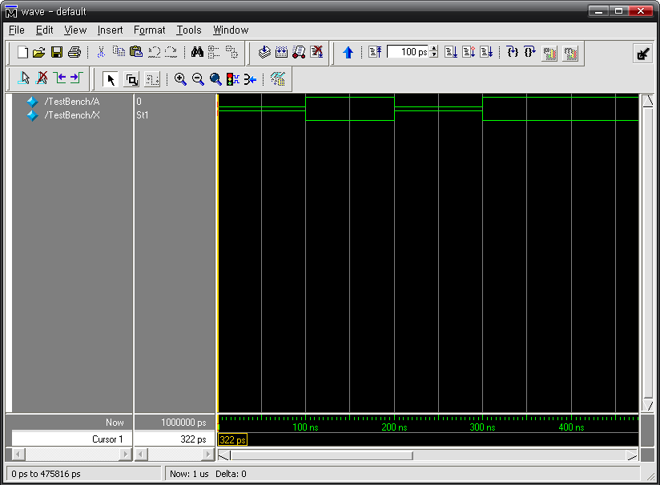 </p>

<br><br>

위의 예제를 HBE-Combo III에서 동작시키기 위해서 아래와 같은 핀 설정을 해 주어야 한다.

입력 A는 각각 Button Switch의 SW1 에 연결하고, 출력 결과 X는 LED1에 핀 설정하여 결과를 장비에서 확인할 수 있도록 한다.

<div align="center">
  
| 포트 이름 | 핀 번호 | 하드웨어 설명 | 포트 이름 | 핀 번호 | 하드웨어 설명 | 
|:-----:|:-----:|:-----:|:-----:|:-----:|:-----:|
| A | V4 | SW1 | X | AE11 | LED1 | 
</div>
  
핀 설정 후 컴파일 한다.H

BE-Combo III 장비에 다운로딩 하고, 위의 진리표와 같이 결과가 나타나는지를 확인해 본다.

<br><br>

---

<br><br>

## 6.3. NAND, NOR 연산

NAND와 NOR 연산은 앞에서 설명한 OR, AND와 NOT 연산을 조합한 것이다.

### (1) NAND

아래 그림은 NAND 게이트의 논리 회로를 나타낸 그림이다.

<br><br>

<p align="center"> 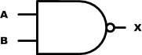 </p>

<br><br>

<div align="center">
  
| A | B | AB | X = /(AB) | 
|:----:|:----:|:----:|:----:|
| 0 | 0 | 0 | 1 | 
| 0 | 1 | 1 | 1 | 
| 1 | 0 | 1 | 1 | 
| 1 | 1 | 1 | 0 | 

</div>
  
NAND 게이트는 AND 게이트와 모양이 비슷하고, 출력에 원이 붙어 있는 차이가 있다. NAND게이트는 AND 게이트에 인버터가 붙은 것으로 아래 그림과 같이 표현 할 수 있다.

<br><br>

<p align="center"> 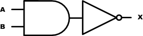 </p>

<br><br>

아래는 NAND 게이트에 임의의 파형을 입력하였을 때의 결과를 나타내는 그림이다.

<br><br>

<p align="center"> 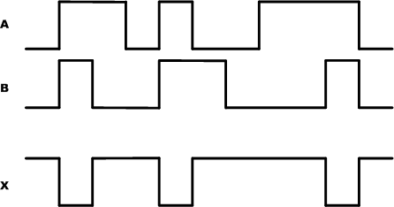 </p>

<br><br>

NAND 게이트는 VERILOG HDL 문법에서 아래의 구문으로 사용할 수 있다. 

```verilog
.// CH2_NAND2.V

module CH2_NAND2(
A, B,
X
);

input A, B;
output X;

wire X;

assign X = ~ (A & B);

endmodule
```

```verilog
1:  // CH2_NAND2.V
2:
3:  module CH2_NAND2(
4:  A, B,
5:  X
6:  );
7:
8: input A, B;
9: output X;
10:
11: wire X;
12:
13: assign X = ~ (A & B);
14:
25: endmodule
```

아래는 이 예제를 시뮬레이션 하기 위한 테스트 벤치 파일과 ModelSim으로 시뮬레이션 한결과이다.

```verilog
// CH2_NAND2_TB.V

`timescale 10ns / 1ps

module TestBench;

// input
reg A, B;

//output
wire X;

// Instantiate the U1
CH2_NAND2 U1(
A,   B,
X/
);

/ Specify input stimulus
initial begin
      A <= 0;B <= 0;
#10  A <= 1;  B <= 0;
#10  A <= 0;  B <= 1;
#10  A <= 1;  B <= 1;
end

endmodule
```

```verilog
1:  // CH2_NAND2_TB.V
2:
3:  `timescale 10ns / 1ps
4:
5:  module TestBench;
6:
7: // input
8: reg A, B;
9:
10: //output
11: wire X;
12:
13: // Instantiate the U1
14: CH2_NAND2 U1(
15: A,   B,
16: X/
17: );
18:
19: / Specify input stimulus
20: initial begin
21:       A <= 0;B <= 0;
22:
23: #10  A <= 1;  B <= 0;
24:
25: #10  A <= 0;  B <= 1;
26:
27: #10  A <= 1;  B <= 1;
28:
29: end
30:
31: endmodule
```

<br><br>

<p align="center"> 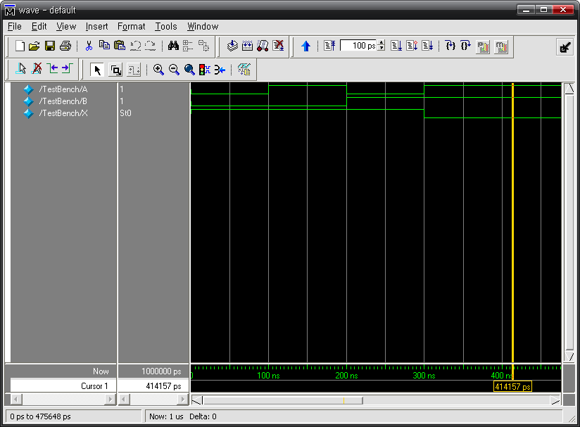 </p>

<br><br>

위의 예제를 HBE-Combo III에서 동작시키기 위해서 아래와 같은 핀 설정을 해 주어야 한다.

입력 A, B는 각각 Button Switch의 SW1, SW2에 연결하고, 출력 결과 X는 LED1에 핀 설정하여결과를 장비에서 확인할 수 있도록 한다.

<div align="center">
  
| 포트 이름 | 핀 번호 | 하드웨어 설명 | 포트 이름 | 핀 번호 | 하드웨어 설명 | 
|:-----:|:-----:|:-----:|:-----:|:-----:|:-----:|
| A | V4 | SW1 | X | AE11 | LED1 | 
| B | V3 | SW2 |  |  |  | 

</div>
  
핀 설정 후 컴파일 한다.

HBE-Combo III 장비에 다운로딩 하고, 위에서 설명한 로직에 대해 이해 하자,

<br><br>

---


<br><br>

### (2) NOR

아래 그림은 NOR 게이트의 논리 회로를 나타낸 그림이다.

<br><br>

<p align="center"> 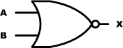 </p>

<br><br>

<div align="center">
  
| A | B | A + B | X = /(A + B) | 
|:----:|:----:|:----:|:----:|
| 0 | 0 | 0 | 1 | 
| 0 | 1 | 1 | 0 | 
| 1 | 0 | 1 | 0 | 
| 1 | 1 | 1 | 0 | 

</div>
  
NOR 게이트는 OR 게이트와 모양이 비슷하고, 출력에 원이 붙어 있는 차이가 있다. NOR 게이트는 OR 게이트에 인버터가 붙은 것으로 아래 그림과 같이 표현 할 수 있다.

<br><br>

<p align="center"> 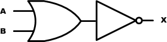 </p>

<br><br>

아래는 NOR 게이트에 임의의 파형을 입력하였을 때의 결과를 나타내는 그림이다.

<br><br>

<p align="center"> 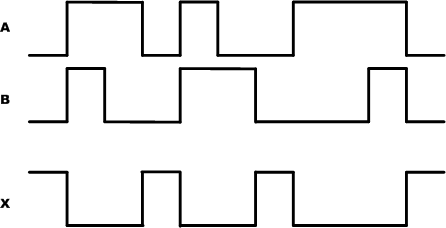 </p>

<br><br>

NOR 게이트는 VERILOG HDL 문법에서 아래의 구문으로 사용할 수 있다. 

```verilog
.// CH2_NOR2.V

module CH2_NOR2(
  A, B,
  X
);

input A, B;
output X;

assign X = ~ (A | B);

endmodule
```

```verilog
1:  // CH2_NOR2.V
2:
3:  module CH2_NOR2(
4:    A, B,
5:    X
6:  );
7:
8: input A, B;
9: output X;
10:
11: assign X = ~ (A | B);
12:
13: endmodule
```

아래는 이 예제를 시뮬레이션 하기 위한 테스트 벤치 파일과 ModelSim 으로 시뮬레이션 한결과이다.

```verilog
// CH2_NOR2_TB.V

`timescale 10ns / 1ps

module TestBench;

// input
reg A, B;

//output
wire X;

// Instantiate the U1
CH2_NOR2 U1(
A,   B,
X
);

// Specify input stimulus
initial begin
      A <= 0;B <= 0;

#10    A <= 1;  B <= 0;

#10    A <= 0;  B <= 1;

#10    A <= 1;  B <= 1;

end

endmodule
```

```
1:  // CH2_NOR2_TB.V
2:
3:  `timescale 10ns / 1ps
4:
5:  module TestBench;
6:
7: // input
8: reg A, B;
9:
10: //output
11: wire X;
12:
13: // Instantiate the U1
14: CH2_NOR2 U1(
15: A,   B,
16: X
17: );
18:
19: // Specify input stimulus
20: initial begin
21:       A <= 0;B <= 0;
22:
23: #10    A <= 1;  B <= 0;
24:
25: #10    A <= 0;  B <= 1;
26:
27: #10    A <= 1;  B <= 1;
28:
29: end
30:
31: endmodule
```

<br><br>

<p align="center"> 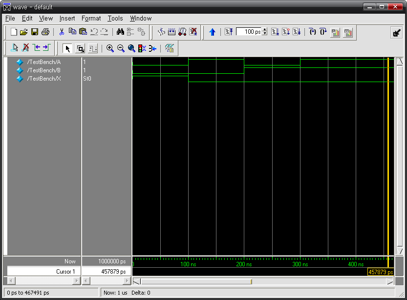 </p>

<br><br>

위의 예제를 HBE-Combo III에서 동작시키기 위해서 아래와 같은 핀 설정을 해 주어야 한다.

입력 A, B는 각각 Button Switch의 SW1, SW2에 연결하고, 출력 결과 X, Y는 LED1, 2에 핀 설정하여 결과를 장비에서 확인할 수 있도록 한다.

<div align="center">
  
| 포트 이름 | 핀 번호 | 하드웨어 설명 | 포트 이름 | 핀 번호 | 하드웨어 설명 | 
|:-----:|:-----:|:-----:|:-----:|:-----:|:-----:|
| A | V4 | SW1 | X | AE11 | LED1 | 
| B | V3 | SW2 |  |  |  | 

</div>
  
핀 설정 후 컴파일 한다. 

HBE-Combo III 장비에 다운로딩 하고, 위의 진리표와 같이 결과가나타나는지를 확인해 본다.

<br><br>

---


<br><br>

## 6.4. XOR, XNOR 연산

<br><br>

---


<br><br>

### (1) XOR

XOR는 배타적 OR라고도 하며, 두 입력이 서로 다른 값을 가질 때에만 출력이 High가 된다.

아래 그림인 이 XOR게이트의 논리 기호를 나타낸 것이다.

<br><br>

<p align="center"> 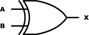 </p>

<br><br>

<div align="center">
  
| A | B |  X = A ⊕ B |
|:-:|:-:||:---------:|
| 0 | 0 |   0     |
| 0 | 1 |   1     |
| 1 | 0 |   1     |
| 1 | 1 |   0     |

</div>

이 XOR 를 AND 와 OR, NOT 게이트를 이용해서 표현하면 아래 그림과 같다.

<br><br>

<p align="center">  </p>

<br><br>

아래는 XOR 게이트에 임의의 파형을 입력하였을 때의 출력 결과를 나타낸 그림이다.

<br><br>

<p align="center"> 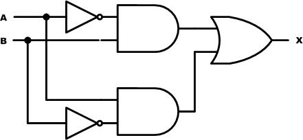 </p>

<br><br>

XOR 게이트는 VERILOG HDL 문법에서 아래의 구문으로 사용할 수 있다. 

```verilog
.// CH2_XOR2.V

module CH2_XOR2(
A, B,
X
);

input A, B;
output X;

assign X = A ^ B;

endmodule
```

```verilog
1:  // CH2_XOR2.V
2:
3:  module CH2_XOR2(
4:  A, B,
5:  X
6:  );
7:
8: input A, B;
9: output X;
10:
11: assign X = A ^ B;
12:
13: endmodule
```

아래는 이 예제를 시뮬레이션 하기 위한 테스트 벤치 파일과 ModelSim으로 시뮬레이션 한결과이다.

```verilog
// CH2_XOR2_TB.V

`timescale 10ns / 1ps

module TestBench;

// input
reg A, B;

//output
wire X;

// Instantiate the U1
CH2_XOR2 U1(
A,   B,
X
);

// Specify input stimulusin
itial begin
      A <= 0;B <= 0;
#10  A <= 1;  B <= 0;

#10  A <= 0;  B <= 1;

#10  A <= 1;  B <= 1;

endendmodule
```

```verilog
1:  // CH2_XOR2_TB.V
2:
3:  `timescale 10ns / 1ps
4:
5:  module TestBench;
6:
7: // input
8: reg A, B;
9:
10: //output
11: wire X;
12:
13: // Instantiate the U1
14: CH2_XOR2 U1(
15: A,   B,
16: X
17: );
18:
19: // Specify input stimulusin
20: itial begin
21:       A <= 0;B <= 0;
22:
23: #10  A <= 1;  B <= 0;
24:
25: #10  A <= 0;  B <= 1;
26:
27: #10  A <= 1;  B <= 1;
28:
29: end
30: 
31: endmodule
```

<br><br>

<p align="center"> 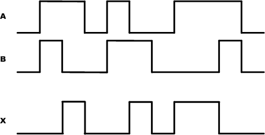 </p>

<br><br>


위의 예제를 HBE-Combo III에서 동작시키기 위해서 아래와 같은 핀 설정을 해 주어야 한다.

입력 A, B는 각각 Button Switch의 SW1, SW2에 연결하고, 출력 결과 X는 LED1에 핀 설정하여결과를 장비에서 확인할 수 있도록 한다.

<div align="center">
  
| 포트 이름 | 핀 번호 | 하드웨어 설명 | 포트 이름 | 핀 번호 | 하드웨어 설명 | 
|:-----:|:-----:|:-----:|:-----:|:-----:|:-----:|
| A | V4 | SW1 | X | AE11 | LED1 | 
| B | V3 | SW2 |  |  |  | 

</div>
  
핀 설정 후 컴파일 한다.

HBE-Combo III 장비에 다운로딩 하고, 위의 진리표와 같이 결과가 나타나는지를 확인해 본다.

<br><br>

---


<br><br>

### (2) XNOR

XNOR는 배타적 NOR라고도 하며, XOR와 반대로 동작한다. 즉 입력이 같을 때만 High가 출력된다.

아래 그림인 이 XNOR게이트의 논리 기호를 나타낸 것이다. NAND와 NOR의 경우와 같이XOR의 출력에 인버터를 붙였다고 생각하면 된다.

<br><br>

<p align="center"> 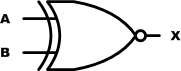 </p>

<p align="center"> 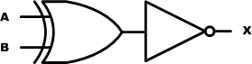 </p>

<br><br>

<div align="center">
  
| A | B | X = /(A ⊕ B) |
|:-:|:-:|:------------:|
| 0 | 0 |   1       |
| 0 | 1 |   0       |
| 1 | 0 |   0       |
| 1 | 1 |   1       |

</div>

XNOR 게이트를 AND, OR, NOT 게이트를 이용하여 아래 그림과 같이 구성할 수 있다.

<br><br>

<p align="center"> 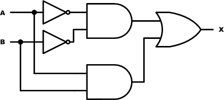 </p>

<br><br>

아래는 XNOR 게이트에 임의의 파형을 입력하였을 때의 출력 결과를 나타내는 그림이다.

<br><br>

<p align="center"> 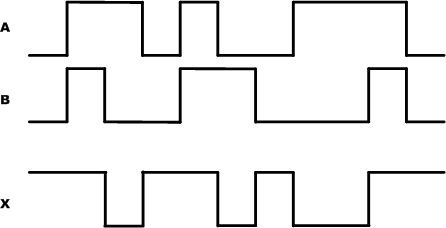 </p>

<br><br>

XNOR 게이트는 VERILOG HDL 문법에서 아래의 구문으로 사용할 수 있다.

```verilog
// CH2_XNOR2.V

module CH2_XNOR2(
A, B,
X
);

input A, B;
output X;

assign X = A ~^ B;

endmodule
```

```verilog
1:  // CH2_XNOR2.V
2:
3:  module CH2_XNOR2(
4:  A, B,
5:  X
6:  );
7:
8: input A, B;
9: output X;
10:
11: assign X = A ~^ B;
12:
13: endmodule
```


아래는 이 예제를 시뮬레이션 하기 위한 테스트 벤치 파일과 ModelSim으로 시뮬레이션 한결과이다.

```verilog
// CH2_XNOR2_TB.V

`timescale 10ns / 1ps

module TestBench;

// input
reg A, B;

//output
wire X;

// Instantiate the U1
CH2_XNOR2 U1(
A,   B,
X
);

// Specify input stimulus
initial begin
       A <= 0;B <= 0;
#10    A <= 1;  B <= 0;
#10    A <= 0;  B <= 1;
#10    A <= 1;  B <= 1;

end

endmodule
```

```verilog
1:  // CH2_XNOR2_TB.V
2:
3:  `timescale 10ns / 1ps
4:
5:  module TestBench;
6:
7: // input
8: reg A, B;
9:
10: //output
11: wire X;
12:
13: // Instantiate the U1
14: CH2_XNOR2 U1(
15: A,   B,
16: X
17: );
18:
19: // Specify input stimulus
20: initial begin
21:        A <= 0;B <= 0;
22:
23: #10    A <= 1;  B <= 0;
24:
25: #10    A <= 0;  B <= 1;
26:
27: #10    A <= 1;  B <= 1;
28:
29: end
30:
31: endmodule
```


<br><br>

<p align="center"> 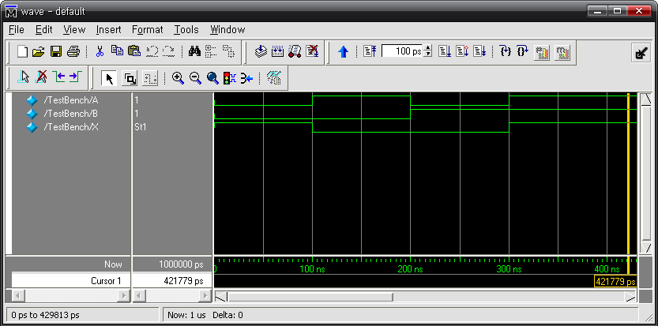 </p>

<br><br>

위의 예제를 HBE-Combo III에서 동작시키기 위해서 아래와 같은 핀 설정을 해 주어야 한다.

입력 A, B는 각각 Button Switch의 SW1, SW2에 연결하고, 출력 결과 X는 LED1에 핀 설정하여결과를 장비에서 확인할 수 있도록 한다.

<div align="center">
  
| 포트 이름 | 핀 번호 | 하드웨어 설명 | 포트 이름 | 핀 번호 | 하드웨어 설명 | 
|:-----:|:-----:|:-----:|:-----:|:-----:|:-----:|
| A | V4 | SW1 | X | AE11 | LED1 | 
| B | V3 | SW2 |  |  |  | 

</div>
  
핀 설정 후 컴파일 한다.

HBE-Combo III 장비에 다운로딩 하고, 위의 진리표와 같이 결과가 나타나는지를 확인해 본다.
