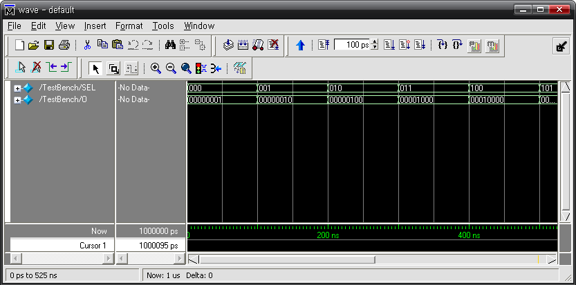
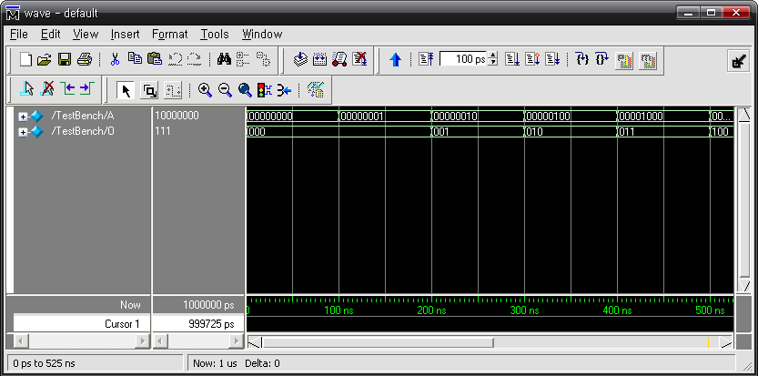

# 8. 조합 논리 회로

## 8.1. 개요

조합 논리 회로는 논리곱(AND), 논리합(OR), 논리 부정(NOT)의 세가지 기본 회로를 조합하여구성한 논리 회로로, 출력이 입력에 의해 결정되는 논리 회로를 말합니다. 이 회로는 논리 게이트로만 구성되며, 플립플롭과 같은 기억소자는 포함되지 않습니다.

이 장에서는 조합 논리 회로를 소개 하면서, HBE-Combo III 장비를 통한 동작의 확인을 할 수있도록 구성되어 있습니다.

## 8.2. 디코더, 인코더 설계

### (1) 디코더

디코더는 해독기라고도 한다. 이것은 임의의 입력 번호에 대응하는 출력만을 활성화시키는 논리 회로로, N 비트 2진 입력 신호를 M개(M=2N)의 출력 신호로 변환시키는 동작을 수행한다.

입력 조합에 대해서 M개의 출력 단자 중에서 1개만 High의 값이 출력되고, 나머지의 출력 단자에서는 Low의 값이 출력된다. 대부분의 디코더는 Low 상태를 이루도록 설계되어 있고, 선택된 출력 단자가 Low이면 다른 모든 단자는 High가 된다.

많이 사용되는 디코더로 3선-8선 디코더라 불리는 것이 있는데, 이것은 3개의 입력선과 8개의출력선을 갖고 있는 디코더를 말한다.

아래 표는 이 3선 8선 디코더의 진리표를 나타내고 있다.

<div align="center">
    
| SEL[2] | SEL[1] | SEL[0] | O7 | O6 | O5 | O4 | O3 | O2 | O1 | O0 | 
|:---:|:---:|:---:|:---:|:---:|:---:|:---:|:---:|:---:|:---:|:---:|
| 0 | 0 | 0 | 0 | 0 | 0 | 0 | 0 | 0 | 0 | 1 | 
| 0 | 0 | 1 | 0 | 0 | 0 | 0 | 0 | 0 | 1 | 0 | 
| 0 | 1 | 0 | 0 | 0 | 0 | 0 | 0 | 1 | 0 | 0 | 
| 0 | 1 | 1 | 0 | 0 | 0 | 0 | 1 | 0 | 0 | 0 | 
| 1 | 0 | 0 | 0 | 0 | 0 | 1 | 0 | 0 | 0 | 0 | 
| 1 | 0 | 1 | 0 | 0 | 1 | 0 | 0 | 0 | 0 | 0 | 
| 1 | 1 | 0 | 0 | 1 | 0 | 0 | 0 | 0 | 0 | 0 | 
| 1 | 1 | 1 | 1 | 0 | 0 | 0 | 0 | 0 | 0 | 0 | 

</div>

위의 3선 – 8선 디코더는 Verilog HDL로 아래와 같이 설계할 수 있다.

```verilog
// CH2_38DECODER.V

module CH2_38DECODER(SEL, O);
    input  [2:0] SEL;
    output [7:0] O;

    reg [7:0] O;

    always @(SEL) begin
        case (SEL)
            3'b000 : O = 8'b00000001;
            3'b001 : O = 8'b00000010;
            3'b010 : O = 8'b00000100;
            3'b011 : O = 8'b00001000;
            3'b100 : O = 8'b00010000;
            3'b101 : O = 8'b00100000;
            3'b110 : O = 8'b01000000;
            default : O = 8'b10000000;
        endcase
    end

endmodule
```

13~25라인의 CASE 문에 3선-8선 디코더의 동작 상황이 설계되어 있다. 이 구문에서 위에서의 진리표 내용이 그대로 사용되었다. 이렇게 디코더의 내용은 조건문을 통해서 쉽게 설계할수 있다.

아래는 이 예제를 시뮬레이션 하기 위한 테스트 벤치 파일과 ModelSim으로 시뮬레이션 한결과이다.

```verilog
// CH2_38DECODER_TB.V
`timescale 10ns / 1ps

module TestBench;

    // input
    reg [2:0] SEL;

    // output
    wire [7:0] O;

    // Instantiate the U1
    CH2_38DECODER U1(SEL, O);

    // Specify input stimulus
    initial begin
        SEL <= 3'b000;
        #10 SEL <= 3'b001;
        #10 SEL <= 3'b010;
        #10 SEL <= 3'b011;
        #10 SEL <= 3'b100;
        #10 SEL <= 3'b101;
        #10 SEL <= 3'b110;
        #10 SEL <= 3'b111;
        #10 $stop;
    end

endmodule
```

이 테스트 벤치파일은 3선-8선 디코더의 모든 입력 조건을 CH2_38DECODER에 전달하도록21 ~ 42라인에 구현되어 있다.

<br><br>

<p align="center">  </p>

<br><br>


위의 예제를 HBE-Combo III에서 동작시키기 위해서 아래와 같은 핀 설정을 해 주어야 한다.

3비트 입력 SEL[2:0]는 각각 Button Switch의 SW3, SW2, SW1에 연결하고, 출력 결과는 8개의LED에 핀 설정하여 결과를 장비에서 확인할 수 있도록 한다.

<div align="center">
    
| 포트 이름 | 핀 번호 | 하드웨어 설명 | 포트 이름 | 핀 번호 | 하드웨어 설명 | 
|:-------:|:-------:|:-------:|:-------:|:-------:|:-------:|
| SEL[2] | V4| SW1 | O[4] | AF7 | LED4 | 
| SEL[1] | V3 | SW2 | O[3] | AF8 | LED5 | 
| SEL[0] | V2S | W3 | O[2] | AF9 | LED6 | 
| O[7] | B3 | LED1 | O[1] | AE10 | LED7 | 
| O[6] | AF5 | LED2 | O[0] | AE11 | LED8 | 
| O[5] | AF6 | LED3 |  |  | 

</div>
핀 설정 후 컴파일 한다.

HBE-Combo III 장비에 다운로딩 하고, 위의 진리표와 같이 결과가 나타나는지를 확인해 본다.

### (2) 인코더

디코더는 특정 코드를 검출, 인식, 식별한다고 할 수 있다. 인코더는 이러한 디코더의 기능을반대로 하는 논리 회로를 말한다. 인코더는 여러 개의 입력 선을 갖고 이 중 하나가 주어진시간에 동작되고, 동작되는 입력에 따라서 N비트의 출력 코드가 생성된다.

예를 들어 3선-8선 디코더는 3비트의 입력 코드를 받아들여, 그 코드에 대한 8개의 출력 선중 하나에 High 값을 출력시킨다. 8선-3선 디코더는 이와 반대의 기능을 한다. 즉, 8개의 입력선을 받아 들여 입력 동작에 따라 3비트의 입력 코드를 생성한다.

아래 진리표는 8선-3선 인코더에 대한 진리표이다.

<div align="center">
    
| A0 | A1 | A2 | A3 | A4 | A5 | A6 | A7 | O2 | O1 | O0 |
|:--:|:--:|:--:|:--:|:--:|:--:|:--:|:--:|:--:|:--:|:--:|
| 1 | 0 | 0 | 0 | 0 | 0 | 0 | 0 | 0 | 0 | 0 |
| 0 | 1 | 0 | 0 | 0 | 0 | 0 | 0 | 0 | 0 | 1 |
| 0 | 0 | 1 | 0 | 0 | 0 | 0 | 0 | 0 | 1 | 0 |
| 0 | 0 | 0 | 1 | 0 | 0 | 0 | 0 | 0 | 1 | 1 |
| 0 | 0 | 0 | 0 | 1 | 0 | 0 | 0 | 1 | 0 | 0 |
| 0 | 0 | 0 | 0 | 0 | 1 | 0 | 0 | 1 | 0 | 1 |
| 0 | 0 | 0 | 0 | 0 | 0 | 1 | 0 | 1 | 1 | 0 |
| 0 | 0 | 0 | 0 | 0 | 0 | 0 | 1 | 1 | 1 | 1 |

</div>

위의 8선 – 3선 인코더는 Verilog HDL로 아래와 같이 설계할 수 있다.

```verilog
// CH2_83ENCODER.V

module CH2_83ENCODER(A, O);
    input  [7:0] A;
    output [2:0] O;

    reg [2:0] O;

    always @(A) begin
        case (A)
            8'b00000001 : O <= 3'b000;
            8'b00000010 : O <= 3'b001;
            8'b00000100 : O <= 3'b010;
            8'b00001000 : O <= 3'b011;
            8'b00010000 : O <= 3'b100;
            8'b00100000 : O <= 3'b101;
            8'b01000000 : O <= 3'b110;
            8'b10000000 : O <= 3'b111;
            default : O <= 3'b000;
        endcase
    end

endmodule
```
위의 로직에서 8선-3선 인코더의 진리표의 내용이 13~26라인의 CASE 문에 그대로 표시 되어있다.

디코더에서도 마찬가지이지만, 디코더와 인코더는 이렇게 Verilog HDL의 CASE문을 사용하여쉽게 표현할 수 있다. 물론 IF문으로 설계할 수도 있다.

IF문으로 설계 할 때에는 CASE문의 부분을 아래와 같이 바꾸어 주면 된다.

```verilog
always @(A) begin
    if      (A == 8'b00000001) O = 3'b000;
    else if (A == 8'b00000010) O = 3'b001;
    else if (A == 8'b00000100) O = 3'b010;
    else if (A == 8'b00001000) O = 3'b011;
    else if (A == 8'b00010000) O = 3'b100;
    else if (A == 8'b00100000) O = 3'b101;
    else if (A == 8'b01000000) O = 3'b110;
    else if (A == 8'b10000000) O = 3'b111;
    else O = 3'b000;
end
```

아래는 이 예제를 시뮬레이션 하기 위한 테스트 벤치 파일과 ModelSim으로 시뮬레이션 한결과이다.

```verilog
// CH2_83ENCODER_TB.V
`timescale 10ns / 1ps

module TestBench;

    // input
    reg [7:0] A;

    // output
    wire [2:0] O;

    // Instantiate the U1
    CH2_83ENCODER U1(A, O);

    // Specify input stimulus
    initial begin
        A = 8'b00000000;
        #10 A = 8'b00000001;
        #10 A = 8'b00000010;
        #10 A = 8'b00000100;
        #10 A = 8'b00001000;
        #10 A = 8'b00010000;
        #10 A = 8'b00100000;
        #10 A = 8'b01000000;
        #10 A = 8'b10000000;
        #10 $stop;
    end

endmodule
```

<br><br>

<p align="center">  </p>

<br><br>

위의 로직을 HBE-Combo III에서 동작시키기 위해서는 아래 표와 같이 핀 설정을 해 주어야한다.A의 입력은 BUS Switch의 8개 입력을 사용하였고, 출력은 LED 3개를 사용하여 결과를 확인할 수 있도록 핀을 설정한다.

<div align="center">
    
| 포트 이름 | 핀 번호 | 하드웨어 설명 | 포트 이름 | 핀 번호 | 하드웨어 설명 |
|:---:|:---:|:---:|:---:|:---:|:---:|
| A[7] | T6 | BUS SW0 | O[2] | AF9 | LED1 |
| A[6] | V1 | BUS SW1 | O[1] | AE10 | LED2 |
| A[5] | U7 | BUS SW2 | O[0] | AE11 | LED3 |
| A[4] | U6 | BUS SW3 |  |  |  |
| A[3] | U5 | BUS SW4 |  |  |  |
| A[2] | U4 | BUS SW5 |  |  |  |
| A[1] | V6 | BUS SW6 |  |  |  |
| A[0] | V5 | BUS SW7 |  |  |  |

</div>
    
핀 설정 후 컴파일 한다.

HBE-Combo III 장비에 다운로딩 하고, 위의 진리표와 같이 결과가 나타나는지를 확인해 본다.

## 8.3. 7-Segment 디코더 설계

7-Segment는 숫자나 문자를 display해 줄 수 있는 최소의 장치이다.

그 중 7-Segment 디코더는 4비트 BCD 입력에 대하여 7-Segment에 10진수를 display하기 위한 데이터로 변경하는 논리 회로이다. 이 7-Segment 디코더는 TTL에서는 7446 또는 7447이사용된다. 단, 결과값이 역으로 나오기 때문에 HBE-Combo III 장비에서 사용하기 위해서는7446과 7447의 출력에 인버터를 붙이는 회로로 설계하여야 한다.

아래에 4bit BCD 입력에 대한 7-Segment 디코더 출력 결과의 진리표와 이 출력 결과를 7-Segment에 연결하였을 때의 결과가 표시되어 있다.

<div align="center">
    
<table>
  <tr>
    <td style="vertical-align:middle; padding:0 16px 0 0;">
      
    </td>
    <td>
  
  <table>
    <thead>
      <tr>
        <th rowspan="2">10진수</th>
        <th colspan="4">4bit BCD</th>
        <th colspan="7">7-Segment Decoder</th>
      </tr>
      <tr>
        <th>D</th><th>C</th><th>B</th><th>A</th>
        <th>a</th><th>b</th><th>c</th><th>d</th><th>e</th><th>f</th><th>g</th>
      </tr>
    </thead>
    <tbody>
      <tr><td>0</td><td>0</td><td>0</td><td>0</td><td>0</td><td>1</td><td>1</td><td>1</td><td>1</td><td>1</td><td>1</td><td>0</td></tr>
      <tr><td>1</td><td>0</td><td>0</td><td>0</td><td>1</td><td>0</td><td>1</td><td>1</td><td>0</td><td>0</td><td>0</td><td>0</td></tr>
      <tr><td>2</td><td>0</td><td>0</td><td>1</td><td>0</td><td>1</td><td>1</td><td>0</td><td>1</td><td>1</td><td>0</td><td>1</td></tr>
      <tr><td>3</td><td>0</td><td>0</td><td>1</td><td>1</td><td>1</td><td>1</td><td>1</td><td>1</td><td>0</td><td>0</td><td>1</td></tr>
      <tr><td>4</td><td>0</td><td>1</td><td>0</td><td>0</td><td>0</td><td>1</td><td>1</td><td>0</td><td>0</td><td>1</td><td>1</td></tr>
      <tr><td>5</td><td>0</td><td>1</td><td>0</td><td>1</td><td>1</td><td>0</td><td>1</td><td>1</td><td>0</td><td>1</td><td>1</td></tr>
      <tr><td>6</td><td>0</td><td>1</td><td>1</td><td>0</td><td>1</td><td>0</td><td>1</td><td>1</td><td>1</td><td>1</td><td>1</td></tr>
      <tr><td>7</td><td>0</td><td>1</td><td>1</td><td>1</td><td>1</td><td>1</td><td>1</td><td>0</td><td>0</td><td>0</td><td>0</td></tr>
      <tr><td>8</td><td>1</td><td>0</td><td>0</td><td>0</td><td>1</td><td>1</td><td>1</td><td>1</td><td>1</td><td>1</td><td>1</td></tr>
      <tr><td>9</td><td>1</td><td>0</td><td>0</td><td>1</td><td>1</td><td>1</td><td>1</td><td>1</td><td>0</td><td>1</td><td>1</td></tr>
    </tbody>
  </table>
    </td>
  </tr>
</table>

</div>
    


이 7-Segment 디코더는 Verilog HDL을 이용하여 아래와 같이 설계할 수 있다.

```verilog
// CH2_SEG_DECODER.V

module CH2_SEG_DECODER(BCD, a, b, c, d, e, f, g);
    input  [3:0] BCD;
    output a, b, c, d, e, f, g;

    reg [6:0] DECODE;

    always @(BCD) begin
        case (BCD)
            4'b0000 : DECODE = 7'b1111110;  // 0
            4'b0001 : DECODE = 7'b0110000;  // 1
            4'b0010 : DECODE = 7'b1101101;  // 2
            4'b0011 : DECODE = 7'b1111001;  // 3
            4'b0100 : DECODE = 7'b0110011;  // 4
            4'b0101 : DECODE = 7'b1011011;  // 5
            4'b0110 : DECODE = 7'b1011111;  // 6
            4'b0111 : DECODE = 7'b1110000;  // 7
            4'b1000 : DECODE = 7'b1111111;  // 8
            4'b1001 : DECODE = 7'b1111011;  // 9
            default : DECODE = 7'b0000000;  // NULL
        endcase
    end

    assign {a, b, c, d, e, f, g} = DECODE;

endmodule
```

아래는 이 예제를 시뮬레이션 하기 위한 테스트 벤치 파일과 ModelSim으로 시뮬레이션 한결과이다.

```verilog
// CH2_SEG_DECODER_TB.V
`timescale 10ns / 1ps

module TestBench;

    // input
    reg [3:0] BCD;

    // output
    wire a, b, c, d, e, f, g;

    // Instantiate the U1
    CH2_SEG_DECODER U1(BCD, a, b, c, d, e, f, g);

    // Specify input stimulus
    initial begin
        BCD <= 4'b0000;
        #10 BCD <= 4'b0001;
        #10 BCD <= 4'b0010;
        #10 BCD <= 4'b0011;
        #10 BCD <= 4'b0100;
        #10 BCD <= 4'b0101;
        #10 BCD <= 4'b0110;
        #10 BCD <= 4'b0111;
        #10 BCD <= 4'b1000;
        #10 BCD <= 4'b1001;
    end

endmodule
```

이 테스트 벤치 파일에서 20~41라인은 CH2_SEG_DECODER의 BCD 입력에 주어야 할 데이터를 생성하는 블록이 구현되어 있다.위의 로직을 HBE-Combo III에서 동작시키기 위해서는 아래 표와 같이 핀 설정을 해 주어야한다. BCD의 입력은 BUS Switch의 4개 입력을 사용하였고, 출력은 7-Segment를 사용하여 결과를 확인할 수 있도록 핀을 설정한다.포트 이름핀 번호하드웨어 설명포트 이름핀 번호하드웨어 설명BCD[3]T6BUS SW0CL7SEG_CBCD[2]V1BUS SW1DL6SEG_DBCD[1]U7BUS SW2EL4SEG_EBCD[0]U6BUS SW3FP6SEG_FAM3SEG_AGP4SEG_GBM2SEG_B핀 설정 후 컴파일 한다.HBE-Combo III 장비에 다운로딩 하고, BUS Switch에 변화를 주었을 때 진리표와 같이 7-Segment에 결과가 나타나는지를 확인해 본다.

## 8.4. MUX, DEMUX 설계

### (1) MUX (Multiplexer)

멀티플렉서 또는 데이터 선택기(data selector)는 여러 개의 데이터 입력을 받아 그 중 하나를선택하여 출력하는 논리 회로이다. 출력할 데이터의 입력 단자는 선택 입력 신호에 의해 제어된다.N개의 입력 데이터 중 하나를 선택하고, 선택된 자료를 하나의 출력 채널에 전송하는 장치가멀티플렉서이다. 예를 들어 2입력 멀티플렉서는 2개의 입력과 입력 신호를 선택하기 위한 선택 입력 신호 그리고 선택된 입력 신호가 출력되는 1개의 출력으로 구성된다. 아래는 이 2입력 멀티플렉서를 블록으로 구성한 그림이다.2입력 멀티플렉서의 동작은 아래의 진리표와 같이 정의할 수 있다.SOutput0Z = I0Z= I1그리고, Verilog HDL을 이용해서 2입력 멀티플렉서를 설계하면 다음과 같다.// CH2_2MUX.Vmodule CH2_2MUX(I0, I1, S,Zinput I0, I1;input S;output Z;reg Z;always @(I0, I1, S)beginif ( S == 0 ) Z = I0;else Z = I1;endendmodule아래는 이 예제를 시뮬레이션 하기 위한 테스트 벤치 파일과 ModelSim으로 시뮬레이션 한결과이다.

```verilog
// CH2_2MUX_TB.V
`timescale 10ns / 1ps

module TestBench;

    // input
    reg I0, I1, S;

    // output
    wire Z;

    // Instantiate the U1
    CH2_2MUX U1(I0, I1, S, Z);

    // Specify input stimulus
    initial begin
        S <= 0;
        #50 S <= 1;
        #50 $stop;
    end

    always begin
        I0 = 0;
        #2 I0 = 1;
        #2;
    end

    always begin
        I1 = 0;
        #5 I1 = 1;
        #5;
    end

endmodule
```

이 테스트 벤치 파일에서 I0과 I1에 다른 데이터가 출력되는 것을 보여주기 위해서 40ns의 주기의 클럭 데이터를 출력하는 I0와 100ns의 주기의 클럭 데이터를 출력하는 I1을 25~37라인에서 구현하였다.아래의 시뮬레이션에서 S의 값이 0일 때와 1일 때 각각 어떤 데이터가 Z에 출력되는지를 확인해 보자.위의 로직을 HBE-Combo III에서 동작시키기 위해서는 아래 표와 같이 핀 설정을 해 주어야한다.입력 데이터 I0, I1은 SW1과 SW2로 핀 설정하고, 선택 신호 입력 S는 SW3으로 설정한다. 그리고, 그 결과는 LED1을 통해서 확인하도록 핀 설정한다.포트 이름핀 번호하드웨어 설명포트 이름핀 번호하드웨어 설명I0V4SW1SV2SW3I1V3SW2ZAE11LED1핀 설정 후 컴파일 한다.HBE-Combo III 장비에 다운로딩 하고, BUS Switch에 변화를 주었을 때 진리표와 같이 결과가나타나는지를 확인해 본다.위의 2입력 멀티플렉서와 동일한 개념으로 4입력 멀티플렉서를 설계 할 수 있다. 4입력 멀티플렉서는 2개의 선택 신호 입력의 조합에 따라 입력 단자가 선택적으로 전송된다는 것만 생각하면 된다.아래는 4입력 멀티플렉서를 블록으로 나타낸 그림과 이것의 동작을 나타내는 진리표이다.S1S0Output00Z = I00Z = I10Z = I2Z = I3위의 진리표의 결과를 보고 아래와 같이 4입력 멀티플렉서를 설계해 보자.

```verilog
// CH2_4MUX.V

module CH2_4MUX(I, S, Z);
    input  [3:0] I;
    input  [1:0] S;
    output Z;

    reg Z;

    always @(I, S) begin
        case (S)
            2'b00 : Z <= I[3];
            2'b01 : Z <= I[2];
            2'b10 : Z <= I[1];
            2'b11 : Z <= I[0];
            default : Z <= 0;
        endcase
    end

endmodule
```

이전의 2입력 멀티플렉서에서는 IF문으로 구성하였지만, 4입력 멀티플렉서에서는 CASE문으로이를 구성하였다.아래는 이 예제를 시뮬레이션 하기 위한 테스트 벤치 파일과 ModelSim으로 시뮬레이션 한결과이다.

```verilog
// CH2_4MUX_TB.V
`timescale 10ns / 1ps

module TestBench;

    // input
    reg [3:0] I;
    reg [1:0] S;

    // output
    wire Z;

    // Instantiate the U1
    CH2_4MUX U1(I, S, Z);

    // Specify input stimulus
    initial begin
        S <= 2'b00;
        #25 S <= 2'b01;
        #25 S <= 2'b10;
        #25 S <= 2'b11;
        #25 $stop;
    end

    always begin
        I[0] = 0;
        #1 I[0] = 1;
        #1;
    end

    always begin
        I[1] = 1;
        #3 I[1] = 0;
        #3;
    end

    always begin
        I[2] = 0;
        #5 I[2] = 1;
        #5;
    end

    always begin
        I[3] = 1;
        #9 I[3] = 0;
        #9;
    end

endmodule
```

28~50라인은 I[3:0]에 임의의 데이터를 생성하기 위한 부분이다. 각각에 다른 주기의 클럭 데이터를 생성하도록 구성하였다.아래의 시뮬레이션 결과에서 S의 선택 데이터 입력에 대하여 I가 선택되어 선택된 I[ ]에 해당하는 데이터가 Z로 출력되는 것을 확인할 수 있다.위의 로직을 HBE-Combo III에서 동작시키기 위해서는 아래 표와 같이 핀 설정을 해 주어야한다. 입력 데이터 I은 각각 SW1~SW4로 핀 설정하고, 선택 신호 입력 S는 BUS SW0~BUSSW1로 설정한다. 그리고, 그 결과 Z는 LED1을 통해서 확인하도록 핀 설정한다.포트 이름핀 번호하드웨어 설명포트 이름핀 번호하드웨어 설명I[0]V4SW1S[0]V5BUS SW1I[1]V3SW2S[1]V6BUS SW2I[2]V2SW3ZAE11LED1I[3]W4SW4핀 설정 후 컴파일 한다.HBE-Combo III 장비에 다운로딩 하고, BUS Switch에 변화를 주었을 때 진리표와 같이 결과가나타나는지를 확인해 본다.

### (2) DEMUX (Demultiplexer)

멀티플렉서는 여러 개의 입력을 받아 들여 그 중 하나를 출력으로 전송한다. 디멀티플렉서는이와 반대로 동작해서 하나의 입력을 받아들여 여러 개의 출력으로 분배한다. 다시 말해서 하나의 입력을 받아 들여 선택 신호 입력에 따라서 여러 개의 출력 중 1개를 선택하여 입력 받은 신호를 출력하는 것이 이 디멀티플렉서이다.예를 들어 1선-8선 디멀티플렉서의 경우 하나의 입력 선을 8개의 출력 선으로 분배하는 기능을 하는 논리 회로이다. 입력 선을 I, 선택 신호 입력 선을 S, 출력 선을 O라 할 때, 선택 신호입력 선에 따라서 출력 선 중 하나에 I의 값이 전달된다. 1선-8선 디멀티플렉서에서 S2, S1, S0의 값의 “000”이라면, 출력선의 O0에 I의 값이 전달되고, 선택 신호 입력 선 S의 값에 따라서출력 선인 O 중 하나에 I가 연결되도록 하는 것이다.아래 표는 1선-8선 디멀티플렉서의 동작을 나타내는 진리표이다.Select CodeOutputS2S1S0O7O6O5O4O3O2O1O00000000000I00000000I00000000I0000000I00000000I0000000I0000000I000000I1선-8선 디멀티플렉서는 아래와 같이 Verilog HDL로 설계된다.

```verilog
// CH2_18DEMUX.V

module CH2_18DEMUX(I, S, O);
    input  I;
    input  [2:0] S;
    output [7:0] O;

    wire [7:0] O;

    assign O[0] = (S == 3'b000) ? I : 1'b0;
    assign O[1] = (S == 3'b001) ? I : 1'b0;
    assign O[2] = (S == 3'b010) ? I : 1'b0;
    assign O[3] = (S == 3'b011) ? I : 1'b0;
    assign O[4] = (S == 3'b100) ? I : 1'b0;
    assign O[5] = (S == 3'b101) ? I : 1'b0;
    assign O[6] = (S == 3'b110) ? I : 1'b0;
    assign O[7] = (S == 3'b111) ? I : 1'b0;

endmodule
```

아래는 이 예제를 시뮬레이션 하기 위한 테스트 벤치 파일과 ModelSim으로 시뮬레이션 한결과이다.

```verilog
// CH2_18DEMUX_TB.V
`timescale 10ns / 1ps

module TestBench;

    // input
    reg I;
    reg [2:0] S;

    // output
    wire [7:0] O;

    // Instantiate the U1
    CH2_18DEMUX U1(I, S, O);

    // Specify input stimulus
    initial begin
        S <= 3'b000;
        #10 S <= 3'b001;
        #10 S <= 3'b010;
        #10 S <= 3'b011;
        #10 S <= 3'b100;
        #10 S <= 3'b101;
        #10 S <= 3'b110;
        #10 S <= 3'b111;
        #10 $stop;
    end

    always begin
        I = 1;
        #1 I = 0;
        #1;
    end

endmodule
```

22~32 라인은 선택 신호 S의 데이터를 생성하는 부분이고, 34~39라인은 임의의 데이터 I를생성하기 위한 부분이다.아래의 시뮬레이션 결과에서 S의 선택 데이터 입력에 대하여 I의 데이터가 선택된 O[ ]의 데이터에 전송되는 것을 확인 할 수 있다.위의 로직을 HBE-Combo III에서 동작시키기 위해서는 아래 표와 같이 핀 설정을 해 주어야한다.  입력 데이터 I은 각각 SW1 로 핀 설정하고, 선택 신호 입력 S는 BUS SW0~BUS SW2로설정한다. 그리고, 그 결과 O는 LED1~8을 통해서 확인할 수 있도록 핀 설정한다.포트 이름핀 번호하드웨어 설명포트 이름핀 번호하드웨어 설명IV4SW1O[5]AF6LED3S[2]U4BUS SW1O[4]AF7LED4S[1]V6BUS SW2O[3]AF8LED5S[0]V5BUS SW3O[2]AF9LED6O[7]B3LED1O[1]AE10LED7O[6]AF5LED2O[0]AE11LED8핀 설정 후 컴파일 한다.HBE-Combo III 장비에 다운로딩 하고, BUS Switch에 변화를 주었을 때 진리표와 같이 결과가나타나는지를 확인해 본다.

## 8.5. 크기 비교기

크기 비교기는 조합 논리 회로에서 많이 사용되며, 2개의 2진 입력의 크기를 비교하여 출력을발생시키는 논리 회로이다.아래는 4비트 크기 비교기인 TTL 7485의 논리 기호와 진리표이다.  A와 B단자는 데이터의 입력 단자이고, O는 비교한 결과를 나타내는 출력 단자이다. I는 비트 확장을 위한 단자로 8비트의 크기 비교를 할 때, 7485의 출력 결과를 I 단자에 연결하여 크기 비교를 할 수 있다.COMPARING INPUTIA>BIA=BIA<BOA>BOA=BOA<BA > BXXX00A = BXXX00A < BXXX00A = B0000A = B0000A = B0000A = B0000A = B0000이 4비트 비교기는 Verilog HDL로 아래와 같이 설계할 수 있다.

```verilog
// CH2_4COMPARE.V

module CH2_4COMPARE(A, B, O);
    input  [3:0] A, B;
    output [2:0] O;

    wire [2:0] O;

    assign O[2] = (A >  B) ? 1'b1 : 1'b0;  // A>B
    assign O[1] = (A == B) ? 1'b1 : 1'b0;  // A=B
    assign O[0] = (A <  B) ? 1'b1 : 1'b0;  // A<B

endmodule
```

아래 표는 위에서 Verilog HDL로 설계한 4비트 비교기의 진리표이다.COMPARING INPUTOA>BOA=BOA<BA > B00A = B00A < B00TTL 7485와 비교해서 I의 비트 확장을 위한 단자가 빠져있는데, Verilog HDL에서 비트의 확장은 숫자 값만 바꾸어 주면 되기 때문에 이 부분을 제외하였다.위의 Verilog HDL 로직에서 입력 단자로 선언한 A와 B의 벡터값을 아래와 같이 수정하면 8비트 비교기가 된다.input [7:0] A, B;아래는 4비트 비교기를 시뮬레이션 하기 위한 테스트 벤치 파일과 ModelSim으로 시뮬레이션한 결과이다.

```verilog
// CH2_4COMPARE_TB.V
`timescale 10ns / 1ps

module TestBench;

    // input
    reg [3:0] A, B;

    // output
    wire [2:0] O;

    // Instantiate the U1
    CH2_4COMPARE U1(A, B, O);

    // Specify input stimulus
    initial begin
        A <= 4'b0000;  B <= 4'b0000;
        #20 A <= 4'b1100;  B <= 4'b0111;
        #20 A <= 4'b1001;  B <= 4'b1001;
        #20 A <= 4'b0010;  B <= 4'b1010;
        #20 $stop;
    end

endmodule
```

A 와 B 의 값을 비교하였을 때의 결과가 아래의 시뮬레이션 결과에서 나타나고 있다.위의 4 비트 비교기를 HBE-Combo III 에서 동작시키기 위해서는 아래 표와 같이 핀 설정을 해주어야 한다.입력 데이터 A와 B는 각각 BUS SW1~4, BUS SW5~8로 핀 설정하고, 출력 결과는 LED1~3을통해 확인할 수 있도록 핀을 설정한다.포트 이름핀 번호하드웨어 설명포트 이름핀 번호하드웨어 설명A[3]T6BUS SW1B[1]V6BUS SW7A[2]V1BUS SW2B[0]V5BUS SW8A[1]U7BUS SW3O[2]AE11LED1A[0]U6BUS SW4O[1]AE10LED2B[3]U5BUS SW5O[0]AF9LED3B[2]U4BUS SW6핀 설정 후 컴파일 한다.HBE-Combo III 장비에 다운로딩 하고, BUS Switch에 변화를 주었을 때 진리표와 같이 결과가나타나는지를 확인해 본다.

## 8.6. 코드 변환기

코드 변환기는 2진 코드를 다른 형태의 2진 코드로 변환시키는 논리 회로이다. 앞에서 설계한7-Segment 디코더의 경우 BCD의 입력 값을 7-Segment 데이터로 변환시켰기 때문에 코드 변환기라 할 수 있다.코드 변환기의 예로 BCD-2진 변환기에 대해 설명하겠다.아래 그림은 이 BCD-2진 변환기의 블록도이다.D1, C1, B1, A1은 10의 자릿수이고, D0, C0, B0, A0는 1의 자릿수를 나타낸다.각 수를 그 크기에 대한 2 진수로 변환한 후, 전체 수를 더한 값이 최종 출력 결과가 된다.아래 표는 이 각 수에 대한 2진수를 표기한 것이다. 값은 각 자릿수의 값이 1일 때를 기준으로 표시되었다.BCD입력변환10 진수변환 2 진수BIN6BIN5BIN4BIN3BIN2BIN1BIN0A0000000B0000000C0000000D0000000A100000B100000C100000D100000예를 들어 십진수 72의 두 자리 수를 2진수로 변환시킨다고 가정하겠다.십진수 72는 십의 자릿수 7과 일의 자릿수 2로 구분된다. 위에서 설명한 형식에 맞도록 구성한다면, 먼저 7과 2를 각각 BCD 코드로 변환한다. 7은 D1, C1, B1, A1에 각각 “0111”의 값을 갖게 되고, 2는 D0, C0, B0, A0에 각각 “0010”의 값을 갖는다.위의 진리표와 대입하면,7210 = C1 + B1 + A1 + B0 = 01010002 + 00101002 + 00010102 + 00000102 = 10010002이런 결과가 나타난다.위의 BCD-2진 변환기는 Verilog HDL로 아래와 같이 설계할 수 있다. ONE와 TEN의 입력 포트는 각각 1의 자릿수와 10의 자릿수를 나타내고, 변환한 값을 BIN을 통해서 출력으로 내보낸다.

```verilog
// CH2_BCDCONVERTER.V

module CH2_BCDCONVERTER(ONE, TEN, BIN);
    input  [3:0] ONE, TEN;
    output [6:0] BIN;

    wire [6:0] REG1, REG2, REG3, REG4, REG5, REG6, REG7, REG8;

    assign REG1 = (ONE[0]) ? 7'b0000001 : 7'b0000000;
    assign REG2 = (ONE[1]) ? 7'b0000010 : 7'b0000000;
    assign REG3 = (ONE[2]) ? 7'b0000100 : 7'b0000000;
    assign REG4 = (ONE[3]) ? 7'b0001000 : 7'b0000000;
    assign REG5 = (TEN[0]) ? 7'b0001010 : 7'b0000000;
    assign REG6 = (TEN[1]) ? 7'b0010100 : 7'b0000000;
    assign REG7 = (TEN[2]) ? 7'b0101000 : 7'b0000000;
    assign REG8 = (TEN[3]) ? 7'b1010000 : 7'b0000000;

    assign BIN = REG1 + REG2 + REG3 + REG4 + REG5 + REG6 + REG7 + REG8;

endmodule
```

아래는 이 예제를 시뮬레이션 하기 위한 테스트 벤치 파일과 ModelSim으로 시뮬레이션 한결과이다.

```verilog
// CH2_BCDCONVERTER_TB.V
`timescale 10ns / 1ps

module TestBench;

    // input
    reg [3:0] ONE, TEN;

    // output
    wire [6:0] BIN;

    // Instantiate the U1
    CH2_BCDCONVERTER U1(ONE, TEN, BIN);

    // Specify input stimulus
    initial begin
        TEN = 4'b0000;  ONE = 4'b0000;
        #20 TEN = 4'b0111;  ONE = 4'b0110;
        #20 TEN = 4'b0001;  ONE = 4'b0010;
        #20 TEN = 4'b1001;  ONE = 4'b1001;
        #20 $stop;
    end

endmodule
```

위의ONE과 TEN의 데이터를 넣었을 때의 2진 데이터 출력 결과를 BIN에서 확인할 수 있다.위의 로직을 HBE-Combo III에서 동작시키기 위해서는 아래 표와 같이 핀 설정을 해 주어야한다. 입력 데이터 TEN과 ONE는 각각 BUS SW1~4, BUS SW5~8로 핀 설정하고, 출력 결과는LED1~7을 통해 확인할 수 있도록 핀을 설정한다.포트 이름핀 번호하드웨어 설명포트 이름핀 번호하드웨어 설명TEN[3]T6BUS SW1BIN[6]AE10LED1TEN[2]V1BUS SW2BIN[5]AF9LED2TEN[1]U7BUS SW3BIN[4]AF8LED3TEN[0]U6BUS SW4BIN[3]AF7LED4ONE[3]U5BUS SW5BIN[2]AF6LED5ONE[2]U4BUS SW6BIN[1]AF5LED6ONE[1]V6BUS SW7BIN[0]B3LED7ONE[0]V5BUS SW8핀 설정 후 컴파일 한다.HBE-Combo III 장비에 다운로딩 하고, BUS Switch에 변화를 주었을 때 LED에 진리표와 같이결과가 나타나는지를 확인해 본다.참고로, 위의 로직이 BCD-2진 변환기의 진리표를 그대로 적용시켜 설계하였다고 한다면,Verilog HDL의 연산 기능을 이용하여 쉽게 설계할 수 있다.위에서 제시하였던 숫자의 예인 72(10)는 10의 자릿수 7과 1의 자릿수 2로 나누어 지는데, 이것은 아래와 같은 수식으로 나타낼 수 있다. 아주 기본적인 내용이다.7210 = 7 X 10 + 27210는 BCD 체계로 변환하면 0111 00102으로 나타낼 수 있다. 이것을 위의 식과 대응해서7210 = 01112 X 10102 + 00102 = 10010002로 나타낼 수 있다.아래의 Verilog HDL로직은 위에서 설명한 방법으로 로직을 설계하였다.// CH2_BCDCONVERTER.Vmodule CH2_BCDCONV2(ONE, TEN,BINinput [3:0] ONE, TEN;output [6:0] BIN;wire [6:0] BUFF;wire [6:0] BIN;assign BUFF = TEN * 10;assign BIN = BUFF + ONE;endmodule위의 로직을 살펴 보면 14라인에서 십의 자리 숫자 TEN에 10을 곱하여 십의 자리의 수를BUFF를 만들고, 16라인에서 BUFF와 일의 자리 수 ONE를 더하여 BIN에 출력하도록 하였다.회로가 더 간단해 졌지만, 동작은 CH2_BCDCONVERTER와 같게 이루어진다.설계한 파일을 시뮬레이션과 장비에 다운로딩하여 같은 결과가 나오는지를 확인해 보자.
