# 9. 플립플롭과 응용

## 9.1. 개요

조합논리는 출력되는 결과가 입력으로 들어오는 값에 의해 정해 진다. 이전의 결과 또는 입력신호에 의해 동작이 구성되기 위해서는 그 값을 저장해 줄 기억 소자가 필요하다.

대부분의 디지털 시스템은 조합논리 회로와 기억 소자로 구성된다. 즉, 조합 논리 회로는 외부의 입력과 기억 소자의 출력으로부터 논리 신호를 받아 여러 출력 신호를 만들며, 출력 신호중 일부는 다시 기억 소자에 저장되는 방법으로 시스템이 구성된다.

아래 그림은 위의 설명을 블록도로 구성한 것이다.

<br><br>

<p align="center"> 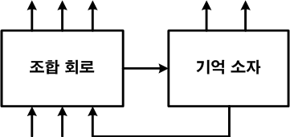 </p>

<br><br>

가장 많이 사용되는 기억 소자는 플립플롭(Flip-Flop)이다. 아래 그림은 플립플롭의 일반적인기호이다.

<br><br>

<p align="center"> 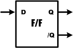 </p>

<br><br>

플립플롭은 보통 2개의 출력 단자를 갖고 있는데, 위의 기호에서 보이듯이 정상 플립플롭의출력을 나타내는 Q와 반전 플립플롭의 출력을 나타내는 /Q이다. 즉 /Q 단자에서는 항상 Q의역변환 된 상태값이 출력된다.

플립플롭은 두 가지의 동작 상태를 갖고 있다. 첫 째 세트(SET) 상태는 플립플롭의 입력이Q=1인 상태가 되도록 할 때를 말한다. 둘 째, 클리어(CLEAR) 또는 리셋(RESET) 상태는 플립플롭의 입력이 Q=0인 상태가 되도록 할 때를 말한다.

대부분의 플립플롭 입력은 플립플롭 출력 상태를 변화시키기 위하여 잠시 동안만 활성화해주면 되며, 출력은 입력 펄스가 없어진 후에도 새로운 출력 상태를 유지하는데, 이는 플립플롭이 그 상태를 기억하는 특성 때문이다.

### (1) 래치(Latch)

가장 기본적인 플립플롭 회로는 아래 그림과 같이 2개의 NAND 게이트 또는 2개의 NOR 게이트로 구성될 수 있다. 이렇게 구성된 플립플롭을 각각 NAND 게이트 래치와 NOR 게이트래치라고 한다.

<br><br>

<p align="center"> 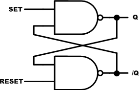 </p>

<p align="center"> 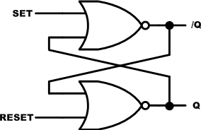 </p>

<br><br>

이 두 가지 래치의 동작에 대하여 간단하게 설명하면 다음과 같다.

먼저 NAND 게이트 래치는 아래의 함수표의 동작을 한다.

<div align="center">
  
| SET | RESET | OUTPUT |
|:---:|:---:|:---:|
| 1 | 1 | 변화 없음 |
| 0 | 1 | Q = 1 |
| 1 | 0 | Q = 0 |
| 0 | 0 | Invalid (Q = /Q = 1) |

</div>
  
SET = RESET = 1일 때, 부동 상태로 출력 상태에 아무런 영향을 미치지 않는다. Q와 /Q 출력은 입력이 들어가기 전의 상태를 유지한다.

SET = 0, RESET = 1 일 때, 출력은 항상 Q = 1인 상태로 만들며, 여기에서 SET 입력이 다시 1이 되어도 출력은 변하지 않는다. SET = RESET = 1일 때 이전의 값을 유지하기 때문이다. 이상태를 래치의 세트상태라고 한다.

SET = 1, RESET = 0 일 때, 출력은 항상 Q = 0인 상태로 만든다. 이 상태를 래치의 클리어 또는 리세트 상태라고 한다.

SET = RESET = 0 일 때, 이 조건은 래치의 세트와 리세트를 동시에 하려는 것으로, Q = /Q =1의 출력을 만든다. 만일 입력이 동시에 1로 돌아가면 출력 값을 예측 할 수 없게 때문에, 이입력 조건은 사용하지 않는다.

NOR게이트 래치는 아래의 함수표의 동작을 한다.

<div align="center">
  
| SET | RESET | OUTPUT |
|:---:|:---:|:---:|
| 0 | 0 | 변화 없음 |
| 1 | 0 | Q = 1 |
| 0 | 1 | Q = 0 |
| 1 | 1 | Invalid (Q = /Q = 0) |

</div>

SET = RESET = 0 일 때, 이것은 NOR 래치에 대한 일반적인 부동상태이고, 출력 상태에 아무런 영향을 주지 않는다. Q와 /Q는 이 입력이 인가되기 이전의 상태를 그대로 유지한다.

SET=1, RESET = 0 일 때, 항상 Q = 1로 만든다.SET = 0, RESET = 1 일 때, 항상 Q = 0으로 만든다.

SET = RESET = 1일 때, 이 조건은 동시에 래치를 세트와 리세트를 하게 되고, Q = /Q = 0의상태를 만든다. 만약 SET과 RESET이 동시에 0의 값으로 되면, 출력 상태를 예측할 수가 없기때문에 이 입력 조건은 사용되지 않는다.

SET과 RESET가 0일 때 동작하느냐, 1일 때 동작하느냐인 것을 제외하고, NOR 게이트 래치와NAND 게이트 래치는 똑 같이 동작한다.

### (2) S-R 플립플롭

S-R 플립플롭은 S-R 래치에 클럭의 입력이라는 부분을 추가했다고 생각하면 된다. 아래 그림은 이 S-R 플립플롭의 논리 회로를 나타낸 것이다.

<br><br>

<p align="center"> 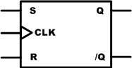 </p>

<br><br>

이 회로는 아래의 함수표와 같이 동작을 한다. 표를 살펴보면 알겠지만, NOR 게이트 래치와동작은 같다는 것을 알 수 있다. 이 S-R 플립플롭은 NOR 게이트 래치와 같이 동작이 되지만,출력 값 Q, /Q의 업데이트가 클럭의 Rising Edge에서 이루어 진다는 점에서 차이가 있다. 클럭이 발생하지 않으면 S, R 입력에 대하여 플립플롭은 응답하지 않는다.

<div align="center">
  
| S | R | CLK | Q | 
|:----:|:----:|:----:|:----:|
| 0 | 0 |  | Q(이전 값) | 
| 1 | 0 |  | 1 | 
| 0 | 1 |  | 0 | 
| 1 | 1 |  | 알 수 없는 값 |

</div>

아래 그림은 S-R 플립플롭에 임의의 신호를 입력하였을 때의 출력 결과를 나타낸 것이다.

<br><br>

<p align="center"> 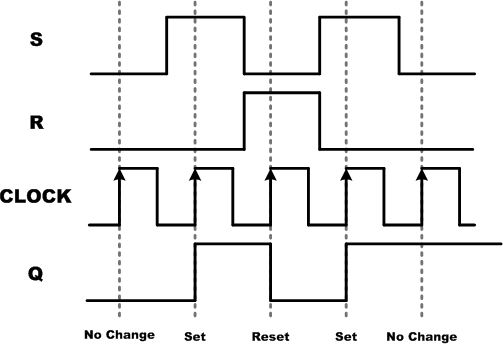 </p>

<br><br>

아래의 예제와 같이 Verilog HDL을 이용하여 S-R 플립플롭을 구현할 수 있다.

```verilog
// CH2_SRFF.V
module CH2_SRFF (S, R, CLK, Q);
    input  S, R, CLK;
    output Q;

    reg  BUFF;
    wire Q;

    always @(posedge CLK) begin
        if ({S, R} == 2'b00)
            BUFF = BUFF;
        else if ({S, R} == 2'b10)
            BUFF = 1'b1;
        else if ({S, R} == 2'b01)
            BUFF = 1'b0;
    end

    assign Q = BUFF;
endmodule
```

위의 함수표에서 나타난 동작 상태가 14~22라인에 구현되어 있다. S=R=1의 경우 출력 데이터가 모호한 데이터이기 때문에 NULL로 정의하였다.

아래는 이 예제를 시뮬레이션 하기 위한 테스트 벤치 파일과 ModelSim으로 시뮬레이션 한결과이다.

```verilog
// CH2_SRFF_TB.V
`timescale 10ns / 1ps

module TestBench;

    // input
    reg  S, R, CLK;
    // output
    wire Q;

    // Instantiate the U1
    CH2_SRFF U1 (S, R, CLK, Q);

    // Specify input stimulus
    initial begin
        S = 1'b0; R = 1'b0; CLK = 0;
        #20 S = 1'b0; R = 1'b1;
        #20 S = 1'b0; R = 1'b0;
        #20 S = 1'b1; R = 1'b0;
        #20 S = 1'b0; R = 1'b0;
    end

    always begin
        CLK = 0; #10;
        CLK = 1; #10;
    end

endmodule
```

S와 R에 데이터를 입력하고, CLK의 Rising Edge에서 Q의 값이 출력되는 것을 확인할 수 있다.

<br><br>

<p align="center"> 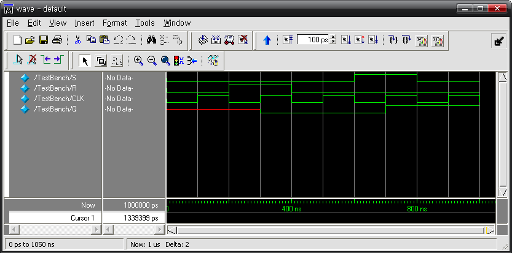 </p>

<br><br>


위의 로직을 HBE-Combo III에서 동작시키기 위해서는 아래 표와 같이 핀 설정을 해 주어야한다.입력 데이터 S, R, CLK에 각각 버튼 스위치 SW1~3을 연결하고, 출력 결과 Q에 LED1을연결하여 동작을 확인한다.

<div align="center">
  
| 포트 이름 | 핀 번호 | 하드웨어 설명 | 포트 이름 | 핀 번호 | 하드웨어 설명 |
|:---:|:---:|:---:|:---:|:---:|:---:|
| S | V4 | SW1 | CLK | V2 | SW3 |
| R | V3 | SW2 | Q | AE11 | LED1 |

</div>

핀 설정 후 컴파일 한다.HBE-Combo III 장비에 다운로딩 하고, 그 결과를 확인하여 S-R 플립플롭의 동작에 대하여 이해해 보자.

### (3) J-K 플립플롭

아래 그림은 클럭의 입력을 갖는 J-K 플립플롭을 나타내는 논리 회로이다.

<br><br>

<p align="center"> 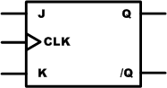 </p>

<br><br>

J-K 플립플롭은 J=K=1인 조건에서 모호한 출력 상태를 갖지 않는다는 동작을 제외하고는 위에서 설명한 S-R 플립플롭과 동일한 상태를 제어한다. J=K=1인 조건에서 플립플롭은 클럭의신호에 대하여 항상 출력 값을 반전시킨다. 즉 이전에 출력된 값을 반전시킨 값이 출력된다.이것을 플립플롭의 토글 모드(Toggle Mode)라고 한다.

아래의 표는 이 J-K 플립플롭의 동작 상태를 나타내는 함수표이다.

<div align="center">
  
| J | K | CLK | Q | 
|:----:|:----:|:----:|:----:|
| 0 | 0 |  | Q(이전 값) | 
| 1 | 0 |  | 1 | 
| 0 | 1 |  | 0 | 
| 1 | 1 |  | /Q(이전 값 토글) |

</div>

다음 그림은 J-K 플립플롭에 임의의 신호를 입력하였을 때의 출력 결과를 나타낸 것이다.

<br><br>

<p align="center"> 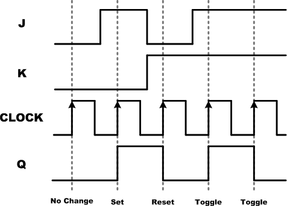 </p>

<br><br>

아래의 예제와 같이 Verilog HDL을 이용하여 J-K 플립플롭을 구현할 수 있다.

```verilog
// CH2_JKFF.V
module CH2_JKFF (J, K, CLK, Q);
    input  J, K, CLK;
    output Q;

    reg  BUFF;
    wire Q;

    always @(posedge CLK) begin
        if ({J, K} == 2'b00)
            BUFF = BUFF;
        else if ({J, K} == 2'b10)
            BUFF = 1'b1;
        else if ({J, K} == 2'b01)
            BUFF = 1'b0;
        else
            BUFF = ~BUFF;
    end

    assign Q = BUFF;
endmodule
```

J-K 플립플롭의 동작을 나타내는 함수표의 내용이 14~25라인에 구현되어 있다. 이전의 S-R플립플롭과의 차이는 22~23라인의 ELSE 부분에서 출력 Q에 이전의 Q를 반전시킨 값을 전달하는 부분이다.

아래는 이 예제를 시뮬레이션 하기 위한 테스트 벤치 파일과 ModelSim으로 시뮬레이션 한결과이다.

```verilog
// CH2_JKFF_TB.V
`timescale 10ns / 1ps

module TestBench;

    // input
    reg  J, K, CLK;
    // output
    wire Q;

    // Instantiate the U1
    CH2_JKFF U1 (J, K, CLK, Q);

    // Specify input stimulus
    initial begin
        J = 1'b0; K = 1'b0; CLK = 0;
        #20 J = 1'b0; K = 1'b1;
        #20 J = 1'b1; K = 1'b0;
        #20 J = 1'b1; K = 1'b1;
    end

    always begin
        CLK = 0; #10;
        CLK = 1; #10;
    end

endmodule
```

J와 K에 데이터를 입력하고, CLK의 Rising Edge에서 Q의 값이 출력되는 것을 확인할 수 있다.

<br><br>

<p align="center"> 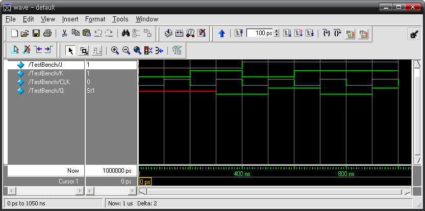 </p>

<br><br>

위의 로직을 HBE-Combo III에서 동작시키기 위해서는 아래 표와 같이 핀 설정을 해 주어야한다. 입력 데이터 J, K, CLK에 각각 버튼 스위치 SW1~3을 연결하고, 출력 결과 Q에 LED1을연결하여 동작을 확인한다.

<div align="center">
  
| 포트 이름 | 핀 번호 | 하드웨어 설명 | 포트 이름 | 핀 번호 | 하드웨어 설명 |
|:---:|:---:|:---:|:---:|:---:|:---:|
| J | V4 | SW1 | CLK | V2 | SW3 |
| K | V3 | SW2 | Q | AE11 | LED1 |

</div>
  
핀 설정 후 컴파일 한다.HBE-Combo III 장비에 다운로딩 하고, 그 결과를 확인하여 J-K 플립플롭의 동작에 대하여 이해해 보자.

### (4) D 플립플롭

아래 그림은 클럭의 입력을 갖는 D 플립플롭을 나타내는 논리 회로이다.

<br><br>

<p align="center"> 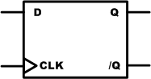 </p>

<br><br>

D 플립플롭은 S-R 플립플롭이나 J-K 플립플롭과는 달리 오직 하나의 데이터 입력 D를 갖는다.이 플립플롭의 동작은 간단하게 클럭이 발생하였을 때 D입력의 상태를 Q에 전달한다.

아래의 표는 이 D 플립플롭의 동작 상태를 나타내는 함수표이다.

<div align="center">
  
| D | CLK | Q | 
|:----:|:----:|:----:|
| 0 | 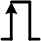 | 0 | 
| 1 |  | 1 | 

</div>

아래 그림은 D 플립플롭에 임의의 신호를 입력하였을 때의 출력 결과를 나타낸 것이다.

<br><br>

<p align="center"> 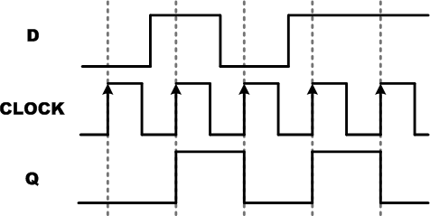 </p>

<br><br>

아래의 예제와 같이 Verilog HDL을 이용하여 D 플립플롭을 구현할 수 있다.

```verilog
// CH2_DFF.V
module CH2_DFF (D, CLK, Q);
    input  D, CLK;
    output Q;

    reg Q;

    always @(posedge CLK) begin
        Q = D;
    end
endmodule
```

위의 로직의 17~22라인은 클럭의 Rising Edge에서 D의 값을 Q에 전달하는 D 플립플롭이 구현되어 있다.아래는 이 예제를 시뮬레이션 하기 위한 테스트 벤치 파일과 ModelSim으로 시뮬레이션 한결과이다.

```verilog
// CH2_DFF_TB.V
`timescale 10ns / 1ps

module TestBench;

    // input
    reg  D, CLK;
    // output
    wire Q;

    // Instantiate the U1
    CH2_DFF U1 (D, CLK, Q);

    // Specify input stimulus
    initial begin
        D = 0; CLK = 0;
        #20 D = 1;
        #25 D = 0;
        #10 D = 1;
    end

    always begin
        CLK = 0; #1;
        CLK = 1; #1;
    end

endmodule
```

아래의 시뮬레이션의 결과에서 D의 입력에 의해 출력 Q의 데이터가 바로 바뀌는 것이 아니라, CLK의 Rising Edge일 때의 D값이 Q에 출력되는 것을 확인할 수 있다.위의 로직을 HBE-Combo III에서 동작시키기 위해서는 아래 표와 같이 핀 설정을 해 주어야한다. 입력 데이터 D, CLK에 각각 버튼 스위치 SW1~2을 연결하고, 출력 결과 Q에 LED1을 연결하여 동작을 확인한다.

<div align="center">
  
| 포트 이름 | 핀 번호 | 하드웨어 설명 | 포트 이름 | 핀 번호 | 하드웨어 설명 |
|:---:|:---:|:---:|:---:|:---:|:---:|
| D | V4 | SW1 | Q | AE11 | LED1 |
| CLK | V3 | SW2 |  |  |  |

</div>

핀 설정 후 컴파일 한다.HBE-Combo III 장비에 다운로딩 하고, 그 결과를 확인하여 D 플립플롭의 동작에 대하여 이해해 보자.

## 9.2. 데이터의 저장과 전송

플립플롭을 데이터를 저장하는 용도로 많이 사용된다. 데이터는 숫자 값이나 2진으로 부호화된 여러 종류의 데이터를 말한다. 이러한 데이터를 일반적으로 레지스터(register)라고 불리는플립플롭 그룹에 저장되는데, 데이터를 이 레지스터에 저장하기 위하여 수행하는 동작을 데이터 전송(data transfer)라고 한다.아래 그림은 클록의 입력을 갖는 D 플립플롭에서 데이터 전송이 이루어 지는 과정을 나타내고 있다.이전의 플립플롭 A에 저장되어 있는 논리 값이 클럭이 ‘0’에서 ‘1’로 변하는 순간(rising edge)에 플립플롭 B로 전송된다. 이런 방법으로 클럭이 발생한 후에는 A의 출력과 B의 출력이 같아진다.다음 그림은 레지스터에서 다른 레지스터로 데이터가 전송되는 것을 보여주는 것이다.레지스터 A는 A3, A2, A1, A0의 4개의 플립플롭으로 구성되어 있고, 레지스터 B는 B3, B2, B1, B0의 4개의 플립플롭으로 구성된다. 클럭이 인가되면 클럭의 Rising Edge일 때, 레지스터 A에저장되어 있는 A3, A2, A1, A0의 데이터는 레지스터 B의 각각 B3, B2, B1, B0으로 전송된다. 이렇게 여러 개의 데이터가 동시에 전송되는 방식을 병렬 데이터 전송이라고 하며, 레지스터 A의내용이 한번에 1비트씩 레지스터 B로 전송되는 방식을 직렬 데이터 전송이라고 한다.병렬 전송은 송신 측의 레지스터 내용은 변하지 않는다는 것을 이해 하는 것이 중요하다. 위의 그림에서 레지스터 B에 클럭이 인가되기 전의 내용이 레지스터 A = 1101, 레지스터 B =1010이었다고 가정하면, 클럭이 인가된 후의 레지스터 내용은 A = 1101, B = 1101으로 두 레지스터의 값이 같아 지는 것을 확인할 수 있다.아래 Verilog HDL 예제는 위의 병렬 데이터 전송을 실험하기 위한 예제로, 4비트 병렬 데이터전송이 구현되어 있다.먼저 4개의 BUS SW의 입력과 SW1의 클럭 입력을 통해서 레지스터 A의 데이터를 저장 시킨후, SW2의 클럭 입력으로 데이터의 전송을 확인해 볼 수 있다.

```verilog
// CH2_4PR.V
module CH2_4PR (DATA_IN, CLK1, CLK2, A, B);
    input  [3:0] DATA_IN;
    input        CLK1, CLK2;
    output [3:0] A, B;

    reg [3:0] A, B;

    always @(posedge CLK1) begin
        A = DATA_IN;
    end

    always @(posedge CLK2) begin
        B = A;
    end
endmodule
```

아래는 이 예제를 시뮬레이션 하기 위한 테스트 벤치 파일과 ModelSim으로 시뮬레이션 한결과이다.

```verilog
// CH2_4PR_TB.V
`timescale 10ns / 1ps

module TestBench;

    // input
    reg  [3:0] DATAIN;
    reg        CLK1, CLK2;
    // output
    wire [3:0] A, B;

    // Instantiate the U1
    CH2_4PR U1 (DATAIN, CLK1, CLK2, A, B);

    // Specify input stimulus
    initial begin
        DATAIN = 4'b0000; CLK1 = 0; CLK2 = 0;
        #10 DATAIN = 4'b1101;
        #1  CLK1 = 1;
        #1  CLK1 = 0;
        #5  CLK2 = 1;
        #1  CLK2 = 0;
        #30 DATAIN = 4'b0010;
        #1  CLK1 = 1;
        #1  CLK1 = 0;
        #5  CLK2 = 1;
        #1  CLK2 = 0;
    end

endmodule
```

이 테스트 벤치에서는 CH2_4PR에서 설계된 첫 번째 레지스터 블록에서 입력된 데이터를 출력하는 CLK1과 첫 번째 레지스터에서 출력되는 데이터를 입력으로 받아 두 번째 레지스터 블록에 출력하기 위한 CLK2가 같은 위치에서 클럭의 Rising Edge가 이루어 지지 않도록 21~33라인에 구현 되어 있다.아래의 시뮬레이션의 결과에서 D의 입력에 의해 출력 Q의 데이터가 바로 바뀌는 것이 아니라, CLK의 Rising Edge일 때의 D값이 Q에 출력되는 것을 확인할 수 있다.위의 로직을 HBE-Combo III에서 동작시키기 위해서는 아래 표와 같이 핀 설정을 해 주어야한다.입력 데이터 DATA_IN에는 BUS SW1~4가 연결되고, CLK1과 CLK2에는 각각 Button SW1과SW2이 연결된다. 출력 결과 A와 B에는 각각 LED1~4, LED5~8을 통해 확인할 수 있도록 핀을설정한다.

<div align="center">
  
| 포트 이름 | 핀 번호 | 하드웨어 설명 | 포트 이름 | 핀 번호 | 하드웨어 설명 |
|:---:|:---:|:---:|:---:|:---:|:---:|
| DATA_IN[3] | V5 | BUS SW1 | A[3] | AF8 | LED1 |
| DATA_IN[2] | V6 | BUS SW2 | A[2] | AF9 | LED2 |
| DATA_IN[1] | U4 | BUS SW3 | A[1] | AE10 | LED3 |
| DATA_IN[0] | U5 | BUS SW4 | A[0] | AE11 | LED4 |
| CLK1 | V4 | SW1 | B[3] | B3 | LED5 |
| CLK2 | V3 | SW2 | B[2] | AF5 | LED6 |
|  |  |  | B[1] | AF6 | LED7 |
|  |  |  | B[0] | AF7 | LED8 |

</div>

핀 설정 후 컴파일 한다.

HBE-Combo III 장비에 다운로딩 하고, 그 결과를 확인하여 위의 병렬 데이터 전송에 대해 이해해 보자.

## 9.3. 시프트 레지스터

시프트 레지스터는 플립플롭에 저장된 2진수를 매 클럭마다 하나의 플립플롭에서 다른 플립플롭으로 이동하도록 구성된 플립플롭의 집합이다. 전자계산기 등에서 화면의 숫자가 새로운숫자의 버튼을 누를 때마다 옆으로 이동하는 것을 볼 수 있는데, 이러한 동작이 시프트 레지스터에서 일어난다.아래 그림은 4비트 시프트 레지스터를 구성한 그림과 그 동작에 대한 것을 보여 주고 있다.위의 파형은 클럭이 발생할 때 왼쪽 플립플롭에서 오른쪽 플립플롭으로 입력 데이터가 어떻게 이동되는지를 보여주고 있다. 여기에서는 클럭이 발생할 때마다 각 플립플롭의 출력은 클럭이 발생하기 전에 바로 왼쪽의 플립플롭의 출력에서 데이터를 가져온다는 것을 유의해야된다.위의 4비트 시프트 레지스터는 1비트의 데이터를 전송하는 논리 회로이기 때문에 직렬 데이터 전송이라 할 수 있다.아래에 설계된 Verilog HDL로직은 위의 4비트 시프트 레지스터를 설계한 것이다.

```verilog
// CH2_4SHIFT.V
module CH2_4SHIFT (RESETN, DATA_IN, CLK, Q);
    input  DATA_IN;
    input  RESETN, CLK;
    output [3:0] Q;

    reg [3:0] Q;

    always @(posedge CLK) begin
        if (RESETN == 1'b0)
            Q = 4'b0000;
        else begin
            Q[2:0] = Q[3:1];
            Q[3]   = DATA_IN;
        end
    end
endmodule
```

위의 로직에서 15~24라인의 구문은 데이터를 하나씩 오른쪽으로 이동시키기 위한 구문이다.21~22라인에서 Q[2:0]의 값에 1비트 상위 값인 Q[3:1]이 입력되어 값이 하나씩 밀리고, Q[3]에는 DATAIN의 값이 들어오는 것을 확인할 수 있다.아래는 이 예제를 시뮬레이션 하기 위한 테스트 벤치 파일과 ModelSim으로 시뮬레이션 한결과이다.

```verilog
// CH2_4SHIFT_TB.V
`timescale 10ns / 1ps

module TestBench;

    // input
    reg  RESETN, DATAIN, CLK;
    // output
    wire [3:0] Q;

    // Instantiate the U1
    CH2_4SHIFT U1 (RESETN, DATAIN, CLK, Q);

    // Specify input stimulus
    initial begin
        RESETN = 0; DATAIN = 0; CLK = 0;
        #10 RESETN = 1;
        #10 DATAIN = 1;
        #30 DATAIN = 0;
        #20 DATAIN = 1;
    end

    always begin
        CLK = 0; #5;
        CLK = 1; #5;
    end

endmodule
```

위의 테스트벤치 파일을 이용하여 시뮬레이션 해 보면, 아래의 시뮬레이션 결과와 같이DATA_IN의 데이터는 클럭에 의해서 1비트씩 시프트 되어 출력되는 것을 확인 할 수 있다.위의 로직을 HBE-Combo III에서 동작시키기 위해서는 아래 표와 같이 핀 설정을 해 주어야한다.입력 데이터 DATA_IN과 CLK에는 Button SW1과 SW2가 설정되고, 출력 결과를 나타내는 Q에는 각각 LED1~4을 통해 확인할 수 있도록 핀을 설정한다.

<div align="center">
  
| 포트 이름 | 핀 번호 | 하드웨어 설명 | 포트 이름 | 핀 번호 | 하드웨어 설명 |
|:---:|:---:|:---:|:---:|:---:|:---:|
| RESETN | C5 | FPGA_RESET | Q[2] | AE10 | LED2 |
| DATA_IN | V3 | SW1 | Q[1] | AF9 | LED3 |
| CLK | V4 | SW2 | Q[0] | AF8 | LED4 |
| Q[3] | AE11 | LED1 |  |  |  |

</div>

핀 설정 후 컴파일 한다.HBE-Combo III 장비에 다운로딩 하고, 그 결과를 확인하여 시프트 레지스터에 대해 이해해 보자.

## 9.4. 주파수 분할과 카운터

앞에서 설명한 것과 같이 J-K 플립플롭은 J와 K에 High의 값이 연결되면, 클럭이 발생할 때마다 출력 상태가 현재 출력되는 값의 반대로 바뀌게 된다.이러한 특징을 이용하여 클럭입력에 대한 출력의 결과는 클럭의 1/2 주파수를 갖도록 된다.아래 그림은 이 J-K 플립플롭을 통한 주파수 분할에 대한 논리 회로를 나타낸 것이다.Q0 플립플롭에서 발생한 출력 결과를 Q1 플립플롭의 클럭 입력에 연결하고, Q1 플립플롭의결과를 Q2 플립플롭의 클럭 입력에 연결하여 각각이 2분주 되도록 회로가 구성되어 있다. Q0플립플롭에 연결되는 클럭은 외부의 입력이며, 위에서 사용한 플립플롭은 클럭의 Falling Edge( High에서 Low로 바뀌는 순간 )에 동작한다.위의 논리 회로의 결과는 아래와 같다.위의 파형에서 알 수 있듯이 외부의 클럭 입력 주기를 tCLK라고 할 때, Q0의 출력 결과의 주기tQ0는 tCLK의 2배의 길이를 갖는다. 이것은 주파수가 1/2인 것을 의미한다. Q1과 Q2의 결과도전 플립플롭의 1/2 주파수를 갖는 파형이 발생하는 것을 알 수 있다.즉, N개의 플립플롭을 사용하면 최종 플립플롭의 출력 주파수는 입력 주파수의 1 / 2N 과 같다. 이러한 플립플롭의 응용 방법을 주파수 분할이라 한다.주파수를 발생시키는 기기인 오실레이터는 그 출력 주파수가 많이 있지만, 모든 사용자의 조건을 맞추지 못하기 때문에, 위와 같은 주파수 분할 방법을 사용하여 시스템에서 사용하고자하는 주파수를 생성하여야 한다. HBE-Combo III에서도 사용자가 원하는 클럭 주파수를 제공하기 위하여 Control 디바이스에 주파수 분할 회로가 설계되어 사용된다.위의 논리 회로는 주파수 분할 기능뿐만 아니라 2진 카운터로도 동작한다. 아래 표는 위의 결과를 표로 나타낸 것이다. 아래의 결과를 살펴보면 클럭이 발생 할 때마다 1씩 더해 지는 3비트 2진 카운터로 구성되는 것을 알 수 있다.CLOCKQ2Q1Q010 진 변환000000000000000000000아래 예제는 주파수 분할 논리 회로를 Verilog HDL로 구현한 것이다.

```verilog
// CH2_F_SEP.V
module CH2_F_SEP (CLK, Q);
    input  CLK;
    output [3:0] Q;

    reg [3:0] Q;

    always @(negedge CLK) begin
        if (Q[0] == 1'b0) Q[0] = 1'b1;
        else              Q[0] = 1'b0;
    end

    always @(negedge Q[0]) begin
        if (Q[1] == 1'b0) Q[1] = 1'b1;
        else              Q[1] = 1'b0;
    end

    always @(negedge Q[1]) begin
        if (Q[2] == 1'b0) Q[2] = 1'b1;
        else              Q[2] = 1'b0;
    end

    always @(negedge Q[2]) begin
        if (Q[3] == 1'b0) Q[3] = 1'b1;
        else              Q[3] = 1'b0;
    end
endmodule
```

위의 로직에서 13~17라인의 PROCESS문을 살펴 보면 CLK의 입력 값이 Falling Edge일 때 Q(0)의 이전 값을 비교하여 ‘0’이면 ‘1’을 입력하고, 그렇지 않으면 ‘0’의 값을 입력하도록 되어 있다. 또, 19~23라인의 PROCESS문은 위의 PROCESS문에서의 출력 결과인 Q(0)이 Falling Edge일 때 Q(1)의 이전 값을 비교하여 ‘0’이면 Q(1)에 ‘1’을 입력하고, 그렇지 않으면 ‘0’의 값을 입력하도록 되어 있다. 나머지 구문도 같은 방법으로 구성되어 있다.아래는 이 예제를 시뮬레이션 하기 위한 테스트 벤치 파일과 ModelSim으로 시뮬레이션 한결과이다.

```verilog
// CH2_F_SEP_TB.V
`timescale 10ns / 1ps

module TestBench;

    // input
    reg  CLK;
    // output
    wire [3:0] Q;

    // Instantiate the U1
    CH2_F_SEP U1 (CLK, Q);

    // Specify input stimulus
    initial begin
        CLK = 0;
    end

    always begin
        CLK = 0; #1;
        CLK = 1; #1;
    end

endmodule
```

위의 로직을 HBE-Combo III에서 동작시키기 위해서는 아래 표와 같이 핀 설정을 해 주어야한다.입력 데이터 CLK에는 Button SW1을 설정하고, 출력 결과를 나타내는 Q에는 각각 LED1~4을통해 확인할 수 있도록 핀을 설정한다.

<div align="center">
  
| 포트 이름 | 핀 번호 | 하드웨어 설명 | 포트 이름 | 핀 번호 | 하드웨어 설명 |
|:---:|:---:|:---:|:---:|:---:|:---:|
| CLK | V4 | SW2 | Q[1] | AF9 | LED3 |
| Q[3] | AE11 | LED1 | Q[0] | AF8 | LED4 |
| Q[2] | AE10 | LED2 |  |  |  |

</div>

핀 설정 후 컴파일 한다.HBE-Combo III 장비에 다운로딩 하고, 그 결과를 확인하여 주파수 분할 및 2진 카운터에 대해 이해해 보자.
