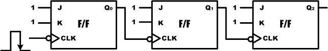

# 11. 레지스터

## 11.1. 개요

레지스터는 2진 데이터의 저장이 가능한 셀들의 집합이다. 즉 기억소자인 플립플롭으로 구성된 데이터 저장 장소라 할 수 있다.

이 장에서는 레지스터의 여러 가지 형태에 데이터가 저장되는 방법과 저장된 데이터가 레지스터에서 출력되는 방법에 대한 설명을 하고 있다.

## 11.2. 병렬입력/병렬출력 레지스터

여러 비트의 데이터를 동시에 저장할 수 있고, 저장된 모든 2진 데이터를 직접 사용할 수 있는 플립플롭의 모음을 병렬입력/병렬출력 레지스터(Parallel In Parallel Out Register)라고 한다.

아래의 그림은 4비트 병렬입력/병렬출력 레지스터를 블록도로 나타낸 것이다.

<br><br>

<p align="center">  </p>

<br><br>

4비트 데이터의 입력을 받으며 클럭의 Rising Edge일 때만, D의 데이터 입력이 Q로 출력이 된다. CLR은 데이터를 초기화 시키기 위한 입력 단자로 Low의 데이터가 들어왔을 때, Q의 값이0000으로 초기화 된다.

아래 상태표는 이 동작 상황을 표로 나타낸 것이다.

| CLR | CLK | Q |
|:---:|:---:|:---:|
| 0 | X | 0000 |
| 1 | ↑ | D |

아래의 예제는 위의 블록도를 Verilog HDL으로 구현한 것이다.

```verilog
// CH2_4REG.V
module CH2_4REG (CLK, CLRN, D, Q);
    input  CLK, CLRN;
    input  [3:0] D;
    output [3:0] Q;

    reg [3:0] Q;

    always @(posedge CLK) begin
        if (~CLRN)
            Q = 4'b0000;
        else
            Q = D;
    end
endmodule
```

14 ~ 20라인의 PROCESS 문에 위의 4비트 병렬입력/병렬출력 레지스터가 설계되어 있다. 초기화 신호인 CLRN이 0의 값을 갖고 있을 때 출력 Q의 값이 0000으로 초기화되고, CLRN이 0이아닐 때, 클럭의 Rising Edge에서 D의 입력된 데이터가 Q로 출력이 되도록 구현되어 있다. 앞의 D 플립플롭을 4비트로 비트 확장한 것으로 생각하면 된다.

아래는 이 예제를 시뮬레이션 하기 위한 테스트 벤치 파일과 ModelSim으로 시뮬레이션 한결과이다.

```verilog
// CH2_4REG_TB.V
`timescale 10ns / 1ps

module TestBench;

    // input
    reg  CLK, CLRN;
    reg  [3:0] D;
    // output
    wire [3:0] Q;

    // Instantiate the U1
    CH2_4REG U1 (CLK, CLRN, D, Q);

    // Specify input stimulus
    initial begin
        CLRN = 1'b0; CLK = 1'b0; D = 4'b0000;
        #5  CLRN = 1'b1;
        #20 D = 4'b1010;
        #20 D = 4'b0111;
        #20 D = 4'b0011;
    end

    always begin
        CLK = 0; #5;
        CLK = 1; #5;
    end

endmodule
```

이 테스트 벤치 파일에서 22~29라인은 CLRN의 데이터와 D 신호 라인에 전달해 줄 데이터를생성하는 구문이다.아래의 시뮬레이션 결과에서 CLRN이 0일 때 모든 Q의 데이터는 0000으로 초기화되고, CLRN이 1이고 클럭의 Rising Edge일 때, D의 입력이 Q로 출력되는 것을 확인할 수 있다.

위의 로직을 HBE-Combo III에서 동작시키기 위해서는 아래 표와 같이 핀 설정을 해 주어야한다.입력 데이터 CLK은 Button SW1와 연결하고 CLRN은 FPGA_RESET과 연결한다. 그리고,  4비트데이터 입력 D는 BUS SW1 ~ 4를 설정한다. 출력 결과 Q는 각각 LED1 ~ 4을 설정하여 LED를 통해서 결과를 확인할 수 있도록 한다.

| 포트 이름 | 핀 번호 | 하드웨어 설명 | 포트 이름 | 핀 번호 | 하드웨어 설명 |
|:---:|:---:|:---:|:---:|:---:|:---:|
| CLK | V4 | SW1 | Q[3] | AE11 | LED1 |
| CLRN | C5 | FPGA_RESET | Q[2] | AE10 | LED2 |
| D[3] | U5 | BUS SW1 | Q[1] | AF9 | LED3 |
| D[2] | U4 | BUS SW2 | Q[0] | AF8 | LED4 |
| D[1] | V6 | BUS SW3 |  |  |  |
| D[0] | V5 | BUS SW4 |  |  |  |

핀 설정 후 컴파일 한다. HBE-Combo III 장비에 다운로딩 하고, 상태 천이도의 동작대로 동작이 되는지를 확인해 보자.

## 11.3. 직렬입력/직렬출력 레지스터

직렬입력/직렬출력 레지스터는 한 번에 한 비트씩 데이터가 저장된다는 점의 차이를 제외하고,병렬입력/병렬출력 레지스터와 구조가 거의 같다. 직렬입력/직렬출력 레지스터는 매 클럭이발생할 때마다 데이터는 한 비트씩 플립플롭들을 통과하여 레지스터의 다른 쪽 끝으로 이동한다. 계속 클럭이 발생하면, 데이터는 처음 저장되는 순서대로 한번에 한 비트씩 레지스터를빠져나간다.

아래는 4비트 직렬입력/직렬출력 레지스터의 블록도와 이것을 논리 회로로 구현한 것이다.DIN에서 입력된 데이터가 클럭의 Rising Edge에서 첫 번째 플립플롭의 출력 Q0으로 출력되어다음 플립플롭의 입력에 연결된다. 이 데이터는 클럭의 다음 Rising Edge에서 두 번째 플립플롭의 출력 Q1에 출력된다. 같은 방법으로 클럭의 Rising Edge에 반응하여 데이터가 전달되며위의 회로에서는 총 4번의 클럭이 발생한 후에 DIN의 데이터가 Q로 출력 된다. CLRN의 신호는 이 값이 0일 때, 모든 레지스터 (플립플롭)의 값이 0으로 초기화 하는 역할을 한다.

아래는 4비트 직렬입력/직렬출력 레지스터에 임의의 데이터와 클럭을 인가하였을 때의 동작을나타낸다.

CLRN이 0의 데이터를 갖고 있을 때 모든 레지스터는 초기화가 되고, CLRN이 1일 때 클럭이발생하면 DIN으로 들어온 데이터가 내부 레지스터에 하나씩 저장이 되어 4번째 클럭에서 외부로 출력되는 것을 확인할 수 있다. 아래 파형에서 (Q0), (Q1), (Q2)의 파형은 논리 회로 내부에서 동작의 이해를 돕고자 같이 그려놓았다. 4비트 직렬입력/직렬출력 레지스터의 DIN 입력에대한 실제 출력 파형은 Q이다.

위의 4비트 직렬입력/직렬출력 레지스터는 아래와 같이 Verilog HDL로 구현할 수 있다.

```verilog
// CH2_4SISO.V
module CH2_4SISO (CLK, CLRN, DIN, Q);
    input  CLK, CLRN;
    input  DIN;
    output Q;

    reg [3:0] BUFF;
    wire Q;

    always @(posedge CLK) begin
        if (CLRN == 1'b0)
            BUFF = 4'b0000;
        else begin
            BUFF[3:1] = BUFF[2:0];
            BUFF[0]   = DIN;
        end
    end

    assign Q = BUFF[3];
endmodule
```

사실 21~22라인의 구문이 4비트 직렬입력/직렬출력 레지스터의 내부 모든 회로를 나타낸다.

이 로직을 살펴보면 한 비트로 출력 결과를 내보낸다는 점을 제외하고는 4비트 시프트 레지스터와 같은 것을 알 수 있다.

아래는 이 예제를 시뮬레이션 하기 위한 테스트 벤치 파일과 ModelSim 으로 시뮬레이션 한결과이다.

```verilog
// CH2_4SISO_TB.V
`timescale 10ns / 1ps

module TestBench;

    // input
    reg  CLK, CLRN;
    reg  DIN;
    // output
    wire Q;

    // Instantiate the U1
    CH2_4SISO U1 (CLK, CLRN, DIN, Q);

    // Specify input stimulus
    initial begin
        CLRN = 1'b0; CLK = 1'b0; DIN = 1'b0;
        #5  CLRN = 1'b1;
        #10 DIN = 1'b1;
        #30 DIN = 1'b0;
        #20 DIN = 1'b1;
    end

    always begin
        CLK = 0; #5;
        CLK = 1; #5;
    end

endmodule
```

아래의 시뮬레이션 결과에서 CLRN이 1일 때부터 D에 들어온 데이터가 클럭이 발생하는 시점에서 4클럭 이후에 출력되는 것을 확인할 수 있다.

위의 로직을 HBE-Combo III에서 동작시키기 위해서는 아래 표와 같이 핀 설정을 해 주어야한다.

입력 데이터 CLK와 DIN에는 각각 Button SW1, SW2을 설정하고, CLRN에는 FPGA_RESET을 설정한다. 출력 결과 Q는 LED1을 설정하여 결과를 LED를 통해서 확인할 수 있도록 한다.

| 포트 이름 | 핀 번호 | 하드웨어 설명 | 포트 이름 | 핀 번호 | 하드웨어 설명 |
|:---:|:---:|:---:|:---:|:---:|:---:|
| CLK | V4 | SW1 | Q | AE11 | LED1 |
| CLRN | C5 | FPGA_RESET |  |  |  |
| DIN | V3 | SW2 |  |  |  |

핀 설정 후 컴파일 한다.HBE-Combo III 장비에 다운로딩 하고, 동작을 살펴보며 위의 로직에 대해 이해해 보자.

## 11.4. 병렬입력/직렬출력 레지스터

병렬입력/직렬출력 레지스터는 N비트의 병렬 데이터의 입력을 받아, N개의 클럭 동안 입력받은 병렬 데이터를 직렬 데이터로 변환하여 출력하는 레지스터를 말한다. 이것은 아래 그림과 같이 블록도로 나타낼 수 있다. SH/LDN 신호는 D 데이터의 입력을 받기 위한 신호로 이값에 0이 들어왔을 때, D 데이터 입력을 받으며 1이 되면 클럭의 Rising Edge에 데이터의 시프트가 이루어져 입력 받은 N비트의 D데이터가 하위 비트에서부터 상위 비트의 순서대로(D0,D1, … , DN-1, DN) Q에 출력된다.

아래 파형은 4 비트 병렬입력/직렬출력 레지스터에 임의의 데이터를 넣어 동작하는 결과이다.

SH_LDN의 신호가 발생하면 4비트 레지스터에 값이 설정되고, 그 후 클럭의 Rising Edge에 하나씩 데이터가 시프트 되어 출력되는 것을 볼 수 있다. 클럭이 4번 발생하여 모든 데이터가출력하면 다음 데이터를 불러 들어올 때까지 출력 값은 0의 값이 나온다.

아래는 위의 4비트 병렬입력/직렬출력 레지스터를 Verilog HDL로 구현한 것이다.

```verilog
// CH2_4PISO.V
module CH2_4PISO (CLK, SH_LDN, D, Q);
    input  CLK, SH_LDN;
    input  [3:0] D;
    output Q;

    reg [3:0] BUFF;
    wire Q;

    always @(posedge CLK) begin
        if (~SH_LDN)
            BUFF = D;
        else begin
            BUFF[3:1] = BUFF[2:0];
            BUFF[0]   = 1'b0;
        end
    end

    assign Q = BUFF[3];
endmodule
```

아래는 이 예제를 시뮬레이션 하기 위한 테스트 벤치 파일과 ModelSim으로 시뮬레이션 한결과이다.

```verilog
// CH2_4PISO_TB.V
`timescale 10ns / 1ps

module TestBench;

    // input
    reg  CLK, SH_LDN;
    reg  [3:0] D;
    // output
    wire Q;

    // Instantiate the U1
    CH2_4PISO U1 (CLK, SH_LDN, D, Q);

    // Specify input stimulus
    initial begin
        SH_LDN = 1'b0; CLK = 1'b0; D = 4'b0000;
        #5  SH_LDN = 1'b1;
        #20 D = 4'b1101; SH_LDN = 1'b0;
        #5  SH_LDN = 1'b1;
        #20 D = 4'b0010; SH_LDN = 1'b0;
        #5  SH_LDN = 1'b1;
    end

    always begin
        CLK = 0; #1;
        CLK = 1; #1;
    end

endmodule
```

위의 로직을 HBE-Combo III에서 동작시키기 위해서는 아래 표와 같이 핀 설정을 해 주어야한다.

입력 데이터 CLK와 SH_LDN은 Button SW1, SW2을 설정하고, D에는 BUS SW1~4를 설정한다.출력 결과 Q는 LED1을 설정하여 결과를 LED를 통해서 확인할 수 있도록 한다.

| 포트 이름 | 핀 번호 | 하드웨어 설명 | 포트 이름 | 핀 번호 | 하드웨어 설명 |
|:---:|:---:|:---:|:---:|:---:|:---:|
| CLK | V4 | SW1 | Q | AE11 | LED1 |
| SH_LDN | V3 | SW2 |  |  |  |
| D[3] | U5 | BUS SW1 |  |  |  |
| D[2] | U4 | BUS SW2 |  |  |  |
| D[1] | V6 | BUS SW3 |  |  |  |
| D[0] | V5 | BUS SW4 |  |  |  |

핀 설정 후 컴파일 한다. HBE-Combo III 장비에 다운로딩 하고, 동작을 살펴보며 위의 로직에대해 이해해 보자.

## 11.5. 직렬입력/병렬출력 레지스터

직렬입력/병렬출력 레지스터는 위의 병렬입력/직렬출력 레지스터와는 정반대의 동작을 수행한다. 즉 직렬 데이터의 입력을 받아 병렬의 데이터를 출력하는 기능을 한다. N비트의 직렬입력/병렬출력 레지스터는 N개의 클럭이 발생하는 데이터에 의해서 병렬데이터가 결정된다. 이것은 시프트 레지스터와 같은 동작을 한다.

아래는 4비트 직렬입력/병렬출력 레지스터이다. CLRN의 입력이 0일 때 모든 레지스터의 값이0으로 초기화 되며, 클럭이 발생할 때마다 DIN의 값이 Q0로 넘겨지고, Q0의 값이 Q1으로 넘겨지는 방법으로 하여 4번의 클럭이 발생하면 4비트의 데이터가 완성된다.

아래 상태 표는 DIN을 1로 고정하였다고 가정하고, 클럭을 발생하였을 때의 그 출력 결과를보여주고 있다.

CLRNCLKDINQ0Q1Q2Q30XX

아래에 설계된 Verilog HDL로직은 위의 직렬 입력/병렬 출력 레지스터를 설계한 것이다.

```verilog
// CH2_4SIPO.V
module CH2_4SIPO (CLK, RESETN, DATA_IN, Q);
    input  CLK, RESETN;
    input  DATA_IN;
    output [3:0] Q;

    reg [3:0] Q;

    always @(posedge CLK) begin
        if (~RESETN)
            Q = 4'b0000;
        else begin
            Q[2:0] = Q[3:1];
            Q[3]   = DATA_IN;
        end
    end
endmodule
```

위의 로직에서 15~24라인의 구문은 데이터를 하나씩 오른쪽으로 이동시키기 위한 구문이다.

RESETN의 값이 ‘0’일 때 Q의 값은 0000으로 초기화 되고, RESETN이 1일 때, DATA_IN에서 들어온 값이 오른쪽으로 1비트 씩 이동하도록 구성되어 있다.

아래는 이 예제를 시뮬레이션 하기 위한 테스트 벤치 파일과 ModelSim으로 시뮬레이션 한결과이다.

```verilog
// CH2_4SIPO_TB.V
`timescale 10ns / 1ps

module TestBench;

    // input
    reg  CLK, RESETN, DATA_IN;
    // output
    wire [3:0] Q;

    // Instantiate the U1
    CH2_4SIPO U1 (CLK, RESETN, DATA_IN, Q);

    // Specify input stimulus
    initial begin
        RESETN = 1'b0; CLK = 1'b0; DATA_IN = 1'b0;
        #10 RESETN = 1'b1;
        #10 DATA_IN = 1'b1;
        #20 DATA_IN = 1'b0;
        #10 DATA_IN = 1'b1;
        #30 DATA_IN = 1'b0;
    end

    always begin
        CLK = 0; #5;
        CLK = 1; #5;
    end

endmodule
```

아래의 시뮬레이션 결과에서 DATA_IN의 데이터는 클럭에 의해서 1비트씩 시프트 되어 출력되는 것을 확인할 수 있다. 총 4번의 클럭이 발생하였을 때, 즉 4개의 데이터가 들어와 완전한4비트의 데이터가 만들어진다.

위의 로직을 HBE-Combo III에서 동작시키기 위해서는 아래 표와 같이 핀 설정을 해 주어야한다.

입력 데이터 DATA_IN과 CLK에는 Button SW1과 SW2가 설정되고, 출력 결과를 나타내는 Q에는 각각 LED1~4을 통해 확인할 수 있도록 핀을 설정한다.

| 포트 이름 | 핀 번호 | 하드웨어 설명 | 포트 이름 | 핀 번호 | 하드웨어 설명 |
|:---:|:---:|:---:|:---:|:---:|:---:|
| RESETN | C5 | FPGA_RESET | Q[2] | AE10 | LED2 |
| DATA_IN | V3 | SW1 | Q[1] | AF9 | LED3 |
| CLK | V4 | SW2 | Q[0] | AF8 | LED4 |
| Q[3] | AE11 | LED1 |  |  |  |

핀 설정 후 컴파일 한다.HBE-Combo III 장비에 다운로딩 하고, 그 결과를 확인하여 시프트 레지스터에 대해 이해해 보자.
