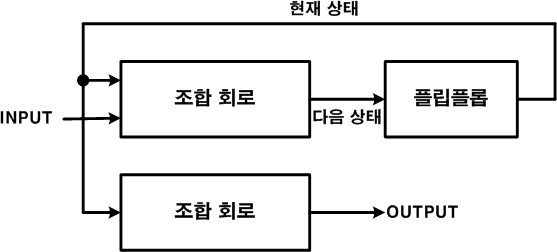
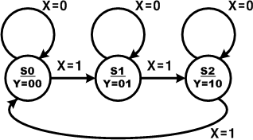

# 12. 스테이트 머신(State Machine)

## 12.1.  개요

스테이트 머신은 외부 입력과 시스템 클럭에 의해 State(상태)가 바뀌게 되고, State에 의존되어 출력 값이 결정된다. 스테이트 머신은 Moore Machine과 Mealy Machine으로 구분한다.

이 장에서는 이 스테이트 머신에 대하여 설명하고 있다.

## 12.2. Moore Machine

Moore Machine은 현재의 상태에 의해 출력이 결정되는 스테이트 머신을 말한다. 따라서, 데이터의 입력은 State를 바꾸는 데에만 사용되고, 결과에 영향을 미치지 않는데, 결과는 State에의해서 결정된다.

이 Moore Machine은 아래 블록도와 같이 시스템이 구성된다.

<br><br>

<p align="center">  </p>

<br><br>

아래의 상태도는 Moore Machine의 방법으로 각 State가 바뀌고, 그에 따라 데이터가 출력하는 것을 설명하는 그림이다.

<br><br>

<p align="center">  </p>

<br><br>

이 스테이트 머신은 State가 각각 S0, S1, S2일 때, 데이터의 입력에 따라서 X의 값이 0이면현재 상태를 유지하고, X의 값이 1이면 S0에서 S1으로, S1에서 S2로, 그리고 S2에서는 다시S1으로 각각 State가 변경되는 것을 확인 할 수 있다. 그리고 각 상태일 때 S0상태에서는 Y에00의 데이터가 출력되고, S1 상태에서는 Y에 01의 데이터가, S2의 상태에서는 Y에 10의 데이터가 각각 출력되도록 구성된다.

아래의 로직은 위의 상태도에 나타나있는 스테이트 머신을 Verilog HDL로 구현한 것이다.

```verilog
// CH2_MOORE.V

module CH2_MOORE(X, Y);
    input  X;
    output [1:0] Y;

    reg [1:0] Y;
    reg [1:0] STATE;

    parameter S0 = 2'b00;
    parameter S1 = 2'b01;
    parameter S2 = 2'b10;

    always @(posedge X) begin
        case (STATE)
            S0      : STATE = S1;
            S1      : STATE = S2;
            S2      : STATE = S0;
            default : STATE = S0;
        endcase
    end

    always @(STATE) begin
        case (STATE)
            S0      : Y = 2'b00;
            S1      : Y = 2'b01;
            S2      : Y = 2'b10;
            default : Y = 2'b11;
        endcase
    end

endmodule
```

14라인에서 스테이트 머신에서 사용할 S0, S1, S2의 값을 parameter를 이용하여 정의하였다.

16 ~ 24라인은 X 데이터의 입력이 있을 때, 상태를 변화하기 위한 구문이다.

26 ~ 34 라인은 스테이트 머신의 각 상태일 때, Y에 출력하는 것을 보여주고 있다.

아래는 이 예제를 시뮬레이션 하기 위한 테스트 벤치 파일과 ModelSim으로 시뮬레이션 한결과이다.

```
// CH2_MOORE_TB.V
`timescale 10ns / 1ps

module TestBench;

    // input
    reg X;

    // output
    wire [1:0] Y;

    // Instantiate the U1
    CH2_MOORE U1(X, Y);

    // Specify input stimulus
    initial begin
        X = 0;
        #50 $stop;
    end

    always begin
        X = 0;
        #5 X = 1;
        #5;
    end

endmodule
```

아래의 시뮬레이션의 결과에서 X가 1로 바뀔 때마다 STATE가 바뀌어 나타나는 Y의 출력 결과를 확인할 수 있다.

위의 로직을 HBE-Combo III에서 동작시키기 위해서는 아래 표와 같이 핀 설정을 해 주어야한다.

입력 데이터 X는 Button SW1으로 설정하고, 출력 결과 Y는 LED1~2을 설정하여 결과를 LED를 통해서 확인할 수 있도록 한다.

| 포트 이름 | 핀 번호 | 하드웨어 설명 | | 포트 이름 | 핀 번호 | 하드웨어 설명 |
|-----------|--------|---------------|-|-----------|--------|---------------|
| X    | V4  | SW1     | | Y[0] | AE10 | LED2 |
|          |        |               | | Y[1] | AE11 | LED1 |

핀 설정 후 컴파일 한다.

HBE-Combo III 장비에 다운로딩 하고, 동작을 살펴보며 위의 스테이트 머신에 대해 이해해 보자.

## 12.3. Mealy Machine

Mealy Machine은 Moore Machine이 State에 의해서 출력이 결정되는 것에 반하여, 현재 상태와 입력 조건에 의해서 State도 변경되고, 출력 데이터도 생성된다.

아래의 블록도는 이 Mealy Machine을 구성하는 시스템에 대해서 나타내는 것인데, MooreMachine에 비해서 INPUT이 출력 데이터를 생성하는 조합논리회로에도 연결되어 있음을 유의하여야 한다.

이 Mealy Machine을 상태도로 그리면 아래 그림과 같다.이 스테이트 머신은 S0과 S1의 상태를 갖고 있고, S0의 상태일 때 X=0이면 Y에 00의 데이터를 출력하고, X=1이면 Y에 10 데이터를 출력하면서, State가 S0에서 S1로 바뀐다. S1의 상태일때, X=0이면 Y에 00의 데이터를 출력하고, X=1이면 y에 01데이터를 출력하면서 State가 S1에서 S0으로 바뀌는 구조를 갖고 있다.

아래의 로직은 위의 상태도를 Verilog HDL로 구현한 것이다.

```
// CH2_MEALY.V

module CH2_MEALY(X, Y);
    input  X;
    output [1:0] Y;

    reg [1:0] Y;
    reg STATE;

    parameter S0 = 1'b0;
    parameter S1 = 1'b1;

    always @(posedge X) begin
        case (STATE)
            S0      : STATE = S1;
            S1      : STATE = S0;
            default : STATE = S0;
        endcase
    end

    always @(STATE, X) begin
        if      ((STATE == S0) && (X == 1'b1)) Y = 2'b10;
        else if ((STATE == S1) && (X == 1'b1)) Y = 2'b01;
        else    Y = 2'b00;
    end

endmodule
```

14라인에서 스테이트 머신에서 사용할 S0, S1의 값을 parameter를 이용하여 정의하였다.16~23라인은 X 데이터의 입력이 있을 때, 상태를 변화하기 위한 구문이다.25~33 라인은 스테이트 머신의 각 상태일 때, X의 값에 의한 데이터를 Y에 출력하도록 설계되어 있다.아래는 이 예제를 시뮬레이션 하기 위한 테스트 벤치 파일과 ModelSim으로 시뮬레이션 한결과이다.

```
// CH2_MEALY_TB.V
`timescale 10ns / 1ps

module TestBench;

    // input
    reg X;

    // output
    wire [1:0] Y;

    // Instantiate the U1
    CH2_MEALY U1(X, Y);

    // Specify input stimulus
    initial begin
        X = 0;
        #50 $stop;
    end

    always begin
        X = 0;
        #5 X = 1;
        #5;
    end

endmodule
```

아래의 시뮬레이션의 결과에서 X가 1로 바뀔 때마다 STATE가 바뀌고, X=0일 때 STATE에 따른값이 Y에 출력되고, X=0일 때에는 Y에 00이 출력 되는 것을 확인 할 수 있다.위의 로직을 HBE-Combo III에서 동작시키기 위해서는 아래 표와 같이 핀 설정을 해 주어야한다.입력 데이터 X는 Button SW1으로 설정하고, 출력 결과 Y는 LED1~2을 설정하여 결과를 LED를 통해서 확인할 수 있도록 한다.

| 포트 이름 | 핀 번호 | 하드웨어 설명 | | 포트 이름 | 핀 번호 | 하드웨어 설명 |
|-----------|--------|---------------|-|-----------|--------|---------------|
| X    | V4  | SW1     | | Y[0] | AE10 | LED2 |
|      |     |         | | Y[1] | AE11 | LED1 |

핀 설정 후 컴파일 한다.

HBE-Combo III 장비에 다운로딩 하고, 동작을 살펴보며 위의 스테이트 머신에 대해 이해해 보자.
