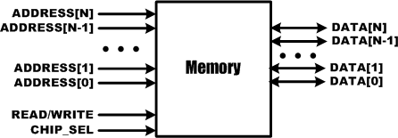

# 13. Memory

> 출처 : 「HBE-Combo III로 배우는 VerilogHDL를 이용한 디지털 회로설계(ALTERA) v1.0 최종 20081006-p337」 2장 「13. Memory」 (원본 도서 229~242쪽)

## 13.1. 개요

메모리는 디지털 데이터를 기억하는 장치를 말한다. 앞에서 설명한 플립플롭과 같이 데이터를저장하지만, 좀 대규모의 데이터를 저장할 수 있는 것을 메모리라 한다.

아래는 SRAM을 블록화 시킨 그림이다.

  

  

  

### ■ DATA

DATA는 메모리에 데이터를 저장하기 위한 신호 라인이다. 위의 그림과 같이 일반적으로 단일비트로 구성되지 않고, 여러 비트가 묶인 버스 형태로 구성된다. 앞에서 설명한 N비트 레지스터는 입력 데이터 신호와 출력 데이터 신호가 분리 되어 입력 신호로 데이터를 넣으면, 출력신호로 데이터가 나오는 구조로 되어 있는데, 일반적으로 메모리는 하나의 데이터 버스에서읽거나 쓸 수 있도록 되어 있다. 읽기와 쓰기가 동시에 되지 않는다. 물론 Dual Port Memory라고 해서 입, 출력 데이터 신호가 분리 되어 있는 메모리도 있지만, 일반적으로는 입, 출력신호가 하나에서 이루어지는 메모리를 많이 사용한다. 메모리의 데이터 버스는 8비트, 16비트,32비트를 많이 사용한다. ADDRESS앞에서 설명한 N 비트 레지스터는 클럭이 발생하면 입력을 받아 바로 출력한다. 하지만 메모리는 많은 양의 데이터를 저장할 수 있는데, 이 데이터를 저장할 때 각각의 데이터를 구분해주는 것이 ADDRESS이다. 집 주소라고 생각하면 된다. 각 주소에 데이터가 저장이 되어 있어서, 사용자에 의해 원하는 ADDRESS의 영역에 데이터를 쓰거나, 읽을 수 있게 된다. 메모리를이야기 할 때, 예를 들어 8K byte의 메모리를 사용한다고 했을 때, 이것은 1k의 ADDRESS와8bit DATA Bus를 갖고 있는 메모리를 사용한다고 생각할 수 있다. 물론 주고 받는 데이터의수가 16bit인 메모리의 경우에는 512 x 16bit 메모리를 사용해야 한다. 여기에서 말한 1k(1024)와 512의 ADDRESS는 각각 210과 29으로 표현할 수 있다. 즉, ADDRESS가 10비트인 메모리는1k의 ADDRESS를 갖고 있는 메모리이다. READ/WRITEDATA가 입출력 신호로 구분되어 있지 않고, 읽고 쓰기를 동시에 할 수 없기 때문에, 메모리에서는 READ와 WRITE의 동작을 구분해주기 위해서 READ/WRITE의 신호를 사용한다. 이 신호는메모리의 특성에 따라서 다르지만, READ/WRITE에 Low 데이터가 전달 될 경우에는 WRITE의동작을 수행하고, High 데이터가 전달될 경우에는 READ의 동작이 수행된다. CHIP_SELCHIP SELECT(CS)핀은 CHIP ENABLE(CE)이라고도 한다. 즉 메모리를 사용할 것인지, 사용하지않을 것인지를 결정하는 핀이다. 일반적으로 메모리는 CPU등에서 데이터의 임시 보관을 위해많이 사용되는데, 이 메모리의 ADDRESS와 DATA라인이 메모리에만 연결되어 있는 것이 아니라 다른 외부 장치와 공용으로 연결되어 있다. 그렇기 때문에 사용하려는 디바이스를 선택해서 그곳에 ADDRESS와 DATA를 전달해 주는 회로가 구성되어야 하는데, 여기에서 사용하려는디바이스를 선택하는 방법이 CHIP SELECT 신호를 사용하는 것이다. 이 신호는 일반적으로Low의 값이 연결될 때, CHIP SELECT가 동작하여 메모리가 동작한다.일반적으로 메모리는 위에서 설명한 요소로 구성되어 있다. 물론 DRAM이나 다른 메모리 칩의 경우 이보다 훨씬 복잡한 구조와 동작 원리를 갖고 있지만, 위와 같은 원리를 기본으로 해서 설계한 것이기 때문이 이 기본에 대하여 먼저 이해해 보도록 하자.

## 13.2.  ROM의 구조와 특징

### (1) ROM(Read-Only Memory)

ROM은 반도체 메모리의 한 형태로 데이터를 영구적으로 저장하거나 쉽게 바꿀 수 없도록 설계되어 있다. 즉, 시스템 동작 중 변하지 않는 데이터나 정보를 저장하기 위해 사용되는 장치로, 전원이 차단되더라도 저장된 정보를 하는 비휘발성의 특징을 갖고 있다.ROM은 데이터를 쓰고 지울 수 있는 방식에 따라 Mask ROM, OTP ROM (혹은 PROM),EPROM, EEPROM의 형태로 발전하였다.

### (2) ROM의 종류와 용도

ROM은 데이터를 프로그램하고, 지우고, 다시 프로그램하는 방법에 따라 종류가 구분된다. Mask ROM일반적인 형태의 ROM은 두 가지 방식이 있다. 제조과정에서부터 ROM에 내용이 기록되어 있는 방식이 있고, 처음 만들어 질 때는 비어있는 상태로 제조된 후 나중에 내용을 기록하는ROM이 있다.Mask ROM은 제조 과정에서 ROM에 내용을 입력해 놓는 ROM으로서, 미리 제품의 구조와 설계를 최적화 하기 때문에 다른 ROM에 비해서 집적도와 효율이 높은 편이다. 보통 특정 제품에 장착할 목적으로 대량 생산하는 경우에 많이 사용되기 때문에 제조원가가 비교적 저렴한것이 특징이다. 메인보드나 그래픽 카드, 각종 입출력 카드 등에 장착되는 ROM은 대부분Mask ROM이다. PROM(Programmable Read-Only Memory)PROM은 제조 과정에서 내부에 내용이 저장되지 않으며, 출시 후 사용자가 원하는 내용을 한번만 기록할 수 있는 ROM이다. 예를 들면 한번만 데이터를 기록할 수 있는 CD-R과 같은 형태라고 볼 수 있다.PROM은 별도의 Write 프로그램을 사용하여 내용을 데이터를 저장하게 되는데, PROM은 수많은 퓨즈들을 하나로 만들어 놓은 구조로 되어 있어서 이 퓨즈에 전류를 흘러 보내어 내부 회선들이 끊어지는 방식으로 정보가 저장된다. 이런 형태 때문에 Mask ROM에 비해서 상대적으로 내부 집적도가 떨어지게 되며 주문자에 맞게 제조되는 소량 생산 제품들에 보통 사용된다. EPOM (Erasable Programmable Read-Only Memory)EPROM은 PROM을 개선한 ROM으로 PROM이 한번만 내용을 기록할 수 있는 것에 비해 여러차례 내용을 지우고 재기록 할 수 있다. PROM 이 퓨즈가 단선되는 원리를 이용해 정보를 기록하지만 EPROM 은 자외선을 이용해 내용을 재기록 할 수 있다. 칩 표면에 부착된 유리창을통해 자외선을 쏘아서 메모리 상태를 조절하게 되는데 강한 자외선을 쏘이면 ROM에 저장된내용을 모두 삭제된다. PROM에 비해서는 상당히 개선된 메모리이지만 자외선으로 정보를 기록하는 속도가 상당히 늦다는 단점이 있다. EEPROM (Electrically Erasable Programmable Read-Only Memory)EPROM 은 기록속도가 매우 늦기 때문에 RAM 처럼 자유롭게 쓰고 지우는 것이 힘들다.EEPROM 은 이런 EPROM 의 느린 기록 속도를 보완한 ROM 으로서 기록 방식으로 자외선대신 전기 신호를 사용하는 ROM 이다. EEPROM 은 내부에 기준 이상의 전류를 흘려 보내 기록을 모두 삭제하고 다시 정상적으로 재기록 하는 방식을 사용하게 된다. 하지만 이런 전류를이용한 충격방식으로 정보를 지우고 기록하기 때문에 RAM처럼 영구적인 내구성을 갖지는 못한다. 보통 EEPROM 의 경우 수만~수십만회 정도까지만 읽고 쓰는 것이 가능하다. EEPROM은 쉽게 재기록을 할 수 있다는 장점 때문에 많은 전자기기들에서 사용된다.최근에 디지털 카메라나 MP3 Player등 다양한 기기에서 많이 사용되는 플래시 메모리(flashmemory) 역시 이 EEPROM 의 한 형태이다.

## 13.3.  RAM의 구조 및 특징

RAM(Random Access Memory)은 기억된 정보를 읽어내기도 하고 다른 정보를 기억시킬 수있는 메모리이다. 또, 전원이 끊어지면 휘발유처럼 기록된 정보도 날아가기 때문에 휘발성 메모리라고 한다. 따라서 RAM은 데이터 처리를 위한 일시적 저장 등에 사용된다. 기존의 자기를 이용한 자기 코어에서 데이터를 읽을 때에는 앞에서부터 순차적으로 읽어야 했었는데 이RAM은 TR을 사용하는 IC로 구성되기 때문에 데이터를 읽을 때 순차적이 아닌 랜덤하게 읽을수 있고, 읽기 또는 쓰기 속도가 매우 빠르다.대표적인 RAM의 종류에는 SRAM과 DRAM이 있다.

### (1) RAM 의 종류와 용도

RAM은 외형상 SIP, DIP, SIMM, DIMM으로 나눌 수 있으나 대부분 기억 방식에 따른 분류로 구분하고 있다. SRAM(Static Random Access Memory)SRAM이란 플립플롭 방식의 메모리 셀을 가진 임의 접근 기억장치로서, 전원 공급이 계속되는한 저장된 내용을 계속 기억하며 소용량의 메모리나 캐시메모리(cache memory)에 주로 사용한다. SRAM은 DRAM보다 구조가 복잡하다. 한 비트를 구성하는데 SRAM은 6개의 트랜지스터가 필요한 데, DRAM은 한 개의 트랜지스터와 한 개의 콘덴서가 필요하다. 따라서 고밀도 집적에 유리하다. SRAM은 동적 램보다 속도가 5배 정도 빠르며 가격도 비싼 편이다. DRAM(Dynamic Random Access Memory)SRAM이 반도체로 구성된 회로에 의해서 데이터를 기억을 하는 것과는 달리 DRAM은 콘덴서를 이용해서 기억을 한다. 데이터의 기입이란 콘덴서에 전기 충전을 하는 것과 같다. 그런데그 충전된 데이터가 계속 콘덴서에 머무르는 것이 아니고 시간이 지나면 조금씩 방전이 되므로 그 데이터가 방전되기 전에 다시 충전해 주어야 하는 방식이 필요해지고 그 방식을Refresh라고 한다. 따라서 메모리를 사용여부에 상관없이 메모리를 동적으로 만들어야 하기때문에 Dynamic RAM이라고 부르는 것이다. Synchronous DRAM(SDRAM)이 메모리는 CPU의 지배하에서 비교적 벗어나 있다고 할 수 있다. SDRAM은 제어신호를 기다리지 않고 무조건 데이터를 출력한다. 그러므로 더욱 고속화할 수 있게 되는 것이다. 그러나무조건적으로 출력을 하는 것이 아니라 CPU의 클럭에 맞추어 데이터를 출력한다. 즉, 메인보드 칩셋에서 버스트 사이클 액세스 명령이 오자마자 CPU 클럭에 맞추어 데이터를 출력하고자신의 클럭으로 작동하기 때문에 다른 시스템이 더 빠른 클럭으로 동작할 수 있는 장점도있다.

## 13.4. SRAM 제어

이 절에서는 HBE-Combo III에 구성된 SRAM을 이용한 실험을 통해 SRAM의 제어 방법을 익히도록 구성되어 있다.

### (1) SRAM에 대하여

HBE-Combo III 장비에 구성되어 있는 SRAM은 Address 비트가 18비트이고, Data가 16비트인4Mbit SRAM이다. 이 SRAM은 아래와 같이 구성되어 있다.아래의 표는 SRAM에서 사용하는 각 입출력 신호선의 특징을 표로 나타낸 것이다. 아래에서설명하고 있는 신호선은 SRAM에 연결되어 있는 FPGA를 기준으로 작성되었다. 즉 OUT은FPGA에서 데이터가 출력되어 SRAM에 전달된다는 뜻이다.신호 이름FPGA 와 연결특 징DATAINOUT데이터를 저장하거나 읽는 신호선ADDRESSOUT데이터를 저장하는 주소 번지/OEOUTOutput Enable 신호로 신호의 값이 ‘0’일 때 데이터의 읽기가가능하다./WE 의 신호는 ‘1’이어야 한다./WEOUTWrite Enable 신호로 신호의 값이 ‘0’일 때 데이터의 쓰기가가능하다./OE 의 신호는 ‘0’이어야 한다./CSOUTChip Select 의 신호로 신호의 값이 ‘0’이어야 SRAM 은 동작을한다. 즉 /CS 의 신호가 ‘1’이면 다른 신호에 상관없이 동작을하지 않는다.

### (2) SRAM 제어 Timing

SRAM을 제어할 때에는 SRAM에 데이터를 쓸 것인지 또는 읽을 것인지에 따라서 제어하는 신호의 값 및 동작 타이밍이 다르다.아래는 HBE-Combo III 장비의 SRAM에 데이터를 쓰고(Write) 읽는(Read) 동작 타이밍을 나타내고 있다. Write CycleParameterSymbolMinMaxUnitWrite Cycle TimetWCnsChip Select to End of WritetCWnsAddress Set-up TimetAS0nsAddress Valid to End of WritetAWnsWrite Pulse Width (/OE High)tWPnsWrite Pulse Width (/OE Low)tWP1nsWrite Recovery TimetWR0nsWrite to Output High-ZtWHZ0nsData to Write Time OverlaptDWnsData Hold from Write TimetDH0nsEnd of Write to Output Low-ZtOWns Read CycleParameterSymbolMinMaxUnitRead Cycle TimetRCnsAddress Access TimetAAnsChip Select to OutputtCOnsOutput Enable to Valid OutputtOEnsChip Enable to Low-Z OutputtLZnsOutput Enable to Low-Z OutputtOLZ0nsChip Disable to High-Z OutputtHZ0nsOutput Disable to High-Z OutputtOHZ0nsOutput Hold form Address ChangetOHnsChip Selection to Power Up TimetPU0nsChip Selection to Power DownTimetPDns

### (3) Verilog HDL을 이용한 SRAM 제어

다음의 예제는 버튼 및 버스 스위치를 이용하여 간단히 SRAM을 동작 시키는 예제이다.이 예제는 버튼 스위치를 통해 SRAM의 READ, WRITE 발생시키고, 버튼 스위치를 통해 SRAM에 데이터를 입력하고, 버스 스위치를 통해 SRAM의 ADDRESS를 지정하게 된다.장비에 프로그래밍 파일을 다운로딩 하고 버스 스위치로 ADDRESS를 설정하고 버튼 스위치로는 SRAM에 입력 데이터를 설정한다. 이 후 WRITE에 연결된 버튼 스위치를 눌러 설정한ADDRESS와 DATA를 SRAM에 저장시키고, READ에 연결된 버튼 스위치를 눌러 SRAM에서 저장한 데이터를 읽어 LED로 확인할 수 있도록 구성되어 있다.// CH2_SRAM.Vmodule CH2_SRAM(WRITE, READ,ADDRESS, DATA_IN,RAM_CS, RAM_OE, RAM_WE,RAM_ADDRESS, RAM_DATA,LED_OUTinput WRITE, READ;input [7:0] ADDRESS;input [7:0] DATA_IN;output RAM_CS, RAM_OE, RAM_WE;output [17:0] RAM_ADDRESS;inout [15:0] RAM_DATA;output [7:0] LED_OUT;wire RAM_CS, RAM_OE, RAM_WE;wire [17:0] RAM_ADDRESS;wire [15:0] RAM_DATA;wire [7:0] LED_OUT;assign RAM_CS = 1'b0;assign RAM_OE = ~READ;assign RAM_WE = ~ WRITE;assign RAM_ADDRESS = {10'b0000000000 , ADDRESS };assign RAM_DATA = (WRITE) ? {8'b00000000 , DATA_IN} : 16'bzzzzzzzzzzzzzzzz;assign LED_OUT = (READ) ? RAM_DATA[7:0] : 8'b00000000;endmodule위에서 설계된 로직에서 3~17 라인에서 READ, WRITE, DATA_IN, ADDRESS는 스위치를 통해SRAM에 전달해 주기 위한 신호이고, RAM_XX 신호는 SRAM에 직접 연결되어 있는 신호이다.SRAM의 DATA는 INOUT으로 선언해야 됨을 유의해야 한다.24라인에서 SRAM의 Chip Select 신호로 계속 사용하기 위하여 0의 값을 전달해 준다.25~26라인은 각각 SRAM의 Output Enable과 Write Enable의 신호로 버튼 스위치와 연결되어있다.27라인은 SRAM의 ADDRESS로 실제 사용하는 SRAM의 ADDRESS가 18비트이기 때문에 앞의10비트를 고정하고 뒤의 8비트는 스위치의 ADDRESS 입력에 연결되도록 구성되어 있다.28라인은 SRAM의 DATA에 연결되는 부분인데, SRAM의 DATA가 양방향 입출력 포트이어서 데이터를 읽을 때에는 High Impedance의 값을 출력해주어야, 읽는 데이터가 정상적으로 들어온다. 이것을 위해 설계된 부분으로 RAM_DATA는 WRITE가 1일 때(RAM_WE = 0)에만 전달되고,1이 아닐 때에는 High Impedance의 값이 전달된다.29라인은 데이터를 출력해 보기 위한 구문으로 READ 신호가 들어왔을 때에 RAM_DATA의 신호를 LED에 출력하도록 구성되어 있다.위의 로직을 HBE-Combo III에서 동작시키기 위해서는 아래 표와 같이 핀 설정을 해 주어야한다.입력 데이터 ADDRESS는 BUS SW1~8에 연결하고, DATA_IN은 버튼 스위치 SW1~8에 연결한다. WRITE와 READ 신호는 각각 SW 9, SW0에 연결한다. 그리고, RAM_.. 신호는 SRAM의 핀번호로 설정하여 SRAM에 연결하도록 한다.  출력 결과 LED_OUT는 LED1~8에 연결하여 저장되었던 데이터를 확인할 수 있도록 한다.포트 이름핀 번호 하드웨어 설명포트 이름핀 번호 하드웨어 설명ADDRESS[7]T6BUS SW1RAM_ADDRESS[7]E22SRAM_ADDR7ADDRESS[6]V1BUS SW2RAM_ADDRESS[6]D26SRAM_ADDR6ADDRESS[5]U7BUS SW3RAM_ADDRESS[5]D25SRAM_ADDR5ADDRESS[4]U6BUS SW4RAM_ADDRESS[4]D23SRAM_ADDR4ADDRESS[3]U5BUS SW5RAM_ADDRESS[3]C25SRAM_ADDR3ADDRESS[2]U4BUS SW6RAM_ADDRESS[2]C24SRAM_ADDR2ADDRESS[1]V6BUS SW7RAM_ADDRESS[1]B25SRAM_ADDR1ADDRESS[0]V5BUS SW8RAM_ADDRESS[0]B24SRAM_ADDR0DATA_IN[7]V4SW1RAM_DATA[15]U24SRAM_DATA15DATA_IN[6]V3SW2RAM_DATA[14]U23SRAM_DATA14DATA_IN[5]V2SW3RAM_DATA[13]U22SRAM_DATA13DATA_IN[4]W4SW4RAM_DATA[12]U21SRAM_DATA12DATA_IN[3]W3SW5RAM_DATA[11]U20SRAM_DATA11DATA_IN[2]W2SW6RAM_DATA[10]T25SRAM_DATA10DATA_IN[1]W1SW7RAM_DATA[9]T24SRAM_DATA9DATA_IN[0]V7SW8RAM_DATA[8]T23SRAM_DATA8WRITEY4SW9RAM_DATA[7]T22SRAM_DATA7READY3SW0RAM_DATA[6]T21SRAM_DATA6RAM_CSH26SRAM_CSRAM_DATA[5]T20SRAM_DATA5RAM_OEJ21SRAM_OERAM_DATA[4]R25SRAM_DATA4RAM_WEJ20SRAM_WERAM_DATA[3]R24SRAM_DATA3RAM_UBG24SRAM1_UBRAM_DATA[2]R20SRAM_DATA2RAM_LBG23SRAM1_LBRAM_DATA[1]P24SRAM_DATA1RAM_ADDRESS[17]G22SRAM_ADDR17RAM_DATA[0]P23SRAM_DATA0RAM_ADDRESS[16]G21SRAM_ADDR16LED_OUT[7]AE11LED1RAM_ADDRESS[15]F26SRAM_ADDR15LED_OUT[6]AE10LED2RAM_ADDRESS[14]F25SRAM_ADDR14LED_OUT[5]AF9LED3RAM_ADDRESS[13]F24SRAM_ADDR13LED_OUT[4]AF8LED4RAM_ADDRESS[12]F20SRAM_ADDR12LED_OUT[3]AF7LED5RAM_ADDRESS[11]E26SRAM_ADDR11LED_OUT[2]AF6LED6RAM_ADDRESS[10]E25SRAM_ADDR10LED_OUT[1]AF5LED7RAM_ADDRESS[9]E24SRAM_ADDR9LED_OUT[0]B3LED8RAM_ADDRESS[8]E23SRAM_ADDR8핀 설정 후 컴파일 한다.HBE-Combo III 장비에 다운로딩 하고, SRAM의 동작 타이밍도를 보고 실험해 보면서 SRAM의제어에 대하여 이해해 보자.동작하는 것을 예로 들면 다음과 같다.BUS SWITCH를 조절하여 ADDRESS를 설정한다. (예, “00000000”)버튼 SWITCH SW1~8을 눌러 입력하려고 하는 DATA_IN을 설정한다.(예, “10101010”)버튼 SWITCH SW9를 눌러 RAM에 데이터를 저장한다.같은 방법으로 ①~③의 동작을 반복하여 여러 개의 데이터를 저장한다. 단ADDRESS와 DATA는 바꾸어준다.BUS SWITCH를 조절하여 읽고자 하는 ADDRESS를 설정한다.버튼 SWITCH SW0을 눌러 LED에 ①~③에서 저장하였던 데이터가 맞게 나오는지를확인한다.
