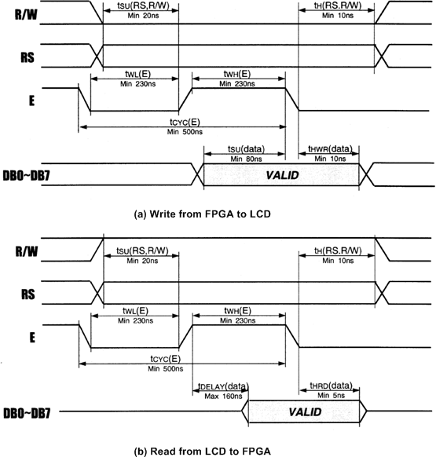
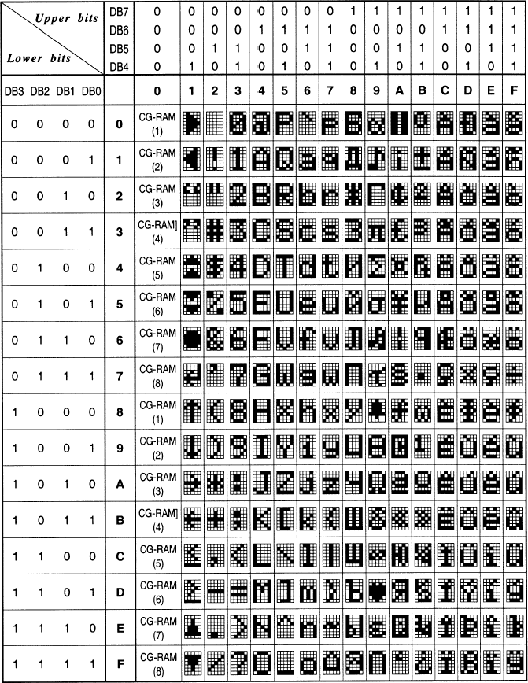
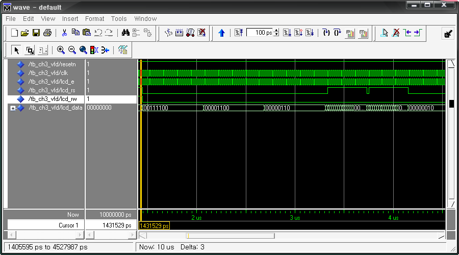

# 17. Character LCD 제어

## 17.1.  개요

Character LCD는 7-Segment보다 더 많은 양의 문자와 숫자를 표시시켜 줄 수 있는 Display장치이다. 이것은 이전의 데이터를 입력하면 바로 결과가 나타나는 다른 Peripheral과 다르게,동작 시키기 위한 설정이 필요하고, 데이터도 Timing에 맞추어서 전달시켜야 한다. 그 이유는Text LCD에는 액정에 문자를 display하기 위한 컨트롤러가 같이 구성되어 있기 때문에, 이Character LCD에 문자를 표시하기 위해서 이 컨트롤러를 제어해 주는 과정이 필요하다.

HBE-Combo III에 장착되어 사용되는 Character LCD는 VFD(Vacuum Fluorescent Display)로 다른 Character LCD와 제어하는 방법은 갖지만 표시 되는 방법이 다르다. 이 VFD는 CRT의 전자총 역할을 하는 필라멘트에서 항시 방출되는 전자를 형광체에 충돌시켜 자체적으로 발광시키는 소자를 사용한다. 예전의 다른 Character LCD와 다르게 하나의 도트마다 자체 발광하여 출력하는 장치라 할 수 있다.

앞에서 말한 것처럼 Character LCD는 각 제어신호의 동작 타이밍을 고려해야 한다. 아래 그림은 VFD 모듈의 데이터를 읽고 쓰는 동작에서의 타이밍을 나타내는 그림이다.

<br><br>

<p align="center">  </p>

<br><br>

아래 표는 VFD를 사용하기 위한 제어 명령어를 정리한 것이다. VFD 는 명령을 받아서 이를실행하기 위해서는 지정된 시간이 필요하므로,  그 다음의 명령을 보내기 전에 충분히 대기하거나 busy flag을 조사하여 앞에서 전송한 제어 코드의 실행이 완료되었는지의 여부를 확인해야 한다.

<div align="center">
  
| Instruction | RS | R/W | DB7 | DB6 | DB5 | DB4 | DB3 | DB2 | DB1 | DB0 |
|---|---|---|---|---|---|---|---|---|---|---|
| Display Data | 0 | 0 | 0 | 0 | 0 | 0 | 0 | 0 | 0 | 1 |
| Cursor Home | 0 | 0 | 0 | 0 | 0 | 0 | 0 | 0 | 1 | X |
| Entry Mode Set | 0 | 0 | 0 | 0 | 0 | 0 | 0 | 1 | I/D | S |
| Display On/Off Control | 0 | 0 | 0 | 0 | 0 | 0 | 1 | D | C | B |
| Cursor/Display Shift | 0 | 0 | 0 | 0 | 0 | 1 | S/C | R/L | X | X |
| Function Set | 0 | 0 | 0 | 0 | 1 | IF | N | X | BR1 | BR0 |
| CGRAM Address Setting | 0 | 0 | 0 | 1 | CG-RAM Address | CG-RAM Address | CG-RAM Address | CG-RAM Address | CG-RAM Address | CG-RAM Address |
| DDRAM Address Setting | 0 | 0 | 1 | DD-RAM Address | DD-RAM Address | DD-RAM Address | DD-RAM Address | DD-RAM Address | DD-RAM Address | DD-RAM Address |
| Busy Flag & Address Reading | 0 | 1 | BF | Address Counter | Address Counter | Address Counter | Address Counter | Address Counter | Address Counter | Address Counter |
| Busy Writing to CG-RAM or DD-RAM | 1 | 0 | Write Data | Write Data | Write Data | Write Data | Write Data | Write Data | Write Data | Write Data |
| Data Reading from CG-RAM or DD-RAM | 1 | 1 | Read Data | Read Data | Read Data | Read Data | Read Data | Read Data | Read Data | Read Data |

| 비트 | 설명 |
|---|---|
| I/D | 1 : Increment 0 : Decrement |
| S | 1 : Display shift enabled 0 : Cursor shift enabled |
| S/C | 1 : Display shift 0 : Cursor move |
| R/L | 1 : Shift to the right 0 : Shift to the left |
| IF | 1 : 8bit 0 : 4bit |
| N | 1 : 2 Line display 0 : 1 Line display |
| BF | 1 : Busy(Internally operation) 0 : Not Busy(Instruction acceptable) |
| BR1, BR0 | 00 : 100% 01 : 75% 10 : 50% 11 : 25% |

</div>

* Display Clear전체 화면을 지우고 어드레스 카운터를 DD-RAM 어드레스 0으로 하여 커서를 home 위치로옮긴다.
* Cursor homeDD RAM의 내용은 변경하지 않고 커서만을 home 위치로 옮긴다.
* Entry mode set데이터를 read하거나 write할 경우에 커서의 위치를 증가시킬 것인가(I/D=1) 감소 시킬 것인가(I/D=0)를 결정하며, 또 이때 화면을 시프트 할 것인지(S=1) 아닌지(S=0)를 결정한다.
* Display ON/OFF control화면 표시를 ON/OFF 하거나(D), 커서를 ON/OFF하거나©, 커서를 깜박이게 할 것인지(B)의 여부를 설정 한다.
* Cursor/Display shift화면(S/C=1) 또는 커서(S/C=0)를 오른쪽(R/L=1) 또는 왼쪽(R/L=0)으로 시프트 한다.
* Function set인터페이스에서 데이터의 길이를 8비트(DL=1) 또는 4비트(DL=0)로 설정하고, 화면 표시 행수를 2행(N=1) 또는 1행(N=0)으로 설정하며, 화면의 밝기를 BR1~0에 의해 100%, 75%, 50%, 25%로 설정을 해 줄 수 있다.※ 전원 투입 후 최초에는 주로 이 명령을 보내게 됩니다. 또한, 4비트로 인터페이스 할 경우에는 DB4~DB7 을 사용하며, 상위 4 bit를 먼저 전송하고 다음에 하위 4 bit를 전송해야 한다.
* CGRAM address SettingCharacter Generator RAM의 어드레스를 설정한다. 이 다음에 송수신하는 데이터는 CG RAM의데이터이다.
* DDRAM address SettingDisplay Data RAM의 어드레스를 설정한다. 이 다음에 송수신하는 데이터는 DD RAM의 데이터이다.
* Busy flag & address ReadingLCD 모듈이 내부 동작중임을 나타내는 Busy Flag(BF) 및 어드레스 카운터의 내용을 read 한다.LCD 모듈이 각 제어 코드를 실행하는데 설정된 시간이 필요하므로 FPGA가 BF를 읽어 1일 경우에는 기다리고 0일 경우에는 다음 제어 코드를 보내는 방법을 사용하면 보다 효율적인 처리가 가능하다.
* Data Writing to CG or DDRAMCG-RAM 또는 DDRAM에 데이터를 쓰는 동작을 한다.
* Data Reading from CG or DDRAMCG-RAM 또는 DDRAM에 데이터를 읽는 동작을 한다.

VFD에 전원을 인가해서 문자를 표시하는 흐름을 순서대로 나열하면 아래와 같다.
   * ①전원을 투입 한다.
   * ②Text LCD 모듈이 리셋 되려면 약 50ms가 소요되므로 이 시간 이상을 대기한다.
   * ③Function set 명령(001xxx00)을 전송한다.
   * ④Display ON/OFF control 명령(00001xxx)을 전송한다.
   * ⑤Entry mode set 명령(000001xx)을 전송한다.
   * ⑥DDRAM address를 전송한다.
   * ⑦문자 데이터를 연속으로 전송한다.
   * ⑧필요에 따라 위의 과정을 반복한다.

* DD-RAM 어드레스DD-RAM은 표시될 각 문자의 ASCII 코드 데이터가 저장되어 있는 메모리로 모두 80개의 번지가 있는데, 화면의 각 행과 열의 위치에는 고유한 Address 값이 부여된다. 그런데, 각 행과행 사이의 어드레스가 연속하여 있지 않으므로 주의하여야 한다. 표시 문자의 위치에 대한DD-RAM의 어드레스는 아래 표와 같다.

<div align="center">
  
|  | 1 | 2 | 3 | 4 | 5 | 6 | 7 | 8 | 9 | 10 | 11 | 12 | 13 | 14 | 15 | 16 |
|---|---|---|---|---|---|---|---|---|---|---|---|---|---|---|---|---|
| 1행 | 00 | 01 | 02 | 03 | 04 | 05 | 06 | 07 | 08 | 09 | 0A | 0B | 0C | 0D | 0E | 0F |
| 2행 | 40 | 41 | 42 | 43 | 44 | 45 | 46 | 47 | 48 | 49 | 4A | 4B | 4C | 4D | 4E | 4F |

</div>

표시 문자 세트VFD에서 화면에 표시할 수 있는 문자의 종류에는 대부분의 ASCII 도형문자들이 포함되며, 기타 일본어의 카타가나 문자와 몇 가지 특수문자들이 포함된다. 00H~0FH의 영역에는 사용자정의문자를 설정하여 사용할 수 있다. 여기에는 최대 8문자를 정의할 수 있는데, 이에 대한정보는 전원이 인가된 후에 정의되어야 하며, 전원이 꺼지면 정의된 내용은 기억되지 않는다.VFD에서 화면에 표시할 수 있는 문자 중 ASCII 도형문자의 종류와 코드 값이 아래의 표에 나타나 있다.


<br><br>

<p align="center">  </p>

<br><br>

## 17.2.  기본 제어

아래 예제는 VFD에 “This is Verilog HDL Text LCD Example” 문자를 표시하는 예제이다. 이 예제에서는 초기화를 위한 RESETN 신호와 100Hz의 클럭의 입력을 받아 VFD에 데이터를 출력하도록 구성되어 있다.

```verilog
// CH3_VFD.V
module CH3_VFD(RESETN, CLK,LCD_E, LCD_RS, LCD_RW,LCD_DATA);
input RESETN, CLK;
output LCD_E, LCD_RS, LCD_RW;
output [7:0] LCD_DATA;
wire LCD_E;
reg LCD_RS, LCD_RW;
reg [7:0] LCD_DATA;
reg [2:0] STATE;
parameter DELAY = 3'b000,
          FUNCTION_SET = 3'b001,
          ENTRY_MODE = 3'b010,
          DISP_ONOFF = 3'b011,
          LINE1 = 3'b100,
          LINE2 = 3'b101,
          DELAY_T = 3'b110,
          CLEAR_DISP = 3'b111;
integer CNT;
always @(posedge CLK)
begin
    if (RESETN == 1'b0)
        STATE = DELAY;
    else
    begin
        case (STATE)
            DELAY :
                if (CNT == 70) STATE = FUNCTION_SET;
            FUNCTION_SET :
                if (CNT == 30) STATE = DISP_ONOFF;
            DISP_ONOFF :
                if (CNT == 30) STATE = ENTRY_MODE;
            ENTRY_MODE :
                if (CNT == 30) STATE = LINE1;
            LINE1 :
                if (CNT == 20) STATE = LINE2;
            LINE2 :
                if (CNT == 20) STATE = DELAY_T;
            DELAY_T :
                if (CNT == 400) STATE = CLEAR_DISP;
            CLEAR_DISP :
                if (CNT == 200) STATE = LINE1;
            default :
                STATE = DELAY;
        endcase
    end
end
always @(posedge CLK)
begin
    if (RESETN == 1'b0)
        CNT = 0;
    else
    begin
        case (STATE)
            DELAY :
                if (CNT >= 70) CNT = 0;
                else CNT = CNT + 1;
            FUNCTION_SET :
                if (CNT >= 30) CNT = 0;
                else CNT = CNT + 1;
            DISP_ONOFF :
                if (CNT >= 30) CNT = 0;
                else CNT = CNT + 1;
            ENTRY_MODE :
                if (CNT >= 30) CNT = 0;
                else CNT = CNT + 1;
            LINE1 :
                if (CNT >= 20) CNT = 0;
                else CNT = CNT + 1;
            LINE2 :
                if (CNT >= 20) CNT = 0;
                else CNT = CNT + 1;
            DELAY_T :
                if (CNT >= 400) CNT = 0;
                else CNT = CNT + 1;
            CLEAR_DISP :
                if (CNT >= 200) CNT = 0;
                else CNT = CNT + 1;
            default :
                CNT = 0;
        endcase
    end
end
always @(posedge CLK)
begin
    if (RESETN == 1'b0)
    begin
        LCD_RS = 1'b1;
        LCD_RW = 1'b1;
        LCD_DATA = 8'b00000000;
    end
    else
    begin
        case (STATE)
            FUNCTION_SET :
                begin
                    LCD_RS = 1'b0;
                    LCD_RW = 1'b0;
                    LCD_DATA = 8'b00111100;
                end
            DISP_ONOFF :
                begin
                    LCD_RS = 1'b0;
                    LCD_RW = 1'b0;
                    LCD_DATA = 8'b00001100;
                end
            ENTRY_MODE :
                begin
                    LCD_RS = 1'b0;
                    LCD_RW = 1'b0;
                    LCD_DATA = 8'b00000110;
                end
            LINE1 :
                begin
                    LCD_RW = 1'b0;
                    case (CNT)
                        0 :
                            begin
                                LCD_RS = 1'b0;
                                LCD_DATA = 8'b10000000;
                            end
                        1 :
                            begin
                                LCD_RS = 1'b1;
                                LCD_DATA = 8'b00100000; //
                            end
                        2 :
                            begin
                                LCD_RS = 1'b1;
                                LCD_DATA = 8'b01010100; // T
                            end
                        3 :
                            begin
                                LCD_RS = 1'b1;
                                LCD_DATA = 8'b01101000; // H
                            end
                        15 :
                            begin
                                LCD_RS = 1'b1;
                                LCD_DATA = 8'b00100000; //
                            end
                        16 :
                            begin
                                LCD_RS = 1'b1;
                                LCD_DATA = 8'b00100000; //
                            end
                        default :
                            begin
                                LCD_RS = 1'b1;
                                LCD_DATA = 8'b00100000;
                            end
                    endcase
                end
            LINE2 :
                begin
                    LCD_RW = 1'b0;
                    case (CNT)
                        0 :
                            begin
                                LCD_RS = 1'b0;
                                LCD_DATA = 8'b11000000;
                            end
                        1 :
                            begin
                                LCD_RS = 1'b1;
                                LCD_DATA = 8'b01010100; // T
                            end
                        16 :
                            begin
                                LCD_RS = 1'b1;
                                LCD_DATA = 8'b01101100; // E
                            end
                        default :
                            begin
                                LCD_RS = 1'b1;
                                LCD_DATA = 8'b01100101;
                            end
                    endcase
                end
            DELAY_T :
                begin
                    LCD_RS = 1'b0;
                    LCD_RW = 1'b0;
                    LCD_DATA = 8'b00000010;
                end
            CLEAR_DISP :
                begin
                    LCD_RS = 1'b0;
                    LCD_RW = 1'b0;
                    LCD_DATA = 8'b00000001;
                end
            default :
                begin
                    LCD_RS = 1'b1;
                    LCD_RW = 1'b1;
                    LCD_DATA = 8'b00000000;
                end
        endcase
    end
end
assign LCD_E = CLK;
endmodule
```

위의 로직에서 29~91라인은 VFD를 동작시키기 위한 설정을 하고, 각 라인에 DISPLAY 데이터를 전달시키기 위한 FLOW를 만드는 부분이다. VFD를 동작시키기 위한 스테이트 머신은 첫번째 always문에서 구성되며, 처음 Delay 상태에서 FUNCTION SET상태로, 또, DISP_ONOFF,ENTRY_MODE로 바뀌어 VFD를 동작하기 위한 설정을 진행한다. 또, LINE1, LINE2상태에서VFD에 문자를 DISPLAY하고 DELAY_T에서 일정시간 VFD에서 문자를 DISPLAY한 내용을 유지하였다가 CLEAR_DISP에서 전체의 화면을 초기화 시킨다. 그리고, 다시 LINE1의 상태로 변경되어 LINE1, LINE2, DELAY_T, CLEAR_DISP의 상태가 순환되도록 구성되어 있다. 두 번째 always문에서는 위의 스테이트 머신의 상태가 바뀌는 시간을 카운트하는 블록이다. 각 상태일 때에일정 시간을 카운트(CNT) 한 후, 0으로 초기화 된다. 여기에서 만들어진 CNT의 값은 처음always 문에서 스테이트 머신의 상태를 바꾸는데 사용된다.108~347라인은 실제 VFD에 데이터를 보내는 블록이다. FUNCTION_SET, DISP_ONOFF,ENTRY_MODE, CLEAR_DISP는 VFD의 초기 설정을 하는 스테이트인데, LCD_RS와 LCD_RW에 0의 값을 출력하고, 해당 설정 데이터를 출력한다. LINE1과 LINE2의 상태에서는 각 라인의 첫ADDRESS만 설정하고, 그 후에 DISPLAY하려는 데이터를 출력한다. 여기에서 설정을 할 때에는 LCD_RS와 LCD_RW가 0의 값을 출력해야 하고, VFD에 문자를 DISPLAY할 때에는 LCD_RW는 마찬가지로 0의 값을 출력해야 하지만, LCD_RS는 1의 값을 출력해야 한다는 점에 유의 해야 한다. 각 라인의 첫 ADDRESS를 설정하는 것도 설정 이기 때문에 LCD_R에는 0을 출력해야한다. DISPLAY하려는 데이터는 앞에서 설명한 표시문자세트 표를 참고하면 된다.아래 테스트 벤치 파일이 이 예제를 시뮬레이션을 하기 위해서 예제에서 필요로 하는 입력신호를 생성하기 위한 것이다.

```verilog
// CH3_VFD_TB.V
`timescale 1ns / 1ps

module TestBench;

    // input
    reg RESETN, CLK;
    // output
    wire LCD_RW, LCD_RS, LCD_E;
    wire [7:0] LCD_DATA;

    // Instantiate the U1
    CH3_VFD U1(RESETN, CLK,
               LCD_E, LCD_RS, LCD_RW,
               LCD_DATA);

    // Specify input stimulus
    initial
    begin
        RESETN = 0;
        CLK = 0;
        #5 RESETN = 1;
    end

    always
    begin
        CLK = 0;
        #1;
        CLK = 1;
        #1;
    end

endmodule
```

이 테스트 벤치 파일은 22~32라인에서 CH3_VFD의 입력 신호인 RESETN과 CLK를 생성하는블록이 구현되어 있다.아래 그림은 ModelSim 소프트웨어로 시뮬레이션 한 결과를 나타낸다.

<br><br>

<p align="center">  </p>

<br><br>

이 예제를 HBE-Combo III에서 동작시키기 위해서는 아래 표와 같이 핀 설정을 해 주어야 한다.위의 로직에서 사용된 RESETN과 CLK의 입력은 각각 FPGA_RESET과 CLK의 입력을 설정하고,LCD_RS, LCD_RW, LCD_D의 출력 신호는 VFD의 해당 핀에 연결한다.

<div align="center">
  
| 포트 이름 | 핀 번호 | 하드웨어 설명 | 포트 이름 | 핀 번호 | 하드웨어 설명 |
|---|---|---|---|---|---|
| RESETN | C5 | FPGA_RESET | LCD_D[5] | L2 | VFD_D[5] |
| CLK | N2 | CLK1 | LCD_D[4] | L3 | VFD_D[4] |
| LCD_RS | J5 | VFD_RS | LCD_D[3] | K1 | VFD_D[3] |
| LCD_RW | J4 | VFD_RW | LCD_D[2] | K2 | VFD_D[2] |
| LCD_E | K5 | VFD_E | LCD_D[1] | K3 | VFD_D[1] |
| LCD_D[7] | K7 | VFD_D[7] | LCD_D[0] | K4 | VFD_D[0] |
| LCD_D[6] | K8 | VFD_D[6] |  |  |  |

</div>

핀 설정 후 컴파일 한다. 먼저 HBE-Combo III 장비에서 클럭의 입력은 100Hz 로 설정하고,위에서 생성된 프로그래밍 파일을 다운로딩 하여 그 동작을 살펴보자.  그리고, 로직을변경하여 VFD 에 DISPLAY 되는 데이터를 바꾸어보자.
