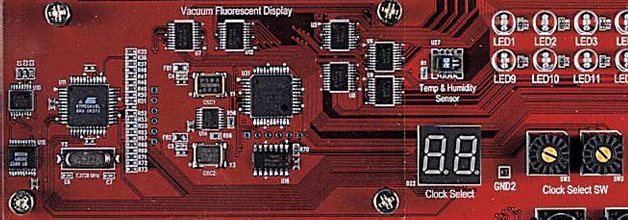
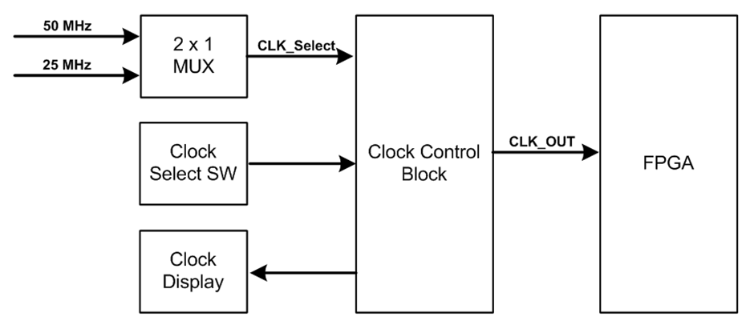
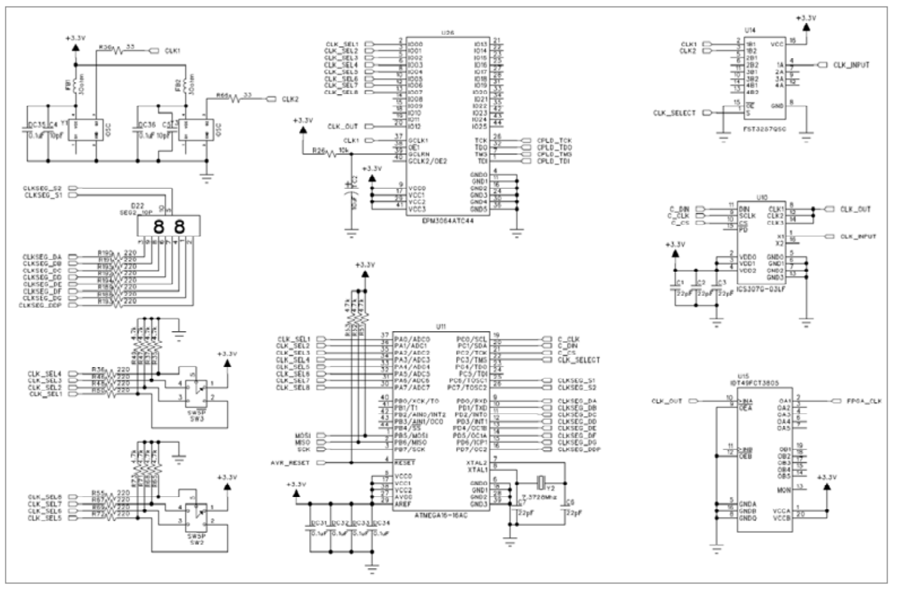
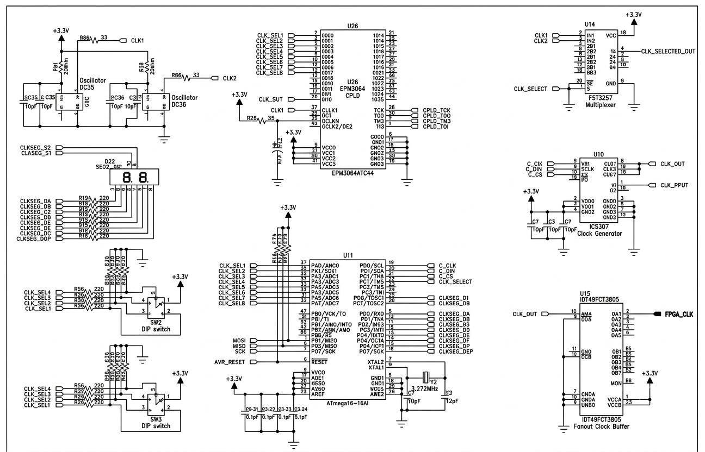

# 3.1 Clock Control Block

[← 목차로 돌아가기](03_제품_사용하기.md)

## 1) 구성
   * 장비 내부에는 사용자가 원하는 클럭을 선택해서 사용할 수 있도록 Clock Control Block을 두고 있습니다.
   * 여기에는 50, 25MHz의 두 종류의 클럭을 입력받아 0 ~ 250MHz의 클럭을 FPGA로 전달하고 있습니다.
   * 따라서 FPGA 설계 시 필요로 하는 대부분의 클럭을 이 블록에서 전달해 주고 있습니다.  <br>

   * 이 클럭은 0 ~ 10KHz의 클럭을 CPLD에서 생성하고,
   * 10KHz ~ 250MHz의 클럭을 AVR을 이용해서 클럭 발생 디바이스에서 생성하고 있습니다.
   * 이 클럭의 선택은 2개의 Clock Select SW를 통해 선택하고,
   * Clock Select의 2-digit 7-Segment를 통해 현재 어떠한 클럭이 선택되었는지 보여 주고 있습니다.
   * 클럭 선택은 이와 같이 오실레이터를 통한 클럭 발생부와 이 클럭을 제어하기 위한 클럭 제어부,
   * 그리고 이 클럭을 표시하기 위한 클럭 표시부로 나뉘게 됩니다. <br> 

   * 클럭 발생부는 2개의 오실레이터 중 1개의 오실레이터 출력 값을 선택하여 클럭 발생 디바이스로 전달을 합니다.
   * 이때 클럭의 선택은 AVR에서 2 x 1 MUX를 통해 이루어집니다. <br>

   * 클럭 제어부는 앞단에서 전달된 클럭을 사용자가 원하는 출력 클럭으로 만들어 주기 위해
   * 클럭 발생 디바이스의 레지스터를 설정하여 원하는 클럭을 발생하게 합니다.
   * 이때 클럭은 10KHz ~ 250MHz의 클럭을 발생시켜 주게 됩니다.
   * 또한 0 ~ 10KHz의 클럭은 CPLD에서 생성하게 됩니다.
   * 이렇게 클럭의 선택은 2개의 Clock Select SW를 통해 이루어집니다.
   * 따라서 Clock Select SW를 통해 AVR 또는 CPLD에서 클럭을 선택하고, 선택된 클럭은 FPGA로 전달이 됩니다. <br>

   * 클럭 표시부는 Clock Select SW를 통해 선택되어진 클럭을 2개의 7-Segment를 통해 표시해 줍니다.
   * 클럭의 선택은 Clock Select SW에 있는 숫자를 통해 확인할 수도 있고,
   * 7-Segment를 통해 간편하게 확인할 수 있습니다.

<p align="center">
  
  
</p>

> **그림 3-1** · Clock Control Block 구성

## 2) 동작

   장비에서 사용하는 클럭은 기본으로 Base Board에 있는 50MHz를 가지고 사용하게 됩니다.  <br>
   따라서 클럭 제어 스위치를 조절하면 7-Segment에 현재 FPGA 디바이스 모듈로 공급되는 클럭 값이 표시되고 있습니다. <br> <br>

   이 스위치를 조절하여 0Hz ~ 250MHz의 분주된 클럭의 값을 FPGA 디바이스 모듈로 전달되게 됩니다.  <br>
   또한 FPGA 디바이스 모듈에는 별도로 오실레이터를 꽂아 사용할 수 있는 소켓을 구성해 놓았습니다.  <br>
   이 소켓에는 사용자가 원하는 값을 가진 오실레이터를 장착해서 사용할 수 있습니다. <br>
   따라서 이 자리에 오실레이터를 장착하고 User Clk EN 스위치를 On 하여 사용하면 됩니다.  <br>
   Main Clock과 User Clock은 서로 다른 입력 전용 핀으로 연결되어 있으므로 설계 소프트웨어에서 핀 연결을 하여 사용하면 됩니다. <br> <br>

   오실레이터의 출력 클럭은 다음 표에서 확인할 수 있습니다. <br>
   표에서는 Clock Select 스위치에 따른 출력 주파수를 확인할 수 있습니다.  <br>
   장비에서는 출력 클럭의 확인을 2개의 7-Segment를 이용하여 현재 Clock Select SW의 값을 확인할 수 있고, <br>
   이 값은 다음의 표를 통해 현재 FPGA로 입력되는 클럭 값을 확인할 수 있습니다. <br>
   클럭 값은 다음 표를 참고하시기 바랍니다. <br> <br>

| Clock SW | 클럭 입력 | Clock SW | 클럭 입력 | Clock SW | 클럭 입력 | Clock SW | 클럭 입력 |
|:---:|:---:|:---:|:---:|:---:|:---:|:---:|:---:|
| 00 | 0Hz | 01 | 1Hz | 02 | 5Hz | 03 | 10Hz |
| 04 | 25Hz | 05 | 50Hz | 06 | 100Hz | 07 | 250Hz |
| 08 | 500Hz | 09 | 1KHz | 0A | 2.5KHz | 0B | 5KHz |
| 0C | 10KHz | - | - | - | - | - | - |
| 10 | 15KHz | 11 | 20KHz | 12 | 25KHz | 13 | 30KHz |
| 14 | 35KHz | 15 | 40KHz | 16 | 45KHz | 17 | 50KHz |
| 18 | 55KHz | 19 | 60KHz | 1A | 65KHz | 1B | 70KHz |
| 1C | 75KHz | 1D | 80KHz | 1E | 85KHz | 1F | 90KHz |
| 20 | 95KHz | 21 | 100KHz | 22 | 150KHz | 23 | 200KHz |
| 24 | 250KHz | 25 | 300KHz | 26 | 350KHz | 27 | 400KHz |
| 28 | 450KHz | 29 | 500KHz | 2A | 550KHz | 2B | 600KHz |
| 2C | 650KHz | 2D | 700KHz | 2E | 750KHz | 2F | 800KHz |
| 30 | 850KHz | 31 | 900KHz | 32 | 950KHz | 33 | 1MHz |
| 34 | 1.5MHz | 35 | 2MHz | 36 | 2.5MHz | 37 | 3MHz |
| 38 | 3.5MHz | 39 | 4MHz | 3A | 4.5MHz | 3B | 5MHz |
| 3C | 5.5MHz | 3D | 6MHz | 3E | 6.5MHz | 3F | 7MHz |
| 40 | 7.5MHz | 41 | 8MHz | 42 | 8.5MHz | 43 | 9MHz |
| 44 | 9.5MHz | 45 | 10MHz | 46 | 15MHz | 47 | 20MHz |
| 48 | 25MHz | 49 | 30MHz | 4A | 35MHz | 4B | 40MHz |
| 4C | 45MHz | 4D | 50MHz | 4E | 55MHz | 4F | 60MHz |
| 50 | 65MHz | 51 | 70MHz | 52 | 75MHz | 53 | 80MHz |
| 54 | 85MHz | 55 | 90MHz | 56 | 95MHz | 57 | 100MHz |
| 58 | 125MHz | 59 | 150MHz | 5A | 200MHz | 5B | 250MHz |

## 3) 회로도

<p align="center">
  
  
</p>

```
[오실레이터 (DC35/DC36)]
       │ (CLK1, CLK2)
       ▼
[U14: FST3257QSC] ──(CLK_INPUT)──▶ [U10: ICS307G-03LF] ──(CLK1 out / CLK_OUT)
(CLK_SELECT by MCU)                    │ (Bit-bang Control: C_DIN, C_CLK, C_CS)
                                       ▼
                             [U26: EPM3064ATC44 CPLD] ──(GCLK1 입력 / CLK_OUT 출력)
                                       │ (Control: CLK_SEL1~8 from MCU/SW)
                                       ▼
                             [U15: IDT49FCT3805]
                                       │ (1-to-10 Fanout Buffer)
                                       ▼
                                   [FPGA_CLK]
```


## 4) 핀 구성표

| FPGA Signal | Altera | Xilinx | Description |
|:---:|:---:|:---:|:---:|
| CLK_MAIN[0] | N2 | F13 | Main Clock Input |
| CLK_MAIN[1] | N25 | AF14 | Main Clock Input |
| CLK_USER[0] | A13 | B14 | User Clock Input |
| CLK_USER[1] | D13 | AF13 | User Clock Input |


## 5) CPLD

```verilog
module cpld_clock_divider (
    input  wire       CLK1_IN,      // Pin 37: GCLK1 (ICS307 CLK_OUT 입력)
    input  wire [7:0] CLK_SEL,      // Pin 2,3,5,6,8,10,11,12 (CLK_SEL1~8)
    output reg        CLK_OUT       // Pin 18: IO13 (IDT49FCT3805 입력으로 전달)
);

    // 16비트 카운터 (필요에 따라 분주율 확장 가능)
    reg [15:0] clk_divider = 16'd0;

    always @(posedge CLK1_IN) begin
        clk_divider <= clk_divider + 1'b1;
    end

    // CLK_SEL[7:0] 설정값에 따른 클럭 출력 선택
    always @(*) begin
        case (CLK_SEL)
            8'h00:   CLK_OUT = CLK1_IN;         // 바이패스 (분주 없음)
            8'h01:   CLK_OUT = clk_divider[0];  // 1/2 분주
            8'h02:   CLK_OUT = clk_divider[1];  // 1/4 분주
            8'h03:   CLK_OUT = clk_divider[2];  // 1/8 분주
            8'h04:   CLK_OUT = clk_divider[3];  // 1/16 분주
            8'h05:   CLK_OUT = clk_divider[7];  // 1/256 분주
            8'h06:   CLK_OUT = clk_divider[11]; // 1/4096 분주
            8'h07:   CLK_OUT = clk_divider[15]; // 1/65536 분주 (저주파 대역)
            default: CLK_OUT = CLK1_IN;         // 기본값: 바이패스
        endcase
    end

endmodule

```

```VHDL
library IEEE;
use IEEE.STD_LOGIC_1164.ALL;
use IEEE.STD_LOGIC_UNSIGNED.ALL;

entity cpld_clock_divider is
    Port (
        CLK1_IN : in  STD_LOGIC;                    -- GCLK1 (Pin 37)
        CLK_SEL : in  STD_LOGIC_VECTOR (7 downto 0);-- IO0~IO7
        CLK_OUT : out STD_LOGIC                     -- IO13 (Pin 18)
    );
end cpld_clock_divider;

architecture Behavioral of cpld_clock_divider is
    signal clk_divider : STD_LOGIC_VECTOR(15 downto 0) := (others => '0');
begin

    -- 카운터 기반 분주기
    process(CLK1_IN)
    begin
        if rising_edge(CLK1_IN) then
            clk_divider <= clk_divider + 1;
        end if;
    end process;

    -- CLK_SEL 멀티플렉싱
    process(CLK_SEL, CLK1_IN, clk_divider)
    begin
        case CLK_SEL is
            when x"00"  => CLK_OUT <= CLK1_IN;
            when x"01"  => CLK_OUT <= clk_divider(0);
            when x"02"  => CLK_OUT <= clk_divider(1);
            when x"03"  => CLK_OUT <= clk_divider(2);
            when x"04"  => CLK_OUT <= clk_divider(3);
            when x"05"  => CLK_OUT <= clk_divider(7);
            when x"06"  => CLK_OUT <= clk_divider(11);
            when x"07"  => CLK_OUT <= clk_divider(15);
            when others => CLK_OUT <= CLK1_IN;
        end case;
    end process;

end architecture Behavioral;

```


## 6) ATMEGA

```c
#define F_CPU 7372800UL
#include <avr/io.h>
#include <util/delay.h>

// PIN 정의 (PORTC)
#define C_CLK      PC0
#define C_DIN      PC1
#define C_CS       PC2
#define CLK_SELECT PC3
#define CLKSEG_S1  PC5
#define CLKSEG_S2  PC7

// 7-Segment 애노드/캐소드 패턴 (Common Anode 기준)
// 0~9 Hex 패턴 (A~G + DP)
const uint8_t SEG_PATTERNS[16] = {
    0xC0, // 0
    0xF9, // 1
    0xA4, // 2
    0xB0, // 3
    0x99, // 4
    0x92, // 5
    0x82, // 6
    0xF8, // 7
    0x80, // 8
    0x90, // 9
    0x88, // A
    0x83, // b
    0xC6, // C
    0xA1, // d
    0x86, // E
    0x8E  // F
};

// ICS307G-03LF 3-Wire Bit-Bang 전송 함수 (24비트 제어 워드)
void ICS307_WriteWord(uint32_t data) {
    // CS Low 설정 (전송 시작 준비)
    PORTC &= ~(1 << C_CS);
    PORTC &= ~(1 << C_CLK);
    _delay_us(1);

    // MSB부터 24비트 시프트 전송
    for (int i = 23; i >= 0; i--) {
        if (data & ((uint32_t)1 << i)) {
            PORTC |= (1 << C_DIN);
        } else {
            PORTC &= ~(1 << C_DIN);
        }
        _delay_us(1);

        // Clock High
        PORTC |= (1 << C_CLK);
        _delay_us(1);
        // Clock Low
        PORTC &= ~(1 << C_CLK);
        _delay_us(1);
    }

    // CS High / Strobe (데이터 래치)
    PORTC |= (1 << C_CS);
    _delay_us(2);
    PORTC &= ~(1 << C_CS);
}

// 7-Segment 다이내믹 디스플레이 출력 (2자리)
void Display_Hex8(uint8_t value) {
    uint8_t high_nibble = (value >> 4) & 0x0F;
    uint8_t low_nibble  = value & 0x0F;

    // Digit 1 (십의 자리 / High Nibble)
    PORTC &= ~(1 << CLKSEG_S2); // S2 Off
    PORTD = SEG_PATTERNS[high_nibble];
    PORTC |= (1 << CLKSEG_S1);  // S1 On
    _delay_ms(2);

    // Digit 2 (일의 자리 / Low Nibble)
    PORTC &= ~(1 << CLKSEG_S1); // S1 Off
    PORTD = SEG_PATTERNS[low_nibble];
    PORTC |= (1 << CLKSEG_S2);  // S2 On
    _delay_ms(2);
}

int main(void) {
    // 1. GPIO 방향 설정
    DDRA = 0x00; // PORTA 입력 (SW2, SW3 스위치/CPLD 입력 읽기)
    PORTA = 0xFF; // 풀업 저항 활성화

    DDRC |= (1 << C_CLK) | (1 << C_DIN) | (1 << C_CS) | (1 << CLK_SELECT) | (1 << CLKSEG_S1) | (1 << CLKSEG_S2);
    DDRD = 0xFF; // PORTD 전체 출력 (7-Segment Segment 데이터선)

    // 2. 초기 상태 설정
    PORTC &= ~(1 << CLK_SELECT); // OSC1 (CLK1) 선택

    // 3. ICS307 초기 주파수 레지스터 설정값 전송 (예시 데이터 워드)
    // ICS307 데이터시트에 따른 R, V, S 비트 설정
    uint32_t ics307_config_word = 0x123456; 
    ICS307_WriteWord(ics307_config_word);

    uint8_t sw_val = 0;

    while (1) {
        // DIP 스위치 / CPLD 입력 상태 읽기 (Active-Low일 경우 반전)
        sw_val = ~PINA;

        // MUX 클럭 선택 제어 (스위치 7번 비트에 따라 OSC1 / OSC2 변경)
        if (sw_val & 0x80) {
            PORTC |= (1 << CLK_SELECT);  // CLK2 선택
        } else {
            PORTC &= ~(1 << CLK_SELECT); // CLK1 선택
        }

        // 7-Segment 표시 업데이트
        Display_Hex8(sw_val);
    }

    return 0;
}

```

