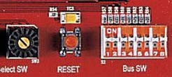
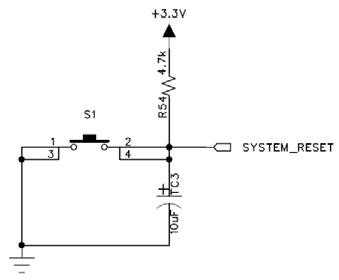

# 3.2 Reset Switch

[← 목차로 돌아가기](03_제품_사용하기.md)

**1)** 구성

장비에서는 기본으로 제공하는 버튼 스위치 이외에 소스 설계 시 Reset 용도로 사용 할 수 있도록 버튼 스위치를 구성하고 있습니다. 이 스위치는 FPGA 디바이스와 연결 되어 있으며, FPGA 동작 시 이 버튼에 의해 Reset 동작에 이용할 수 있습니다.

**2)** 동작

이 스위치는 Reset 스위치의 용도이기 때문에 버튼 스위치와는 달리 눌렀을 때, 0 의 값이 FPGA로 전달 됩니다. 따라서 FPGA에서는 이 버튼 스위치의 0 이 되는 동작을 감지하여 리셋 시점으로 이용할 수 있습니다.

**3)** 회로

회로에서도 알 수 있듯이 버튼이 눌려지면 0 의 값이 FPGA로 전달 됩니다.

**4)** 핀 구성표

| FPGA Signal | Altera | Xilinx | Description |
|:-----:|:-----:|:-----:|:-----:|
| Reset | C5 | AB7 | Reset Switch |
