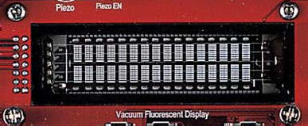
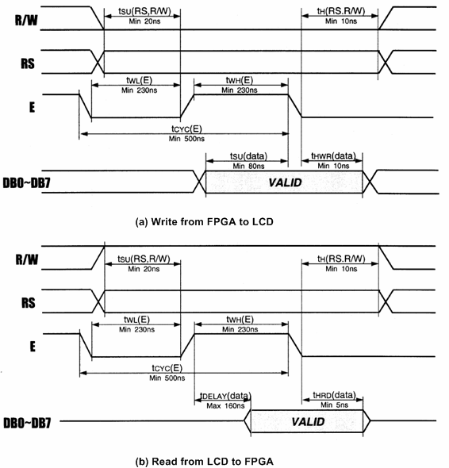
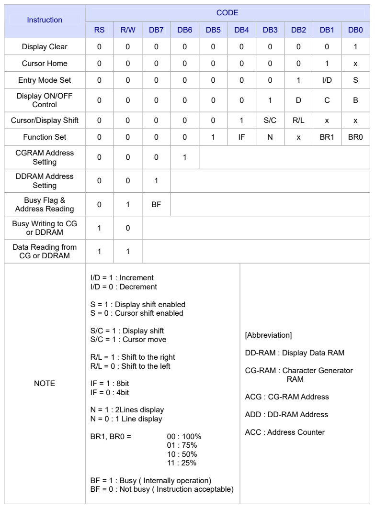
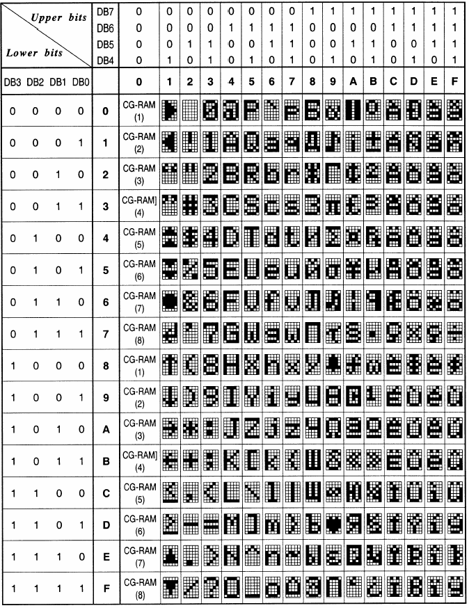
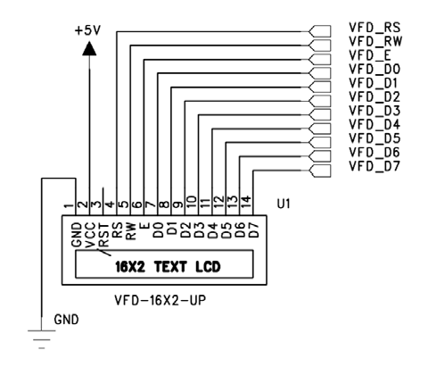

# 3.3 VFD (16 x 2 Line)

[← 목차로 돌아가기](03_제품_사용하기.md)

---

## 1) VFD란

   * VFD[Vacuum Fluorescent Display]는 형광 표시 판으로써 1960년도에 개발되어 전자 계산기에 적용되기 시작 하였으며, 80년대에 다색화에 성공하여 여러 색깔을 만들어 가고 있습니다.
   * 이 모듈은 CRT의 전자총 역할을 하는 필라멘트에서 항시 방출되는 전 자를 형광체에 충돌시켜 자체적으로 발광시키는 소자입니다.
   * 따라서 예전의 Text LCD 에서 보는 백 라이트에서 보는 것과 달리 하나의 도트마다 자체 발광하여 출력하는 장치라 할 수 있습니다.

---

## 2) 특징

   * VFD는 형광 물질의 조절로 여러가지 색의 표시가 용이하고, 자체적으로 발광하기 때 문에 시인성이 뛰어납니다.
   * 또한 LED등과 비교 시 빛이 부드러워 눈의 피로를 덜고 어두운 곳이나 밝은 곳에서도 문자 식별이 가능하며,
   * 시야 각 또한 우수하고 저 전압 으로 구동이 가능하여 부품의 적용이 쉬우며 고 신뢰성을 가지고 있습니다.

---

## 3) 구성

   * VFD 모듈의 외부 구조는 아래의 그림과 같이 16문자 X 2의 표시부를 가지며 표시부 좌측에 커넥터가 위치한 형태입니다.

> **그림 3-2** · 16 x 2 VFD

   * 사용되는 인터페이스 커넥터 핀의 기능을 요약하면 다음의 표와 같습니다.

| 핀 | 신호명 | 기능 |
|:------:|:------:|:------:|
| 1 | GND | 전원 GND |
| 2 | VCC | 전원 +5V |
| 3 | /RST | Reset input |
| 4 | RS | Register Select ( 0 = instruction, 1 = data ) |
| 5 | R/W | Read/Write ( 0 = FPGA -> LCD, 1 : FPGA <- LCD ) |
| 6 | E | Enable Signal for read/write LCD |
| 7 | DB0 (LSB) | |
| 8 | DB1 | |
| 9 | DB2 | |
| 10 | DB3 | |
| 11 | DB4 | |
| 12 | DB5 | |
| 13 | DB6 | |
| 14 | DB7 | |

> **<표 3-1>** VFD 인터페이스 핀

---

## 4) 동작 타이밍

   * VFD 모듈은 FPGA로 접속할 때는 각 제어신호의 동작 타이밍을 고려하여야 합니다. VFD 모듈은 과거의 Text LCD 보다 동작 타이밍에 대한 성능이 우수해 졌습니다. VFD 모듈의 read 및 write 동작시의 타이밍 도를 보면 아래의 그림과 같습니다.

> **그림 3-3** · VFD 모듈의 동작 타이밍

   * VFD 모듈을 사용하기 위한 제어 명령을 정리하면 다음 페이지와 표와 같습니다.
   * 이들 명령은 FPGA가 VFD 모듈을 제어하는 프로그램에서 사용되며 데이터 버스 DB0~DB7 을 통하여 전송됩니다.

   * VFD 모듈이 각 명령을 받아 이를 실행하기 위해서는 지정된 시간이 필요하므로 FPGA는 그 다음의 명령을 보내기 전에 충분히 대기하거나 busy flag을 조사하여 앞 에서 전송한 제어 코드의 실행이 완료되었는지의 여부를 확인하여야 합니다.

> **<표 3-2>** VFD모듈 제어명령

▪ **Display Clear**
   * ▶ 전체 화면을 지우고 어드레스 카운터를 DD-RAM 어드레스 0으로 하여 커서를 home 위치로 합니다.

▪ **Cursor home**
   * ▶ DD RAM의 내용은 변경하지 않고 커서만을 home 위치로 합니다.

▪ **Entry mode set**
   * ▶ 데이터를 read하거나 write할 경우에 커서의 위치를 증가시킬 것인가(I/D=1) 감소 시킬 것인가 (I/D=0)를 결정하며, 또 이때 화면을 시프트 할 것인지(S=1) 아닌지(S=0)를 결정합니다.

▪ **Display ON/OFF control**
   * ▶ 화면 표시를 ON/OFF 하거나(D) 커서를 ON/OFF하거나(C) 커서를 깜박이게 할 것인지(B)의 여 부를 지정 합니다.

▪ **Cursor/Display shift**
   * ▶ 화면(S/C=1) 또는 커서(S/C=0)를 오른쪽(R/L=1) 또는 왼쪽(R/L=0)으로 시프트 합니다.

▪ **Function set**
   * ▶ 인터페이스에서 데이터의 길이를 8비트(DL=1) 또는 4비트(DL=0)로 지정하고, 화면 표시 행수 를 2행(N=1) 또는 1행(N=0)으로 지정하며, 화면의 밝기를 BR1~0에 의해 100%, 75%, 50%, 25%로 설정을 해 줄 수 있습니다.
   * ※ 전원 투입 후 최초에는 주로 이 명령을 보내게 됩니다. 또한, 4비트로 인터페이스 할 경우에는 DB4~DB7을 사용하며, 상위 4 bit를 먼저 전송하고 다음에 하위 4 bit를 전송해야 합니다.

▪ **CGRAM address Setting**
   * ▶ Character Generator RAM의 어드레스를 지정합니다. 이후에 송수신하는 데이터는 CG RAM 의 데이터입니다.

▪ **DDRAM address Setting**
   * ▶ Display Data RAM의 어드레스를 지정합니다. 이후에 송수신하는 데이터는 DD RAM의 데이터 입니다.

▪ **Busy flag & address Reading**
   * ▶ LCD 모듈이 내부 동작중임을 나타내는 Busy Flag(BF) 및 어드레스 카운터의 내용을 read 합 니다.
   * LCD 모듈이 각 제어 코드를 실행하는데 지정된 시간이 필요하므로 FPGA가 BF를 읽어 1일 경우에는 기다리고 0일 경우 다음 제어 코드를 보내는 방법을 사용하면 보다 효율적인 처 리가 가능 합니다.

▪ **Data Writing to CG or DDRAM**
   * ▶ CG-RAM 또는 DDRAM에 데이터를 쓰는 동작을 합니다.

▪ **Data Reading from CG or DDRAM**
   * ▶ CG-RAM 또는 DDRAM에 데이터를 읽는 동작을 합니다.

* VFD 모듈을 전원 투입부터 초기화하는 과정을 요약하면 다음과 같습니다.
   * 전원을 투입 합니다.
   * VFD 모듈이 리셋 되려면 약 50ms가 소요되므로 이 시간 이상을 기다립니다.
   * Function set 명령(001xxx00)을 보냅니다.
   * Display ON/OFF control 명령(00001xxx)을 보냅니다.
   * Entry mode set 명령(000001xx)을 보냅니다.
   * DDRAM address를 보냅니다.
   * 문자 데이터를 연속으로 보냅니다.
   * 필요에 따라 위의 과정을 반복 합니다.

---

## 5) DD RAM 어드레스

* DD RAM은 표시될 각 문자의 ASCII 코드 데이터가 저장되어 있는 메모리이며 모두 80개의 번지가 있는데, 화면의 각 행과 열의 위치에는 고유한 Address 값이 부여됩니다.
* 그런데, 각 행과 행 사이의 어드레스가 연속하여 있지 않으므로 주의하여야 한다. 표시 문자의 위치에 대한 DD RAM의 어드레스는 <표 3-3>과 같습니다.

| | 1 | | | | | | | | | | | | | | | 16 |
|:----:|:----:|:----:|:----:|:----:|:----:|:----:|:----:|:----:|:----:|:----:|:----:|:----:|:----:|:----:|:----:|:----:|
| 제1행 | 00 | 01 | 02 | 03 | 04 | 05 | 06 | 07 | 08 | 09 | 0A | 0B | 0C | 0D | 0E | 0F |
| 제2행 | 40 | 41 | 42 | 43 | 44 | 45 | 46 | 47 | 48 | 49 | 4A | 4B | 4C | 4D | 4E | 4F |

> **<표 3-3>** 표시문자 위치에 대한 DD RAM 어드레스

---

## 6) 표시 문자 세트

* VFD 모듈에서 화면에 표시할 수 있는 문자의 종류에는 대부분의 ASCII 도형문자들이 포함되며, 기타 일본어의 카타가나 문자와 몇 가지 특수문자들이 포함됩니다.
* 00H~0FH의 영역에는 사용자 정의문자를 설정하여 사용할 수 있다. 여기에는 최대 8 문자를 정의할 수 있는데, 이에 대한 정보는 전원이 인가된 후에 정의되어야 하며,
* 전원이 꺼지면 정의된 내용은 기억되지 않습니다.
* VFD 모듈에서 화면에 표시할 수 있는 문자 중 ASCII 도형문자의 종류와 코드 값을 보면 아래의 표와 같습니다.

> **<표 3-4>** ASCII 도형문자의 종류 및 코드

---

## 7) 회로도

* VFD 모듈은 총 14개의 핀으로 구성되어 있습니다.
* 여기에는 전원 및 데어터 전송, 컨 트롤 핀, reset핀으로 구성되어 있습니다.
* 회로도에 나와 있는것과 같이 전원은 보드 에서 공급받아 사용할 수 있도록 구성 되어 있고,
* Reset 핀은 하드웨어적으로는 사용 하고 있지 않습니다.
* VFD의 사요을 위해서는 제어신호인 VFD_RS, VFD_RW, VFD_E 의 제어신호와 데이터 신호 8개를
* FPGA에서 직접 제어하여 VFD를 Display 하게 됩 니다.

---

## 8) 핀 구성표

| FPGA Signal | Altera | Xilinx | Description |
|:-------:|:-------:|:-------:|:-------:|
| VFD_D[0] | K4 | L10 | VFD_DATA |
| VFD_D[1] | K3 | L9 | VFD_DATA |
| VFD_D[2] | K2 | L7 | VFD_DATA |
| VFD_D[3] | K1 | L4 | VFD_DATA |
| VFD_D[4] | L3 | M6 | VFD_DATA |
| VFD_D[5] | L2 | M5 | VFD_DATA |
| VFD_D[6] | K8 | M4 | VFD_DATA |
| VFD_D[7] | K7 | M3 | VFD_DATA |
| VFD_E | K5 | M1 | VFD Enable |
| VFD_RW | J4 | K8 | VFD Read/Write |
| VFD_RS | J5 | K9 | VFD Register Select |

