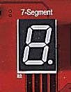
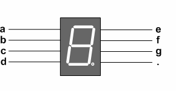
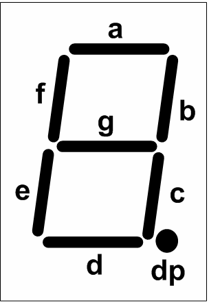
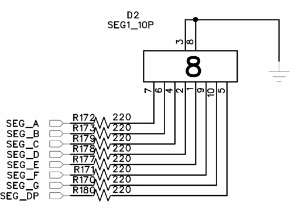

# 3.4 7-Segment

[← 목차로 돌아가기](03_제품_사용하기.md)

**1)** 구성

7-Segment는 LED를 통해 숫자를 표현할 수 있는 장치로 현재 장비에서는 1개로 구 성된 것과 8개의 7-Segment가 Array로 구성된 방식을 기본으로 구성하고 있습니다. 1개의 숫자를 표현할 수 있는 7-Segment는 8개의 LED를 통해 숫자를 표현할 수 있 는 방식으로 데이터 라인도 8개로 구성되어 있습니다. 따라서 8개의 데이터 라인을 제어하여 0 ~ F의 숫자를 Display 할 수 있습니다.

> **그림 3-4** · 7-Segment LED 구성

**2)** 동작

현재 장착되어 있는 7-Segment는 Cathode 방식의 장치로써 FPGA에서 1 의 값을 전달하면 해당하는 7-Segment의 LED에 불이 켜집니다. 따라서 a ~ g의 7개의 데이 터 라인을 통해 숫자를 표시하고 .의 DP를 이용하여 Segment의 DOT를 표시하게 됩 니다. 따라서 8개의 데이터 라인을 통해 1 의 값을 주면 켜지고 반대로 0 의 값 을 주면 꺼지는 방식을 통해 숫자를 표시하게 됩니다. 7-Segment의 각 LED는 다음의 그림과 같이 배치가 되어 있고 이것을 제어하기 위해 8개의 데이터 선이 라인이 필요합니다. 예를 들어 숫자 2 를 표현하기 위해 a, b, g, e, d 에 1 라는 값을 주고 나머지는 0 의 값을 주어야 합니다.

**3)** 회로도

**4)** 핀 구성표

| FPGA Signal | Altera | Xilinx | Description |
|:-------:|:-------:|:-------:|:-------:|
| SEG_DATA_A | M3 | N1 | Segment data A |
| SEG_DATA_B | M2 | M10 | Segment data B |
| SEG_DATA_C | L7 | M9 | Segment data C |
| SEG_DATA_D | L6 | M8 | Segment data D |
| SEG_DATA_E | L4 | M7 | Segment data E |
| SEG_DATA_F | P6 | N7 | Segment data F |
| SEG_DATA_G | P4 | N6 | Segment data G |
| SEG_DATA_DP | P3 | N5 | Segment data DP |