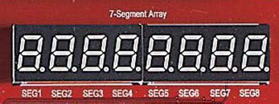
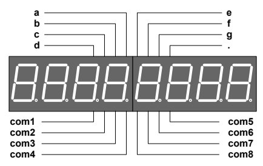
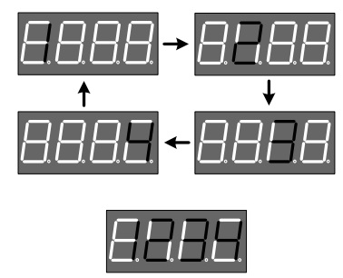
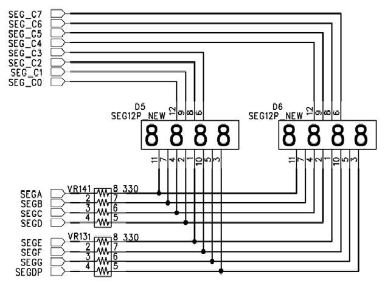

# 3.5 7-Segment Array

[← 목차로 돌아가기](03_제품_사용하기.md)

**1)** 구성

이전의 장치는 1개의 숫자만 표현하기 위한 것이라면, 이번 장치에서 사용된 것은 4개 의 7-Segment가 하나로 구성되어 있는 것을 두 개를 연결하여 다음 그림과 같은 구 성으로 이루어져 있습니다. 이러한 구성은 7-Segment를 이용한 시계 표현을 지원하 기 위한 구성으로 장비에서 기본으로 지원해 주고 있습니다.

> **그림 3-5** · 7-Segnent LED Array 구성

**2)** 동작

일반적인 방법에서의 7-Segment라면 8개를 사용할 경우 하나의 7-Segment당 출력 인 a , b , c , d , e , f , g , . 가 각각 출력 핀을 가져 64개의 출력 핀이 필요로 하게 됩니다. 이러 할 경우 FPGA의 한정된 핀을 가지고 Segment에 너무 많은 핀이 할당되게 되므로 핀 소모를 개선하기 위하여 위와 같이 7-Segment의 Data 라인은 공통으로 연결되어 있고 출력할 위치인 7-Segment를 지정하는 com1 ~ com8의 값을 제어하여 원하는 숫자나 문자를 표시하는 방법을 사용하게 됩니다. 이렇게 하면 16개의 핀을 가지고 8개의 7-Segment를 제어하게 됩니다. 따라서 8개의 7-Segment 중에 Display 하려는 Segment common 핀을 선택하고 동시에 Segment에 Data를 주는 형태로 7-Segment를 제어할 수 있다. 아래의 그림은 4개의 7-Segment 에 1234 의 숫자를 표시하기 위한 방법을 설명한 것입니다.

다시 설명하면 7-segment 데이터 값을 00000110 로 주어 1 를 표시하는 값을 주고 com1에 0 을 그리고 나머지 com2~4는 1 의 값을 주면 첫째 7-Segment 에 1 이 표시됩니다. 다음으로 데이터에 01011011 을 주어 2 의 값을 주고 com2에 0 과 com1, com3~4에 1 을 주면 둘째 7-Segment에 2가 표시됩니다. 이런 순서로 4까지의 숫자를 표시하고 다시 처음으로 돌아가 위의 내용을 반복합니다. 이를 약 1ms 이상의 주기로 반복하면 잔상효과에 의해 1234 의 숫자가 모두 켜져 있는 것처럼 표시되게 됩니다. 이러한 형태로 8개의 7-segment를 com 핀을 이용하여 선택하고, 해당되는 data 값을 줌으로써 각각의 7-Segment의 제어가 가능하게 됩니 다.

**3)** 회로도

이전에 설명 했듯이 회로도 에서는 16개의 핀을 가지고 7개의 Segment를 제어하고 있 습니다. 위쪽에 있는 SEG_C의 8개의 핀을 이용하여 각각의 Segment를 선택하게 됩 니다. 그리고 데이터 핀인 SEGA~SEGDP의 핀을 제어하여 7-Segment를 제어하게 됩 니다. 이 모든 작업은 FPGA 디바이스와 연결된 I/O핀에서 제어를 하면 됩니다.

**4)** 핀 구성표

| FPGA Signal | Altera | Xilinx | Description |
|:-------:|:-------:|:-------:|:-------:|
| SEG_COM[0] | T3 | P9 | Segment 1 Select |
| SEG_COM[1] | T2 | P8 | Segment 2 Select |
| SEG_COM[2] | R7 | P7 | Segment 3 Select |
| SEG_COM[3] | R6 | P6 | Segment 4 Select |
| SEG_COM[4] | U3 | R4 | Segment 5 Select |
| SEG_COM[5] | U2 | R3 | Segment 6 Select |
| SEG_COM[6] | U1 | R2 | Segment 7 Select |
| SEG_COM[7] | T7 | R1 | Segment 8 Select |
| SEG_DATA_A | M5 | N4 | Segment data A |
| SEG_DATA_B | M4 | N2 | Segment data B |
| SEG_DATA_C | R5 | P4 | Segment data C |
| SEG_DATA_D | R4 | P3 | Segment data D |
| SEG_DATA_E | R3 | P2 | Segment data E |
| SEG_DATA_F | R2 | P1 | Segment data F |
| SEG_DATA_G | P7 | N9 | Segment data G |
| SEG_DATA_DP | T4 | P10 | Segment data H |