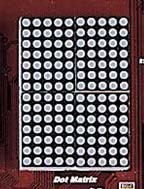
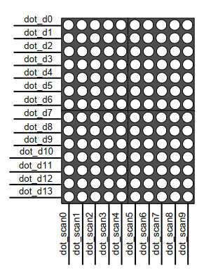
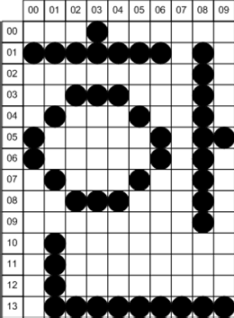

# 3.7 Dot matrix LED

[← 목차로 돌아가기](03_제품_사용하기.md)

**1)** 구성

본 제품에 사용된 Dot matrix LED 모듈은 5열 x 7행 dot LED 4개를 조합하여 10개의 열 과 14개의 행으로 구성하고 있습니다. 이는 영문, 숫자 및 한글까지 표현할 수 있도록 구성할 것입니다. Dot matrix LED는 베이스 보드에 있는 것이 아니라 기본으로 장착 된 확장 모듈인 Peripheral 보드에 구성되어 있습니다. 따라서 이 장치를 이용하기 위 해서는 장비에 Peripheral 보드를 장착하신 다음에 이용하셔야 합니다.

보드에서 모듈 의 구성은 아래의 그림과 같습니다.

> **그림 3-7** · Dot matrix LED 구성

dot_d0~dot_d13은 해당 열에 표시될 데이터 입력이 되며 데이터 값은 1 의 값을 가질 경우 켜지게 됩니다. dot_scan0~dot_scan9는 dot_d0~dot_d13의 데이터를 표시 할 열의 위치를 지정하는 입력이며 1 의 값을 가질 때 해당 열이 선택됩니다. 예를 들어 1행 1열의 dot LED를 켜기 위해서는 dot_d0의 값을 1 로 입력하고 dot_scan0의 값을 1 으로 할 때 1행 1열의 dot LED가 켜지게 됩니다. 이런 방법으 로 dot의 scan 라인을 선택하고, 해당되는 라인에 data값을 주어서 dot를 display하게 됩니다. 이것도 7-Segment와 같이 1ms 이상의 주기로 반복해서 display 하게 되면 눈의 잔상 효과로 인해서 모든 dot가 display 되어 있는 것처럼 느끼게 됩니다. 이러 한 구동 방식은 7-Segment의 scan 방식과 비슷한 구조를 가지고 있습니다.

**2)** 동작

다음은 아래 그림의 한글과 영문을 동시에 display하기 위한 방법에 대해 살펴보겠습 니다. 

처음으로 dot_d13~dot_d0에 00000001100010 인 첫째 열의 데이터를 입력하고 dot_scan9~ dot_scan0에 1111111110 의 값을 입력하면 첫째 열의 원하는 dot LED 가 켜지게 됩니다. 둘째로 dot_d13~dot_d0에 11110010010010 인 둘째 열의 데이터 를 입력하고 dot_scan9~dot_scan0에 1111111101 의 값을 입력하면 둘째 열의 원하 는 dot LED가 켜지게 됩니다. 이를 열 다섯 번째 열까지 반복하며, 반복되는 주기를 약 1m초 이하로 해서 반복하게 되면 눈의 잔상효과에 의해서 한 이라는 글자가 dot matrix LED 모듈에 표시됩니다. 

이를 정리하면 다음과 같습니다.

| 구분 | dot_d13~dot_d0 | dot_scan9~dot_scan0 |
|:---:|:---:|:---:|
| 0열 | "00000001100010" | "0000000001" |
| 1열 | "11110010010010" | "0000000010" |
| 2열 | "10000100001010" | "0000000100" |
| 3열 | "10000100001011" | "0000001000" |
| 4열 | "10000100001010" | "0000010000" |
| 5열 | "10000010010010" | "0000100000" |
| 6열 | "10000001100010" | "0001000000" |
| 7열 | "10000000000000" | "0010000000" |
| 8열 | "10001111111110" | "0100000000" |
| 9열 | "10000000100000" | "1000000000" |

**3)** 회로

회로에서 보는 것과 같이 5 X 7의 Dot LED 4개를 사용하고 있고, 행과 열의 데이터 라인을 공통으로 사용하고 있는 모습을 볼 수 있습니다. 따라서 행과 열의 신호가 서 로 일치되는 구간에서 Dot의 LED에 불이 들어 오게 됩니다. 현재 장비에서는 동작을 스캔 라인과 데이터 라인으로 구분 지어 동작 시키고 있습니다. 따라서 스캔 라인을 하나씩 일정한 주기로 시프트 시키고, 해당되는 스캔 라인에 데이터를 입력하는 방식 으로 되어 있습니다.

**4)** 핀 구성표

| FPGA Signal | Altera | Xilinx | Description |
|:-------:|:-------:|:-------:|:-------:|
| DOT_D[0] | L23 | N24 | DOT DATA 0 |
| DOT_D[1] | C21 | D16 | DOT DATA 1 |
| DOT_D[2] | C19 | C26 | DOT DATA 2 |
| DOT_D[3] | L21 | N21 | DOT DATA 3 |
| DOT_D[4] | L20 | N20 | DOT DATA 4 |
| DOT_D[5] | C17 | C25 | DOT DATA 5 |
| DOT_D[6] | D18 | D24 | DOT DATA 6 |
| DOT_D[7] | L19 | N19 | DOT DATA 7 |
| DOT_D[8] | K26 | N18 | DOT DATA 8 |
| DOT_D[9] | D17 | D23 | DOT DATA 9 |
| DOT_D[10] | D16 | D22 | DOT DATA 10 |
| DOT_D[11] | M21 | P23 | DOT DATA 11 |
| DOT_D[12] | M20 | P22 | DOT DATA 12 |
| DOT_D[13] | D15 | D21 | DOT DATA 13 |
| DOT_COM[0] | B23 | C21 | DOT SCAN LINE 1 |
| DOT_COM[1] | K25 | N17 | DOT SCAN LINE 2 |
| DOT_COM[2] | K24 | M26 | DOT SCAN LINE 3 |
| DOT_COM[3] | B22 | C20 | DOT SCAN LINE 4 |
| DOT_COM[4] | B21 | C18 | DOT SCAN LINE 5 |
| DOT_COM[5] | K23 | M25 | DOT SCAN LINE 6 |
| DOT_COM[6] | K22 | M23 | DOT SCAN LINE 7 |
| DOT_COM[7] | C23 | D18 | DOT SCAN LINE 8 |
| DOT_COM[8] | C22 | D17 | DOT SCAN LINE 9 |
| DOT_COM[9] | K21 | M22 | DOT SCAN LINE 10 |
