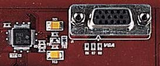
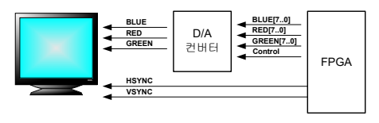
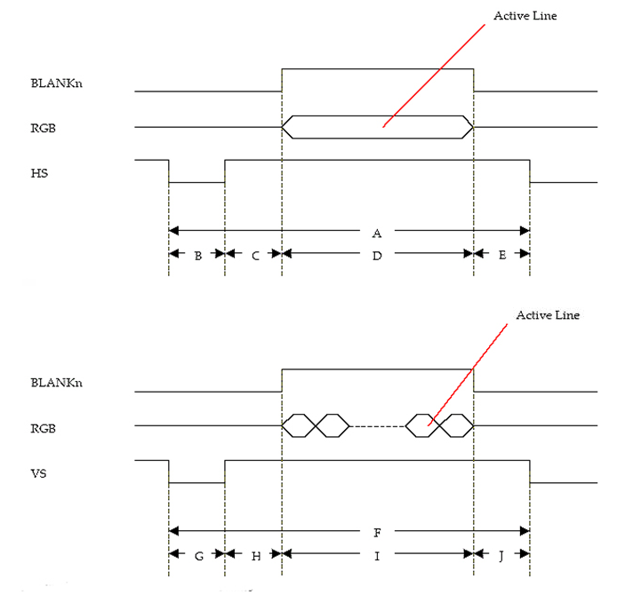
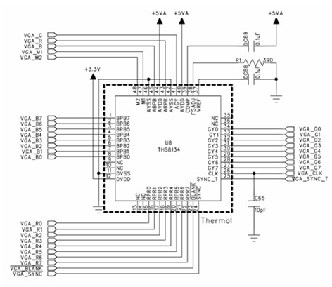
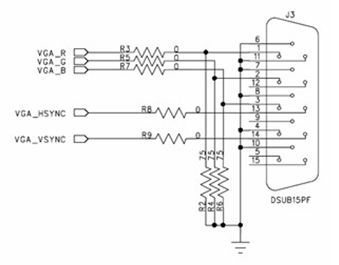

# 3.18 VGA

[← 목차로 돌아가기](03_제품_사용하기.md)

**1)** 구성

HBE-Combo III에서는 VGA port를 Peripheral의 확장 보드에서 지원해 주고 있습니다. 따라서 이 장치를 이용하기 위해서는 해당되는 확장 보드를 장착 후 이용하셔야 합니 다. 현재 장비에서 지원하는 VGA 장치는 FPGA I/O에 컬러 VGA 모니터를 구동할 수 있 도록 (디지털 RGB를 아날로그 RGB 신호 변환해 줄 수 있는) D/A Converter가 연결 되어 있습니다. 다음 그림에서는 데이터의 흐름에 대한 블록도를 보이고 있습니다.

```
                        D/A 컨버터
 FPGA  ┌──────────────┐
       │ BLUE[7..0]   ├─────────▶ RED
       │ RED[7..0]    ├─────────▶ GREEN
       │ GREEN[7..0]  ├─────────▶ BLUE
       │ Control      │
       │ HSYNC        │
       │ VSYNC        │
       └──────────────┘
```




> **그림 3-21** · VGA 블록 구성

**2)** 동작

VGA 모니터를 구동하기 위해 FPGA가 디지털 신호를 처리하는 디바이스이기 때문에 신호를 변환하기 위한 D/A 컨버터로 R (빨강), G (녹색), B (파랑) 색깔 별로 8개의 데이터 라인이 연결되어 총 24 bit의 데이터 라인으로 제어하도록 구성되어 있습니다. 이러한 D/A 컨버터를 통해 다양한 색깔을 표현할 수 있고, 1024x768 해상도에 최대 24-비트 RGB 컬러를 구현할 수 있도록 구성되어 있습니다.

사용된 D/A 컨버터의 특 징은 다음과 같습니다.

▪ Triple 8-Bit D/A Converters
▪ Minimum 80 MSPS Operation
▪ Direct Drive of Doubly-Terminated 75-Ohm Load Into Standard Video Levels
▪ 3x8 Bit 4:4:4, 2x8 Bit 4:2:2 or 1x8 Bit 4:2:2 (ITU-BT.656) Multiplexed YPbPr/GBR Input Modes
▪ Bi-Level (EIA) or Tri-Level (SMPTE) Sync
▪ Generation With 7:3 Video/Sync Ratio
▪ Integrated Insertion of Sync-On-Green/Luminance or Sync-On-All Channels
▪ Configurable Blanking Level
▪ Internal Voltage Reference
▪ High-Definition Television (HDTV) Set-Top Boxes/Receivers
▪ High-Resolution Image Processing
▪ Desktop Publishing
▪ Direct Digital Synthesis/I-Q Modulation

디바이스에 대한 보다 자세한 설명은 데이터시트를 참고로 하도록 합니다.

VGA 블록은 FPGA에서 VGA D/A Driver를 제어하는 회로와 VGA 모니터 동기 신호 (H-sync/V-sync)를 생성해 주는 회로를 설계해 주어야 하며, 동시에 이와 관련된 I/O 핀을 적절히 지정해 주어야 합니다. 모니터 동기 신호는 구현하고자 하는 해상도 에 따라 그 출력 주파수도 달라지며, 동시에 D/A 컨버터 입력 클럭도 수정되어야 합 니다. 1024x768 해상도를 구현하기 위해서는 구동 클럭이 65MHz가 되어야 합니다.

다음 표는 해상도에 따른 VGA 동작 타이밍과 기타 유용한 정보를 보이고 있습니다.

<표 3-6> VGA 동작 타이밍

| 구분 | 640 X 480 | 800 X 600 | 1024 X 768 |
|:---:|:---:|:---:|:---:|
| A Line Period | 32.8us | 26.4us | 20.7us |
| B Hsync Sync Period | 3.8us | 3.2us | 2.1us |
| C Hsync Back Porch | 1.9us | 2.2us | 2.5us |
| D Active Video | 25.4us | 20us | 15.7us |
| E Hsync Front Porch | 0.6us | 1us | 0.4us |
| F Frame Period | 16.7ms | 16.58ms | 16.67ms |
| G Vsync Sync Period | 0.05ms | 0.1ms | 0.12ms |
| H Vsync Back Porch | 1ms | 0.6ms | 0.6ms |
| I Active Frame | 15.3ms | 15.84ms | 15.88ms |
| J Vsync Front Porch | 0.3ms | 0.02ms | 0.06ms |

비디오 신호는 라인 수평 동기 신호와 수직 동기 신호로 구성됩니다. 해상도에 따라 수평 동기 신호는 640, 800, 1024 픽셀로 구성되며, 수직 동기 신호는 480, 600, 768 픽셀이 됩니다. Blankn 신호가 비디오 DAC 출력 (R, G, B)가 0 임을 출력합니다. 수 평 동기 신호 (HS)는 새로운 라인의 시작을 의미하고, 수직 동기 신호 (VS)는 새로운 프레임의 시작을 나타냅니다.



> **그림 3-22** · 수평 동기 및 수직 동기

<표 3-7> Video Settings

| 해상도 | 640 X 480 | 800 X 600 | 1024 X 768 |
|:---:|:---:|:---:|:---:|
| Video clock | 25.2MHz | 40MHz | 65MHz |
| Horizontal Resolution | 640 | 800 | 1024 |
| Vertical Resolution | 480 | 600 | 768 |
| Hsync Pulse Width | 95 | 128 | 136 |
| Hsync Back Porch width | 40 | 88 | |
| Hsync Front Porch width | | | |
| Vsync Pulse Width | 6 | | |
| Vsync Back Porch Width | 22 | 23 | 29 |
| Vsync Front Porch Width | 10 | 1 | 3 |

그리고 H.Sync (수평동기)와 V.Sync (수직동기)는 각각 주사선의 수평, 수직동기를 맞 추기 위한 신호로 이 동기신호가 적절해야만 정상적인 화면을 표현할 수 있습니다. 따 라서, H.Sync와 V.Sync에 적절히 동기 시켜 RGB 데이터를 입력함으로 모니터 내의 원하는 위치에 데이터를 표현할 수 있습니다.

**3)** 회로

  

회로에서 보는 것과 같이 THS8134의 D/A 컨버터를 이용하여 모니터를 제어합니다. 
FPGA 디바이스로부터 R (빨강), G (녹색), B (파랑) 세가지 색깔에 대한 8-bit 데이터 를 THS8134 디바이스로 전달하고 이러한 데이터 값을 변환하여 모니터의 색깔을 제어하고 있습니다.

**4)** 핀 구성표

| FPGA Signal | Altera | Xilinx | Description |
|:-------:|:-------:|:-------:|:-------:|
| VGA_BLUE[0] | G17 | F25 | Blue/Pr pixel data 0 |
| VGA_BLUE[1] | G16 | F24 | Blue/Pr pixel data 1 |
| VGA_BLUE[2] | B20 | C17 | Blue/Pr pixel data 2 |
| VGA_BLUE[3] | B19 | C16 | Blue/Pr pixel data 3 |
| VGA_BLUE[4] | J22 | L22 | Blue/Pr pixel data 4 |
| VGA_BLUE[5] | K19 | M21 | Blue/Pr pixel data 5 |
| VGA_BLUE[6] | B18 | C15 | Blue/Pr pixel data 6 |
| VGA_BLUE[7] | B17 | B23 | Blue/Pr pixel data 7 |
| VGA_RED[0] | A20 | A22 | Red/Pr pixel data 0 |
| VGA_RED[1] | A19 | A20 | Red/Pr pixel data 1 |
| VGA_RED[2] | A18 | A19 | Red/Pr pixel data 2 |
| VGA_RED[3] | A17 | A18 | Red/Pr pixel data 3 |
| VGA_RED[4] | G15 | F23 | Red/Pr pixel data 4 |
| VGA_RED[5] | G14 | F22 | Red/Pr pixel data 5 |
| VGA_RED[6] | A14 | A15 | Red/Pr pixel data 6 |
| VGA_RED[7] | B15 | B20 | Red/Pr pixel data 7 |
| VGA_GREEN[0] | G13 | F20 | Green/Pr pixel data 0 |
| VGA_GREEN[1] | F18 | F19 | Green/Pr pixel data 1 |
| VGA_GREEN[2] | B14 | B19 | Green/Pr pixel data 2 |
| VGA_GREEN[3] | A23 | B18 | Green/Pr pixel data 3 |
| VGA_GREEN[4] | F17 | F17 | Green/Pr pixel data 4 |
| VGA_GREEN[5] | G18 | G15 | Green/Pr pixel data 5 |
| VGA_GREEN[6] | B18 | B17 | Green/Pr pixel data 6 |
| VGA_GREEN[7] | B17 | B15 | Green/Pr pixel data 7 |
| VGA_BLANK | B16 | B21 | Blanking control input |
| VGA_SYNC | C16 | C23 | Sync control input |
| VGA_CLK | F23 | J21 | VGA clock |
| VGA_SYNC_T | J24 | M18 | Sync tri-level control |
| VGA_HSYNC | J23 | L24 | Horizontal Sync |
| VGA_VSYNC | C15 | C22 | Vertical Sync |
| VGA_M1 | J26 | M20 | Operation mode control 1 |
| VGA_M2 | J25 | M19 | Operation mode control 2 |
