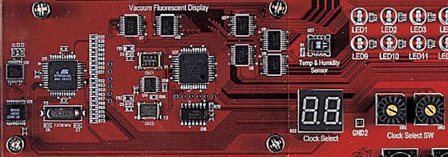
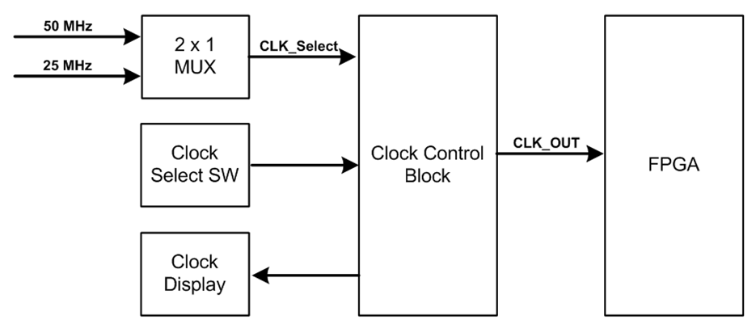
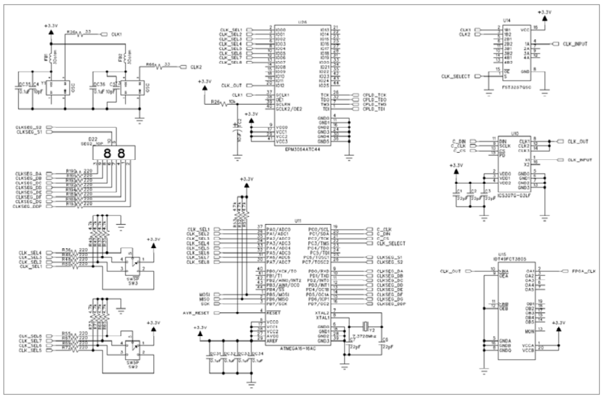
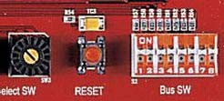
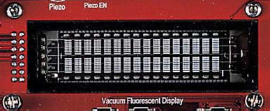
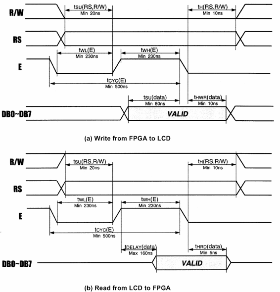
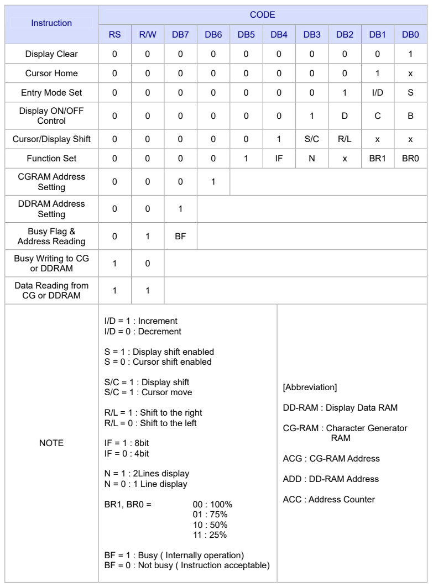
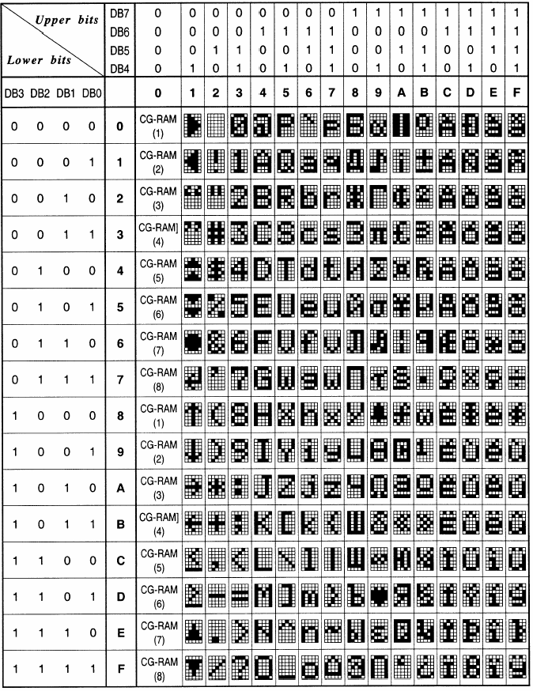
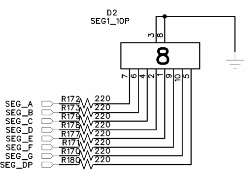

# 3. 제품 사용하기

3.1 [Clock Control Block](#3.1-Clock-Control-Block)
3.2 [Reset Switch](#3.2-Reset-Switch)
3.3 [VFD (16 x 2 Line)](#3.3-VFD-(16-x-2-Line))
3.4 [7-Segment](#3.4-7-Segment)
3.5 [7-Segment Array](#3.5-7-Segment-Array)
3.6 [LED](#3.6-LED)
3.7 [Dot matrix LED](#3.7-Dot-matrix-LED)
3.8 [TFT LCD Module](#3.8 TFT LCD Module)
3.9 [OLED](#3.9 OLED)
3.10 [Button Switch](#3.10 Button Switch)
3.11 [Dip Switch](#3.11 Dip Switch)
3.12 [Piezo](#3.12 Piezo)
3.13 [SRAM](#3.13 SRAM)
3.14 [Flash Memory](#3.14 Flash Memory)
3.15 [Step Motor](#3.15 Step Motor)
3.16 [UART](#3.16 UART)
3.17 [USB/Serial 포트](#3.17 USB/Serial 포트)
3.18 [VGA](#3.18 VGA)
3.19 [PS/2 포트 사용하기](#3.19 PS/2 포트 사용하기)
3.20 [Sensor](#3.20 Sensor)
3.21 [SD Connector](#3.21 SD Connector)
3.22 [확장 포트](#3.22-확장-포트)


## 3.1 Clock Control Block

**1)** 구성

장비 내부에는 사용자가 원하는 클럭을 선택해서 사용할 수 있도록 Clock control block를 두고 있습니다. 여기에는 50, 25MHz의 두 종류의 클럭을 입력 받아 0 ~ 250MHz의 클럭을 FPGA로 전달하고 있습니다. 따라서 FPGA 설계 시 필요로 하는 대 부분의 클럭을 이 블록에서 전달해 주고 있습니다. 이 클럭은 0 ~ 10 KHz의 클럭을 CPLD에서 생성하고, 10 KHz ~ 250MHz의 클럭을 AVR을 이용해서 클럭 발생 디바이 스에서 생성하고 있습니다. 이 클럭의 선택은 2개의 Clock Select SW를 통해 선택하 고 Clock Select의 2-digit의 7-Segment를 통해 현재 어떠한 클럭이 선택 되었는지 보여 주고 있습니다. 클럭 선택은 이와 같이 오실레이터를 통한 클럭 발생 부와 이 클 럭을 제어하기 위한 클럭 제어 부, 그리고 이 클럭을 표시하기 위한 클럭 표시 부로 나뉘게 됩니다. 

클럭 발생 부는 2개의 오실레이터 중 1개의 오실레이터 출력 값을 선택하여 클럭 발 생 디바이스로 전달을 합니다. 이 때 클럭의 선택을 AVR에서 2 x 1 MUX를 통해 이루 어 집니다. 

클럭 제어 부는 앞단에서 전달된 클럭을 사용자가 원하는 출력 클럭을 만들어 주기 위해 클럭 발생 디바이스의 레지스터를 설정하여 원하는 클럭을 발생하게 합니다. 이 때 클럭은 10KHz ~ 250MHz의 클럭을 발생시켜 주게 됩니다. 또한 0 ~ 10KHz의 클 럭은 CPLD에서 생성하게 됩니다. 이렇게 클럭의 선택은 2개의 Clock Select SW를 통 해 이루어 집니다. 따라서 Clock Select SW를 통해 AVR 또는 CPLD에서 클럭을 선택 하고 선택 된 클럭은 FPGA로 전달이 됩니다. 

클럭 표시 부는 Clock Select SW를 통해 선택되어진 클럭을 2개의 7-Segment를 통해 표시 해 줍니다. 클럭의 선택은 Clock Select SW에 있는 숫자를 통해 확인할 수도 있 고, 7-Segment를 통해 간편하게 확인할 수 있습니다.





> **그림 3-1** · Clock Control Block 구성

**2)** 동작

장비에서 사용하는 클럭은 기본으로 Base board 에 있는 50 MHz를 가지고 사용하게 됩니다. 따라서 클럭 제어 스위치를 조절하면 7-Segment에 현재 FPGA 디바이스 모 듈로 공급되는 클럭 값이 표시되고 있습니다. 

이 스위치를 조절하여 0 Hz ~ 250 MHz 의 분주된 클럭의 값을 FPGA 디바이스 모듈 로 전달되게 됩니다. 또한 FPGA 디바이스 모듈에는 별도로 오실레이터를 꽂아 사용 할 수 있는 소켓을 구성해 놓았습니다. 이 소켓에는 사용자가 원하는 값을 가진 오실 레이터를 장착해서 사용할 수 있습니다. 따라서 이 자리에 오실레이터를 장착하고 User Clk EN 스위치를 On 하여 사용하면 됩니다. Main clock 과 User clock은 서로 다른 입력 전용 핀으로 연결이 되어 있으므로 설계 소프트웨어에서 핀 연결을 하여 사용하면 됩니다. 

오실레이터의 출력 클럭은 다음에서 확인할 수 있습니다. 표에서는 Clock Select 스위치 에 따른 출력 주파수를 확인할 수 있습니다. 장비에서는 출력 클럭의 확인은 2개의 7-Segment를 이용하여 현재 Clock Select SW의 값을 확인할 수 있고, 이 값은 다음의 표를 통해 현재 FPGA로 입력되는 클럭 값을 확인할 수 있습니다. 클럭의 값을 다 음 표를 참고 하시기 바랍니다. 

| Clock SW | 클럭 입력 | Clock SW |  클럭 입력 |  Clock SW  |  클럭 입력 |  Clock SW |  클럭 입력 | 
|:------:| :------:|:------:|:------:|:------:|:------:|:------:|:------:|
| 00 | 0Hz | 01 | 1Hz | 02 | 5Hz | 03 | 10Hz | 
| 04 | 25Hz | 05 | 50Hz | 06 | 100Hz | 07 | 250Hz | 
| 08 | 500Hz | 09 | 1KHz  | 0A  | 2.5KHz  | 0B  | 5KHz  | 
| 0C  | 10KHz  | -  | -  | -  | -  | -  | -  | 
| 10 | 15KHz | 11 | 20KHz | 12 | 25KHz | 13 | 30KHz | 
| 14 | 35KHz | 15 | 40KHz | 16 | 45KHz | 17 | 50KHz | 
| 18 | 55KHz | 19 | 60KHz  | 1A  | 65KHz  | 1B  | 70KHz  | 
| 1C  | 75KHz | 1D  | 80KHz  | 1E  | 85KHz  | 1F  | 90KHz  | 
| 20 | 95KHz | 21 | 100KHz | 22 | 150KHz | 23 | 200KHz | 
| 24 | 250KHz | 25 | 300KHz | 26 | 350KHz | 27 | 400KHz | 
| 28 | 450KHz | 29 | 500KHz  | 2A  | 550KHz  | 2B  | 600KHz  | 
| 2C  | 650KHz  | 2D  | 700KHz  | 2E  | 750KHz  | 2F  | 800KHz  | 
| 30 | 850KHz | 31 | 900KHz | 32 | 950KHz | 33 | 1MHz | 
| 34 | 1.5MHz | 35 | 2MHz | 36 | 2.5MHz | 37 | 3MHz | 
| 38 | 3.5MHz | 39 | 4MHz  | 3A  | 4.5MHz  | 3B  | 5MHz  | 
| 3C  | 5.5MHz  | 3D  | 6MHz  | 3E  | 6.5MHz  | 3F  | 7MHz  | 
| 40 | 7.5MHz | 41 | 8MHz | 42 | 8.5MHz | 43 | 9MHz | 
| 44 | 9.5MHz | 45 | 10MHz | 46 | 15MHz | 47 | 20MHz | 
| 48 | 25MHz | 49 | 30MHz  | 4A  | 35MHz  | 4B  | 40MHz  | 
| 4C  | 45MHz  | 4D  | 50MHz  | 4E  | 55MHz  | 4F  | 60MHz  | 
| 50 | 65MHz | 51 | 70MHz | 52 | 75MHz | 53 | 80MHz | 
| 54 | 85MHz | 55 | 90MHz | 56 | 95MHz | 57 | 100MHz | 
| 58 | 125MHz | 59 | 150MHz  | 5A  | 200MHz  | 5B  |   | 

**3)** 회로도




**4)** 핀 구성표

| FPGA Signal | Altera | Xilinx | Description | 
|:----------:|:----------:|:----------:|:----------:|
| CLK_MAIN[] | N2 | F13 | Main Clock Input | 
| CLK_MAIN[] | N25 | AF14 | Main Clock Input | 
| CLK_USER[] | A13 | B14 | User Clock Input | 
| CLK_USER[] | D13 | AF13 | User Clock Input | 

## 3.2 Reset Switch

**1)** 구성

장비에서는 기본으로 제공하는 버튼 스위치 이외에 소스 설계 시 Reset 용도로 사용 할 수 있도록 버튼 스위치를 구성하고 있습니다. 이 스위치는 FPGA 디바이스와 연결 되어 있으며, FPGA 동작 시 이 버튼에 의해 Reset 동작에 이용할 수 있습니다.



**2)** 동작

이 스위치는 Reset 스위치의 용도이기 때문에 버튼 스위치와는 달리 눌렀을 때, 0 의 값이 FPGA로 전달 됩니다. 따라서 FPGA에서는 이 버튼 스위치의 0 이 되는 동작을 감지하여 리셋 시점으로 이용할 수 있습니다.

**3)** 회로


회로에서도 알 수 있듯이 버튼이 눌려지면 0 의 값이 FPGA로 전달 됩니다.

**4)** 핀 구성표

| FPGA Signal | Altera | Xilinx | Description | 
|:-----:|:-----:|:-----:|:-----:|
| Reset | C5 | AB7 | Reset Switch| 

## 3.3 VFD (16 x 2 Line)

**1)** VFD란

VFD[Vacuum Fluorescent Display]는 형광 표시 판으로써 1960년도에 개발되어 전자 계산기에 적용되기 시작 하였으며, 80년대에 다색화에 성공하여 여러 색깔을 만들어 가고 있습니다. 이 모듈은 CRT의 전자총 역할을 하는 필라멘트에서 항시 방출되는 전 자를 형광체에 충돌시켜 자체적으로 발광시키는 소자입니다. 따라서 예전의 Text LCD 에서 보는 백 라이트에서 보는 것과 달리 하나의 도트마다 자체 발광하여 출력하는 장치라 할 수 있습니다.

**2)** 특징

VFD는 형광 물질의 조절로 여러가지 색의 표시가 용이하고, 자체적으로 발광하기 때 문에 시인성이 뛰어납니다. 또한 LED등과 비교 시 빛이 부드러워 눈의 피로를 덜고 어두운 곳이나 밝은 곳에서도 문자 식별이 가능하며, 시야 각 또한 우수하고 저 전압 으로 구동이 가능하여 부품의 적용이 쉬우며 고 신뢰성을 가지고 있습니다.

**3)** 구성

VFD 모듈의 외부 구조는 아래의 그림과 같이 16문자 X 2의 표시부를 가지며 표시부 좌측에 커넥터가 위치한 형태입니다.



> **그림 3-2** · 16 x 2 VFD

사용되는 인터페이스 커넥터 핀의 기능을 요약하면 다음의 표와 같습니다. 

<표 3-1> VFD 인터페이스 핀 

| 핀 | 신호명 | 기능 | 
|:------:|:------:|:------:|
| 1 | GND | 전원 GND | 
| 2 | VCC | 전원 +5V | 
| 3 | /RST | Reset input | 
| 4 | RS | Register Select ( 0 = instruction, 1 = data ) | 
| 5 | R/W | Read/Write ( 0 = FPGA -> LCD, 1 : FPGA <- LCD ) | 
| 6 | E | Enable Signal for read/write LCD | 
| 7 | DB0 (LSB) |  | 
| 8 | DB1 |  | 
| 9 | DB2 |  | 
| 10 | DB3 |  | 
| 11 | DB4 |  | 
| 12 | DB5 |  | 
| 13 | DB6 |  | 
| 14 | DB7 |  | 

**4)** 동작 타이밍

VFD 모듈은 FPGA로 접속할 때는 각 제어신호의 동작 타이밍을 고려하여야 합니다. VFD 모듈은 과거의 Text LCD 보다 동작 타이밍에 대한 성능이 우수해 졌습니다. VFD 모듈의 read 및 write 동작시의 타이밍 도를 보면 아래의 그림과 같습니다.



> **그림 3-3** · VFD 모듈의 동작 타이밍

VFD 모듈을 사용하기 위한 제어 명령을 정리하면 다음 페이지와 표와 같습니다. 이들 명령은 FPGA가 VFD 모듈을 제어하는 프로그램에서 사용되며 데이터 버스 DB0~DB7 을 통하여 전송됩니다. 

VFD 모듈이 각 명령을 받아 이를 실행하기 위해서는 지정된 시간이 필요하므로 FPGA는 그 다음의 명령을 보내기 전에 충분히 대기하거나 busy flag을 조사하여 앞 에서 전송한 제어 코드의 실행이 완료되었는지의 여부를 확인하여야 합니다.

<표 3-2> VFD모듈 제어명령 CODE Instruction RS R/W DB7 DB6 DB5 DB4 DB3 DB2 DB1 DB0 Display Clear




▪ Display Clear 
   * ▶ 전체 화면을 지우고 어드레스 카운터를 DD-RAM 어드레스 0으로 하여 커서를 home 위치로 합니다. 

▪ Cursor home 
   * ▶ DD RAM의 내용은 변경하지 않고 커서만을 home 위치로 합니다. 

▪ Entry mode set 
   * ▶ 데이터를 read하거나 write할 경우에 커서의 위치를 증가시킬 것인가(I/D=1) 감소 시킬 것인가 (I/D=0)를 결정하며, 또 이때 화면을 시프트 할 것인지(S=1) 아닌지(S=0)를 결정합니다. 

▪ Display ON/OFF control 
   * ▶ 화면 표시를 ON/OFF 하거나(D) 커서를 ON/OFF하거나(C) 커서를 깜박이게 할 것인지(B)의 여 부를 지정 합니다. 

▪ Cursor/Display shift 
   * ▶ 화면(S/C=1) 또는 커서(S/C=0)를 오른쪽(R/L=1) 또는 왼쪽(R/L=0)으로 시프트 합니다. 

▪ Function set 
   * ▶ 인터페이스에서 데이터의 길이를 8비트(DL=1) 또는 4비트(DL=0)로 지정하고, 화면 표시 행수 를 2행(N=1) 또는 1행(N=0)으로 지정하며, 화면의 밝기를 BR1~0에 의해 100%, 75%, 50%, 25%로 설정을 해 줄 수 있습니다.
   * ※ 전원 투입 후 최초에는 주로 이 명령을 보내게 됩니다. 또한, 4비트로 인터페이스 할 경우에는 DB4~DB7을 사용하며, 상위 4 bit를 먼저 전송하고 다음에 하위 4 bit를 전송해야 합니다. 

▪ CGRAM address Setting 
   * ▶ Character Generator RAM의 어드레스를 지정합니다. 이후에 송수신하는 데이터는 CG RAM 의 데이터입니다. 

▪ DDRAM address Setting 
   * ▶ Display Data RAM의 어드레스를 지정합니다. 이후에 송수신하는 데이터는 DD RAM의 데이터 입니다. 

▪ Busy flag & address Reading 
   * ▶ LCD 모듈이 내부 동작중임을 나타내는 Busy Flag(BF) 및 어드레스 카운터의 내용을 read 합 니다.
   * LCD 모듈이 각 제어 코드를 실행하는데 지정된 시간이 필요하므로 FPGA가 BF를 읽어 1일 경우에는 기다리고 0일 경우 다음 제어 코드를 보내는 방법을 사용하면 보다 효율적인 처 리가 가능 합니다. 

▪ Data Writing to CG or DDRAM 
   * ▶ CG-RAM 또는 DDRAM에 데이터를 쓰는 동작을 합니다. 

▪ Data Reading from CG or DDRAM 
   * ▶ CG-RAM 또는 DDRAM에 데이터를 읽는 동작을 합니다.

VFD 모듈을 전원 투입부터 초기화하는 과정을 요약하면 다음과 같습니다. 
   * 전원을 투입 합니다. 
   * VFD 모듈이 리셋 되려면 약 50ms가 소요되므로 이 시간 이상을 기다립니다. 
   * Function set 명령(001xxx00)을 보냅니다. 
   * Display ON/OFF control 명령(00001xxx)을 보냅니다. 
   * Entry mode set 명령(000001xx)을 보냅니다. 
   * DDRAM address를 보냅니다. „ 문자 데이터를 연속으로 보냅니다. 
   * 필요에 따라 위의 과정을 반복 합니다.

**5)** DD RAM 어드레스

   * DD RAM은 표시될 각 문자의 ASCII 코드 데이터가 저장되어 있는 메모리이며 모두 80개의 번지가 있는데, 화면의 각 행과 열의 위치에는 고유한 Address 값이 부여됩니다.
   * 그런데, 각 행과 행 사이의 어드레스가 연속하여 있지 않으므로 주의하여야 한다. 표시 문자의 위치에 대한 DD RAM의 어드레스는 <표 3-3>과 같습니다. 

|  | 1 |  |  |  |  |  |  |  |  |  |  |  |  |  |  | 16 | 
|:----:|:----:|:----:|:----:|:----:|:----:|:----:|:----:|:----:|:----:|:----:|:----:|:----:|:----:|:----:|:----:|:----:|
| 제1행 | 00 | 01 | 02 | 03 | 04 | 05 | 06 | 07 | 08 | 09 | 0A | 0B | 0C | 0D | 0E | 0F |
| 제2행 | 40 | 41 | 42 | 43 | 44 | 45 | 46 | 47 | 48 | 49 | 4A | 4B | 4C | 4D | 4E | 4F |

<표 3-3> 표시문자 위치에 대한 DD RAM 어드레스

**6)** 표시 문자 세트

* VFD 모듈에서 화면에 표시할 수 있는 문자의 종류에는 대부분의 ASCII 도형문자들이 포함되며, 기타 일본어의 카타가나 문자와 몇 가지 특수문자들이 포함됩니다.
* 00H~0FH의 영역에는 사용자 정의문자를 설정하여 사용할 수 있다. 여기에는 최대 8 문자를 정의할 수 있는데, 이에 대한 정보는 전원이 인가된 후에 정의되어야 하며,
* 전 원이 꺼지면 정의된 내용은 기억되지 않습니다.
* VFD 모듈에서 화면에 표시할 수 있는 문자 중 ASCII 도형문자의 종류와 코드 값을 보면 아래의 표와 같습니다.



<표 3-4> ASCII 도형문자의 종류 및 코드

**7)** 회로도



* VFD 모듈은 총 14개의 핀으로 구성되어 있습니다. 여기에는 전원 및 데어터 전송, 컨 트롤 핀, reset핀으로 구성되어 있습니다. 회로도에 나와 있는것과 같이 전원은 보드 에서 공급받아 사용할 수 있도록 구성 되어 있고, Reset 핀은 하드웨어적으로는 사용 하고 있지 않습니다. VFD의 사요을 위해서는 제어신호인 VFD_RS, VFD_RW, VFD_E 의 제어신호와 데이터 신호 8개를 FPGA에서 직접 제어하여 VFD를 Display 하게 됩 니다.

**8)** 핀 구성표

| FPGA Signal | Altera | Xilinx | Description | 
|:-------:|:-------:|:-------:|:-------:|
| VFD_D[] | K4 | L10 | VFD_DATA | 
| VFD_D[] | K3 | L9 | VFD_DATA | 
| VFD_D[] | K2 | L7 | VFD_DATA | 
| VFD_D[] | K1 | L4 | VFD_DATA | 
| VFD_D[] | L3 | M6 | VFD_DATA | 
| VFD_D[] | L2 | M5 | VFD_DATA | 
| VFD_D[] | K8 | M4 | VFD_DATA | 
| VFD_D[] | K7 | M3 | VFD_DATA | 
| VFD_E | K5 | M1 | VFD Enable  | 
| VFD_RW | J4 | K8 | VFD Read/Write  | 
| VFD_RS | J5 | K9 | VFD Register Select | 

## 3.4 7-Segment

**1)** 구성

7-Segment는 LED를 통해 숫자를 표현할 수 있는 장치로 현재 장비에서는 1개로 구 성된 것과 8개의 7-Segment가 Array로 구성된 방식을 기본으로 구성하고 있습니다. 1개의 숫자를 표현할 수 있는 7-Segment는 8개의 LED를 통해 숫자를 표현할 수 있 는 방식으로 데이터 라인도 8개로 구성되어 있습니다. 따라서 8개의 데이터 라인을 제어하여 0 ~ F의 숫자를 Display 할 수 있습니다.
> **그림 3-4** · 7-Segment LED 구성

**2)** 동작

현재 장착되어 있는 7-Segment는 Cathode 방식의 장치로써 FPGA에서 1 의 값을 전달하면 해당하는 7-Segment의 LED에 불이 켜집니다. 따라서 a ~ g의 7개의 데이 터 라인을 통해 숫자를 표시하고 .의 DP를 이용하여 Segment의 DOT를 표시하게 됩 니다. 따라서 8개의 데이터 라인을 통해 1 의 값을 주면 켜지고 반대로 0 의 값 을 주면 꺼지는 방식을 통해 숫자를 표시하게 됩니다. 7-Segment의 각 LED는 다음의 그림과 같이 배치가 되어 있고 이것을 제어하기 위해 8개의 데이터 선이 라인이 필요합니다. 예를 들어 숫자 2 를 표현하기 위해 a, b, g, e, d 에 1 라는 값을 주고 나머지는 0 의 값을 주어야 합니다.
**3)** 회로도

**4)** 핀 구성표

FPGA Signal Altera Xilinx Description SEG_DATA_A M3 N1 Segment data A SEG_DATA_B M2 M10 Segment data B SEG_DATA_C L7 M9 Segment data C SEG_DATA_D L6 M8 Segment data D SEG_DATA_E L4 M7 Segment data E SEG_DATA_F P6 N7 Segment data F SEG_DATA_G P4 N6 Segment data G SEG_DATA_DP P3 N5 Segment data DP
## 3.5 7-Segment Array

**1)** 구성

이전의 장치는 1개의 숫자만 표현하기 위한 것이라면, 이번 장치에서 사용된 것은 4개 의 7-Segment가 하나로 구성되어 있는 것을 두 개를 연결하여 다음 그림과 같은 구 성으로 이루어져 있습니다. 이러한 구성은 7-Segment를 이용한 시계 표현을 지원하 기 위한 구성으로 장비에서 기본으로 지원해 주고 있습니다. a b c d e f g
.

com1 com2 com3 com4 com5 com6 com7 com8
> **그림 3-5** · 7-Segnent LED Array 구성

**2)** 동작

일반적인 방법에서의 7-Segment라면 8개를 사용할 경우 하나의 7-Segment당 출력 인 a , b , c , d , e , f , g , . 가 각각 출력 핀을 가져 64개의 출력 핀이 필요로 하게 됩니다. 이러 할 경우 FPGA의 한정된 핀을 가지고 Segment에 너무 많은 핀이 할당되게 되므로 핀 소모를 개선하기 위하여 위와 같이 7-Segment의 Data 라인은 공통으로 연결되어 있고 출력할 위치인 7-Segment를 지정하는 com1 ~ com8의 값을 제어하여 원하는 숫자나 문자를 표시하는 방법을 사용하게 됩니다. 이렇게 하면 16개의 핀을 가지고 8개의 7-Segment를 제어하게 됩니다. 따라서 8개의 7-Segment 중에 Display 하려는 Segment common 핀을 선택하고 동시에 Segment에 Data를 주는 형태로 7-Segment를 제어할 수 있다. 아래의 그림은 4개의 7-Segment 에 1234 의 숫자를 표시하기 위한 방법을 설명한 것입니다.
다시 설명하면 7-segment 데이터 값을 00000110 로 주어 1 를 표시하는 값을 주고 com1에 0 을 그리고 나머지 com2~4는 1 의 값을 주면 첫째 7-Segment 에 1 이 표시됩니다. 다음으로 데이터에 01011011 을 주어 2 의 값을 주고 com2에 0 과 com1, com3~4에 1 을 주면 둘째 7-Segment에 2가 표시됩니다. 이런 순서로 4까지의 숫자를 표시하고 다시 처음으로 돌아가 위의 내용을 반복합니다. 이를 약 1ms 이상의 주기로 반복하면 잔상효과에 의해 1234 의 숫자가 모두 켜져 있는 것처럼 표시되게 됩니다. 이러한 형태로 8개의 7-segment를 com 핀을 이용하여 선택하고, 해당되는 data 값을 줌으로써 각각의 7-Segment의 제어가 가능하게 됩니 다.
**3)** 회로도

이전에 설명 했듯이 회로도 에서는 16개의 핀을 가지고 7개의 Segment를 제어하고 있 습니다. 위쪽에 있는 SEG_C의 8개의 핀을 이용하여 각각의 Segment를 선택하게 됩 니다. 그리고 데이터 핀인 SEGA~SEGDP의 핀을 제어하여 7-Segment를 제어하게 됩 니다. 이 모든 작업은 FPGA 디바이스와 연결된 I/O핀에서 제어를 하면 됩니다.
**4)** 핀 구성표

FPGA Signal Altera Xilinx Description SEG_COM[0] T3 P9 Segment 1 Select SEG_COM[1] T2 P8 Segment 2 Select SEG_COM[2] R7 P7 Segment 3 Select SEG_COM[3] R6 P6 Segment 4 Select SEG_COM[4] U3 R4 Segment 5 Select SEG_COM[5] U2 R3 Segment 6 Select SEG_COM[6] U1 R2 Segment 7 Select SEG_COM[7] T7 R1 Segment 8 Select SEG_DATA_A M5 N4 Segment data A SEG_DATA_B M4 N2 Segment data B SEG_DATA_C R5 P4 Segment data C SEG_DATA_D R4 P3 Segment data D SEG_DATA_E R3 P2 Segment data E SEG_DATA_F R2 P1 Segment data F SEG_DATA_G P7 N9 Segment data G SEG_DATA_DP T4 P10 Segment data H
## 3.6 LED

**1)** 구성

LED는 Bit 출력을 확인하거나 동작의 상태를 표시하기 위해 사용하는데 본 제품에서 는 총 16개의 DIP 타입의 LED를 제공하고 있습니다. 또한 사용자가 보는 시인성을 좋게 하기 위해 고휘도 LED를 사용하여 밝기를 강화 했으며, 윗면이 평평한 LED를 사용하여 어느 방향에서나 잘 볼 수 있는 장치를 사요하고 있습니다. 아래 그림은 LED에 대한 블록도를 보여주고 있습니다.
> **그림 3-6** · LED 블록도

**2)** 동작

LED의 입력 단에 디지털 신호 1 에 해당하는 입력이 인가 될 경우 LED에 불이 들 어오게 됩니다. 초기의 전원 인가 시 LED의 특성상 미세한 전류의 흐름에 의해서도 희미하게 LED가 켜지는 경우가 있는데 이것은 제품의 문제가 아니며 프로그램 되지 않는 디바이스의 잔류 전류가 나와서 이러한 현상이 일어나게 됩니다. 이러한 증상은 툴을 통한 디바이스를 프로그램을 끝내고 디바이스가 동작을 시작하면 LED는 정상적 으로 동작하게 됩니다.
**3)** 회로

LED는 회로도 에서 보는 것과 같이 16개의 LED가 각각의 FPGA의 I/O 핀과 시리얼 저항에 연결 되어 있음을 볼 수 있습니다. 따라서 FPGA에 연결된 부분에 1 이라는 신호를 주어 LED를 제어 할 수 있도록 구성 하였습니다.
**4)** 핀 구성표

FPGA Signal Altera Xilinx Description LED_DATA[1] AE11 Y2 LED 1 Display LED_DATA[2] AE10 Y1 LED 2 Display LED_DATA[3] AF9 AA10 LED 3 Display LED_DATA[4] AF8 AA7 LED 4 Display LED_DATA[5] AF7 AA3 LED 5 Display LED_DATA[6] AF6 AA2 LED 6 Display LED_DATA[7] AF5 Y10 LED 7 Display LED_DATA[8] B3 AB12 LED 8 Display LED_DATA[9] B2 AB9 LED 9 Display LED_DATA[10] AF13 AB1 LED 10 Display LED_DATA[11] Y25 Y20 LED 11 Display LED_DATA[12] AF23 AD6 LED 12 Display LED_DATA[13] G1 J4 LED 13 Display LED_DATA[14] G2 J5 LED 14 Display LED_DATA[15] AA24 Y23 LED 15 Display LED_DATA[16] AF10 AA12 LED 16 Display
## 3.7 Dot matrix LED

**1)** 구성

본 제품에 사용된 Dot matrix LED 모듈은 5열x7행dot LED 4개를 조합하여 10개의 열 과 14개의 행으로 구성하고 있습니다. 이는 영문, 숫자 및 한글까지 표현할 수 있도록 구성할 것입니다. Dot matrix LED는 베이스 보드에 있는 것이 아니라 기본으로 장착 된 확장 모듈인 Peripheral 보드에 구성되어 있습니다. 따라서 이 장치를 이용하기 위 해서는 장비에 Peripheral 보드를 장착하신 다음에 이용하셔야 합니다. 보드에서 모듈 의 구성은 아래의 그림과 같습니다. dot_d7 dot_d0 dot_d1 dot_d2 dot_d3 dot_d4 dot_d5 dot_d6 dot_d8 dot_d9 dot_d10 dot_d11 dot_d12 dot_d13 dot_scan1 dot_scan0 dot_scan2 dot_scan3 dot_scan4 dot_scan5 dot_scan6 dot_scan7 dot_scan8 dot_scan9
> **그림 3-7** · Dot matrix LED 구성

Dot_d0~dot_d13은 해당 열에 표시될 데이터 입력이 되며 데이터 값은 1 의 값을 가질 경우 켜지게 됩니다. dot_scan0~dot_scan9는 dot_d0~dot_d13의 데이터를 표시 할 열의 위치를 지정하는 입력이며 1 의 값을 가질 때 해당 열이 선택됩니다. 예를 들어 1행 1열의 dot LED를 켜기 위해서는 dot_d0의 값을 1 로 입력하고
dot_scan0의 값을 1 으로 할 때 1행 1열의 dot LED가 켜지게 됩니다. 이런 방법으 로 dot의 scan 라인을 선택하고, 해당되는 라인에 data값을 주어서 dot를 display하게 됩니다. 이것도 7-Segment와 같이 1ms 이상의 주기로 반복해서 display 하게 되면 눈의 잔상 효과로 인해서 모든 dot가 display 되어 있는 것처럼 느끼게 됩니다. 이러 한 구동 방식은 7-Segment의 scan 방식과 비슷한 구조를 가지고 있습니다.
**2)** 동작

다음은 아래 그림의 한글과 영문을 동시에 display하기 위한 방법에 대해 살펴보겠습 니다. 처음으로 dot_d13~dot_d0에 00000001100010 인 첫째 열의 데이터를 입력하고 dot_scan9~ dot_scan0에 1111111110 의 값을 입력하면 첫째 열의 원하는 dot LED 가 켜지게 됩니다. 둘째로 dot_d13~dot_d0에 11110010010010 인 둘째 열의 데이터 를 입력하고 dot_scan9~dot_scan0에 1111111101 의 값을 입력하면 둘째 열의 원하 는 dot LED가 켜지게 됩니다. 이를 열 다섯 번째 열까지 반복하며, 반복되는 주기를 약 1m초 이하로 해서 반복하게 되면 눈의 잔상효과에 의해서 한 이라는 글자가 dot matrix LED 모듈에 표시됩니다. 이를 정리하면 다음과 같습니다. 구 분 dot_d13~dot_d0 dot_scan9~dot_scan0 0 열 “00000001100010” “0000000001” 1 열 “11110010010010” “0000000010”
2 열 “10000100001010” “0000000100” 3 열 “10000100001011” “0000001000” 4 열 “10000100001010” “0000010000” 5 열 “10000010010010” “0000100000” 6 열 “10000001100010” “0001000000” 7 열 “10000000000000” “0010000000” 8 열 “10001111111110” “0100000000” 9 열 “10000000100000” “1000000000”
**3)** 회로

회로에서 보는 것과 같이 5 X 7의 Dot LED 4개를 사용하고 있고, 행과 열의 데이터 라인을 공통으로 사용하고 있는 모습을 볼 수 있습니다. 따라서 행과 열의 신호가 서 로 일치되는 구간에서 Dot의 LED에 불이 들어 오게 됩니다. 현재 장비에서는 동작을 스캔 라인과 데이터 라인으로 구분 지어 동작 시키고 있습니다. 따라서 스캔 라인을 하나씩 일정한 주기로 시프트 시키고, 해당되는 스캔 라인에 데이터를 입력하는 방식 으로 되어 있습니다.
**4)** 핀 구성표

FPGA Signal Altera Xilinx Description DOT_D[0] L23 N24 DOT DATA 0 DOT_D[1] C21 D16 DOT DATA 1 DOT_D[2] C19 C26 DOT DATA 2 DOT_D[3] L21 N21 DOT DATA 3 DOT_D[4] L20 N20 DOT DATA 4 DOT_D[5] C17 C25 DOT DATA 5 DOT_D[6] D18 D24 DOT DATA 6 DOT_D[7] L19 N19 DOT DATA 7 DOT_D[8] K26 N18 DOT DATA 8 DOT_D[9] D17 D23 DOT DATA 9 DOT_D[10] D16 D22 DOT DATA 10 DOT_D[11] M21 P23 DOT DATA 11 DOT_D[12] M20 P22 DOT DATA 12 DOT_D[13] D15 D21 DOT DATA 13 DOT_COM[0] B23 C21 DOT SCAN LINE 1 DOT_COM[1] K25 N17 DOT SCAN LINE 2 DOT_COM[2] K24 M26 DOT SCAN LINE 3 DOT_COM[3] B22 C20 DOT SCAN LINE 4 DOT_COM[4] B21 C18 DOT SCAN LINE 5 DOT_COM[5] K23 M25 DOT SCAN LINE 6 DOT_COM[6] K22 M23 DOT SCAN LINE 7 DOT_COM[7] C23 D18 DOT SCAN LINE 8 DOT_COM[8] C22 D17 DOT SCAN LINE 9 DOT_COM[9] K21 M22 DOT SCAN LINE 10
## 3.8 TFT LCD Module

**1)** 구성

본 장비에서는 멀티미디어의 설계를 실험 할 수 있는 장치로 TFT-LCD 모듈을 기본 으로 구성하고 있습니다. 이 모듈의 특징은 130만 화소 Image Sensor와 연동하여 영 상 데이터를 FPGA에서 받아 TFT-LCD에 Display하기 위한 형태로 변경하여 출력하 는 형태를 지원하고 있습니다. 따라서 영상 데이터의 입력 장치 및 Display 장치를 한 모듈에 구성하여서 멀티미디어의 설계에 도움이 될 수 있도록 장비에 구성하고 있습 니다.
**2)** 동작

현재 장비에 구성되어 있는 TFT-LCD는 3.5 로써, 최대 320xRGBx240의 사양을 가 진 것으로 최대 16.7M의 컬러를 지원하고 있습니다. 또한 RGB 24 bit로 제어하도록 구성되어 있으며, TFT-LCD의 구동을 위해서는 내부에 있는 레지스터를 설정해 주어 야 합니다. 이 방식은 SPI 방식을 이용하여 TFT-LCD를 설정해 주도록 되어 있으며 이 작업은 모듈에 있는 AVR에 전원 인가와 동시에 TFT-LCD를 설정해 주도록 되어 있습니다. 따라서 사용자는 레지스터 설정을 따로 할 필요 없기 때문에 편리하게 사용 할 수 있습니다. TFT-LCD의 구동을 위해서는 한 프레임에 HSYNC가 240개가 할당해 줍니다. 또한 HSYNC 한 클럭당 TFTLCD 클럭이 320개 할당해 주어야 합니다. 다시 말해 한 프레 임당 HSYNC가 240개 발생되고, 이 HSYNC한 클럭당 TFT-LCD 클럭이 320개 생성 되어야 합니다. 이렇게 VSYNC와 HSYNC간의 클럭을 제어하고 이 제어 클럭에 따라 TFT-LCD 클럭 하나당 한 DOT의 24 bit 데이터 값을 할당하는 방식으로 한 화면을 Display
> **그림 3-8** · TFT-LCD Interface Timing

TFT-LCD와 구성된 Image Sensor는 130만 화소의 영상을 처리할 수 있는 이미지 센 서 입니다. 54MHz에서 최대 30 프레임의 영상을 처리할 수 있는 장치로 전력 소모, 동작 전압 및 제품의 크기 등을 줄이고 성능을 향상시키기 위하여 최적화된 설계 및 제조 기술이 적용되어 특히 휴대폰이나 PDA등의 기기에 경쟁력 있게 사용할 수 있는 제품입니다. Image Sensor는 TFT-LCD의 반대로 영상 데이터와 함께 픽셀 클럭과 같이 VSYNC, HSYNC등의 신호가 출력이 되게 됩니다. 따라서 사용자는 하나의 프레임 클럭에 따라 LINE VALID를 통해 출력되는 영상 데이터의 라인 만큼 클럭이 발생됩니다. 또한 하 나의 LINE VALID에 하나의 라인에 Display하는 만큼 PIXCLK가 발생합니다. 따라서 이러한 클럭에 따른 8 bit 영상 데이터를 통해 한 dot당 이미지 데이터를 캐치할 수 있습니다. 다음의 그림은 이 두가 클럭에 대한 파형을 보여주고 있습니다.
> **그림 3-9** · Image Sensor Vertical timing

> **그림 3-10** · Image Sensor Horizontal Timing

Image Sensor는 영상 데이터가 YCbCr 포멧으로 FPGA로 입력됩니다. 이 때 이 영상 을 TFT-LCD에 Display하기 위해서는 데이터 변환 작업을 해 주어야 합니다. 이는 변 환 공식에 의해 이 작업을 해 주게 되는데, 이 변환 공식을 다음에서 보여주고 있습니 다. R = Y + (1.402 * Cr) G = Y ((0.344 * Cb) (0.713 * Cr)) B = Y + (1.772 * Cb)
**3)** 회로도

**4)** 핀 구성표

▪ TFT-LCD FPGA Signal Altera Xilinx Description TFTLCD_D[0] AC8 V12 TFTLCD RED[0] TFTLCD_D[1] AC7 V11 TFTLCD RED[1] TFTLCD_D[2] AB12 V7 TFTLCD RED[2] TFTLCD_D[3] AB10 V6 TFTLCD RED[3] TFTLCD_D[4] AB8 V5 TFTLCD RED[4] TFTLCD_D[5] AA12 V2 TFTLCD RED[5] TFTLCD_D[6] AC10 W3 TFTLCD RED[6] TFTLCD_D[7] AC9 V13 TFTLCD RED[7] TFTLCD_D[8] AC6 V10 TFTLCD GREEN[0] TFTLCD_D[9] AD6 W7 TFTLCD GREEN[1] TFTLCD_D[10] AD5 W6 TFTLCD GREEN[2] TFTLCD_D[11] AD4 W4 TFTLCD GREEN[3] TFTLCD_D[12] AC12 V4 TFTLCD GREEN[4] TFTLCD_D[13] AC11 U3 TFTLCD GREEN[5] TFTLCD_D[14] AD12 Y8 TFTLCD GREEN[6] TFTLCD_D[15] AD11 Y4 TFTLCD GREEN[7] TFTLCD_D[16] AD10 Y3 TFTLCD_BLUE[0]
TFTLCD_D[17] AD8 W2 TFTLCD_BLUE[1] TFTLCD_D[18] AD7 W1 TFTLCD_BLUE[2] TFTLCD_D[19] AE9 Y11 TFTLCD_BLUE[3] TFTLCD_D[20] AE8 W13 TFTLCD_BLUE[4] TFTLCD_D[21] AE7 W12 TFTLCD_BLUE[5] TFTLCD_D[22] AE6 W10 TFTLCD_BLUE[6] TFTLCD_D[23] AE5 W9 TFTLCD_BLUE[7] TFTLCD_ENABLE AF4 Y9 Enable signal TFTLCD_LCLK AE13 Y6 HSYNC TFTLCD_FCLK AE12 Y5 VSYNC TFTLCD_PCLK AA6 R8 CLOCK TFTLCD_RESET AA9 U9 RESET ▪ Image Sensor FPGA Signal Altera Xilinx Description CIS DATA[] AC2 T9 Image out Data CIS DATA[] AC1 T7 Image out Data CIS DATA[] AB4 T5 Image out Data CIS DATA[] AB3 T4 Image out Data CIS DATA[] Y10 U6 Image out Data CIS DATA[] AE3 U5 Image out Data CIS DATA[] AE2 U4 Image out Data CIS DATA[] AD3 U2 Image out Data CIS_SCK AD2 U1 Serial clock CIS_SDA AA11 V1 Serial data CIS_STROBE AA10 U11 Strobe signal CIS_VCLK Y12 U8 Pixel clock CIS_LVALID Y11 U7 Line valid CIS_FSYNC AC5 V8 Frame valid CIS_MCLK AA7 R9 Master clock CIS_RESET AA9 U9 reset ▪ Touch FPGA Signal Altera Xilinx Description TOUCH_DCLK AC3 T10 External clock TOUCH_DIN AA1 R6 Data input
TOUCH_DOUT AB1 R10 Data output TOUCH_BUSY Y5 R5 Busy output TOUCH_IRQ AA5 R7 Pen interrupt TOUCH_CS AB2 T3 Chip Select
## 3.9 OLED

**1)** 구성

컬러 디스플레이 장치는 최근 다양한 정보를 표시하기 위한 수단으로 이용되면서 여 러 가지 기술의 제품들이 출시되고 있습니다. 현재 장비에서도 여러 TFT-LCD를 포함 한 OLED의 디스플레이 장치들이 구성되어 있습니다. 여기서 설명하는 OLED는 최신 기술의 표시 장치로 최근 핸드폰 등에서 사용되면서 사용자들의 관심을 끌고 있습니 다. 이 장치는 LCD와는 달리 보조 광원이 필요 없고, 시야각의 제한이 없어 우수한 시인성을 보여주고 있습니다. 또한 저 전압 저 전력으로 차세대 표시장치로 각광 받고 있습니다. 현재 이 장치는 확장 모듈이 Peripheral 보드에 장착되어 있으며, 장치의 구동을 위해 서는 HBE-Combo III에 해당하는 확장 모듈이 장착되어 있어야 합니다.
**2)** 동작

OLED의 핀 구성 및 동작은 VFD의 제어 방법과 유사한 구조를 가지고 있습니다. 따 라서 8 bit의 픽셀 데이터를 순차적으로 전달하여 OLED를 구동 시키게 됩니다. 이러 한 방법으로 사용자가 쉽게 이미지를 표시할 수 있습니다. 다음에 각 제어 핀의 역할 을 보여주고 있습니다.
핀 신호명 기 능
1

Vss 전원 GND
2

Vdd 전원 +3.3V
3

CS Chip select pin
4

/RES Hardware Reset pin
5

D/C H : Data, L : Command
6

RW Data Write enable pin
7

E Data Read enable pin
8

DB0
9

DB1
10

DB2
11

DB3
12

DB4
13

DB5
14

DB6
15

DB7 Data bus line
16

NC/VO No Connector OLED의 제어는 다음의 클럭 정보를 통해 설계를 해 주어야 합니다. 따라서 다음의 응답 속도에 맞게 설계를 해 주시면 됩니다.
> **그림 3-11** · OLED Data interface

위에 나와 있는 타이밍 정보를 OLED에 데이터를 Read/Write할 때의 타이밍 정보입니 다. 이와 같이 OLED를 구동하기 위해서는 사전에 화면에 표시할 사이즈, 각 색상 별 밝기, 데이터 정보들을 설정할 필요가 있습니다. 이에 대한 정보를 함께 제공되는 데 이터 시트를 통해 확인해 보시기 바랍니다.
**3)** 회로

OLED는 회로도에서 볼 수 있듯이 제어 방법이나 구성이 비슷한 것을 보여주고 있습 니다.
**4)** 핀 구성표

FPGA Signal Altera Xilinx Description OLED_D[0] L24 P18 OLED data bus 0 OLED_D[1] N20 R19 OLED data bus 1 OLED_D[2] D21 E14 OLED data bus 2 OLED_D[3] D20 D26 OLED data bus 3 OLED_D[4] M25 R18 OLED data bus 4 OLED_D[5] M24 R17 OLED data bus 5 OLED_D[6] D19 D25 OLED data bus 6 OLED_D[7] F16 F15 OLED data bus 7 OLED_CS D14 D20 OLED Chip Select OLED_RSTN M19 P21 OLED Hardware reset OLED_DC L25 P20 OLED Data/Command OLED_WN E18 E17 OLED Write enable OLED_RN E15 E15 OLED Read enable
## 3.10 Button Switch

**1)** 구성

버튼 스위치는 16개로 구성이 되어 있으며 각 버튼 스위치가 별도의 FPGA I/O와 연 결이 되어 있습니다. 따라서 0 ~ F의 16개의 버튼 스위치를 통해 설계 소스에 활용할 수 있습니다. 아래의 그림은 이러한 Button Switch의 블록 도를 보여주고 있습니다.
> **그림 3-12** · Push Button Switch 구성

**2)** 동작

버튼 스위치마다 별개의 I/O로 직접 연결이 되어 있으므로 제어 방법이 간단합니다. 또한 버튼 스위치는 키가 눌려 질 때 발생하는 채터링 현상을 방지하기 위한 회로가
내장되어 정확한 입력이 가능하도록 구성하였습니다.
**3)** 회로

회로도에서 보는 것과 같이 저항과 캐패시터를 사용한 채터링 방지 회로가 내장되어 있습니다. 현재 회로에서는 스위치가 안 눌려 졌을 때, 저항의 풀 업 저항에 의해 +3.3V 즉 1 의 값이 가지게 됩니다. 따라서 FPGA 쪽으로 가는 신호는 인버터에 의해 반전되어 0 의 값이 FPGA 디바이스에 입력되게 됩니다. 반대로 스위치가 눌 려 졌을 때는 신호선이 GND와 연결되어 스위치에서는 0 의 값을 가지게 되고 FPGA 디바이스로 가는 최종 데이터는 인버터에 의해 1 의 값이 됩니다.
**4)** 핀 구성표

FPGA Signal Altera Xilinx Description BUTTON_DATA[1] AE11 Y2 LED 1 Display BUTTON_DATA[2] AE10 Y1 LED 2 Display BUTTON_DATA[3] AF9 AA10 LED 3 Display BUTTON_DATA[4] AF8 AA7 LED 4 Display BUTTON_DATA[5] AF7 AA3 LED 5 Display BUTTON_DATA[6] AF6 AA2 LED 6 Display BUTTON_DATA[7] AF5 Y10 LED 7 Display BUTTON_DATA[8] B3 AB12 LED 8 Display BUTTON_DATA[9] B2 AB9 LED 9 Display BUTTON_DATA[10] AF13 AB1 LED 10 Display BUTTON_DATA[11] Y25 Y20 LED 11 Display BUTTON_DATA[12] AF23 AD6 LED 12 Display BUTTON_DATA[13] G1 J4 LED 13 Display BUTTON_DATA[14] G2 J5 LED 14 Display BUTTON_DATA[15] AA24 Y23 LED 15 Display BUTTON_DATA[16] AF10 AA12 LED 16 Display
## 3.11 Dip Switch

**1)** 구성

딥 스위치는 입력의 경우 데이터 입력이나 모드 설정 등의 입력 소스로 주로 사용하 게 됩니다. 여기에서는 8개의 딥 스위치를 이용하여 버스 스위치를 제어 할 수 있는 구조를 가지고 있습니다. 아래 그림은 이에 대한 간단한 구성을 보여주고 있습니다.
> **그림 3-13** · Bus Switch 구성

**2)** 동작

딥 스위치의 경우 데이터의 입력이나 모드 설정의 스위치로 동작을 하게 되므로 버튼 의 설정이 고정 되는 형태를 취하고 있습니다. 동작은 스위치를 위로 올리면 FPGA 디바이스 쪽에서 1 의 값을 인식하고 아래로 내리면 0 의 값이 전달 되는 동작 을 하고 있습니다. 이 스위치는 버튼 스위치처럼 키가 리셋 되지 않고 그 상태를 유지를 하고 있기 때문 에 사용하지 않을 때는 스위치를 OFF하여 디바이스에 필요치 않는 입력을 주지 않도 록 하여야 합니다.
**3)** 회로

딥 스위치의 회로는 다음의 그림과 같이 구성 되어 있습니다. 스위치의 OFF시 4.7K 의 풀 다운 저항에 의해 0 의 값이 FPGA 디바이스에 전달 되게 됩니다. 또한 스 위치가 ON 되면 스위치에서 +3.3V와 연결이 되어 FPGA 디바이스로 1 의 값이 전 달 되어 HIGH값을 인식하게 됩니다. ▶ 스위치와 디바이스의 연결은 바로 연결 되는 것이 아니라 버퍼를 통해 디바이스의 I/O로 연결 이 되어 있습니다. 이러한 것은 다른 출력 장치와 달리 스위치의 경우 FPGA 디바이스로 입력 신호를 보내는 역할, 즉 FPGA 디바이스는 스위치에서 신호를 입력 받아 사용하는 장치이므로 신호의 입력 시 전압이 불안정할 때 디바이스가 손상을 입을 수 있습니다. 따라서 버퍼를 통해 연결을 하여 이러한 문제점으로부터 디바이스의 손상을 줄이고 있습니다.
**4)** 핀 구성표

FPGA Signal Altera Xilinx Description DIP_D[0] T6 A13 Bus Switch Data 0 DIP_D[1] V1 C1 Bus Switch Data 1 DIP_D[2] U7 C2 Bus Switch Data 2 DIP_D[3] U6 C4 Bus Switch Data 3 DIP_D[4] U5 A5 Bus Switch Data 4 DIP_D[5] U4 A7 Bus Switch Data 5 DIP_D[6] V6 D1 Bus Switch Data 6 DIP_D[7] V5 D2 Bus Switch Data 7
## 3.12 Piezo

**1)** 구성

소리를 출력하는 장치로 흔히 사용하는 것이 스피커인데 스피커의 경우 소리의 높낮 이와 주파수를 조정하여 원하는 소리를 출력할 수 있게 구성되어 있습니다. 이외에 사 용할 수 있는 것이 Piezo인데 소리의 높낮이는 고정되어 있고 단지 소리의 주파수를 조정할 수 있도록 구성되어 있는 출력 장치입니다. 장비에서는 FPGA I/O 핀 한 개와 연결 되어 있고, 이 핀에 주파수를 조절하여 주면 Piezo 소리를 조절할 수 있습니다.
**2)** 동작

Piezo는 디지털 신호 1 에 해당하는 입력 레벨의 음성 주파수대의 펄스 신호를 입 력하면 해당 주파수 소리를 출력하게 됩니다. 따라서 Piezo에 1 의 값만 입력함으 로써 Piezo를 동작 시키는 것이 아니라, 주파수를 조절하여 Piezo를 동작시킬 수 있습 니다. 그러나 Piezo의 일반적인 주파수 특성에 의해 약 10KHz 이상의 주파수에서는 소리를 내지 않게 됩니다. 그리고 같은 전압 레벨에서도 주파수에 따라 소리의 강약이 달라지는 특성을 가지고 있습니다. 다음은 옥타브 및 음계별 주파수를 정리한 것입니다. <표 3-5> Piezo 옥타브 및 음계별 주파수 (단위 : Hz) Oct
```text
0
1
2
3
4
5
6
7
```

A
```text
27.5000
55.0000 110.0000
220.0000
440.0000
880.0000
1760.000
3520.000
```

Bb
```text
29.1352
58.2705 116.5409
233.0819
466.1638
932.3275
1864.655
3729.310
```

B
```text
30.8677
61.7354 123.4708
246.9417
493.8833
987.7666
1975.533
3951.066
```

C
```text
32.7032
65.4064 130.8128
261.6256
523.2511
1046.502
2093.005
4186.009
```

Db
```text
34.6478
69.2957 138.5913
277.1826
554.3653
1108.731
2217.461
4434.922
```

D
```text
36.7081
73.4162 146.8324
293.6648
587.3295
1174.659
2349.318
4698.636
```

Eb
```text
38.8909
77.7817 155.5635
311.1270
622.2540
1244.508
2489.016
4978.032
```

E
```text
41.2034
82.4069 164.8138
329.6276
659.2551
1318.510
2637.020
5274.041
```

F
```text
43.6535
87.3071 174.6141
349.2282
698.4565
1396.913
2793.826
5587.652
```

Gb
```text
46.2493
92.4986 184.9972
369.9944
739.9888
1479.978
2959.955
5919.911
```

G
```text
48.9994
97.9989 195.9977
391.9954
783.9909
1567.982
3135.963
6271.927
```

Ab
```text
51.913 103.8262 207.6523
415.3047
830.6094
1661.219
3322.438
6644.875
```

※ 참고: C=도, D=레, E=미, F=파, G=솔, A=라, B=시 (C음행/3옥타브열 의 261.6256Hz가 피아 노의 중앙 C음에 해당함.)
**3)** 회로

Piezo의 회로에서는 FPGA에서 주파수 신호를 받아 소리는 내는 장치로 위 그림과 같 은 회로를 구성하고 있습니다. 기본적으로는 Piezo에는 +3.3V의 High 신호가 74LCX14에 의해 반전되어 FPGA에서 아무런 신호가 없으면 Piezo에는 0 의 신호 가 기본으로 들어가게 되어 아무런 소리가 들리지 않습니다. 현재 회로에서는 딥 스위치를 사용하여 FPGA와 Piezo간의 신호를 연결 할 것인지 결 정하게 됩니다. 이러한 딥 스위치의 역할은 Piezo를 구동하지 않을 때 연결 라인의 잡 음에 의해 Piezo에 동작 되는 것을 방지해 주고 있습니다. 따라서 Piezo를 구동하지 않을 때는 딥 스위치를 OFF하여 잡음으로 인한 동작이 안되게 해 주어야 합니다.
**4)** 핀 구성표

FPGA Signal Altera Xilinx Description PIEZO K6 M2 Speaker control
## 3.13 SRAM

**1)** 구성

본 제품에는 디바이스 내부에서 메모리 영역으로 사용하는 공관 이외에 별도로 256Kx16 Bit를 2개 장착하여, 총 8M bit의 High Speed SRAM을 기본으로 제공하고 있습니다. 이처럼 장비에서는 SRAM을 통한 메모리 영역을 확장해서 사용할 수 있습 니다. 그림에서 SRAM의 구성을 보여주고 있으며, Address를 공통으로 사용하고 데이 터를 32비트로 동작할 수 있도록 구성하고 있습니다. SRAM은 FPGA 모듈의 아랫 부 분에 배치하고 있으며, 보드 아랫 쪽에도 하나가 장착되어 있어 총 2개로 구성되어 있 습니다.
> **그림 3-14** · SRAM 블록 구성

**2)** 동작

여기서 제공되는 SRAM (Static Random Access Memory)과 Flash Memory는 각각 FPGA I/O와 연결되어 있기 때문에 SRAM을 제어하기 위해서는 FPGA 핀 설정과 제어 회로를 설계해 주어야 합니다. 이렇게 컨트롤 핀 설정을 통하여 메모리 영역의 제어가 이루어 집니다. 다음 그림에서는 SRAM에서의 READ와 WRITE에 대한 동작 사이클의 모습을 보여주고 있습니다. SRAM의 동작은 Read시 Address에 해당하는 값을 인가한 뒤 SRAM_CS 및 SRMA_OE 에 대한 제어 핀을 0 으로 인가함과 동시에 데이터 라인에서 해당되는 번지에 저 장된 값이 출력 되게 됩니다. 또한 Write는 이와 반대로 Address와 32 bit 데이터 라 인에 해당하는 값을 인가 한 뒤 SRAM_CS 및 SRAM_WR에 대한 제어 핀을 0 으로 변경함과 동시에 32 bit 데이터 값이 해당하는 번지에 저장되게 됩니다.
이때 SRAM_UB 및 SRAM_LB는 작업에 따라 다음의 그림과 같이 인가 해 주어야 합 니다.
> **그림 3-15** · SRAM Read Cycle

> **그림 3-16** · SRAM Write Cycle

**3)** 회로

SRAM은 위의 그림과 같은 회로를 구성하고 있습니다. 여기에서는 18개의 Address라 인과 32개의 Data 라인으로 구성되어 있고, 3개의 제어 신호를 통해 SRAM을 제어하 고 있습니다. SRAM의 모든 제어 신호는 FPGA 디바이스와 직접 연결 되어 있고, FPGA 디바이스에서 SRAM 핀을 제어하여 내부에 읽고, 쓰고 하는 작업을 하게 됩니 다.
**4)** 핀 구성표

FPGA Signal Altera Xilinx Description SRAM_ADD[0] B24 G17 SRAM Address 0 SRAM_ADD[1] B25 G19 SRAM Address 1 SRAM_ADD[2] C24 G20 SRAM Address 2 SRAM_ADD[3] C25 G21 SRAM Address 3 SRAM_ADD[4] D23 G22 SRAM Address 4 SRAM_ADD[5] D25 G23 SRAM Address 5 SRAM_ADD[6] D26 G24 SRAM Address 6 SRAM_ADD[7] E22 H15 SRAM Address 7 SRAM_ADD[8] E23 H17 SRAM Address 8 SRAM_ADD[9] E24 H20 SRAM Address 9 SRAM_ADD[10] E25 H21 SRAM Address 10 SRAM_ADD[11] E26 J16 SRAM Address 11 SRAM_ADD[12] F20 J19 SRAM Address 12 SRAM_ADD[13] F24 J22 SRAM Address 13 SRAM_ADD[14] F25 J23 SRAM Address 14 SRAM_ADD[15] F26 J25 SRAM Address 15 SRAM_ADD[16] G21 J26 SRAM Address 16 SRAM_ADD[17] G22 K16 SRAM Address 17 SRAM_DATA[0] P23 R25 SRAM Data 0 SRAM_DATA[1] P24 R26 SRAM Data 1 SRAM_DATA[2] R20 T17 SRAM Data 2 SRAM_DATA[3] R24 T18 SRAM Data 3 SRAM_DATA[4] R25 T20 SRAM Data 4 SRAM_DATA[5] T20 T23 SRAM Data 5 SRAM_DATA[6] T21 T24 SRAM Data 6 SRAM_DATA[7] T22 U15 SRAM Data 7 SRAM_DATA[8] T23 U16 SRAM Data 8 SRAM_DATA[9] T24 U18 SRAM Data 9 SRAM_DATA[10] T25 U19 SRAM Data 10
SRAM_DATA[11] U20 U20 SRAM Data 11 SRAM_DATA[12] U21 U21 SRAM Data 12 SRAM_DATA[13] U22 U22 SRAM Data 13 SRAM_DATA[14] U23 U23 SRAM Data 14 SRAM_DATA[15] U24 U24 SRAM Data 15 SRAM_DATA[16] U25 V14 SRAM Data 16 SRAM_DATA[17] U26 V15 SRAM Data 17 SRAM_DATA[18] V22 V18 SRAM Data 18 SRAM_DATA[19] V23 V19 SRAM Data 19 SRAM_DATA[20] V24 V21 SRAM Data 20 SRAM_DATA[21] V25 V22 SRAM Data 21 SRAM_DATA[22] V26 V23 SRAM Data 22 SRAM_DATA[23] W21 V24 SRAM Data 23 SRAM_DATA[24] W23 V25 SRAM Data 24 SRAM_DATA[25] W24 W15 SRAM Data 25 SRAM_DATA[26] W25 W17 SRAM Data 26 SRAM_DATA[27] W26 W20 SRAM Data 27 SRAM_DATA[28] Y21 W21 SRAM Data 28 SRAM_DATA[29] Y22 W23 SRAM Data 29 SRAM_DATA[30] Y23 Y15 SRAM Data 30 SRAM_DATA[31] Y24 Y17 SRAM Data 31 SRAM_CS H26 L17 SRAM Chip Select SRAM_WE J20 L18 SRAM Write Enable SRAM_OE J21 L20 SRAM Output Enable SRAM1_LB G23 K18 SRAM1 Lower byte control SRAM1_UB G24 K19 SRAM1 Upper byte control SRAM2_LB H23 K23 SRAM2 Lower byte control SRAM2_UB H24 K25 SRAM2 Upper byte control
## 3.14 Flash Memory

**1)** 구성

본 장비에서는 휘발성을 가진 SRAM과는 달리 비 휘발성의 Flash memory를 사용할 수 있도록 구성하고 있습니다. Flash Memory는 ST사의 8Mbit 용량을 가진 Flash Memory를 2개 장착하고 있어 총 16Mbit 용량을 가진 Flash Memory를 지원해 주고 있습니다. 이 메모리는 FPGA 디바이스의 핀 수의 제한이 있어 SRAM과 공통으로 사 용하고 있습니다. 따라서 Address 및 Data 라인이 공동으로 연결되어 구성되어 있습 니다. Flash Memory도 FPGA 모듈 아랫 부분에 배치되어 있으며, 보드의 아랫 부분을 포함한 총 2개의 메모리로 구성되어 있습니다.
> **그림 3-17** · Flash Memory 구성

**2)** 동작

이 장치의 동작은 Read, Write, Reset의 세 가지로 나뉘게 됩니다. 다음 그림에서는 각 동작마다 신호의 현태를 보여주고 있습니다.
> **그림 3-18** · Read Operations

> **그림 3-19** · Write Operations

> **그림 3-20** · Reset Operations

**3)** 회로

Flash Memory의 SRAM과 같이 2개의 디바이스가 병렬로 연결 되어 있습니다. 따라서 Address를 포함한 제어 신호를 공통으로 사용하고 있고, Data 라인을 따로 사용해 32 bit의 데이터 사이즈를 가진 구조로 되어 있습니다.
**4)** 핀 구성표

SRAM의 설명 부분에도 나와 있듯이 두 메모리는 핀을 공통으로 사용하고 있습니다. 따라서 다음에 핀 구성표에서 알 수 있듯이 핀의 중복 사용이 된 점을 확인해 볼 수 있습니다. FPGA Signal Altera Xilinx Description Flash_ADD[1] B24 G17 Flash Address 1 Flash_ADD[2] B25 G19 Flash Address Flash_ADD[3] C24 G20 Flash Address Flash_ADD[4] C25 G21 Flash Address Flash_ADD[5] D23 G22 Flash Address Flash_ADD[6] D25 G23 Flash Address Flash_ADD[7] D26 G24 Flash Address Flash_ADD[8] E22 H15 Flash Address Flash_ADD[9] E23 H17 Flash Address Flash_ADD[10] E24 H20 Flash Address Flash_ADD[11] E25 H21 Flash Address Flash_ADD[12] E26 J16 Flash Address Flash_ADD[13] F20 J19 Flash Address Flash_ADD[14] F24 J22 Flash Address Flash_ADD[15] F25 J23 Flash Address Flash_ADD[16] F26 J25 Flash Address
Flash_ADD[17] G21 J26 Flash Address Flash_ADD[18] G22 K16 Flash Address Flash_ADD[19] G23 K18 Flash Address Flash_ADD[20] G24 K19 Flash Address Flash_Data[0] P23 R25 Flash Data 0 Flash_Data[1] P24 R26 Flash Data Flash_Data[2] R20 T17 Flash Data Flash_Data[3] R24 T18 Flash Data Flash_Data[4] R25 T20 Flash Data Flash_Data[5] T20 T23 Flash Data Flash_Data[6] T21 T24 Flash Data Flash_Data[7] T22 U15 Flash Data Flash_Data[8] T23 U16 Flash Data Flash_Data[9] T24 U18 Flash Data Flash_Data[10] T25 U19 Flash Data Flash_Data[11] U20 U20 Flash Data Flash_Data[12] U21 U21 Flash Data Flash_Data[13] U22 U22 Flash Data Flash_Data[14] U23 U23 Flash Data Flash_Data[15] U24 U24 Flash Data Flash_Data[16] U25 V14 Flash Data Flash_Data[17] U26 V15 Flash Data Flash_Data[18] V22 V18 Flash Data Flash_Data[19] V23 V19 Flash Data Flash_Data[20] V24 V21 Flash Data Flash_Data[21] V25 V22 Flash Data Flash_Data[22] V26 V23 Flash Data Flash_Data[23] W21 V24 Flash Data Flash_Data[24] W23 V25 Flash Data Flash_Data[25] W24 W15 Flash Data Flash_Data[26] W25 W17 Flash Data Flash_Data[27] W26 W20 Flash Data Flash_Data[28] Y21 W21 Flash Data Flash_Data[29] Y22 W23 Flash Data Flash_Data[30] Y23 Y15 Flash Data Flash_Data[31] Y24 Y17 Flash Data Flash_OE G25 K20 Flash Output Enable Flash_WE G26 K21 Flash Write Enable Flash_CE H21 K22 Flash Chip Enable
Flash_RP H23 K23 Flash Reset/Block Flash_RB H24 K25 Falsh Reset/Busy
## 3.15 Step Motor

**1)** 구조

장비에서는 모터의 구동 원리 학습을 위해 스테핑 모터 기본으로 제공합니다. 이 모터 는 A, B, /A, /B 4개의 데이터 라인을 가지고 모터 동작을 제어하는 유니폴라 방식의 스텝 모터를 사용하고, 모터로 들어가는 데이터 라인의 주파수 높고 낮음에 따라서 모 터의 회전 속도를 제어 할 수 있습니다.
**2)** 동작

모터 제어를 할 수 있도록 일반적으로 많이 사용하는 스텝 모터가 설치되어 있습니다. 위상 제어를 위해 FPGA I/O가 TR을 통해 연결되어 있으며, 모터의 제어는 여자 방식 에 따라 세가지 방식으로 제어가 가능합니다. 1상 여자, 2상 여자, 1-2상 여자 방식이 있고, 이 중 1-2 여자 방식은 고-분해능의 이점을 기지고 있습니다. 다음의 표에서는 모터를 제어하기 위한 데이터의 흐름을 표로 보여주고 있습니다. 각각의 데이터 라인 에 다음가 같은 표를 순차적으로 인가하여 모터를 회전 시킬 수 있습니다. ▪ 1상 여자 구분
```text
1
2
3
4
5
6
7
8
9
```

A
```text
1
0
0
0
1
0
0
0
1
```

B
```text
0
1
0
0
0
1
0
0
0
```

/A
```text
0
0
1
0
0
0
1
0
0
```

/B
```text
0
0
0
1
0
0
```

1주기
▪ 2상 여자 구분
```text
1
2
3
4
5
6
7
8
9
```

A
```text
1
0
0
1
1
0
0
1
1
```

B
```text
1
1
0
0
1
1
0
0
1
```

/A
```text
0
1
1
0
0
1
1
0
0
```

/B
```text
0
0
1
1
0
0
1
1
0
```

1주기 ▪ 1-2상 여자 구분
```text
1
2
3
4
5
6
7
8
9
```

A
```text
1
1
0
0
0
0
0
1
1
```

B
```text
0
1
1
1
0
0
0
0
0
```

/A
```text
0
0
0
1
1
1
0
0
0
```

/B
```text
0
0
0
0
0
1
1
1
0
```

1주기 FPGA에서의 모터 제어는 위 표 중 하나의 여자 방식을 선택하여 모터에 신호를 제공 하여 모터를 동작하게 합니다.
**3)** 회로

회로에서 보는 것과 같이 A, B, /A, /B 4개의 데이터 라인이 FPGA로부터 모터로 입 력되는 모습을 보여주고 있습니다. 모터에서는 FPGA로부터 출력되는 전류가 작기 때 문에 중간에 NPN 트랜지스터를 사용, 전류를 증폭하여 모터로 보내게 됩니다. 따라서 모터에 사용할 수 있는 전류로 증폭이 되어 모터의 동작이 이루어 지게 됩니다.
**4)** 핀 구성표

FPGA Signal Altera Xilinx Description STEP_DATA[0] AA23 Y22 Motor Data A STEP_DATA[1] AB24 Y25 Motor Data B STEP_DATA[2] Y26 Y21 Motor Data /A STEP_DATA[3] AB23 Y24 Motor Data /B Motor_Sensor AA26 Y26 Magnetic Sensor
핀 구성에 있는 Motor_Sensor는 스텝 모터의 구동에 활용할 수 있도록 자기 센서를 두어 모터의 회전을 카운트 하도록 마련하고 있습니다. 이 자기 센서는 모터의 회전 구조물에 자석이 설치 되어 있고 이 자석의 자기를 감지하여 감지된 값을 FPGA로 전 달하게 됩니다. 이 센서는 모터의 구동에 이용할 수 있는 장치로 회전을 감지하여 모 터의 구동에 이용할 수 있도록 구성하고 있습니다.
## 3.16 UART

**1)** 구성

본 제품에는 PC의 RS232(시리얼)포트와 연결하여 시리얼 데이터 통신을 할 수 있도록 하는 Male타입의 9핀 커넥터를 제공하고 있습니다. 이 장치는 PC에서 장비를 제어할 때 이용할 수 있는 장치로 PC의 하이퍼터미널의 통신 프로그램을 통해 장비와 연동하 여 사용할 수 있습니다. 예를 들어 PC에서 시리얼 포트를 통해 명령어를 장비로 전달하면, 장비의 FPGA 디바 이스가 미리 설계된 소스를 통해 이를 파악하고 해당하는 동작을 하게 됩니다.
**2)** 동작

제품에서 사용된 시리얼 인터페이스용 디바이스는 Analog사의 ADM3202를 사용하였 습니다. 이 디바이스는 최대 460 kbps의 데이터 전송 속도를 가진 디바이스로 최대 2 개의 시리얼 포트를 지원해 주는 디바이스 입니다. FPGA에서 TTL 레벨로 시리얼 디바이스로 데이터를 보내면 이 디바이스가 시리얼 통 신을 위한 전압 레벨로 변환해 줍니다. 입력은 이와 반대로 입력된 전압 레벨을 FPGA가 인식할 수 있는 TTL 레벨로 변환해 주기 때문에 FPGA 및 PC간의 데이터 통 신이 이루어 지게 됩니다. 시리얼 통신의 이용은 PC등의 주변 환경과 데이터 통신을 장비 내부의 장치를 제어하 거나, 장비에서 얻어지는 센서 등의 값을 다른 장비로 전송하는데 이용할 수 있습니다.
**3)** 회로

회로에서 보는 것과 같이 +3.3V의 전원으로 시리얼 디바이스가 동작을 하게 됩니다. 따라서 회로 구현이 쉬운 장점이 있습니다. 이 디바이스와 9핀 D-SUB 커넥터를 통해 PC와 장비간의 데이터 통신이 이루어 지게 됩니다.
**4)** 핀 구성표

FPGA Signal Altera Xilinx Description UART_TXD F7 H12 Transmitter Data Input UART_RXD H3 K2 Transmitter Data Output
## 3.17 USB/Serial 포트

**1)** 구성

본 장비에서 USB 포트는 시리얼 통신을 할 수 있는 포트 입니다. 따라서 RS232 포트 를 통한 통신 실험이 아닌 USB 포트를 이용한 시리얼 통신 실험을 할 수 있는 블록입 니다. 이러한 구성은 현재 PC의 RS232포트가 USB 포트로 변화하는 장비에서도 시리 얼 통신을 할 수 있도록 하는 USB 포트를 구성하고 있습니다.
**2)** 동작

장비에서는 FT232 디바이스를 사용하여 USB를 통한 Serial 데이터 통신 기능을 지원 하고 있습니다. UART와 비슷한 핀 구조로 연결 되어 있고, 제어 방법도 UART의 제 어 방법과 같은 방법으로 제어 하시면 됩니다. USB 장치를 PC와 연결하면 드라이버를 설치하라는 메시지가 생기게 됩니다. 이 드라 이버를 설치하기 위해서는 먼저 http://www.ftdichip.com/ 에서 FT232R에 대한 드 라이버를 먼저 설치를 하거나 CD에서 Windows XP용으로 제공하고 드라이버를 설치 하여야 합니다. 아래 그림에서 사이트의 다운로드 센터를 확인할 수 있습니다. 여기에 서 사용자의 컴퓨터 환경에 맞는 드라이버를 다운받아 설치해 주시면 됩니다.
드라이버를 설치하면 USB port가 인식이 되며 PC의 드라이버 정보를 통해 현재 연결 된 USB to Serial의 등록 상태를 확인할 수 있습니다.
**3)** 회로

회로에서 보는 것과 같이 USB에서 입력되는 데이터 핀이 FT232 디바이스를 통해 바 로 FPGA 디바이스로 연결되어 있습니다.
**4)** 핀 구성표

FPGA Signal Altera Xilinx Description USB_TXD H1 J11 Transmitter Data Input USB_RXD H2 J12 Transmitter Data Output
## 3.18 VGA

**1)** 구성

HBE-Combo III에서는 VGA port를 Peripheral의 확장 보드에서 지원해 주고 있습니다. 따라서 이 장치를 이용하기 위해서는 해당되는 확장 보드를 장착 후 이용하셔야 합니 다. 현재 장비에서 지원하는 VGA 장치는 FPGA I/O에 컬러 VGA 모니터를 구동할 수 있 도록 (디지털 RGB를 아날로그 RGB 신호 변환해 줄 수 있는) D/A Converter가 연결 되어 있습니다. 다음 그림에서는 데이터의 흐름에 대한 블록도를 보이고 있습니다. D/A 컨버터 FPGA BLUE[7..0] RED[7..0] GREEN[7..0] Control HSYNC VSYNC BLUE RED GREEN
> **그림 3-21** · VGA 블록 구성

**2)** 동작

VGA 모니터를 구동하기 위해 FPGA가 디지털 신호를 처리하는 디바이스이기 때문에 신호를 변환하기 위한 D/A 컨버터로 R (빨강), G (녹색), B (파랑) 색깔 별로 8개의 데이터 라인이 연결되어 총 24 bit의 데이터 라인으로 제어하도록 구성되어 있습니다. 이러한 D/A 컨버터를 통해 다양한 색깔을 표현할 수 있고, 1024x768 해상도에 최대 24-비트 RGB 컬러를 구현할 수 있도록 구성되어 있습니다. 사용된 D/A 컨버터의 특 징은 다음과 같습니다.
„ Triple 8-Bit D/A Converters „ Minimum 80 MSPS Operation „ Direct Drive of Doubly-Terminated 75-W Load Into Standard Video Levels „ 3×8 Bit 4:4:4, 2×8 Bit 4:2:2 or 1×8 Bit 4:2:2 (ITU-BT.656) Multiplexed YPbPr/GBR Input Modes „ Bi-Level (EIA) or Tri-Level (SMPTE) Sync „ Generation With 7:3 Video/Sync Ratio „ Integrated Insertion of Sync-On-Green/Luminance or Sync-On-All Channels „ Configurable Blanking Level „ Internal Voltage Reference „ High-Definition Television (HDTV) Set-Top „ Boxes/Receivers „ High-Resolution Image Processing „ Desktop Publishing „ Direct Digital Synthesis/I-Q Modulation 디바이스에 대한 보다 자세한 설명은 데이터시트를 참고로 하도록 합니다. VGA 블록은 FPGA에서 VGA D/A Driver를 제어하는 회로와 VGA 모니터 동기 신호 (H-sync/V-sync)를 생성해 주는 회로를 설계해 주어야 하며, 동시에 이와 관련된 I/O 핀을 적절히 지정해 주어야 합니다. 모니터 동기 신호는 구현하고자 하는 해상도 에 따라 그 출력 주파수도 달라지며, 동시에 D/A 컨버터 입력 클럭도 수정되어야 합 니다. 1024x768 해상도를 구현하기 위해서는 구동 클럭이 65MHz가 되어야 합니다. 다음 표는 해상도에 따른 VGA 동작 타이밍과 기타 유용한 정보를 보이고 있습니다. <표 3-6> VGA 동작 타이밍 구분 해상도 640 X 480 800 X 600 1024 X 768 A Line Period 32.8us 26.4us 20.7us B Hsync Sync Period 3.8us 3.2us 2.1us C Hsync Back Porch 1.9us 2.2us 2.5us D Active Video 25.4us 20us 15.7us E Hsync Front Porch 0.6us 1us 0.4us F Frame Period 16.7ms 16.58ms 16.67ms G Vsync Sync Period 0.05ms 0.1ms 0.12ms H Vsync Back Porch 1ms 0.6ms 0.6ms I Active Frame 15.3ms 15.84ms 15.88ms J Vsync Front Porch 0.3ms 0.02ms 0.06ms
비디오 신호는 라인 수평 동기 신호와 수직 동기 신호로 구성됩니다. 해상도에 따라 수평 동기 신호는 640, 800, 1024 픽셀로 구성되며, 수직 동기 신호는 480, 600, 768 픽셀이 됩니다. Blankn 신호가 비디오 DAC 출력 (R, G, B)가 0 임을 출력합니다. 수 평 동기 신호 (HS)는 새로운 라인의 시작을 의미하고, 수직 동기 신호 (VS)는 새로운 프레임의 시작을 나타냅니다.
> **그림 3-22** · 수평 동기 및 수직 동기

<표 3-7> Video Settings 해상도 640 X 480 800 X 600 1024 X 768 Video clock 25.2MHz 40MHz 65MHz Horizontal Resolution
```text
640
800
1024
```

Vertical Resolution
```text
480
600
768
```

Hsync Pulse Width
```text
95
128
136
```

Hsync Back Porch width
40 88

Hsync Front Porch width
Vsync Pulse Width
6

Vsync Back Porch Width
```text
22
23
29
```

Vsync Front Porch Width
```text
10
1
3
```

그리고 H.Sync (수평동기)와 V.Sync (수직동기)는 각각 주사선의 수평, 수직동기를 맞 추기 위한 신호로 이 동기신호가 적절해야만 정상적인 화면을 표현할 수 있습니다. 따 라서, H.Sync와 V.Sync에 적절히 동기 시켜 RGB 데이터를 입력함으로 모니터 내의 원하는 위치에 데이터를 표현할 수 있습니다.
**3)** 회로

회로에서 보는 것과 같이 THS8134의 D/A 컨버터를 이용하여 모니터를 제어합니다.
FPGA 디바이스로부터 R (빨강), G (녹색), B (파랑) 세가지 색깔에 대한 8-bit 데이터 를 THS8134 디바이스로 전달하고 이러한 데이터 값을 변환하여 모니터의 색깔을 제 어하고 있습니다.
**4)** 핀 구성표

FPGA Signal Altera Xilinx Description VGA_BLUE[0] G17 F25 Blue/Pr pixel data 0 VGA_BLUE[1] G16 F24 Blue/Pr pixel data 1 VGA_BLUE[2] B20 C17 Blue/Pr pixel data 2 VGA_BLUE[3] B19 C16 Blue/Pr pixel data 3 VGA_BLUE[4] J22 L22 Blue/Pr pixel data 4 VGA_BLUE[5] K19 M21 Blue/Pr pixel data 5 VGA_BLUE[6] B18 C15 Blue/Pr pixel data 6 VGA_BLUE[7] B17 B23 Blue/Pr pixel data 7 VGA_RED[0] A20 A22 Red/Pr pixel data 0 VGA_RED[1] A19 A20 Red/Pr pixel data 1 VGA_RED[2] A18 A19 Red/Pr pixel data 2 VGA_RED[3] A17 A18 Red/Pr pixel data 3 VGA_RED[4] G15 F23 Red/Pr pixel data 4 VGA_RED[5] G14 F22 Red/Pr pixel data 5 VGA_RED[6] A14 A15 Red/Pr pixel data 6 VGA_RED[7] B15 B20 Red/Pr pixel data 7 VGA_GREEN[0] G13 F20 Green/Pr pixel data 0 VGA_GREEN[1] F18 F19 Green/Pr pixel data 1 VGA_GREEN[2] B14 B19 Green/Pr pixel data 2 VGA_GREEN[3] A23 B18 Green/Pr pixel data 3 VGA_GREEN[4] F17 F17 Green/Pr pixel data 4 VGA_GREEN[5] G18 G15 Green/Pr pixel data 5 VGA_GREEN[6] B18 B17 Green/Pr pixel data 6 VGA_GREEN[7] B17 B15 Green/Pr pixel data 7 VGA_BLANK B16 B21 Blanking control input VGA_SYNC C16 C23 Sync control input VGA_CLK F23 J21 VGA clock VGA_SYNC_T J24 M18 Sync tri-level control VGA_HSYNC J23 L24 Horizontal Sync VGA_VSYNC C15 C22 Vertical Sync VGA_M1 J26 M20 Operation mode control 1 VGA_M2 J25 M19 Operation mode control 2
## 3.19 PS/2 포트 사용하기

**1)** 구성

PS/2 포트는 주로 PC 키보드나 마우스의 입력장치로 사용되는 직렬 통신방식 입니다. 따라서 키보드 컨트롤러나 마우스 컨트롤러를 설계해 볼 수 있는 PS/2 커넥터를 제공 하고 있습니다. PS/2는 데이터 선과 클럭 선 두 개만 가지고 데이터의 전송이 이루어 집니다. 데이터 라인이 하나이기 때문에 데이터는 클럭에 동기 되어 시리얼 형태로 전달 됩니 다. PS/2의 클럭은 키보드나 마우스 (슬레이브)가 어떤 동작 (키를 눌렀을 경우)을 할 때만 발생됩니다. PS/2 PORT <표 3-8> PS/2 Pin Description Pin Name Description
1

Data Key Data
2

N/C Not Connect
3

GND Ground
4

VCC +5V DC
5

CLK Clock
6

N/C Not Connect 데이터 형태는 시작(1-bit), 정지 비트(1-bit), 패리티 비트(1-bit), 데이터 비트(8- bit)로 구성되며, 모두 11-bit로 구성되어 있습니다. 키보드를 누르면 키보드는 해당 키의 스캔코드 값을 출력합니다. 이 코드는 처음 눌렀을 때 출력할 뿐 만 아니라 키를 뗐을 때에도 출력이 되기 때문 에 키가 계속 눌려져 있을 상태를 알 수 있도록 해 줍니다. 결국 키보드는 키를 누를 때 키 값에 해당하는 마크 코드와 키를 뗐을 때 브레이크 코드의 마크 코드를 출력하 므로 그 사이를 구분을 할 수 있습니다.
**2)** 동작

아래의 그림과 같이 키보드 통신에 사용되는 데이터 형태는 start bit, data bit 8개, parity bit, stop bit등의 총 11비트로 구성되어 있습니다. 데이터 신호는 클럭 신호로 동기를 취하는 것이 전제 되어있기 때문에 타이밍만 일치하면 데이터를 보내는 속도 에 오차가 많더라도 문제가 되지 않으며 규격으로는 1비트당 60 s에서 100 s면 됩 니다. D0 D1 start bit D2 D3 D4 D5 D6 D7 parity bit stop bit Data Clock 키보드의 키가 눌려지면 키보드 내부 컨트롤러에 의해 키에 대응하는 스캔 코드를 데 이터 선을 통해 보냅니다. 스캔코드는 키가 떨어질 때에도 코드를 발생하기 때문에 이 를 통해 키가 계속 눌러지는 것을 인식 할 수 있게 됩니다. 키를 누를 때는 make code가 떨어져 break code가 발생합니다. Make code는 1 Byte로 이루어져 있으며 break code는 make code 앞부분에 F0가 더해진 2 Byte로 이루어 집니다. 아래의 표는 해당 알파벳 및 숫자에 대한 스캔코드 입니다. <표 3-9> 알파벳 숫자에 대한 스캔 코드 입력 키 Make 코드 Break 코드 입력키 Make 코드 Break 코드 입력키 Make 코드 Break 코드
1 16

F0 16 C
21

F0 21 Q
15

F0 15
2

1E F0 1E D
23

F0 23 R 2D F0 2D
3 26

F0 26 E
24

F0 24 S 1B F0 1B
4 25

F0 25 F 2B F0 2B T 2C F0 2C
5

2E F0 2E G
34

F0 34 U 3C F0 3C
6 36

F0 36 H
33

F0 33 V 2A F0 2A
7

3D F0 3D I
43

F0 43 W 1D F0 1D
8

3E F0 3E J 3B F0 3B X
22

F0 22
9 46

F0 46 K
42

F0 42 Y
35

F0 35
0 45

F0 45 L 4B F0 4B Z 1A F0 1A - 4E F0 4E M 3A F0 3A Enter 5A F0 5A
= F0 55 N
31

F0 31 A 1C F0 1C O
44

F0 44 B
32

F0 32 P 4D F0 4D
**3)** 회로

회로에서 보는 것과 같이 PS/2에 해당되는 클럭과 데이터 라인이 FPGA 디바이스와 연결 된 모습을 보여주고 있습니다. 이 데이터 라인으로부터 FPGA 디바이스로 스캔 코드를 읽어 들여 키보드에서 어떠한 값이 들어 왔는지 분석하여 인식하게 되는 것 입니다.
**4)** 핀 구성표

FPGA Signal Altera Xilinx Description PS2_CLK G6 J9 PS/2 Clock PS2_DATA G5 J8 PS/2 Key data input
## 3.20 Sensor

**1)** 구성

현재 장비에 장착되어 있는 센서는 장비가 있는 환경의 온도 및 습도를 측정 할 수 있는 장치로 디지털 방식의 측정 장치입니다. 이 장치는 I2C 방식으로 데이터를 주고 받으며, 측정할 수 있는 온도는 -40 ~ 124℃, 측정할 수 있는 습도의 범위는 0 ~ 100%의 범위를 가지고 있습니다.
> **그림 3-23** · Sensor 구성

**2)** 동작

장치를 통해 현재 센서 값을 받기 위해서는 컨트롤러에서 해당하는 Command를 I2C 로 보내주어야 합니다. 따라서 센서가 요청한 Command에 따라서 어떠한 동작을 할 것인지 결정하게 됩니다. 다음에 이러한 Command에 대한 내용을 보여주고 있습니다.
> **그림 3-24** · Command list

위의 표에서 보이듯이 Command에 대한 값을 I2C를 통해 센서로 전달하면 데이터 값 이 바로 나오는 것이 아니라 얼마간의 Delay 시간을 두고 해당하는 정보 값을 FPGA 로 전달하게 됩니다. 이러한 타이밍 정보는 다음의 그림을 통해 참고해 보시기 바랍니 다. 이 파형을 통해 데이터의 송 수신 시점을 확인해 보시기 바랍니다.
> **그림 3-25** · Data Interface Timing

사용자의 위의 그림과 같은 방법으로 온도 및 습도에 대한 값을 요청하고 해당되는 데이터 값을 센서 로부터 전달 받을 수 있습니다. 위와 같은 방법으로 데이터를 전달 받으면 전달 받은 데이터 값을 기준으로 현재 온도 및 습도에 대 한 값을 계산해 주어야 합니다. 다음의 자료를 통해 계산 공식을 참고 하시기 바랍니다. ▪ Temperature ▪ Humidity
**3)** 회로도

FPGA와 센서간의 I2C를 이용한 데이터 통신을 하기 때문에 Clock 및 Data 라인으로 연결되어 있습니다. 또한 센서 전원은 3.3V를 사용하고 있습니다.
**4)** 핀 구성표

FPGA Signal Altera Xilinx Description SENSOR_CLK J7 K12 Sensor Clock line SENSOR_DATA J6 K11 Sensor data line
## 3.21 SD Connector

**1)** 구성

본 장비에서는 외부 메모리의 한 형태로 SD Card를 지원하기 위한 커넥터를 구성하 고 있습니다. 따라서 이 커넥터를 통해 SD Card를 장착하여 데이터를 읽고 쓰는 환 경을 지원해주고 있습니다.
**2)** 동작

SD 카드는 SPI 통신 방식을 통해 데이터를 주고 받는 형식을 가지고 있습니다. 그리 고 온 습도 센서와 같은 방법으로 SD Memory가 어떠한 작업을 할 것인지 Command 를 보내면 SD 카드 해당하는 Command에 맞는 데이터를 FPGA로 전달하게 됩니다. 다음에 Command에 대한 자료를 보여주고 있습니다.
**2)** 회로도

**3)** 핀 구성표

FPGA Signal Altera Xilinx Description SD_DATA[] J1 K5 SD data 0 SD_DATA[] H6 K4 SD data 1 SD_DATA[] H4 K3 SD data 2 SD_DATA[] J8 L3 SD data 3 SD_CMD J3 K7 SD CMD SD_CLK J2 K6 SD Clock
**4)** Audio Codec

**5)** 구성

본 장치는 Audio Codec 디바이스를 통해 마이크와 스피커 및 다른 장비와 연결할 수 있도록 지원해 주고 있습니다. 사용하고 있는 디바이스는 8 ~ 96 KHz의 Stereo Audio Codec 디바이스로 높은 성능의 Audio 변환 작업을 지원해 주고 있습니다. Audio Codec 디바이스의 사양은 다음과 같습니다. ▪ Stereo Codec „ High-Performance Stereo Codec - 90dB SNR Multibit Sigma-Delta ADC (A-weighted at 48 KHz) - 100-dB SNR Multibit Sigma-Delta DAC (A-weighted at 48 KHz) - 8KHz ~ 96KHz Sampling Frequency Support „ Stereo Line Inputs „ Volume Control With Mute on Input and Output „ Audio-Data Input/Output Via TI McBSP Compatible programmable Audio Interface - ADC Multiplexed Input for Stereo Line Inputs and Microphone - Ideally Suitable for Portable Solid-State Audio Players and Recorders
**6)** 동작

장비에 사용하고 있는 Audio 디바이스는 Stereo Audio Codec 디바이스로써, 스테레오 잭을 통해 입력되는 음원 데이터를 FPGA 디바이스에서 처리할 수 있도록 디지털로 변경하거나 FPGA에서 처리된 음원 데이터를 스피커나 다른 음원 장치에서 사용할 수 있도록 아날로그 값으로 변경해 주는 작업을 합니다.
여기에서 사용하는 TLV320AIC23B는 내부에 레지스터를 통해 디바이스의 데이터 흐름 을 제어할 수 있습니다. 다음에서 내부 레지스터의 정보를 보여주고 있습니다. 이러한 레지스터를 설정하기 위해서는 SPI 모드를 통해 할 수 있습니다. 이 작업을 위 한 핀의 타이밍 정보를 다음에서 보여주고 있습니다.
> **그림 3-26** · Audio Codec Register Setting

**7)** 회로도

**8)** 핀 구성표

FPGA Signal Altera Xilinx Description AIC_CS M23 P26 Latch/Address Select AIC_MODE M22 P25 Serial Interface Mode AIC_SDI F15 F14 Serial Data input AIC_SCLK F14 E26 Serial Data clock AIC_MCLK F21 J20 External clock AIC_LRCOUT N23 R21 ADC Clock signal AIC_DOUT F13 E24 Serial data output AIC_LRCIN E20 E21 DAC Clock signal AIC_DIN N24 R22 Serial Data input AIC_BCLK V21 V17 Serial bit clock
## 3.22 확장 포트

**1)** 구성

HBE-Combo III 장비에서는 기본으로 보드에 장착되어 제공하는 장치 이외에 별도의 확장 모듈을 장착하여 사용할 수 있는 확장 커넥터를 두고 있습니다. 이 커넥터를 HBE-Combo III에 대한 전용 확장 모듈의 장착 및 다른 별도의 장치와 연결하기 용이 한 50 핀 2.54 피치의 커넥터를 이용하였습니다. 따라서 50핀 플렛 케이블을 통한 연 결에 용이하고, 양면 기판에 커넥터를 조립하여 장비에 장착할 수 있도록 지원해 주고 있습니다. 또한 이 커넥터를 통해 외부로 전원도 공급할 수 있습니다. 확장 커넥터를 통해 5V 및 12V의 전원을 외부로 공급해 주기 때문에 확장해서 사용시 따로 전원을 공급 받을 필요가 없습니다. 다음의 표를 통해 커넥터를 핀 정보를 확인할 수 있습니다.
**2)** 핀 구성표

▪ Expansion port #1 FPGA Signal Altera Xilinx Description EXT1[1] - - +5V EXT1[2] - - +5V EXT1[3] - - +12V EXT1[4] - - +12V EXT1[5] A20 A22 FPGA I/O EXT1[6] A19 A20 FPGA I/O EXT1[7] A18 A19 FPGA I/O EXT1[8] A17 A18 FPGA I/O EXT1[9] A14 A15 FPGA I/O EXT1[10] B15 B20 FPGA I/O EXT1[11] B14 B19 FPGA I/O EXT1[12] A23 B18 FPGA I/O EXT1[13] A22 B17 FPGA I/O EXT1[14] A21 B15 FPGA I/O EXT1[15] B20 C17 FPGA I/O EXT1[16] B19 C16 FPGA I/O EXT1[17] B18 C15 FPGA I/O EXT1[18] B17 B23 FPGA I/O EXT1[19] B16 B21 FPGA I/O EXT1[20] C16 C23 FPGA I/O
EXT1[21] C15 C22 FPGA I/O EXT1[22] B23 C21 FPGA I/O EXT1[23] B22 C20 FPGA I/O EXT1[24] B21 C18 FPGA I/O EXT1[25] C23 D18 FPGA I/O EXT1[26] C22 D17 FPGA I/O EXT1[27] C21 D16 FPGA I/O EXT1[28] C19 C26 FPGA I/O EXT1[29] C17 C25 FPGA I/O EXT1[30] D18 D24 FPGA I/O EXT1[31] D17 D23 FPGA I/O EXT1[32] D16 D22 FPGA I/O EXT1[33] D15 D21 FPGA I/O EXT1[34] D14 D20 FPGA I/O EXT1[35] E18 E17 FPGA I/O EXT1[36] E15 E15 FPGA I/O EXT1[37] D21 E14 FPGA I/O EXT1[38] D20 D26 FPGA I/O EXT1[39] D19 D25 FPGA I/O EXT1[40] F16 F15 FPGA I/O EXT1[41] F15 F14 FPGA I/O EXT1[42] F14 E26 FPGA I/O EXT1[43] F13 E24 FPGA I/O EXT1[44] E20 E21 FPGA I/O EXT1[45] - - GND EXT1[46] - - GND EXT1[47] - - GND EXT1[48] - - GND EXT1[48] - - GND EXT1[50] - - GND ▪ Expansion port #2 FPGA Signal Altera Xilinx Description EXT2[1] - - +5V EXT2[2] - - +5V EXT2[3] - - +12V EXT2[4] - - +12V
EXT2[5] F17 F23 FPGA I/O EXT2[6] G18 F22 FPGA I/O EXT2[7] G17 F20 FPGA I/O EXT2[8] G16 F19 FPGA I/O EXT2[9] F23 F17 FPGA I/O EXT2[10] F21 G15 FPGA I/O EXT2[11] J22 F25 FPGA I/O EXT2[12] K19 F24 FPGA I/O EXT2[13] J26 J21 FPGA I/O EXT2[14] J25 J20 FPGA I/O EXT2[15] J24 L22 FPGA I/O EXT2[16] J23 M21 FPGA I/O EXT2[17] K25 M20 FPGA I/O EXT2[18] K24 M19 FPGA I/O EXT2[19] K23 M18 FPGA I/O EXT2[20] K22 L24 FPGA I/O EXT2[21] K21 N17 FPGA I/O EXT2[22] L23 M26 FPGA I/O EXT2[23] L21 M25 FPGA I/O EXT2[24] L20 M23 FPGA I/O EXT2[25] L19 M22 FPGA I/O EXT2[26] K26 N24 FPGA I/O EXT2[27] M21 N21 FPGA I/O EXT2[28] M20 N20 FPGA I/O EXT2[29] M19 N19 FPGA I/O EXT2[30] L25 N18 FPGA I/O EXT2[31] L24 P23 FPGA I/O EXT2[32] N20 P22 FPGA I/O EXT2[33] M25 P21 FPGA I/O EXT2[34] M24 P20 FPGA I/O EXT2[35] M23 P18 FPGA I/O EXT2[36] M22 R19 FPGA I/O EXT2[37] N24 R18 FPGA I/O EXT2[38] N23 R17 FPGA I/O EXT2[39] N21 P26 FPGA I/O EXT2[40] V21 P25 FPGA I/O EXT2[41] V20 R22 FPGA I/O EXT2[42] AA23 R21 FPGA I/O EXT2[43] Y26 R20 FPGA I/O
EXT2[44] Y25 V17 FPGA I/O EXT2[45] - - GND EXT2[46] - - GND EXT2[47] - - GND EXT2[48] - - GND EXT2[48] - - GND EXT2[50] - - GND
## 3.23 AMBA Connector

장비에서는 ARM Processor와 FPGA 디바이스간의 AMBA 버스를 통한 인터페이스를 통해 ARM Processor에서 HBE-Combo III의 내부 장치를 제어할 수 있도록 할 수 있 습니다. 현재 이 AMBA 버스 지원을 위해 FPGA는 ARM Processor간의 핀이 할당 되 어 있고 여기에서 이 핀에 대한 정보를 확인해 보도록 하겠습니다. FPGA Signal Altera Xilinx Description H_ADDR[0] A5 A4 H_ADDR[1] B8 B7 H_ADDR[2] B9 B8 H_ADDR[3] A10 B1 H_ADDR[4] AF21 AD1 H_ADDR[5] B12 B12 H_ADDR[6] A4 A3 H_ADDR[7] AF22 AD2 H_ADDR[8] A9 A12 H_ADDR[9] AF17 AC8 H_ADDR[10] AE17 AF20 H_ADDR[11] AF20 AC12 H_ADDR[12] AE22 AC3 H_ADDR[13] B7 B6 H_ADDR[14] AE18 AF23 H_ADDR[15] AD21 AE23 H_ADDR[16] AE23 AC6 H_ADDR[17] AF19 AC11 H_ADDR[18] AE21 AC2 H_ADDR[19] AF18 AC9 H_ADDR[20] AC22 AE17 H_ADDR[21] AD22 AE25 H_ADDR[22] AE19 AF25 H_ADDR[23] AE16 AF19 H_ADDR[24] AE20 AC1 H_ADDR[25] AC17 AD20 H_ADDR[26] AD15 AE18 H_ADDR[27] AD19 AE21 H_ADDR[28] AE15 AF18 H_ADDR[29] AD23 AE26 H_ADDR[30] AB20 AC26
H_ADDR[31] AC21 AD26 H_DATA[0] G10 F7 H_DATA[1] G12 F12 H_DATA[2] F2 H6 H_DATA[3] D10 D13 H_DATA[4] F11 F3 H_DATA[5] D2 G9 H_DATA[6] D9 D11 H_DATA[7] F9 E12 H_DATA[8] F10 F2 H_DATA[9] C12 D3 H_DATA[10] D5 D6 H_DATA[11] D12 E3 H_DATA[12] E8 E4 H_DATA[13] C8 C8 H_DATA[14] C7 C7 H_DATA[15] D11 E1 H_DATA[16] D8 D10 H_DATA[17] B11 B10 H_DATA[18] D7 D9 H_DATA[19] B5 B3 H_DATA[20] B10 B9 H_DATA[21] C10 C11 H_DATA[22] B6 B4 H_DATA[23] D6 D8 H_DATA[24] C11 C12 H_DATA[25] C9 C10 H_DATA[26] A7 A9 H_DATA[27] A8 A10 H_DATA[28] C4 C5 H_DATA[29] C6 C6 H_DATA[30] A6 B2 H_DATA[31] B4 A8 H_RESET F6 H10 DMA_REQ0 G3 J6 DMA_CLR0 G4 J7 DMA_TC0 E5 H1 DMA_REQ1 F4 H9 DMA_CLR1 C3 G4
DMA_TC1 F1 H2 DMA_REQ2 E2 G12 DMA_CLR2 G9 F5 DMA_TC2 F3 H7 DMA_REQ3 D1 G6 DMA_CLR3 C2 G3 DMA_TC3 F12 F4 INT0 E1 G10 INT1 G11 F8 INT2 E12 E10 INT3 E10 E7 SPLIT0 Y16 AB26 SPLIT1 AB25 AA17 SPLIT2 AD24 AB15 SPLIT3 AB26 AA18 MASTER0 AA16 AC20 MASTER1 AC26 AA25 MASTER2 AA15 AC19 MASTER3 Y15 AB24 H_SEL Y14 AB23 SLAVE_READYIN AB18 AC25 SLAVE_READYOUT AA14 AC16 MASTER_READY AC25 AA24 GRANT AA20 AC23 BUSREQ Y13 AB18 MASTLOCK AC23 AA22 LOCK AC14 AD15 PROT0 AA18 AC22 PROT1 AB15 AC24 PROT2 AC24 AA23 PROT3 AA13 AC15 TRANS0 AD25 AB16 TRANS1 AC19 AD22 RESP0 Y18 AC14 RESP1 AC15 AD17 BURST0 AD16 AE19 BURST1 AC20 AD25 BURST2 AB21 AD14 WRITE AA17 AC21
SIZE0 AD17 AE20 SIZE1 AC18 AD21 SIZE2 AC16 AD19 AHB_CLK AF14 EASIC_PI_CLK AA25
