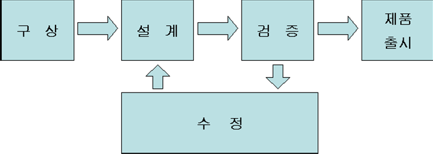
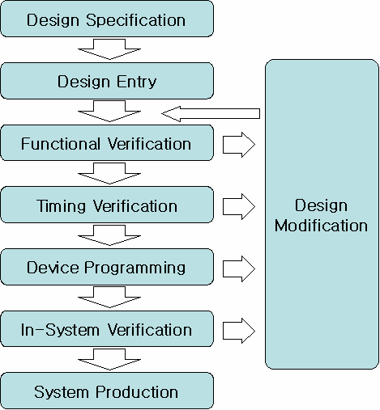

# 4. 설계S/W 기본사용법

## 4.1 Design Flow

일반적으로 어떤 제품을 개발할 때, 아래 그림과 같은 과정으로 진행합니다.

  

> **그림 4-1** · 제품 생산의 흐름

어떤 제품을 만들 것인지를 생각하고 (구상), 그 물건을 만들고 (설계), 그 물건이 의 도한 대로 만들어 졌는지 테스트 (검증)합니다. 만약에 이상이 발견되면 다시 수정하 여 검증하고, 이상이 없다면 제품을 출시하는 과정을 거칩니다. 

하나의 시스템을 설계 하는 것도 마찬가지인데, [그림 4-2]는 설계 소프트웨어를 이용 해서 시스템을 설계하는 과정입니다. 

먼저 Design Specification에서는 어떤 논리 회로를 설계할 것인가를 구상합니다. 구 체적으로 어떤 입력을 받아 어떻게 동작하여 어떤 핀으로 출력을 할 것 인지와 같은 내용을 구상하는 것입니다.

> **그림 4-2** · 시스템 설계 시 설계 흐름

그리고, Design Entry에서 설계하고자 하는 논리 회로를 어떤 방법으로 어떻게 설계 할 것인가를 결정하여 논리 회로를 설계합니다. 여기에서 어떤 방법에 해당하는 논리 회로를 설계하는 방법은 여러 가지 있는데, Graphic Design (Schematic Capture에 의 한 방법)으로 설계하는 방법, HDL (Hardware Description Language: 하드웨어 기술 언어)를 사용하여 설계하는 방법, 파형으로 설계하는 방법이 그것입니다. 

위에서 설계한 내용에 대해 문법을 검사하여 이상이 있다면 그 이상에 대한 메시지 등을 알려주고, 이상이 없다면 설계한 논리 회로를 하드웨어적으로 만들거나 시뮬레이 션 할 수 있는 파일 또는 프로그래밍 할 수 있는 파일 등을 생성하는 부분이 Compilation입니다. 

이렇게 문법 오류까지 검증된 논리 회로는 설계한 의도대로 동작이 잘 되는지에 대한 검증 과정을 거치게 됩니다. 먼저 기능적으로 문제가 없는지를 살펴보는 Function Verification, 그 후에 직접 디바이스의 특성을 이용하여 설계한 회로가 사용하고자 하 는 디바이스나 클럭에 따른 오동작을 하지 않는지를 살펴보는 Timing Verification 과 정을 진행합니다. 

위의 Function Verification과 Timing Verification은 PC상에서 소프트웨어로 검증하는 방법이고, 이렇게 검증된 논리 회로가 직접 하드웨어 (시스템)에 연결되었을 때 정확 하게 동작이 되는지를 검증해야 할 필요가 있습니다. 이 부분이 Device Programming 과 In-System Verification입니다. 전자는 말 그대로 디바이스에 설계한 논리 회로를 프로그래밍 한다는 말이고, 후자는 시스템이 꾸며진 상태에서 하드웨어 테스트를 한다 는 것입니다.

이렇게 모든 검증이 끝난 후에 비로서 제품이 완성되어 제조됩니다.

## 4.2 설계 소프트웨어

### 4.2.1 Quartus II를 이용한 설계

**1)** 역할

Altera Quartus II 프로그램은 모든 설계를 프로젝트 중심으로 관리합니다. 프로젝트 에 포함된 설계 파일 및 컴파일 한 파일, 환경저장 파일, 시뮬레이션 파일, 프로그래 밍 파일이 모두 같은 프로젝트 이름으로 관리가 됩니다. 또한 모든 설계를 프로젝트화 하였기 때문에 전체 프로젝트에 대한 관리도 각각의 프 로젝트 별로 관리하게 되어 있습니다. [그림 4-3]은 Quartus II에서 기본으로 제공해 주는 예제 중 Fir-filter라는 예제이고, [그림 4-4]는 이 Fir-filter 프로젝트에 대한 Hierarchy Display로, Fir-filter에 대한 하위 블록들을 계층구조로 보여주는 것입니다.
> **그림 4-4** · 와 같이 프로젝트에 포함된 설계 파일 및 하위 파일들은 쉽게 파악할 수

있습니다. 또한 이러한 파일들은 Setting 메뉴를 통해 파일 뿐만 아니라 프로젝트에 대한 전반적인 관리를 쉽게 하도록 구성되어 있습니다.
> **그림 4-3** · Fir-filter Project

> **그림 4-4** · Hierarchy Display

**2)** Project 선언

> **그림 4-5** · 와 같이 Quartus II 프로그램은 File -> New Project Wizard 메뉴를 선택

해서 현재 작업하려는 프로젝트를 생성할 수 있습니다. 프로젝트 선언은 프로젝트 명 선언에서부터 디바이스 선택 등의 총 5단계로 이루어져 있는데, 이 과정을 거쳐야 실 제 코딩을 위한 프로젝트 선언 과정이 완료됩니다.
> **그림 4-5** · New Project Wizard

각 단계에서 다음 단계로 진행하기 위해서는 Next 버튼을 클릭해야 합니다. 프로젝트 선언을 시작하면 프로젝트에 대한 전반적인 진행 사항을 설명하는 창이 활성화되고 Next 버튼에 의해 다음 프로젝트 선언을 시작하게 됩니다.
첫 단계로 프로젝트 관련 파일들이 저장될 Directory, Project, Top-Level의 Entity 이름을 설정 합니다. 이때 주의할 사항은 VHDL등의 Language로 작성할 경우 코드의 Entity 이름과 현재 저장하는 Top-Level의 Entity의 이름을 같게 해 주어야 합니다.
> **그림 4-6** · 에서는 프로젝트의 이름과 Entity의 이름을 동일하게 counter로 설정해 주

었고, 이에 관련된 파일들이 C:\sample에 저장되도록 설정했습니다.
> **그림 4-6** · Directory, Name, Top-Level Entity 설정

다음으로 다른 프로젝트 파일에서 필요한 파일들을 추가하거나, 그 프로젝트의 모든 파일들을 참조하기 위한 Library Path를 설정해 주는 부분입니다. 이 부분은 여러 사 람들이 함께 작업하는 설계과정에서 유용하게 사용됩니다. 따라서 여러 사람들이 각각 의 프로젝트를 나누어 설계하고, 최종 top 프로젝트에서 하나로 모아 설계할 때, [그 림 4-7]은 파일들을 Add 버튼에 의해서 필요한 파일들을 프로젝트에 추가하게 됩니 다.
> **그림 4-7** · Add Files

다음으로 Family & Device Settings 설정 부분입니다. Device Family는 사용하는 디바 이스가 RAM 또는 ROM 타입이냐에 따라 FPGA, CPLD로 구분 지을 수 있고, 세부적 으로 Device 용량 및 디바이스가 가지고 있는 핀 수, 처리 속도에 따라 나누어 집니 다. 종류를 보면, Stratix II, Stratix, Cyclone II, Cyclone, APEX II, APEX 20K, & FLEX 10K의 수백만 게이트 단계까지 설계가 가능하고, SoC라는 하나의 디바이스에서 모든 구현을 해 볼 수 있는 제품도 있습니다. 또한 이러한 디바이스에서 주로 사용하는 기능만으로 구성되어 있는 Cyclone II, Cyclone, APEX 1K 가 있습니다. 또한 고속 통신이 가능한 Stratix GX, Mercury가 있 고, CPLD로 MAX Series가 있습니다. 이렇게 다양한 Device Family를 Tool에서 선택 할 수 있습니다. [그림 4-8]에서는 현재 HBE-Combo III 장비에서 사용하는 Family 군인 cyclone II를 선택한 것을 볼 수 있습니다. 그리고 밑에 보이는 Target device에서의 체크하는 부분은 현재 결정한 Device Family 내에 있는 여러 디바이스 중 타겟 디바이스를 선택해서 프로젝트에 적용할 것 인지, 아니면 컴파일러가 디바이스 중 적당한 디바이스를 자동으로 선택해서 프로젝트 에 적용할 것인지를 선택하는 작업입니다. 예를 들어 사용자가 타겟 디바이스를 가지고 설계를 할 때, Target device는 Specific device selected in Available device list 에 체크를 해 주고 가지고 있
는 디바이스를 선택해 주면 됩니다. 또한 오른 쪽 화면에 있는 Filters 부분은 Family 내에 있는 여러 디바이스 중, 디바이스의 Package, Pin count, Speed grade에 따라서 디바이스를 검색해 주는 작업을 하는 부분입니다. 따라서 타겟 디바이스를 쉽게 찾아 선택할 수 있게 도와주는 부분입니다. 아래의 [그림 4-8]에서는 현재 HBE-Combo III 에서 사용하는 EP2C70F672C8을 선택한 모습을 보여주고 있습니다.
> **그림 4-8** · Family & Device Settings

Quartus II는 기본적으로 설계, 합성 및 시뮬레이션 작업을 할 수 있도록 기능을 포함 하고 있습니다. 하지만 Quartus II가 PLD 지원을 목적으로 만들어진 설계 프로그램이 기 때문에 이러한 개개의 작업에서의 최대의 성능을 지원해 준다고는 말하기 힘듭니 다. 따라서 여기에서는 이러한 점을 보완하기 위해 다른 전문적인 툴과 연동해서 작업이 가능합니다. 이러한 작업을 위해 [그림 4-9]의 창에서 이러한 툴의 연동을 시킬 수 있습니다. 따라서 현재 사용자의 컴퓨터에서 연동하려는 다른 프로그램이 설치되어 있 다면 여기에서 설정을 해 주면 됩니다.
> **그림 4-9** · EDA Tool Settings

여기에서는 현재까지의 프로젝트 설정 단계에서 각 단계에 대한 설정이 어떻게 되었 는지 모두 보여주게 됩니다. 따라서 사용자가 이러한 정보를 보고 프로젝트 선언 단계 에서 다르게 설정된 부분이 없는지 다시 한번 확인하는 단계가 되겠습니다. 따라서 이러한 확인 절차에 의해 잘못된 부분은 Back 버튼에 의해 그 단계로 가서 수 정을 하고, 이상이 없을 시 Finish 버튼에 의해 프로젝트 설정 단계를 마치면 됩니다. 이러한 설정 부분은 프로젝트 설정을 마치더라도 Setting 메뉴를 통해 재 수정이 가능 합니다. 아래 [그림 4-10]에서는 Summary 창을 보여주고 있습니다.
> **그림 4-10** · Summary

이전까지는 작업으로 프로젝트가 선언되었습니다. 이로써 설계할 수 있는 환경이 만들 어진 것입니다. 이렇게 프로젝트를 선언하면 [그림 4-11]과 같이 Quartus II 프로그램의 왼쪽 상단의 타이틀 바에 현재 프로젝트가 선언된 경로명 및 프로젝트의 이름이 표시됩니다.
> **그림 4-11** · 타이틀에 표시된 프로젝트 이름

작업을 진행하는 중에 Project Navigator라고 해서 프로젝트 내에 어떤 형태로 구성 되어 있는지 알아볼 수 있는데 이것은 크게 3가지로 구분됩니다. 프로젝트의 계층구조 를 보여주고, Top-Level Design File이라고 해서 최종 Design을 확인할 수 있는 Hierarchy라는 것이 있습니다. 또한 포함되어있는 파일들(시뮬레이션 파일, 프로그래
밍 파일, 하위 블록 및 각 블록에 포함된 파일)을 쉽게 확인하고 관리할 수 있는 것이 Files입니다. 마지막으로 Design Unit 의 type 세부사항을 Design Units에서 확인해볼 수 있습니다.
> **그림 4-12** · 에서 맨 위에 있는 것이 Hierarchy 이고, 중앙에 Files, 아래에 Design

Units 을 보여주고 있습니다. 이것을 통해 프로젝트의 계층구조를 파악해볼 수 있습니 다.
> **그림 4-12** · Project Navigator

**3)** Design Entry

▪ Graphic Editor (Schematic Capture에 의한 설계) ① 특징 특정 기능을 가진 심볼 라이브러리를 생성하여, 그 심볼 라이브러리의 입 출력 데이터 라인을 선 (wire) 등으로 각 심볼 등의 입 출력 데이터 신호를 연결하여 논리 회로를 설계하는 방법입니다. ② Graphic Editor 선택하기 Graphic Editor를 이용해 하나의 논리 회로를 설계하기 위해서는 Graphic Editor 창을 활성화 시켜야 하는데, [그림 4-13]과 같이 File -> New 메뉴를 선택하여 New 창을 활성화 한 후 Block Diagram/Schematic File이라는 항목을 선택하여 OK 버튼을 누르 면 [그림 4-14]와 같이 Graphic Editor 창이 활성화 됩니다.
> **그림 4-13** · 설계 메뉴에서 Block Diagram/Schematic File 선택

> **그림 4-14** · Block Diagram/Schematic File을 활성화 한 상태

③ 심볼 라이브러리
Quartus II의 Block Diagram/Schematic File에서는 도면을 마우스 왼쪽 버튼으로 더 블-클릭하는 방법 또는 마우스의 오른쪽 버튼을 눌러 Pop-Up 메뉴의 Insert -> Symbol 항목을 선택하는 방법과 Quartus II 메뉴의 Edit -> Insert Symbol 을 통해 라이브러리를 불러오는 방법이 있습니다.
> **그림 4-15** · Pop-up 메뉴에서 “Insert Symbol”선택

> **그림 4-16** · Insert Symbol 창

위의 Enter Symbol 창에서 Name에 직접 심볼 명을 쓰거나, 왼쪽의 Libraries에서 해
당 심볼 라이브러리가 들어 있는 폴더에서 찾는 방법으로 Symbol들을 검색 할 수 있 습니다. 여기에서는 AND 또는 OR 게이트의 간단한 Symbol에서 약간의 논리가 포함 된 74 시리즈, Megafunctions라고 하여 기본 설정과 Parameter 값만 변화시켜 줌으 로써 쉽게 설계할 수 있도록 해주는 라이브러리입니다. 이처럼 일부 항목을 바꾸어서 범위가 큰 논리 회로를 쉽게 설계할 수 있도록 해줍니다. ④ 각 Symbol의 연결 각 Symbol 간의 데이터 연결은 wire 또는 이름으로 연결해 줄 수 있습니다. [그림 4- 17]은 stop-watch 예제를 보여주고 있다. 각 Symbol 라이브러리 간의 bus 데이터를 연결할 때는 선 굵기가 굵은 bus wire를 사용하고, bit 데이터를 연결할 때는 굵기가 가는 bit wire를 사용합니다.
> **그림 4-17** · Stop-watch 예제에서의 연결

Symbol을 연결하는 방법은 [그림 4-18]과 같이 각 Symbol의 데이터 라인의 연결점을 마우스로 가져가면 마우스의 포인터가 십자 모양으로 바뀝니다. 이 상태에서 마우스의 왼쪽 버튼을 누른 채 드래그 하면 wire가 생성이 되는 데, [그림 4-19]와 같이 wire를 연결하고자 하는 곳까지 드래그 하여 연결하면 됩니다.
> **그림 4-18** · 마우스 포인터의 변화

> **그림 4-19** · wire 연결

bus wire의 경우에는 [그림 4-20] 위에서처럼 wire을 연결한 후, 마우스 왼쪽 버튼의 더블 클릭으로 그 bus wire 전체를 선택 할 수 있습니다. 이 때, 마우스의 오른 쪽 버 튼을 눌러 pop-up 메뉴의 Bus Line을 선택하면 됩니다.
> **그림 4-20** · bus wire로 변환

이름으로 연결할 경우에는 연결하고자 하는 Node를 [그림 4-21]과 같이 Symbol에서 wire을 일정 부분 연결한 후 마우스의 왼쪽 버튼을 이용하여 wire를 선택(클릭)하고 Node 명을 적어 주면 됩니다. 버스 데이터의 경우도 bus wire을 그린 후 이름을 버스 의 형태로 적어 줍니다. 이름을 적을 때 4bit의 A라는 이름이 있다면 A[3..0] 또는 A[0..3]로 적어 줍니다. 이 차이는 MSB(상위 비트)의 번호가 4인지 또는 0인지의 차 이입니다.
> **그림 4-21** · 이름으로 연결

⑤ 심볼 생성 사용자가 설계하여 만든 논리 회로를 하나의 블록으로 하여 더 큰 프로젝트에 넣을 수 있습니다. 이렇게 생성한 것은 Graphic Editor 상태에서는 Symbol 형태로 불러오 게 됩니다. 이 Symbol 형태를 만들기 위해서는 Graphic Editor를 활성화 시킨 상태에
서 File -> Create / Update -> Create Symbol Files for Current File 메뉴를 선택하 여 변화시킵니다. 이 진행 과정은 왼쪽의 상태표시 창에서 확인해볼 수 있습니다.
> **그림 4-22** · 심볼 생성

⑥ 설계 완성 위의 심블을 이용한 설계 방법을 이용하여 BCD_COUNTER에 대한 설계를 완성할 수 있습니다. 심블은 74160, INPUT, OUTPUT, NOT의 심블을 이용하였습니다.
> **그림 4-23** · BCD COUNTER

▪ Text Editor (HDL에 의한 설계) HDL을 이용하여 논리 회로를 설계하는 방법은 각 HDL에 따라 문법을 알아야 하기 때문에 설계 언어에 대한 지식이 필요합니다. 따라서 이 사용자 설명서에서는 가장 기 본적으로 Editor 창을 활성화 시키는 방법을 간단한 예제를 보여드리겠습니다. ① 특징 언어를 이용해서 논리 회로를 설계하는 것으로 보통 HDL(Hardware Description Language) 언어를 사용하여 설계합니다. HDL의 종류는 VHDL(Very High-speed integrated circuit HDL), Verilog HDL등이 있는데, Quartus II에서는 Text Editor를 이용하여 HDL을 설계합니다. ② Text Editor 선택하기 Text Editor를 이용하여 하나의 논리 회로를 설계하기 위해서는 Text Editor 창을 활 성화 시켜야 하는데, File -> New 메뉴를 선택한 후 [그림 4-24]와 같은 그림이 활성 화 되며, 여기에서는 VHDL File을 선택한 것을 보여주고 있다. 이렇게 HDL의 종류를 선택했으면 OK 버튼을 눌러서 Text Editor 창을 활성화 시킨다.
> **그림 4-24** · New 메뉴에서 Text Editor File 선택

> **그림 4-25** · Text Editor File을 활성화 한 상태

③ 설계하기 HDL 코드를 사용하여 논리 회로를 설계하기 위해서는 각 HDL (AHDL, VHDL, Verilog HDL 등 )의 문법 등에 대해 알아야 할 것이 많기 때문에 간단히 설계한 예만 보여드리겠습니다. 참고로 각각의 설계파일은 다른 확장자(VHDL 파일은 .vhd, AHDL 파일은 .tdf, Verilog HDL 파일은 .v)를 갖는다는 것을 유념해야 합니다.
> **그림 4-26** · AHDL로 설계한 예

> **그림 4-27** · VHDL로 설계한 예

> **그림 4-28** · Verilog HDL로 설계한 예

참고. 설계하는 문법은 Text Editor 창을 활성화 시킨 상태에서 [그림 4-29]과 같이 Template 메뉴의 각 언어 - VHDL, Verilog HDL등 - 의 Template 창을 선택하여 설 계하는 구문의 문법을 알 수 있습니다.
> **그림 4-29** · Template 선택

④ 설계 완성 이전에 설명한 것과 같이 다양한 종류의 Text 언어로 설계가 가능하고 Template를 통 해 설계 형태에 대한 도움을 받아 설계가 가능합니다. 다음의 그림은 BCD COUNTER 에 대한 예제를 보여주고 있습니다.
> **그림 4-30** · BCD COUNT(VHDL)

▪ 설계 시 Block Diagram/Schematic File로 설계하는 방법과 HDL로 설계하는 방법은 설계 방법에서 차이가 있습니다. 또한 설계가 완성된 결과도 차이를 보여주고 있습니다. 위에서 예로 보여준 두 가지 방식의 BCD_COUNT는 설계 방법에서만 다르고 이 후로 진행되는 Compile부터의 진행 과정은 동일하게 진행 됩니다.
**4)** Compile

① 역할 컴파일러는 프로젝트에 포함된 모든 디자인 파일을 통합하는 과정과 문법 오류와 일 반적인 설계의 오류를 찾는 과정을 하게 됩니다. 또한 논리 회로 합성 및 설계한 논리 회로가 하드웨어에서 이루어지는 가장 기본 단위인 로직 셀로 나누고, 각 셀의 위치를 결정하는 과정을 하게 되고, 시뮬레이션과 시간 측정을 할 수 있도록 하는 파일을 생 성하고, 마지막으로 타겟 디바이스에 프로그래밍 할 수 있는 파일을 만드는 과정을 진 행합니다.
컴파일 과정은 보통 2번의 과정을 수행하게 되는데, 처음의 컴파일 과정은 현재 작성 된 설계 파일에 대한 오류를 검증하는 단계입니다. 따라서 이 과정을 통해 컴파일 오 류를 찾아서 수정이 가능합니다. 다음의 컴파일 과정은 설계 파일에 대한 핀 할당 정 보 등의 프로젝트 선언 다음의 수정 내용을 현재 프로젝트에 적용해 주는 단계라 할 수 있습니다. ② Compiler
> **그림 4-31** · 과 같이 메뉴의 Processing -> Start Compilation 항목을 선택하면 컴파

일 과정을 수행하게 됩니다. 이 컴파일 과정은 4단계로 나뉘어 수행하게 되는데, 왼쪽 의 상태 표시 창에서 진행 상황을 확인해 볼 수 있습니다. Analysis & Synthesis 에서는 프로젝트 내에 있는 파일들을 분석하고 통합하는 과정 에서 발생하는 기본적인 오류를 체크하는 과정입니다. 따라서 회로를 분석하는 과정에 서 오류가 발생하면 컴파일을 중단하고 메시지 창에 에러를 찾아 표시해 줌으로써 회 로를 쉽게 수정할 수 있게 해줍니다.그리고 회로를 분석하는 과정에서 디바이스의 내 부구조를 효율적으로 사용하기 위해 불필요한 논리를 제거합니다. Fitter 에서는 사용자가 디바이스를 정해주지 않았을 때는 Quartus II에서 회로에 최 적인 디바이스를 자동적으로 찾아서 디바이스의 로직 셀에 배치해 줍니다. 디바이스를 정해 주었을 때는 그 디바이스에 맞게 회로를 적당한 로직 셀에 배치합니다.먼저 각각 의 논리 함수를 가장 적합한 위치의 로직 셀에 할당하고 상호 연결이나 핀 등을 적합 하게 할당시킵니다. Assembler에서는 이전의 작업을 디바이스에 프로그램 할 수 있는 파일을 생성시킵니 다. 마지막으로 Classic Timing Analyzer에서는 최종적으로 디바이스에 할당된 정보를 가 지고 핀과 핀 또는 로직 셀 사이의 데이터 전달 시간을 검사하는 과정입니다.
> **그림 4-31** · Processing -> Start Compilation 항목 선택

> **그림 4-32** · 에서는 컴파일 과정이 끝난 화면을 보여주고 있습니다. 따라서 왼쪽의 상

태 표시 창에서 모든 과정이 100%로 완료된 것을 볼 수 있고, 이전에서 말한 4가지의 컴파일 과정을 오른쪽 메인 화면 창에서 리포트 형태로 볼 수 있습니다. 따라서 여기 에서 어떠한 형태로 작업이 수행되었는지 나중에 확인해 볼 수 있습니다. 또한 밑에 메시지 창에서 컴파일 과정에 생긴 간단한 정보나, 에러, 또는 경고 등을 표시해 줍니다. 에러 메시지의 발생 시 컴파일이 중단되고 어떠한 내용의 에러 메시지 인지 표시해 주게 됩니다. 따라서 에러 메시지를 클릭하면 에러가 난 지점으로 커서가 이동하게 되고 사용자는 에러 메시지와 더불어 에러에 대한 수정을 쉽게 할 수 있습 니다.
> **그림 4-32** · Compiler 과정 완료

**5)** Assignments

① 역할 이 작업은 현재 작업하는 프로젝트의 디바이스 설정과 선택한 디바이스의 I/O 핀 할 당에 대한 작업을 수행하게 됩니다. 디바이스 선택은 사전에 프로젝트 선언 단계에서 현재 사용하는 디바이스를 선택했습니다. 하지만 프로젝트 선언 후에 이 메뉴를 통한 디바이스 변경 작업을 해 줄 수 있습니다. 지금은 Assignments라는 작업에서의 크게 할 작업은 설계 파일과 디바이스에 있는 I/O핀과의 연결을 해 주는 작업입니다. 따라 서 사용자가 어떠한 핀을 이용하여 사용할지를 프로젝트에 선언해 주는 작업이 되겠 습니다. ②Device 디바이스는 [그림 4-33]과 같이 Assignments -> Device 메뉴를 선택하여 설정합니다. 이 메뉴를 선택하면 [그림 4-34]와 같은 Settings 창이 활성화 됩니다. 이 부분에서 사용하려는 디바이스의 선택을 하거나 다른 디바이스를 찾아 재 설정을 해 줄 수 있 습니다.
> **그림 4-33** · Assignments -> Device 항목 선택

> **그림 4-34** · Device Settings

작업 창은 프로젝트 설정에서의 디바이스 설정 과정과 비슷한 구조로 되어 있으며, 동 일한 방법을 통해 디바이스를 선택해 줍니다. 여기에 있는 Device & Pin Options은 디 바이스 내부에 있는 특수 핀, 사용하지 않는 핀, 전원 관리 등의 설정을 해 주는 작업 을 하게 됩니다. 따라서 디바이스 관리에 대한 전반적인 작업을 설정해 줄 수 있는 메 뉴가 되겠습니다.
활성화 된 창에서는 디바이스 선택 이외의 현재 프로젝트에서 사용자가 설정하려는 모든 작업을 할 수 있습니다. 따라서 프로젝트에서 관리하는 파일, 연동해서 사용하는 툴 설정, 컴파일 및 시뮬레이션 과정의 설정 등의 작업을 Settings 창에서 할 수 있습 니다. ③ Pin Assignments 핀 설정은 [그림 4-35]에서와 같이 메뉴에서 Assignments -> Assignment Editor에서 핀 설정을 해 줄 수 있습니다.
> **그림 4-35** · Assignment Editor 선택

위의 그림에서는 위쪽 그림은 Assignment Editor에 들어가는 메뉴를 보여주고 있습니 다. 따라서 이렇게 메뉴에 들어가서 핀 할당을 위한 작업으로 오른 쪽 그림과 같이 Pin 이라는 버튼을 눌러 핀 할당을 위한 환경을 만들어 주어야 합니다.
> **그림 4-36** · Assignment Editor

위의 [그림 4-36]에서는 Assignment Editor창을 보여주고 있습니다. 여기에서는 할당 하려는 핀 이름은 설계 파일 작성 시 미리 지정을 해 놓았습니다. 따라서 핀 이름에 대해서는 따로 타이핑 할 필요 없이 찾아서 Assign해 주면 됩니다. 핀 할당 방법은 [그림 4-37]과 같이 To에서는 핀 이름이 들어가는 부분이고, Location 부분에서는 디바이스의 핀 번호가 들어가게 됩니다. 따라서 To와 Location 부분 하위에 <<new>> 라는 녹색의 부분에 마우스로 클릭하면, To에서는 설계 파일 의 포트 이름이 보이게 되고 Location에서는 선택된 디바이스의 핀 번호 모두가 보이 게 됩니다. 따라서 이러한 방식으로 포트 이름과 디바이스 핀 번호를 찾아서 할당해 주면 됩니다. [그림 4-35]에서는 핀 할당에 대한 작업을 자세히 보여 주고 있습니다.
> **그림 4-37** · 핀 할당 작업

위와 같은 방법으로 6개의 입 출력 핀 번호를 할당하면 됩니다. 현재 핀이 연결되어 있는 것은 CLEAR은 버튼 스위치, CLOCK는 메인 클럭, Q0 ~ Q3은 LED를 통해 할당 되어 있습니다. 위의 그림 및 매뉴얼에 있는 핀 정보를 통해 핀을 할당해 주시기 바랍 니다.
**6)** Simulation

① 역할 설계한 논리 회로를 하드웨어를 이용해서 검증하는 경우에, 처리하는 데이터량이 많거 나 속도가 빠를 경우에는 검증하는데 시간이 많이 걸리고 그 원인을 파악하지 못하는 경우가 있기 때문에 소프트웨어 적으로 먼저 검증하는 것이 필요합니다. Quartus II에 서는 이를 위해 파형으로 검증하는 시뮬레이션을 제공하는데, 이 시뮬레이션에서 동작 하는데 필요한 입력 파형의 조건을 설정해 주면 그에 따른 출력 결과의 파형이 출력 되어 쉽게 확인해 볼 수 있습니다. 따라서 설계 로직에 대한 시뮬레이션 결과가 사용 자가 원하는 동작이 되는지 검증 해 볼 수 있습니다. ② 구성 시뮬레이션을 하기 위해서는 입력 파형의 조건을 설정해 주어야 한다고 했습니다. [그 림 4-38] Segment에 대한 예제를 시뮬레이션으로 구동한 모습을 보여주고 있는데, 구성으로 왼쪽에 보이는 창에는 입,출력 포트의 이름을 보여줍니다. 이곳에서는 현재 프로젝트의 설계 파일에서 선언한 포트들이 여기에 나타나는 것입니다. 다음으로 가운 데 창에서 각 포트에서 사용자가 선택한 시뮬레이션 시간에 나타나는 출력 값을 표시
해줍니다. 따라서 파형을 일일이 보면서 값을 알아내는 것과는 달리, 상태 표시 바를 이동하여 사용자가 측정 하고 싶은 시뮬레이션 시간에 출력되는 포트 값을 이곳에서 표시해줍 니다. 마지막으로 오른쪽 창에서 각 포트에 대한 실제 데이터 값을 시간의 따라 파형 으로 표시해줍니다. 따라서 이 시뮬레이션 창을 통해 포트들이 어떻게 동작했는지를 여기에서 파형으로 한 눈에 파악할 수 있습니다.
> **그림 4-38** · Simulation 입력 창

다음으로 [그림 4-39]에서는 시뮬레이션 결과값이 나타나는 창을 보여주고 있습니다. Quartus II 에서는 입력 포트의 입력 값을 설정해 주는 창에서 바로 그 결과값이 나타 나지 않고, 새로운 창에서 시뮬레이션 결과 값이 어떻게 나타나는지를 확인할 수 있습 니다. 그림과 같이 시뮬레이션 결과 파형이 나오는 창의 구성도 리포트 구간이 더 추 가된 것을 볼 수 있습니다.
> **그림 4-39** · Simulation 결과 창

리포트 창에서는 시뮬레이션 결과에 대한 내용을 Text 형식으로 보여주고 있습니다. 여기에서는 시뮬레이션 과정과 설정 정보 등을 확인해 볼 수 있습니다. 그리고 나머지 두 개의 영역에서 시뮬레이션 결과에 대한 것을 파형으로 검증해 볼 수 있습니다. ③ Simulator 시뮬레이션은 결과 값의 형태에 따라 크게 두 가지 방법으로 나뉘어 집니다. 기능적인 시뮬레이션(Functional Simulation)과 시간 특성을 지닌 시뮬레이션(Timing Simulation)입니다. 기능적인 시뮬레이션은 설계한 회로에 대한 논리적으로 분석하여 이 사항을 시뮬레이션 결과로 보여주게 됩니다. 위의 기능적인 시뮬레이션이 단지 설 계한 회로를 논리적으로 검증한다면, 타이밍 시뮬레이션 (시간 특성을 지닌 시뮬레이 션 : Timing Simulation)은 설계자가 결정한 하드웨어의 상태 즉, 사용하려고 하는 디 바이스와 핀 번호 등의 지연 시간을 고려한 파형으로 검증하는 것입니다. 시뮬레이션은 기본 설정이 타이밍 시뮬레이션으로 동작하게끔 되어 있습니다. 따라서 아무 설정 없이 시뮬레이션을 시키면 타이밍 시뮬레이션으로 동작을 하게 됩니다. 초반에 타이밍 시뮬레이션을 통한 검증에서 타이밍 정보와 논리적인 결과값이 동시에 나옵니다. 또한 포트의 수가 늘어날 때 시뮬레이션에 대한 검증 작업에 어려움이 있을 수 있습니다. 시뮬레이션 분석 방법으로 처음 설계 파일의 검증을 위한 것이므로 기능 적인 시뮬레이션을 통해 먼저 설계된 파일의 문제가 없는지 먼저 분석하고 이러한 분
석이 완료가 되었을 때, 타이밍 시뮬레이션을 통해 타겟 디바이스를 적용한 시뮬레이 션 검증을 하는 방법으로 이루어 져야 합니다. 다음으로 시뮬레이션 과정을 하나씩 해 보도록 하겠습니다. 먼저 메뉴 창에서 File -> New 항목을 선택하면 [그림 4-40]과 같이 New 창이 활성화 되는데 여기서 Other Files 에서 Vector Waveform File을 선택합니다. 그러면 [그림 4-41]과 같이 시뮬레이 션을 할 수 있는 Waveform 창이 활성화 됩니다. 여기에서 입력 핀에 파형을 인가해, 출력되는 파형을 검증해 볼 수 있습니다.
> **그림 4-40** · Simulation 메뉴 선택

> **그림 4-41** · Simulation 창 활성화

위의 그림과 같이 시뮬레이션 창을 활성화 시켰으면, 여기에 입,출력 핀을 불러와야
합니다. 불러오는 방법은 [그림 4-42]의 위쪽 그림과 같이 시뮬레이션 창의 왼쪽 편 에 있는 Name 창에서 마우스 오른쪽 키에 의한 pop-up메뉴에서 Insert -> Insert Node or Bus를 선택하거나, [그림 4-42]의 아래 쪽 그림과 같이 Quartus II 메뉴의 Edit -> Insert -> Insert Node or Bus 를 선택합니다. 그러면 [그림 4-43]과 같이 입, 출력 포트를 넣는 새로운 창이 생깁니다. 여기서 포트를 검색하기 위해 오른쪽에 있는 Node Finder 버튼을 클릭하여 입,출력 포트를 찾을 수가 있습니다.
> **그림 4-42** · Simulation 입ㆍ출력 포트 불러오기

> **그림 4-43** · Insert Node or Bus

> **그림 4-43** · 의 Node Finder 버튼을 사용하여 [그림 4-44]의 Node Finder 창이 활성

화 됩니다. 이 창에서는 입,출력 포트에서 보고자 하는 포트를 선택하는 곳으로 Filter 을 all로 설정해 준 다음 검색을 하여야 합니다. 검색을 위해서는 List 버튼을 통해 그 림과 같이 설계한 프로젝트의 입,출력 포트가 나타나게 됩니다. 이 포트들 중에 확인 하려는 포트를 찾아서 선택을 하면 됩니다.
> **그림 4-44** · Node Finder

이상으로 포트 선택을 완료하면 OK 버튼을 눌러 마치면, 시뮬레이션 창에 포트 이름 이 보입니다. Waveform 창에서 불러들인 포트들을 마우스로 블록화해서 파형을 그려 주면 됩니다. 방법으로는 마우스로 파형을 입력하려는 포트의 영역을 블록을 지정하고, File -> Value 에 있는 메뉴를 통해 블록으로 지정된 곳에 입력 파형을 줄 수 있습니 다. 여기에서는 0, 1값부터, High Impedance, Unknown, Clock등의 값을 줄 수 있습 니다.
그림 [그림 4-45]은 입력 파형에 대한 정의를 마친 모습을 보여주고 있습니다. CLOCK은 주기적인 클럭을 CLEAR에 대해서는 일정 구간을 1 로 할당한 모습입니 다.
> **그림 4-45** · Waveform Editor 파형 정의

이렇게 파형 정의를 마치면 현재 작업한 것을 프로젝트에 저장하고, Processing -> Start Simulation을 통해 시뮬레이션 결과 파형을 볼 수 있습니다. [그림 4-46]는 이 러한 결과 파형을 보여 주고 있습니다. 여기에서는 초기의 파형 입력 창과 달리 별도 의 창이 활성화 되어 결과 파형을 분석해 주고 있습니다. 왼쪽의 창의 리포트 창을 통 해 시뮬레이션에서 발생하는 결과값을 문서로 표시해 주고 있습니다.
> **그림 4-46** · Simulation Waveforms

시뮬레이션에서는 이러한 입력파형에 대한 값과 설계 파일의 정보를 보고 결과 값을 보여주게 됩니다. [그림 4-46]에서는 파형의 입력 창과는 달리 Report 구간에 대한 영역이 나타나 있습니다. 따라서 파형적인 분석과 달리 문서적으로 결과에 대한 리포트를 해 주고 있습니다. 또 한 이러한 시뮬레이션은 앞서 설명한 것과 같이 타이밍 시뮬레이션을 기본으로 하고 있습니다. 그러므로 사용자가 아무런 설정이 없으면, 디바이스에 대한 delay 시간을 고려한 시뮬레이션 과정을 수행하게 됩니다. Function 시뮬레이션 작업을 위해서는 [그림 4-47]과 같이 메뉴의 Processing -> Generate Functional Simulation Netlist 작업을 먼저 해 주어야 합니다. 이 작업을 통 해 만들어진 데이터 값을 보고 기능적인 시뮬레이션 작업을 수행하게 되는 겁니다. 그 리고 Assignments -> Settings에서 왼쪽 Category를 Simulator Setting로 선택해 주 고, 나타나는 시뮬레이션 창의 Simulation mode를 Functional로 선택해 서 시뮬레이 션을 실행 시키면 됩니다. 만약 Generate Functional Simulation Netlist 작업이 수행되지 않고 Setting 창에서 Functional만 바꾸어서 실행을 시키면, 시뮬레이션 과정에서 Netlist 파일에 대한 정 보가 없어서 에러가 발생하고 시뮬레이션 과정이 중단되게 됩니다. 따라서 위의 두 과 정을 꼭 진행해 주어야 합니다.
> **그림 4-47** · Functional Simulation Settings

다음의 [그림 4-48]과 [그림 4-49]는 두 가지의 시뮬레이션 결과를 비교해서 보여주 고 있습니다. 타이밍 시뮬레이션에서는 디바이스에서 발생하는 delay 시간을 고려한 시뮬레이션 결과를 보여주고 있어 클럭의 상승 구간에 바로 동작하지 않고 디바이스 지연 시간을 고려한 시뮬레이션을 볼 수 있습니다.
> **그림 4-48** · Timing Simulation

> **그림 4-49** · Function Simulation

**7)** Programming

위에서 설계 및 검증이 끝난 논리 회로를 디바이스에 프로그래밍 부분입니다. ① Programmer 활성화
> **그림 4-50** · 과 같이 Quartus II 메뉴에서 Tool 　> Programmer에서 Programmer 창

을 활성화해서 사용할 수 있습니다. 이 메뉴를 선택하면 [그림 4-51]과 같이 Programmer창이 활성화 되고 여기에서 장비에 직접 다운할 수 있습니다.
> **그림 4-50** · Quartus II 메뉴에서 Programmer 항목 선택

> **그림 4-51** · Programmer 창 활성화

② 하드웨어 설치 처음에 Programmer 창을 활성화 하면 Hardware Setup 창에 No Hardware라는 것이 표시가 됩니다. 여기에서는 ByteBlaster라는 하드웨어를 가지고 Altera device를 프로 그램 하기 때문에 이러한 하드웨어를 등록을 해 주어야 합니다. Programmer 창 위에 보이는 Hardware Setup를 클릭하면 하드웨어를 등록해 주는 창이 활성화 됩니다. [그 림 4-52]와 같이 Hardware Setup 창에서 ByteBlaster를 등록해 주면, [그림 4-53]과 같이 ByteBlaster의 등록된 모습을 볼 수 있습니다.
> **그림 4-52** · Hardware Setup

> **그림 4-53** · Hardware Setup 완료

③ 프로그래밍 하나의 프로젝트가 선언되고 컴파일을 통해 프로그래밍 파일이 만들어 졌을 때, Programmer 창을 활성을 하면, File에 현재 프로젝트에서 프로그램 할 수 있는 .sof 파일과 device정보 등이 보이게 됩니다. 여기에서 Program/Configure에 대한 부분을 체크하고 Start 버튼을 클릭하여 다운 하시면 됩니다. 만약 동작이 되지 않을 때, Programmer 창에서 활성화 되는 부분의 버튼인 Auto Detect 버튼을 눌러 디바이스와 PC간의 연결이 제대로 되었는지 확인해 보기 바랍니 다. 따라서 [그림 4-54]와 같이 화면상에 두 개의 디바이스가 나타나는지 확인해 보 기 바랍니다. 만약 이 화면과 다르게 표시되거나 Unable to scan device chain. Can t scan JTAG chain. 이라는 메시지가 표시되면 연결 케이블에 대한 확인과 디바이 스 전원에 대한 확인을 해 주고, 이 사항에 대한 문제가 없을 시 회사로 문의 해 주기 바랍니다.
> **그림 4-54** · Auto Detect

위 사항에서 아무런 이상이 없이 진행이 되면, 다운로드 케이블을 PC의 Parallel port 와 보드의 다운로드 port에 연결한 후 Start 버튼을 누르면 디바이스에 다운이 됩니다.
> **그림 4-55** · 에는 다운이 완료된 모습을 보여주고 있습니다. 이렇게 다운이 완료되었

을 때, 메시지 창에 Configuration succeeded 메시지가 표시되며 보드에서 설계한 회 로가 바로 동작이 진행되게 됩니다.
> **그림 4-55** · Configuration Ended

④ Configuration ROM Programming HBE-Combo III 보드에는 Cyclone II device가 RAM 타입의 디바이스이기 때문에 별도 의 ROM 타입의 디바이스인 EPCS16 사용하고 있습니다. 따라서 전원의 ON/OFF시마 다 FPGA 디바이스의 데이터가 사라져 다운을 다시 해야 되는 작업을 막기 위해 별도 의 ROM을 두어서 전원의 ON/OFF시 마다 데이터를 ROM에서 FPGA디바이스로 전달 하여 보드가 작동이 되도록 구성하고 있습니다. Configuration ROM에 writing하는 방법은 기존의 프로젝트에서 설계된 .sof 파일을 변환하여 사용해 주면 됩니다. 따라서 Quartus II의 메뉴의 File -> Convert Programming Files에서 이 작업을 수행해 주면 됩니다. 여기에서는 Programming file type는 JTAG Indirect Configuration File (.jic) 로 변경해 주시고, Configuration device는 보드에서 사용하고 있는 EPCS16을 선택해 주셔야 합니다. 또한 File name는 사용자가 만들려는 적당한 이름을 주면 됩니다. 여기서 선택한 File name이 현재 작업하는 프로젝트 폴더에 생성되게 됩니다. 확장자는 .jic로 생성이 됩 니다. 또한 Flash Loader를 선택하여 오른쪽에 활성화 되는 Add Device 버튼을 눌러 현재 사용하는 FPGA 디바이스인 EP2C70를 선택해 주고, SOF Data는 똑 같은 방법으 로 Add File를 통해 현재 프로젝트에서 설계한 결과 파일인 .sof 파일을 넣어 주면 됩 니다. 이상으로 모든 것에 대한 설정이 마쳤으면, Generate 버튼을 눌러 EPCS16에 프 로그램 할 수 있는 파일을 생성하게 됩니다. [그림 4-56]에는 파이변환에 관한 창을 보여주고 있고, [그림 4-57]에는 이 결과 파일을 가지고 EPCS16 디바이스에 프로그램 하는 과정을 보여주고 있습니다.
> **그림 4-56** · Convert Programming Files

> **그림 4-57** · Configuration ROM Programmer

### 4.2.2 ISE를 이용한 설계

**1)** 역할

Xilinx ISE 프로그램도 Quartus II와 마찬가지로 프로젝트를 선언하여 프로젝트 중심 으로 관리를 하도록 되어 있습니다. 따라서 프로젝트에 속한 설계 파일, 컴파일 관련 파일, 시뮬레이션 파일, 핀 정보 등의 일련의 파일들이 하나의 프로젝트에 속해 관리 를 하게 됩니다. 이렇게 구성이 되어 있어, 하나의 프로젝트 파일을 오픈 하였을 때, 프로젝트에 관련된 모든 파일을 불러와서 정보를 보고 사용할 수 있도록 구성을 하고 있습니다.
> **그림 4-58** · 은 장비의 Full demo 예제의 VHDL로 작성한 소스 코드를 보여주고 있으

며, [그림 4-59]에서는 프로젝트에서 관련된 소스파일들을 보여주고 있습니다.
> **그림 4-58** · full demo 예제

> **그림 4-59** · Source Files

**2)** Project 선언

Xilinx ISE도 Quartus II에서 설명한 예제를 그대로 설명 하도록 하겠습니다.
> **그림 4-58** · 와 같이 ISE 프로그램은 File -> New Project 메뉴를 선택하여 프로젝트

를 선언할 수 있습니다. 프로젝트 선언은 프로젝트 명 선언에서부터 디바이스 선택에 서 파일 추가까지 총 5단계로 이루어져 있는데, 이 과정을 거쳐야 실제 코딩을 위한 프로젝트 선언 과정이 완료됩니다.
> **그림 4-60** · New Project

각 단계에서 다음 단계로 진행하기 위해서는 Next 버튼을 클릭해야 합니다. 프로젝트 선언을 시작하면 프로젝트에 대한 전반적인 진행 사항을 설명하는 창이 활성화되고 Next 버튼에 의해 다음 프로젝트 선언을 시작하게 됩니다.
첫 단계로 프로젝트 관련 파일들의 Project Name, Project Location, Top-Level Source Type을 설정 해 주어야 합니다. Project Name을 선택할 때는 Project Location에도 같은 이름의 폴더가 자동으로 생성하여 그 폴더 내에서 관리 하도록 하 고 있습니다. Top-Level Source Type는 현재 프로젝트의 top 파일의 타입을 설정해 주는 것입니다. 여기에는 HDL, Schematic, EDIF, NGC/NGO의 파일 형태를 선택해 주면 됩니다. [그림 4-61]에서는 프로젝트의 이름을 bcd_cont로 설정해 주었고, 이에 관련된 파일들은 C:\sample에 저장되도록 설정했습니다. 또한 top 파일을 VHDL파일 형태로 설계를 할 것이기 때문에 Top-Level Source Type을 HDL로 설정한 것입니다.
> **그림 4-61** · Create New Project

다음은 프로젝트 설정 단계에서 디바이스 설정 및 EDA 툴 설정을 하는 단계입니다. 따라서 현재 사용하는 디바이스를 선택하고 합성과 시뮬레이션 툴을 선택하여 설정해 주는 작업을 하는 단계라고 볼 수 있습니다.
> **그림 4-62** · 에서는 현재 작업을 설정한 모습을 보여주고 있습니다. Spartan-3A DSP

Family의 180만 게이트 676핀 사양을 가진 디바이스를 선택한 모습을 보여주고 있으 며, 합성과 시뮬레이션 툴은 ISE에서 지원해 주는 것을 사용하고 있습니다. 아래 그림 에서 이와 같은 설정 모습을 볼 수 있습니다.
> **그림 4-62** · Device Properties

다음 과정은 프로젝트 설정 단계에서 프로젝트에 추가 할 파일 중 새로 생성할 파일 의 이름과 타입을 적어주는 단계입니다. 따라서 설계자가 어떤 파일을 생성하여 설계 를 할지 미리 생각하고 프로젝트를 선언하고 있다면 이 단계에서 새로 생성할 파일을 적어 주면 됩니다. 새로 생성할 파일을 현 단계에서 넣어 주어도 되고, 프로젝트 선언 이 끝난 다음에서도 추가가 가능합니다. [그림 4-63]에서는 Create New Source단계의 창을 보여주고 있습니다.
> **그림 4-63** · Create New Source

현 단계는 이전 단계와 비슷한 소스 파일을 추가하는 단계이지만 다른 점은 미리 설 계 된 소스 파일을 추가해 주는 단계입니다. 따라서 사용자가 미리 설계된 상위 또는 하위 파일들이 있을 시 이것을 현재 생성하려는 프로젝트에 추가해 주는 부분입니다. 이 부분도 프로젝트를 생성한 후에도 설정이 가능합니다. [그림 4-64]에는 Add Existing Sources 단계를 보여주고 있습니다.
> **그림 4-64** · Add Existing Sources

이 단계는 프로젝트 설정의 마지막 단계로써 프로젝트 설정 단계에 대한 Summary를 보여주는 창입니다. 따라서 이전 단계에 프로젝트 설정 정보를 다시 확인해 보면서 잘 못된 부분이 없는지 다시 확인하는 단계입니다. 현 단계에서 잘 못 설정된 부분을 있 으면 Back 버튼에 의해 이전 단계로 이동하여 수정을 하고, 이상이 없으면 Finish 버 튼을 눌러 프로젝트 선언을 마치면 되겠습니다.
> **그림 4-65** · Project Summary

이전까지의 작업으로 현 작업에 대한 프로젝트 선언 작업을 마쳤습니다. 따라서 이 후 에 만들어지는 모든 파일들은 현재의 프로젝트 폴더 내에서 되고 관리가 될 것입니다.
> **그림 4-64** · 에서는 프로젝트 설정을 마치고 ISE창에 설정된 모습을 보여주고 있습니

다. Sources창에서 현재 설정된 프로젝트인 watch와 디바이스인 Spartan3 계열의 디 바이스가 보여지고 있습니다.
> **그림 4-66** · 타이틀에 표시된 프로젝트

**3)** Design Entry

▪ Schematic Editor ① 특징 특정 기능을 가진 심볼 라이브러리를 생성하여, 그 심볼 라이브러리의 입 출력 데이터 라인을 선(wire) 등으로 각 심볼 등의 입 출력 데이터 신호를 연결하여 논리 회로를 설계하는 방법입니다. ② Schematic 선택하기 Schematic을 이용해 하나의 논리 회로를 설계하기 위해서는 Schematic Design 창을 활성화 시켜야 하는데, [그림 4-67]과 같이 File -> New 메뉴를 선택하여 New 창을 활성화 한 후 Schematic이라는 항목을 선택하여 OK 버튼을 누르면 [그림 4-68]과 같 이 Schematic Editor 창이 활성화 됩니다
> **그림 4-67** · 설계 메뉴에서의 Schematic 선택

> **그림 4-68** · Schematic Editor

③ 심볼 라이브러리 Schematic 으로 작업할 수 있는 환경이 되었으면 이곳에 symbol을 삽입해 주어야 합 니다. 따라서 Sources 창에서 아래쪽에 Symbols를 선택하면 아래 [그리 4-69]와 같 은 창이 활성화 되고, Symbol Name Filter에서 찾고자 하는 Symbol을 검색하여 찾으 면 됩니다. 그림에서는 cb4cle라는 심블을 선택하는 부분을 보여주고 있습니다. 또한 이 창에서는 Symbol을 회전할 수 있는 Orientation 설정 부분과, 현재 선택한 Symbol 에 대한 정보를 확인 할 수 있는 Symbol Info 버튼이 있습니다.
> **그림 4-69** · Symbols

사용자가 심볼의 이름을 알고 있을 때 직접 Symbol의 이름으로 검색하여 불러와 사용 이 가능하고 Symbols에서 직접 심볼을 검색하여 찾아 설계 소스에 추가해 주면 됩니 다. ④ 각 심볼의 연결 이전의 작업으로 심볼을 불러오면 심볼간의 연결을 해 주어야 합니다. 또한 심볼을 디 바이스의 I/O 핀과 연결할 수 있는 포트를 연결해 주어야 합니다. [그림 4-70]은 심 볼을 이용하여 회로를 설계하는데 사용하는 아이콘들이 나와 있습니다.
> **그림 4-70** · Tools

> **그림 4-70** · 과 같이 자주 사용하는 아이콘에서는 Wire를 추가해 주는 부분과, 각

Wire간의 이름을 주는 아이콘, 심볼을 추가하는 아이콘, 화면에 대한 확대, 축소하는 아이콘들이 포함되어 있습니다. 따라서 설계자가 이러한 아이콘을 통해 Schematic으 로 설계를 하는데 쉽게 할 수 있습니다.
> **그림 4-71** · 에서는 심볼들간의 연결하는 모습을 볼 수 있습니다. 왼쪽 상단의 AND2

에 마우스를 가져가면, 그림과 같이 사각형 모양의 그림이 4개가 생기게 됩니다. 이것 은 심볼의 핀과 연결하여 Wire을 생성하겠다는 표시입니다. 따라서 이 상태로 Wire을 생성하면서 연결하려는 심볼의 핀까지 마우스로 드래그 해 주면 됩니다. 만약 마우스 를 커서의 모양이 바뀌지 않으면, 아이콘에서 Add Wire에 대한 것을 선택하였는지 다 시 한번 확인해 보시기 바랍니다.
> **그림 4-71** · 마우스 포인터의 변화

> **그림 4-72** · Wire 연결

이름으로 연결할 경우에는 연결하고자 하는 Node를 [그림 4-73]과 같이 Symbol에서 wire을 일정 부분 연결한 후 마우스로 이름을 부여하는 모습을 보여주고 있습니다. 메 뉴의 Add -> Net Name을 선택한 후에 ISE의 Processes 창에서 Name의 이름을 적어 주면 화면의 마우스 커서 옆에 이름이 표시되게 됩니다. 이 상태에서 미리 그려 둔 Wire에 마우스로 클릭하면 Wire에 이름이 표시되게 됩니다.
> **그림 4-73** · 이름으로 연결

다음 그림에는 현재 예제 소스로 사용하기 위한 4bit count의 회로 설계 모습을 보여 주고 있습니다. CB4RE, VCC 심블을 이용하였고, 심블들 간의 Wire를 통해 연결해 주 었습니다. 또한 입, 출력 포트는 Add I/O Marker을 통해 설계를 해 주었습니다. I/O 포트의 이름은 마우스로 선택하여 하나 씩 이름을 지정해 주었습니다.
> **그림 4-74** · 4 bit Count

▪ Text Editor (HDL에 의한 설계) HDL에 의한 설계의 기본 내용은 Quartus II에 설명이 되어 있으므로 ISE 설명에서는 생략하고 설계 방법으로 바로 넘어가도록 하겠습니다. ① Text File 선택하기 Text의 HDL을 이용하여 설계하기 위해서는 Text File 창을 활성화 시켜야 하는데, File -> New 메뉴를 선택하면, [그림 4-75]와 같이 어떠한 형태로 설계를 할 것인지 선택하게 된다. 여기에서 Text File를 선택하면 그림과 같이 설계를 할 수 있는 창이 활성화 됩니다. 여기에서 사용자가 HDL을 이용하여 설계를 하고 저장을 하면 됩니다.
> **그림 4-75** · Text File

② 설계하기 HDL을 이용한 설계 방법에는 VHDL, Verilog HDL에 의한 설계 방법이 있습니다. 이 러한 예제는 Quartus II 툴 설명에서 나온 예제 그림과 같습니다. 저장하는 파일 이름 도 Quartus II와 같은 VHDL 파일은 .vhd, Verilog HDL 파일은 .v의 확장자를 가지고 저장합니다. 여기에서도 Quartus II와 마찬가지로 메뉴의 Edit -> Language Templates가 존재하 여 각 언어에 대한 기본적인 형태를 지원해 주고 있습니다. 따라서 사용자는 이러한 메뉴를 이용하여 어떠한 형태로 설계할 지 알 수 있고 간단하게 HDL을 작성할 수 있 습니다. [그림 4-76]은 Language Templates를 보여주고 있습니다.
> **그림 4-76** · Language Templates

여기에서도 Quartus II에서 설명한 예제 소스인 BCD_COUNT를 이용하여 설명하도록 하겠습니다. 다음 그림에서 설계 소스를 보여주고 있습니다.
> **그림 4-77** · BCD_COUNT Source

소스 설계가 끝나고 파일을 저장했으면, 프로젝트에 현재 설계한 소스 파일을 추가해 주어야 합니다. 이 작업은 메뉴에의 Project -> Add Source를 통해 현재 설계한 파일 을 추가할 수 있습니다. 다음의 그림에서 파일을 추가하는 모습을 보여주고 있습니다.
> **그림 4-78** · Adding Source

위의 그림에서 볼 수 있듯이 Add Source의 메뉴를 통해 3단계를 거치면서 현재 설계 한 BCD_COUNT.VHD를 추가하면 다음의 그림과 같이 현재 현 프로젝트에 등록된 모 습을 보여주고 있습니다.
> **그림 4-79** · Add Source

위의 그림과 같이 소스를 추가하면 Process창에 새로운 메뉴가 생깁니다. 이러한 메뉴 는 컴파일 과정에서 사용하는 것으로 메뉴가 활성화가 되는지 꼭 확인하셔야 합니다.
**4)** Compile

① 역할 컴파일러는 과정은 Quartus II에서 설명한 같은 목적을 가지고 수행을 하게 됩니다. 여기에서는 Xilinx ISE에서의 컴파일 과정을 살펴보기로 하겠습니다. ② Compiler ISE에서는 컴파일 과정을 크게 4부분으로 나누고 있습니다. ISE Processes창에서 볼 수 있듯이 Synthesize, Implement Design, Generate Programming File, Configure Target Device로 나뉘고 있습니다. Synthesize는 현재 설계한 회로에 대한 부분을 확 인하는 작업을 하게 됩니다. 따라서 사용자의 설계 파일을 보고 컴파일을 하는 부분입 니다. 설계 소스를 보고 문법적인 오류에 대한 검사를 하고 이에 대한 합성을 하는 단 계 입니다. Implement Design은 디바이스를 보고 컴파일 하는 과정입니다. 따라서 디바이스에 대한 디바이스의 로직에 이전에 컴파일 한 소스를 배치하는 단계
입니다. 또한 디바이스의 핀에서 어떠한 핀을 사용하여 제어를 할 지 결정하는 단계입 니다. 여기에서 설계 소스에서 사용하는 핀을 지정하여 사용할 수 있도록 활성화 시켜 주는 작업을 하게 됩니다. Generate Programming File은 프로그램에 관련된 작업을 하게 됩니다. 따라서 프로그램 할 수 있는 파일을 생성하는 작업을 하게 됩니다. 또한 Configure Target Device는 타깃 디바이스에 프로그램 하는 과정입니다. 이 과정에서 FPGA 디바이스 이외의 Configuration ROM에 대한 프로그램 파일도 생성해 줄 수 있 습니다. 이렇게 나눠져 있는 컴파일 수행 작업은 메뉴의 Process 또는 툴의 Processes 창에서 실행을 할 수 있습니다. 위에 있는 각각의 작업에 마우스 오른쪽 키를 누르면 팝업 창 이 활성화되는데, 여기에서 run을 클릭하여 각각의 컴파일 작업을 수행하게 됩니다.
> **그림 4-80** · 에서는 이러한 컴파일 작업을 보여주고 있습니다. 여기에서는 Synthesis

작업에 대한 컴파일 수행 작업을 보여주고 있습니다. 나머지도 이 작업과 똑같이 수행 해 주면 됩니다.
> **그림 4-80** · Compiler

**5)** Assignments

① 역할 이 작업은 디바이스의 I/O핀 설정을 위한 작업입니다. Quartus II에 설명을 참고해 보 기 바랍니다. ② Assign Package Pins 프로젝트 설정 단계에서 디바이스 설정을 미리 해 두었기 때문에 여기에서는 핀에 대 한 설정만 해 주면 됩니다. 컴파일 과정에서 컴파일러가 포트에 대한 정보를 가지게 됩니다. 따라서 핀 설정 과정에서 사용하려는 핀을 불러와서 타겟으로 사용하는 디바 이스에 Assign 하게 되는 것입니다. 이 작업은 Processes 창에서 할 수 있습니다. Processes 메뉴에서 User Constraints -> Floorplan Area / IO / Logic Post-Sunthesis에서 이러한 작업을 수행하게 됩 니다. 이 메뉴를 마우스로 클릭하면 확장자가 .ucf 파일을 생성하면서 핀을 할당하는 새로운 창이 활성화 되는데 이 창에서 Yes 를 클릭하시면 됩니다. 그러면 Process 에 Design Objects창이 활성화 되고, 여기에서 핀을 할당을 할 수 있습니다. 이 창에 서는 Design Object List에 이전에 설계한 회로의 I/O Name이 미리 지정이 되어 있습 니다. 따라서 사용자는 해당되는 I/O Name에 핀을 할당해 주면 됩니다. Design Object List에서 LOC에 핀 번호를 적어서 할당해 주면 됩니다. [그림 4-81]에서는 핀 이 할당된 모습을 보여주고 있습니다. 핀 번호는 장비에서 메인 클럭과 버튼 스위치, LED를 통해 할당해 주었습니다.
> **그림 4-81** · Assign Package Pins

**6)** Simulation

ISE 시뮬레이션도 툴 내부에서 지원해 주고 있습니다. 이것도 또한 장비의 설계 단계 에서 사용자가 원하는 동작을 하는 지 파형적으로 검증해 보기 위해 시뮬레이션을 통 해 분석하게 됩니다. 따라서 입력 따른 출력 파형이 사용자가 의도한 데로 동작을 하 는지 이번 단계에서 검증하게 됩니다. 이번 단계에서는 시뮬레이션을 하기 위한 첫 번째 단계로 시뮬레이션 구동을 위해 입 력 파형을 정의해 주어야 합니다. 따라서 이러한 파형을 프로젝트에 적용해 주기 위한 파일을 생성해 주어야 합니다. 따라서 메뉴의 Project -> New Source를 선택합니다. 다음 그림에서 Test Bench Waveform을 선택하고 오른쪽에 File name에서 생성할 파 일 이름을 기입합니다.
> **그림 4-82** · Test Bench Waveform

Test Bench Waveform 파일을 생성하기 위해서는 총 3단계로 작업이 이루어 집니다. 첫 번째 단계는 앞서 설명한 것과 같이 파일 이름 및 저장될 폴더를 지정해 주고, 다 음 단계로 현재 시뮬레이션이 이루어질 설계 파일을 지정한다. 마지막 창에 이러한 설 정을 정리해서 보여주게 됩니다. Finish 버튼으로 파일을 생성하면 다음 창에서는 입력 클럭에 대한 정의를 해 주게 됩
니다. 여기에서는 클럭에 따른 동작 시점과 클럭의 주파수 정보를 이 창에서 설정 해 줄 수 있습니다.
> **그림 4-83** · Initialize Timing

위와 같이 설정이 끝나면 다음 그림과 같은 창이 보여지게 됩니다.
> **그림 4-84** · Create Waveform

이렇게 입력 클럭에 대한 정의를 마치면 CLEAR에 대한 파형도 정의해 주어야 합니다. 이를 위해서는 마우스로 CLEAR의 파형이 있는 쪽을 마우스로 클릭하면 파형이 반전 됩니다. 이러한 방식으로 기본 0 의 값을 가지고 있는 파형에 마우스를 이용하여 입력 파형을 정의해 줍니다. 다음 그림에서 입력 파형의 정의가 완성된 것을 확인할 수 있습니다.
> **그림 4-85** · Input Signal

이상으로 시뮬레이션을 위한 준비 작업을 마쳤습니다. 이제부터 시뮬레이션을 시작하 도록 하겠습니다. 시뮬레이션을 위해 먼저 Source 창에 있는 Source for의 Implementation을 Behavioral Simulation으로 변경해 주어야 합니다. 다음 창에 이러 한 작업이 나와 있습니다.
> **그림 4-86** · Behavioral Simulation

이렇게 설정하면 아래 쪽의 Processes창도 변하게 되는데, Xilinx ISE Simulator의 하 위 메뉴인 Simulate Behavioral Model을 클릭하여 시뮬레이션을 실행하시면 됩니다.
> **그림 4-87** · Start Simulation

이와 같이 시뮬레이션을 동작 시키면 다음 그림과 같이 설계된 파형의 시뮬레이션 결
과 같이 보여집니다. BCD COUNTER를 설계한 것이기 때문에 CLEAR이 1 인 구간 에서는 0 으로 출력 되고, 나머지 구간에서는 클럭이 상승 구간에서 출력이 1 씩 증가하게 됩니다. 다음 파형에서 이러한 결과값을 확인해 보도록 합니다.
> **그림 4-88** · Simulation End

**7)** Configure Device (iMPACT)

Configure Device 작업은 현재까지의 툴에서의 작업을 직접 디바이스에 다운하여 디 바이스를 직접 동작해 보는 작업입니다. 따라서 이전까지의 툴에서의 설계 작업을 통 한 결과 파일을 디바이스에 직접 다운하여 동작을 시켜 보는 작업이라 할 수 있습니 다. ISE에서는 iMPACT를 통해서 이러한 작업을 할 수 있습니다. 이전까지의 설계와 컴파일 작업이 끝난 상태에서 Generate Programming File을 실행 하면 프로그램 할 수 있는 파일이 생성됩니다. 그리고 Configure Target Device -> Manage Configuration Project(iMPACT)를 마우스 오른쪽 키를 이용하여 생성되는 팝 업 메뉴에서 RUN을 실행하면 프로그램을 위한 작업 창이 활성화 됩니다. 다음 [그림 4-89]에서는 iMPACT을 실행 시 초기 화면을 보여주고 있습니다.
만약 실행 시 이전 단계의 컴파일 단계 중 빠진 것이 있으면, 앞 단계의 컴파일 과정 이 모두 끝난 뒤 iMPACT이 실행 됩니다.
> **그림 4-89** · iMPACT

여기에서는 다운하려는 디바이스에 대한 다운 방식을 선택해 주는 작업입니다. 모드와 사용하려는 디바이스가 어떠한 것인지 선택을 해 주어야 합니다. 현재 장비에서는 Spartan-3A DSP군의 디바이스를 JTAG 방식으로 다운하는 모드를 취하고 있으므로, 처음에 있는 Configure devices using Boundary-Scan(JTAG)을 선택해서 Finish 버튼 을 눌러 주면 됩니다. 이렇게 하면 다음 그림과 같은 창이 활성화 되는데 이때 오른 쪽 메인 창에서 마우스 오른 쪽 키를 이용하여 팝업 메뉴를 활성화 합니다. 이 메뉴에서 Initialize Chain을 선택합니다. 이 메뉴를 선택하기 이전에 PC와 장비간의 다운로드 케이블을 통해 연결 되어 있고, 장비의 전원은 On 상태로 해 주셔야 합니다. 만약 이렇게 되어 있지 않으 면 PC에서 다운로드 할 디바이스를 검색하지 못해 에러 메시지를 띄우게 됩니다.
> **그림 4-90** · Initialize Chain

현재 장비에서 사용하고 있는 디바이스는 XC3SD1800AFGG676의 FPGA 디바이스와 XCF08의 PROM을 사용하고 있습니다. 따라서 디바이스 검색에서 2개의 디바이스가 검색이 되고, 검색된 디바이스에 어떠한 프로그램 파일을 프로그램 할지 검색할 수 있 는 탐색 창이 나타나게 됩니다. 따라서 디바이스 별로 탐색 창이 생성되어 파일을 검 색하여 지정해 주면 됩니다. 파일 설정이 끝나면 프로그램 설정을 해 주는 옵션 창이 활성화 되는데 여기에서 각 디바이스 별 다운로드 시 동작에 대한 설정을 해 주어야 합니다. 왼쪽 Category 창에서 FPGA와 PROM2를 선택할 수 있으며, 선택된 디바이스 에 따른 설정을 오른쪽 메인 창에서 작업 하게 됩니다. FPGA 디바이스는 따로 체크할 필요가 없으며 PROM에 대한 다운로드 작업을 위해서는 다음의 그림과 같은 옵션을 체크해 주셔야 합니다. 이 옵션 작업은 PROM에 대한 설정 작업이면 PROM에 대한 프로그램 작업을 하지 않을 시 체크를 안하고 OK 버튼을 눌려 주셔도 됩니다.
> **그림 4-91** · Programming Properties

> **그림 4-92** · 에서는 JTAG를 통해 검색된 디바이스와 XC3SD1800A 디바이스에 프로그

램 파일인 bcd_count.bit 파일이 지정된 모습을 보여주고 있습니다.
> **그림 4-92** · iMPACT

이렇게 파일을 지정했으면, 지정된 디바이스에 마우스 오른쪽 키를 눌러 Program 메 뉴를 클릭해서 디바이스에 프로그램 하면 됩니다. [그림 4-93]에서 이러한 모습을 보 여주고 있습니다.
> **그림 4-93** · Programming

디바이스에 프로그램이 완료 되면 프로그램 완료 창이 생성 됩니다. 또한 프로그램 다 운로드 시 command가 99%에서 완료 메시지 창이 뜨기 까지의 시간이 수십 초가 걸 리게 됩니다. 따라서 이 시간동안 케이블의 연결이나 전원을 OFF 시키는 일이 없어야 합니다. 다음의 그림에 다운로드 완료가 되었을 시 모습을 보여주고 있습니다.
> **그림 4-94** · Program Succeeded

**8)** Configuration PROM

Xilinx 메인 디바이스도 Altera 디바이스와 같이 RAM 타입의 디바이스이기 때문에 별 도의 ROM 타입의 디바이스를 같이 사용하여 이러한 점을 보완해 주고 있습니다. 여 기에서 사용하는 PROM은 Xilinx사에서 나온 전용 Configuration PROM인 XCF08PVO48을 사용하고 있습니다. 따라서 여기도 마찬가지로 Xilinx사의 tool인 ISE 를 가지고 파일의 변환 작업을 수행 하여야 합니다. Spartan-3A DSP를 가지고 컴파 일 된 최종 파일을 이용하여 변환 작업을 수행합니다. 다음의 과정을 통해 이러한 변환 작업을 수행하는 방법이 나와 있습니다. [그림 A- 95]은 .bit 파일을 Configuration PROM에 사용할 수 있는 파일로 변환을 위한 작업을 보여주고 있습니다. 이 작업 또한 iMPACT에서 할 수 있습니다. 따라서 ISE 왼쪽 창 에서 있는 Configure Target Device에서 Manage Configuration Project(iMPACT)를 실 행합니다. 다음의 그림에서 iMPACT를 실행하는 모습을 보여주고 있습니다. 이렇게 실 행된 iMPACT창에서 Prepare a PROM File를 체크한 뒤 다음 단계로 진행합니다.
> **그림 4-95** · Create PROM File

> **그림 4-97** · 은 생성할 파일에 관한 설정을 해 주는 창입니다. 창에서 윗 부분에 잇

는 I want to targer a 부분에서 어떠한 종류의 PROM을 사용하고 있는지 선택을 해 줍니다. 여기에서는 현재 장비에 장착되어 있는 Xilinx PROM 을 선택해 줍니 다. 다음으로 PROM File Format 은 일반적인 PROM 프로그램 파일 형태인 MCS 를 선택해 줍니다. Checksum Fill Value (2 Hex Digits)는 Default로 설정되어 있는 FF 로 두고 다음에 있는 파일의 이름과 저장되는 폴더는 사용자가 직접 설정을 해 줍니다. 설정 전의 PROM File Name는 Untitled, Location은 프로젝트가 선언된 폴더 로 지정이 되어 있습니다. 다음의 그림에서는 이러한 작업을 수행한 그림이 나와 있습
니다.
> **그림 4-96** · Prepare PROM Files

다음의 그림은 현재 장비에서 PROM과 FPGA의 연결 상태를 체크하는 창입니다. 현재 장비에서는 두 디바이스간의 데이터 전송 방식이 Serial Mode로 구성되어 있습니다. 따라서 이 창에서 I am using a Xilinx PROM in Serial Mode 를 체크하신 다음에 다음 단계로 진행하시면 됩니다.
> **그림 4-97** · Select PROM/Flash Mode

> **그림 4-98** · 은 현재 장비에서 사용하고 있는 Xilinx PROM 디바이스를 선택하는 작

업을 합니다. 현재 타겟 장비에서 사용하고 있는 PROM의 종류를 선택해 주고 이러한 PROM이 몇 개 사용하는지를 이 창에서 결정해 주는 것 입니다. 따라서 현재 창에서 는 Select a PROM 에서 Xilinx Device Module 에서 사용하고 있는 PROM인 XCF08PVO48를 선택하게 됩니다. 이러한 디바이스를 선택하고 현재 모듈에서 몇 개를 사용하는지를 Add 버튼을 이용하여 넣어 주면 됩니다. 여기에서는 현재 디바이스 모듈을 확인해 사용하는 디바이스를 넣어주고 가운데 창을 통해 디바이스 첨가해서 확인을 해 주면 됩니다.
> **그림 4-98** · Specify PROM Device

[그림 A-99]은 현재까지의 작업에 대한 Summary 형태로 보여주고 있습니다. 따라서 이전에서 작업한 것에 대한 내용을 이 창을 통해 최종적으로 확인해 볼 수 있습니다. 여기에서 확인한 내용이 이상이 없으면 Finish 버튼을 눌러 마치고, 수정 사항이 이상 이 있을 시 Back 버튼을 통해 이 전 단계로 가서 다시 수정을 해 주면 됩니다.
> **그림 4-99** · File Generation Summary

이상의 작업을 마치고 아래의 Xilinx PROM에 적용을 해줄 파일 변환에 대한 창이 활 성화 됩니다. 따라서 여기에서 변환할 .bit 파일을 현재의 작업 폴더에서 찾아서 넣어
주면 됩니다. 또한 bit 파일을 선택하면 더 추가할 파일이 있는 지 묻게 되는데 이 때 No를 클릭하여 창을 빠져 나오면 됩니다. 이렇게 하고 창에서 마우스 오른쪽 버튼을 이용해 Generate File... 을 실행하면 파일 변환을 수행하면 됩니다. 아래에서 이러 한 작업의 완료된 모습을 보여주고 있습니다.
> **그림 4-100** · PROM File Generation Succeeded

현재까지 두 메인 디바이스에 대한 PROM 파일 변환 작업을 수행하였습니다. 사전에 위와 같이 파일 변환 작업을 하고 Xilinx 디바이스의 전용 다운로드 케이블을 이용하 여 프로그램 수행을 하면 됩니다. 프로그램 하는 방법은 이 전의 FPGA 디바이스를 프로그램 할 때 PROM의 파일을 검색해서 포함해 주고, PROM도 같은 방법으로 프로 그램 해 주면 됩니다.
