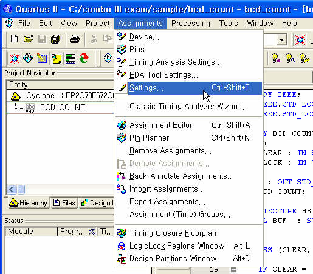
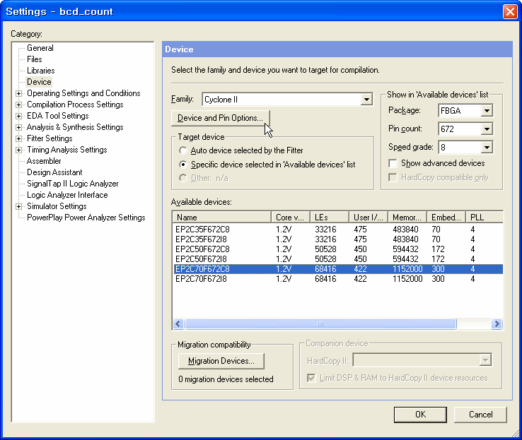
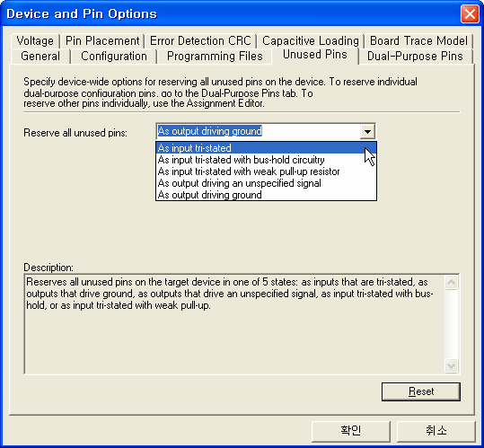
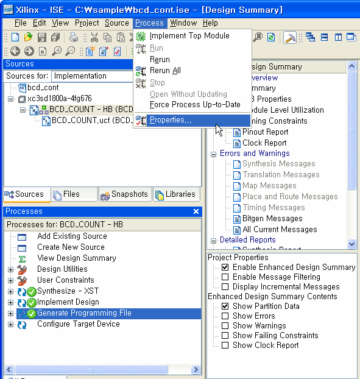
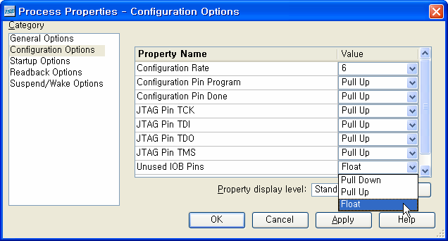

# 5. 부록

## 5.1 장비 사용시 주의 사항

   * 장비의 구동을 위해서는 상황에 따라 여러 개의 툴을 이용하게 됩니다.
   * 또한 FPGA 디바이스를 제어하기 위해서도 각 회사 별로 Quartus II 및 Vivado를 이용하여 설계해 주셔야 합니다.
   * 현재 장비에서는 FPGA Module 및 Process 모듈이 장착되어 있고 이 모듈들 간의 AMBA bus를 통해 연결 되어 있습니다.
   * 따라서 FPGA 설계 시 이러한 AMBA bus에 대한 핀 정의를 해 주어야 합니다.
   * 만약 FPGA 설계 시 이러한 핀을 사용하고 있으면 상관이 없지만 사용하지 않을 시 FPGA 툴에서는 핀을 사용하지 않은 핀을 GND나 HIGH로 동작을 하게 합니다.
   * 따라서 FPGA 툴을 설계 시 사용하지 않는 핀에 대한 정의를 꼭 해 주셔야 합니다.
   * 만약 다음에 나오는 핀 설정 작업이 없으면 FPGA 라인에 의한 Processor 모듈의 메 인 디바이스가 손상을 입을 수 있기 때문에 이러한 작업을 꼭 해 주시기 당부 드립니다.

### 5.1.1 Quartus II에서의 Unused Pin 설정

   * Quartus II의 설계 과정에서의 설정 작업은 메뉴의 Assignments를 통해 할 수 있습니다.
   * 따라서 핀 작업뿐만 아니라 다른 설정 작업도 이 메뉴를 이용하여 설정 할 수 있 도록 구성되어 있습니다.
   * 먼저 메뉴의 Assignments -> Settings를 선택하여 프로젝트 설정 창을 활성화 합니다.

> **그림 5-1** · Assignments -> Settings

  * Setting 창에서 왼쪽 Category에서 Device를 선택하면 오른 쪽 설정 그림이 바뀌게 됩니다.
  * 이 디바이스 설정 부분에서 Device and Pin Options 버튼을 클릭하여 다 음 단계로 진행합니다.

> **그림 5-2** · Setting Device

  * 버튼에 의해 생성되는 Device and Pin Options 창에서 위의 메뉴를 Unused Pins 로 선택하고,
  * 활성화 되는 옵션에서 Reserve all unused pins를 As input tri- stated 를 선택해 줍니다.

> **그림 5-3** · Device and Pin Options

  * 이상의 설정을 마치고 확인을 눌러 설정을 마치고 다시 컴파일 작업을 수행해 주어야 현재 설정한 부분에 대해 프로젝트에 적용할 수 있습니다.
  * 이상으로 Altera Quartus II에 대한 핀 설정 작업을 수행하였습니다.

### 5.1.2 ISE에서의 Unused Pin 설정

  * Xilinx ISE에서도 사용하지 않는 핀에 대한 설정을 위해 메뉴의 Process -> Properties를 선택합니다.

> **그림 5-4** · Process -> Properties

  * 이 창의 왼쪽 Category 에서 Configuration Options 를 선택하면 오른쪽 설정 창이 바뀌게 됩니다.
  * 이창에서 Unused IOB Pins의 설정 부분을 Float 로 바꿔주시 면 됩니다.

> **그림 5-5** · Configuration Options

  * 설정이 바뀌면 OK 버튼을 통해 설정을 종료 하시면 되고, 완료된 작업을 프로젝 트에 적용해 주기 위해 컴파일을 다시 해 주셔야 합니다.
  * 이때 컴파일 작업은 Generate Programming File에 대한 컴파일 작업만 해 주시면 됩니다.

## 5.2 HBE-COMBO III Pin map

**1)** Altera Device Module

### 1. Clock

| Net Name | PAD | From | To | 비고 |
|---|---|---|---|---|
| CLK_MAIN[0] | N2 | Oscillator | FPGA Device | MAIN CLOCK |
| CLK_MAIN[1] | N25 | Oscillator | FPGA Device | MAIN CLOCK |
| CLK_USER[0] | A13 | Oscillator | FPGA Device | USER CLOCK |
| CLK_USER[1] | D13 | Oscillator | FPGA Device | USER CLOCK |
### 2. RESET

| Net Name | PAD | From | To | 비고 |
|---|---|---|---|---|
| RESET | C5 | Button Switch | FPA Device | System Switch |
### 3. LED

| Net Name | PAD | From | To | 비고 |
|---|---|---|---|---|
| LED_D[0] | AE11 | FPGA Module | Base board | Display LED |
| LED_D[1] | AE10 | FPGA Module | Base board | Display LED |
| LED_D[2] | AF9 | FPGA Module | Base board | Display LED |
| LED_D[3] | AF8 | FPGA Module | Base board | Display LED |
| LED_D[4] | AF7 | FPGA Module | Base board | Display LED |
| LED_D[5] | AF6 | FPGA Module | Base board | Display LED |
| LED_D[6] | AF5 | FPGA Module | Base board | Display LED |
| LED_D[7] | B3 | FPGA Module | Base board | Display LED |
| LED_D[8] | B2 | FPGA Module | Base board | Display LED |
| LED_D[9] | AF13 | FPGA Module | Base board | Display LED |
| LED_D[10] | Y25 | FPGA Module | Base board | Display LED |
| LED_D[11] | AF23 | FPGA Module | Base board | Display LED |
| LED_D[12] | G1 | FPGA Module | Base board | Display LED |
| LED_D[13] | G2 | FPGA Module | Base board | Display LED |
| LED_D[14] | AA24 | FPGA Module | Base board | Display LED |
| LED_D[15] | AF10 | FPGA Module | Base board | Display LED |
### 4. Segment(Array)

| Net Name | PAD | From | To | 비고 |
|---|---|---|---|---|
| SEG_SCAN[0] | T3 | FPGA Module | Base board | Display Segment |
| SEG_SCAN[1] | T2 | FPGA Module | Base board | Display Segment |
| SEG_SCAN[2] | R7 | FPGA Module | Base board | Display Segment |
| SEG_SCAN[3] | R6 | FPGA Module | Base board | Display Segment |
| SEG_SCAN[4] | U3 | FPGA Module | Base board | Display Segment |
| SEG_SCAN[5] | U2 | FPGA Module | Base board | Display Segment |
| SEG_SCAN[6] | U1 | FPGA Module | Base board | Display Segment |
| SEG_SCAN[7] | T7 | FPGA Module | Base board | Display Segment |
| SEG_DATA_A | M5 | FPGA Module | Base board | Display Segment |
| SEG_DATA_B | M4 | FPGA Module | Base board | Display Segment |
| SEG_DATA_C | R5 | FPGA Module | Base board | Display Segment |
| SEG_DATA_D | R4 | FPGA Module | Base board | Display Segment |
| SEG_DATA_E | R3 | FPGA Module | Base board | Display Segment |
| SEG_DATA_F | R2 | FPGA Module | Base board | Display Segment |
| SEG_DATA_G | P7 | FPGA Module | Base board | Display Segment |
| SEG_DATA_DP | T4 | FPGA Module | Base board | Display Segment |
### 5. Segment

| Net Name | PAD | From | To | 비고 |
|---|---|---|---|---|
| SEG_DATA_A | M3 | FPGA Module | Base board | Display Segment |
| SEG_DATA_B | M2 | FPGA Module | Base board | Display Segment |
| SEG_DATA_C | L7 | FPGA Module | Base board | Display Segment |
| SEG_DATA_D | L6 | FPGA Module | Base board | Display Segment |
| SEG_DATA_E | L4 | FPGA Module | Base board | Display Segment |
| SEG_DATA_F | P6 | FPGA Module | Base board | Display Segment |
| SEG_DATA_G | P4 | FPGA Module | Base board | Display Segment |
| SEG_DATA_DP | P3 | FPGA Module | Base board | Display Segment |
### 6. Vacuum Fluorescent Display(VFD)

| Net Name | PAD | From | To | 비고 |
|---|---|---|---|---|
| VFD_D[0] | K4 | FPGA Module | Base board | Display LCD |
| VFD_D[1] | K3 | FPGA Module | Base board | Display LCD |
| VFD_D[2] | K2 | FPGA Module | Base board | Display LCD |
| VFD_D[3] | K1 | FPGA Module | Base board | Display LCD |
| VFD_D[4] | L3 | FPGA Module | Base board | Display LCD |
| VFD_D[5] | L2 | FPGA Module | Base board | Display LCD |
| VFD_D[6] | K8 | FPGA Module | Base board | Display LCD |
| VFD_D[7] | K7 | FPGA Module | Base board | Display LCD |
| VFD_E | K5 | FPGA Module | Base board | Display LCD |
| VFD_RW | J4 | FPGA Module | Base board | Display LCD |
| VFD_RS | J5 | FPGA Module | Base board | Display LCD |
### 7. DOT

| Net Name | PAD | From | To | 비고 |
|---|---|---|---|---|
| DOT_D[0] | L23 | FPGA Module | Base board | Display Dot-matrix |
| DOT_D[1] | C21 | FPGA Module | Base board | Display Dot-matrix |
| DOT_D[2] | C19 | FPGA Module | Base board | Display Dot-matrix |
| DOT_D[3] | L21 | FPGA Module | Base board | Display Dot-matrix |
| DOT_D[4] | L20 | FPGA Module | Base board | Display Dot-matrix |
| DOT_D[5] | C17 | FPGA Module | Base board | Display Dot-matrix |
| DOT_D[6] | D18 | FPGA Module | Base board | Display Dot-matrix |
| DOT_D[7] | L19 | FPGA Module | Base board | Display Dot-matrix |
| DOT_D[8] | K26 | FPGA Module | Base board | Display Dot-matrix |
| DOT_D[9] | D17 | FPGA Module | Base board | Display Dot-matrix |
| DOT_D[10] | D16 | FPGA Module | Base board | Display Dot-matrix |
| DOT_D[11] | M21 | FPGA Module | Base board | Display Dot-matrix |
| DOT_D[12] | M20 | FPGA Module | Base board | Display Dot-matrix |
| DOT_D[13] | D15 | FPGA Module | Base board | Display Dot-matrix |
| DOT_COM[0] | B23 | FPGA Module | Base board | Display Dot-matrix |
| DOT_COM[1] | K25 | FPGA Module | Base board | Display Dot-matrix |
| DOT_COM[2] | K24 | FPGA Module | Base board | Display Dot-matrix |
| DOT_COM[3] | B22 | FPGA Module | Base board | Display Dot-matrix |
| DOT_COM[4] | B21 | FPGA Module | Base board | Display Dot-matrix |
| DOT_COM[5] | K23 | FPGA Module | Base board | Display Dot-matrix |
| DOT_COM[6] | K22 | FPGA Module | Base board | Display Dot-matrix |
| DOT_COM[7] | C23 | FPGA Module | Base board | Display Dot-matrix |
| DOT_COM[8] | C22 | FPGA Module | Base board | Display Dot-matrix |
| DOT_COM[9] | K21 | FPGA Module | Base board | Display Dot-matrix |
### 8. PIEZO

| Net Name | PAD | From | To | 비고 |
|---|---|---|---|---|
| PIEZO | K6 | FPGA Module | Base board | Speaker control |
### 9. SRAM

| Net Name | PAD | From | To | 비고 |
|---|---|---|---|---|
| SRAM_A[0] | B24 | FPGA Module | Base board | Memory control |
| SRAM_A[1] | B25 | FPGA Module | Base board | Memory control |
| SRAM_A[2] | C24 | FPGA Module | Base board | Memory control |
| SRAM_A[3] | C25 | FPGA Module | Base board | Memory control |
| SRAM_A[4] | D23 | FPGA Module | Base board | Memory control |
| SRAM_A[5] | D25 | FPGA Module | Base board | Memory control |
| SRAM_A[6] | D26 | FPGA Module | Base board | Memory control |
| SRAM_A[7] | E22 | FPGA Module | Base board | Memory control |
| SRAM_A[8] | E23 | FPGA Module | Base board | Memory control |
| SRAM_A[9] | E24 | FPGA Module | Base board | Memory control |
| SRAM_A[10] | E25 | FPGA Module | Base board | Memory control |
| SRAM_A[11] | E26 | FPGA Module | Base board | Memory control |
| SRAM_A[12] | F20 | FPGA Module | Base board | Memory control |
| SRAM_A[13] | F24 | FPGA Module | Base board | Memory control |
| SRAM_A[14] | F25 | FPGA Module | Base board | Memory control |
| SRAM_A[15] | F26 | FPGA Module | Base board | Memory control |
| SRAM_A[16] | G21 | FPGA Module | Base board | Memory control |
| SRAM_A[17] | G22 | FPGA Module | Base board | Memory control |
| SRAM_D[0] | P23 | FPGA & Base board | FPGA & Base board | Memory control |
| SRAM_D[1] | P24 | FPGA & Base board | FPGA & Base board | Memory control |
| SRAM_D[2] | R20 | FPGA & Base board | FPGA & Base board | Memory control |
| SRAM_D[3] | R24 | FPGA & Base board | FPGA & Base board | Memory control |
| SRAM_D[4] | R25 | FPGA & Base board | FPGA & Base board | Memory control |
| SRAM_D[5] | T20 | FPGA & Base board | FPGA & Base board | Memory control |
| SRAM_D[6] | T21 | FPGA & Base board | FPGA & Base board | Memory control |
| SRAM_D[7] | T22 | FPGA & Base board | FPGA & Base board | Memory control |
| SRAM_D[8] | T23 | FPGA & Base board | FPGA & Base board | Memory control |
| SRAM_D[9] | T24 | FPGA & Base board | FPGA & Base board | Memory control |
| SRAM_D[10] | T25 | FPGA & Base board | FPGA & Base board | Memory control |
| SRAM_D[11] | U20 | FPGA & Base board | FPGA & Base board | Memory control |
| SRAM_D[12] | U21 | FPGA & Base board | FPGA & Base board | Memory control |
| SRAM_D[13] | U22 | FPGA & Base board | FPGA & Base board | Memory control |
| SRAM_D[14] | U23 | FPGA & Base board | FPGA & Base board | Memory control |
| SRAM_D[15] | U24 | FPGA & Base board | FPGA & Base board | Memory control |
| SRAM_D[16] | U25 | FPGA & Base board | FPGA & Base board | Memory control |
| SRAM_D[17] | U26 | FPGA & Base board | FPGA & Base board | Memory control |
| SRAM_D[18] | V22 | FPGA & Base board | FPGA & Base board | Memory control |
| SRAM_D[19] | V23 | FPGA & Base board | FPGA & Base board | Memory control |
| SRAM_D[20] | V24 | FPGA & Base board | FPGA & Base board | Memory control |
| SRAM_D[21] | V25 | FPGA & Base board | FPGA & Base board | Memory control |
| SRAM_D[22] | V26 | FPGA & Base board | FPGA & Base board | Memory control |
| SRAM_D[23] | W21 | FPGA & Base board | FPGA & Base board | Memory control |
| SRAM_D[24] | W23 | FPGA & Base board | FPGA & Base board | Memory control |
| SRAM_D[25] | W24 | FPGA & Base board | FPGA & Base board | Memory control |
| SRAM_D[26] | W25 | FPGA & Base board | FPGA & Base board | Memory control |
| SRAM_D[27] | W26 | FPGA & Base board | FPGA & Base board | Memory control |
| SRAM_D[28] | Y21 | FPGA & Base board | FPGA & Base board | Memory control |
| SRAM_D[29] | Y22 | FPGA & Base board | FPGA & Base board | Memory control |
| SRAM_D[30] | Y23 | FPGA & Base board | FPGA & Base board | Memory control |
| SRAM_D[31] | Y24 | FPGA & Base board | FPGA & Base board | Memory control |
| SRAM1_LB | G23 | FPGA Module | Base board | Memory control |
| SRAM1_UB | G24 | FPGA Module | Base board | Memory control |
| SRMA2_LB | H23 | FPGA Module | Base board | Memory control |
| SRAM2_UB | H24 | FPGA Module | Base board | Memory control |
| SRAM_OE | J21 | FPGA Module | Base board | Memory control |
| SRAM_WE | J20 | FPGA Module | Base board | Memory control |
| SRAM_CS | H26 | FPGA Module | Base board | Memory control |
### 10. Flash Memory

| Net Name | PAD | From | To | 비고 |
|---|---|---|---|---|
| Flash_A[1] | B24 | FPGA Module | Base board | Memory control |
| Flash_A[2] | B25 | FPGA Module | Base board | Memory control |
| Flash_A[3] | C24 | FPGA Module | Base board | Memory control |
| Flash_A[4] | C25 | FPGA Module | Base board | Memory control |
| Flash_A[5] | D23 | FPGA Module | Base board | Memory control |
| Flash_A[6] | D25 | FPGA Module | Base board | Memory control |
| Flash_A[7] | D26 | FPGA Module | Base board | Memory control |
| Flash_A[8] | E22 | FPGA Module | Base board | Memory control |
| Flash_A[9] | E23 | FPGA Module | Base board | Memory control |
| Flash_A[10] | E24 | FPGA Module | Base board | Memory control |
| Flash_A[11] | E25 | FPGA Module | Base board | Memory control |
| Flash_A[12] | E26 | FPGA Module | Base board | Memory control |
| Flash_A[13] | F20 | FPGA Module | Base board | Memory control |
| Flash_A[14] | F24 | FPGA Module | Base board | Memory control |
| Flash_A[15] | F25 | FPGA Module | Base board | Memory control |
| Flash_A[16] | F26 | FPGA Module | Base board | Memory control |
| Flash_A[17] | G21 | FPGA Module | Base board | Memory control |
| Flash_A[18] | G22 | FPGA Module | Base board | Memory control |
| Flash_A[19] | G23 | FPGA Module | Base board | Memory control |
| Flash_A[20] | G24 | FPGA Module | Base board | Memory control |
| Flash_DQ[0] | P23 | FPGA & Base board | FPGA & Base board | Memory control |
| Flash_DQ[1] | P24 | FPGA & Base board | FPGA & Base board | Memory control |
| Flash_DQ[2] | R20 | FPGA & Base board | FPGA & Base board | Memory control |
| Flash_DQ[3] | R24 | FPGA & Base board | FPGA & Base board | Memory control |
| Flash_DQ[4] | R25 | FPGA & Base board | FPGA & Base board | Memory control |
| Flash_DQ[5] | T20 | FPGA & Base board | FPGA & Base board | Memory control |
| Flash_DQ[6] | T21 | FPGA & Base board | FPGA & Base board | Memory control |
| Flash_DQ[7] | T22 | FPGA & Base board | FPGA & Base board | Memory control |
| Flash_DQ[8] | T23 | FPGA & Base board | FPGA & Base board | Memory control |
| Flash_DQ[9] | T24 | FPGA & Base board | FPGA & Base board | Memory control |
| Flash_DQ[10] | T25 | FPGA & Base board | FPGA & Base board | Memory control |
| Flash_DQ[11] | U20 | FPGA & Base board | FPGA & Base board | Memory control |
| Flash_DQ[12] | U21 | FPGA & Base board | FPGA & Base board | Memory control |
| Flash_DQ[13] | U22 | FPGA & Base board | FPGA & Base board | Memory control |
| Flash_DQ[14] | U23 | FPGA & Base board | FPGA & Base board | Memory control |
| Flash_DQ[15] | U24 | FPGA & Base board | FPGA & Base board | Memory control |
| Flash_DQ[16] | U25 | FPGA & Base board | FPGA & Base board | Memory control |
| Flash_DQ[17] | U26 | FPGA & Base board | FPGA & Base board | Memory control |
| Flash_DQ[18] | V22 | FPGA & Base board | FPGA & Base board | Memory control |
| Flash_DQ[19] | V23 | FPGA & Base board | FPGA & Base board | Memory control |
| Flash_DQ[20] | V24 | FPGA & Base board | FPGA & Base board | Memory control |
| Flash_DQ[21] | V25 | FPGA & Base board | FPGA & Base board | Memory control |
| Flash_DQ[22] | V26 | FPGA & Base board | FPGA & Base board | Memory control |
| Flash_DQ[23] | W21 | FPGA & Base board | FPGA & Base board | Memory control |
| Flash_DQ[24] | W23 | FPGA & Base board | FPGA & Base board | Memory control |
| Flash_DQ[25] | W24 | FPGA & Base board | FPGA & Base board | Memory control |
| Flash_DQ[26] | W25 | FPGA & Base board | FPGA & Base board | Memory control |
| Flash_DQ[27] | W26 | FPGA & Base board | FPGA & Base board | Memory control |
| Flash_DQ[28] | Y21 | FPGA & Base board | FPGA & Base board | Memory control |
| Flash_DQ[29] | Y22 | FPGA & Base board | FPGA & Base board | Memory control |
| Flash_DQ[30] | Y23 | FPGA & Base board | FPGA & Base board | Memory control |
| Flash_DQ[31] | Y24 | FPGA & Base board | FPGA & Base board | Memory control |
| /Flash_OE | G25 | FPGA Module | Base board | Memory control |
| /Flash_WE | G26 | FPGA Module | Base board | Memory control |
| /Flash_CS | H21 | FPGA Module | Base board | Memory control |
| /Flash_RP | H23 | FPGA Module | Base board | Memory control |
| /Flash_RB | H24 | FPGA Module | Base board | Memory control |
| /Flash_WP | H25 | FPGA Module | Base board | Memory control |
### 11. Step Motor

| Net Name | PAD | From | To | 비고 |
|---|---|---|---|---|
| STEP_DATA[0] | AA23 | FPGA Module | Base board | Motor control (A) |
| STEP_DATA[1] | AB24 | FPGA Module | Base board | Motor control (B) |
| STEP_DATA[2] | Y26 | FPGA Module | Base board | Motor control (/A) |
| STEP_DATA[3] | AB23 | FPGA Module | Base board | Motor control (/B) |
| MOTOR_SENSOR | AA26 | Base board | FPGA Module | Magnetic sensor |
### 12. SD Connector

| Net Name | PAD | From | To | 비고 |
|---|---|---|---|---|
| SD_DATA[0] | J1 | FPGA & Base board | FPGA & Base board | Memory control |
| SD_DATA[1] | H6 | FPGA & Base board | FPGA & Base board | Memory control |
| SD_DATA[2] | H4 | FPGA & Base board | FPGA & Base board | Memory control |
| SD_DATA[3] | J8 | FPGA & Base board | FPGA & Base board | Memory control |
| SD_CMD | J3 | FPGA & Base board | FPGA & Base board | Memory control |
| SD_CLK | J2 | FPGA & Base board | FPGA & Base board | Memory control |
### 13. DIP SWITCH

| Net Name | PAD | From | To | 비고 |
|---|---|---|---|---|
| DIP_D[0] | T6 | Base board | FPGA Module | Input Equipment |
| DIP_D[1] | V1 | Base board | FPGA Module | Input Equipment |
| DIP_D[2] | U7 | Base board | FPGA Module | Input Equipment |
| DIP_D[3] | U6 | Base board | FPGA Module | Input Equipment |
| DIP_D[4] | U5 | Base board | FPGA Module | Input Equipment |
| DIP_D[5] | U4 | Base board | FPGA Module | Input Equipment |
| DIP_D[6] | V6 | Base board | FPGA Module | Input Equipment |
| DIP_D[7] | V5 | Base board | FPGA Module | Input Equipment |
### 14. BUTTON SWITCH

| Net Name | PAD | From | To | 비고 |
|---|---|---|---|---|
| BUTTON_SW[0] | V4 | Base board | FPGA Module | Input Equipment |
| BUTTON_SW[1] | V3 | Base board | FPGA Module | Input Equipment |
| BUTTON_SW[2] | V2 | Base board | FPGA Module | Input Equipment |
| BUTTON_SW[3] | W4 | Base board | FPGA Module | Input Equipment |
| BUTTON_SW[4] | W3 | Base board | FPGA Module | Input Equipment |
| BUTTON_SW[5] | W2 | Base board | FPGA Module | Input Equipment |
| BUTTON_SW[6] | W1 | Base board | FPGA Module | Input Equipment |
| BUTTON_SW[7] | V7 | Base board | FPGA Module | Input Equipment |
| BUTTON_SW[8] | Y4 | Base board | FPGA Module | Input Equipment |
| BUTTON_SW[9] | Y3 | Base board | FPGA Module | Input Equipment |
| BUTTON_SW[10] | Y2 | Base board | FPGA Module | Input Equipment |
| BUTTON_SW[11] | Y1 | Base board | FPGA Module | Input Equipment |
| BUTTON_SW[12] | W6 | Base board | FPGA Module | Input Equipment |
| BUTTON_SW[13] | AA4 | Base board | FPGA Module | Input Equipment |
| BUTTON_SW[14] | AA3 | Base board | FPGA Module | Input Equipment |
| BUTTON_SW[15] | AA2 | Base board | FPGA Module | Input Equipment |
### 15. Humidity & Temp Sensor

| Net Name | PAD | From | To | 비고 |
|---|---|---|---|---|
| SENSOR_CLK | J7 | FPGA Module | Base board | Serial clock input |
| SENSOR_DATA | J6 | FPGA & Base board | FPGA & Base board | Serial data |
### 16. TFT-LCD

| Net Name | PAD | From | To | 비고 |
|---|---|---|---|---|
| TFTLCD_D[0] | AC8 | FPGA Module | TFTLCD Module | TFTLCD RED[0] |
| TFTLCD_D[1] | AC7 | FPGA Module | TFTLCD Module | TFTLCD RED[1] |
| TFTLCD_D[2] | AB12 | FPGA Module | TFTLCD Module | TFTLCD RED[2] |
| TFTLCD_D[3] | AB10 | FPGA Module | TFTLCD Module | TFTLCD RED[3] |
| TFTLCD_D[4] | AB8 | FPGA Module | TFTLCD Module | TFTLCD RED[4] |
| TFTLCD_D[5] | AA12 | FPGA Module | TFTLCD Module | TFTLCD RED[5] |
| TFTLCD_D[6] | AC10 | FPGA Module | TFTLCD Module | TFTLCD RED[6] |
| TFTLCD_D[7] | AC9 | FPGA Module | TFTLCD Module | TFTLCD RED[7] |
| TFTLCD_D[8] | AC6 | FPGA Module | TFTLCD Module | TFTLCD GREEN[0] |
| TFTLCD_D[9] | AD6 | FPGA Module | TFTLCD Module | TFTLCD GREEN[1] |
| TFTLCD_D[10] | AD5 | FPGA Module | TFTLCD Module | TFTLCD GREEN[2] |
| TFTLCD_D[11] | AD4 | FPGA Module | TFTLCD Module | TFTLCD GREEN[3] |
| TFTLCD_D[12] | AC12 | FPGA Module | TFTLCD Module | TFTLCD GREEN[4] |
| TFTLCD_D[13] | AC11 | FPGA Module | TFTLCD Module | TFTLCD GREEN[5] |
| TFTLCD_D[14] | AD12 | FPGA Module | TFTLCD Module | TFTLCD GREEN[6] |
| TFTLCD_D[15] | AD11 | FPGA Module | TFTLCD Module | TFTLCD GREEN[7] |
| TFTLCD_D[16] | AD10 | FPGA Module | TFTLCD Module | TFTLCD_BLUE[0] |
| TFTLCD_D[17] | AD8 | FPGA Module | TFTLCD Module | TFTLCD_BLUE[1] |
| TFTLCD_D[18] | AD7 | FPGA Module | TFTLCD Module | TFTLCD_BLUE[2] |
| TFTLCD_D[19] | AE9 | FPGA Module | TFTLCD Module | TFTLCD_BLUE[3] |
| TFTLCD_D[20] | AE8 | FPGA Module | TFTLCD Module | TFTLCD_BLUE[4] |
| TFTLCD_D[21] | AE7 | FPGA Module | TFTLCD Module | TFTLCD_BLUE[5] |
| TFTLCD_D[22] | AE6 | FPGA Module | TFTLCD Module | TFTLCD_BLUE[6] |
| TFTLCD_D[23] | AE5 | FPGA Module | TFTLCD Module | TFTLCD_BLUE[7] |
| TFTLCD_ENABLE | AF4 | FPGA Module | TFTLCD Module | Enable signal |
| TFTLCD_LCLK | AE13 | FPGA Module | TFTLCD Module | HSYNC |
| TFTLCD_FCLK | AE12 | FPGA Module | TFTLCD Module | VSYNC |
| TFTLCD_PCLK | AA6 | FPGA Module | TFTLCD Module | CLOCK |
| TFTLCD_RESET | AA9 | FPGA Module | TFTLCD Module | RESET |
### 17. Image Sensor

| Net Name | PAD | From | To | 비고 |
|---|---|---|---|---|
| CIS DATA[] | AC2 | FPGA Module | TFTLCD Module | Image out Data |
| CIS DATA[] | AC1 | FPGA Module | TFTLCD Module | Image out Data |
| CIS DATA[] | AB4 | FPGA Module | TFTLCD Module | Image out Data |
| CIS DATA[] | AB3 | FPGA Module | TFTLCD Module | Image out Data |
| CIS DATA[] | Y10 | FPGA Module | TFTLCD Module | Image out Data |
| CIS DATA[] | AE3 | FPGA Module | TFTLCD Module | Image out Data |
| CIS DATA[] | AE2 | FPGA Module | TFTLCD Module | Image out Data |
| CIS DATA[] | AD3 | FPGA Module | TFTLCD Module | Image out Data |
| CIS_SCK | AD2 | FPGA Module | TFTLCD Module | Serial clock |
| CIS_SDA | AA11 | FPGA Module | TFTLCD Module | Serial data |
| CIS_STROBE | AA10 | FPGA Module | TFTLCD Module | Strobe signal |
| CIS_VCLK | Y12 | FPGA Module | TFTLCD Module | Pixel clock |
| CIS_LVALID | Y11 | FPGA Module | TFTLCD Module | Line valid |
| CIS_FSYNC | AC5 | FPGA Module | TFTLCD Module | Frame valid |
| CIS_MCLK | AA7 | FPGA Module | TFTLCD Module | Master clock |
| CIS_RESET | AA9 | FPGA Module | TFTLCD Module | reset |
### 18. TFT-LCD Touch

| Net Name | PAD | From | To | 비고 |
|---|---|---|---|---|
| TOUCH_DCLK | AC3 | FPGA Module | TFTLCD Module | External clock |
| TOUCH_DIN | AA1 | FPGA Module | TFTLCD Module | Data input |
| TOUCH_DOUT | AB1 | FPGA Module | TFTLCD Module | Data output |
| TOUCH_BUSY | Y5 | FPGA Module | TFTLCD Module | Busy output |
| TOUCH_IRQ | AA5 | FPGA Module | TFTLCD Module | Pen interrupt |
| TOUCH_CS | AB2 | FPGA Module | TFTLCD Module | Chip Select |
### 19. OLED

| Net Name | PAD | From | To | 비고 |
|---|---|---|---|---|
| OLED_DATA[0] | L24 | FPGA Module | OLED Module | OLED Data |
| OLED_DATA[1] | N20 | FPGA Module | OLED Module | OLED Data |
| OLED_DATA[2] | D21 | FPGA Module | OLED Module | OLED Data |
| OLED_DATA[3] | D20 | FPGA Module | OLED Module | OLED Data |
| OLED_DATA[4] | M25 | FPGA Module | OLED Module | OLED Data |
| OLED_DATA[5] | M24 | FPGA Module | OLED Module | OLED Data |
| OLED_DATA[6] | D18 | FPGA Module | OLED Module | OLED Data |
| OLED_DATA[7] | D17 | FPGA Module | OLED Module | OLED Data |
| OLED_CS | D14 | FPGA Module | OLED Module | Chip select |
| OLED_WN | E18 | FPGA Module | OLED Module | Write enable |
| OLED_RN | E15 | FPGA Module | OLED Module | Read enable |
| OLED_DC | L25 | FPGA Module | OLED Module | Data/Command |
| OLED_RESET | M19 | FPGA Module | OLED Module | Reset pin |
### 20. Audio Codec

| Net Name | PAD | From | To | 비고 |
|---|---|---|---|---|
| AIC_CS | M23 | FPGA Module | Audio Codec | Latch/Add Select |
| AIC_MODE | M22 | FPGA Module | Audio Codec | Serial interface |
| AIC_ADI | F15 | FPGA Module | Audio Codec | Serial Data input |
| AIC_SCLK | F14 | FPGA Module | Audio Codec | Serial Data clock |
| AIC_MCLK | F21 | FPGA Module | Audio Codec | External clock |
| AIC_LRCOUT | N23 | FPGA Module | Audio Codec | ADC clock signal |
| AIC_DOUT | F13 | FPGA Module | Audio Codec | Serial Data output |
| AIC_LRCIN | E20 | FPGA Module | Audio Codec | DAC clock signal |
| AIC_DIN | N24 | FPGA Module | Audio Codec | Serial Data input |
| AIC_BCLK | V21 | FPGA Module | Audio Codec | Serial bit clock |
### 21. VGA PORT

| Net Name | PAD | From | To | 비고 |
|---|---|---|---|---|
| VGA_B[0] | G17 | FPGA Module | VGA Port | Display Equipment |
| VGA_B[1] | G16 | FPGA Module | VGA Port | Display Equipment |
| VGA_B[2] | B20 | FPGA Module | VGA Port | Display Equipment |
| VGA_B[3] | B19 | FPGA Module | VGA Port | Display Equipment |
| VGA_B[4] | J22 | FPGA Module | VGA Port | Display Equipment |
| VGA_B[5] | K19 | FPGA Module | VGA Port | Display Equipment |
| VGA_B[6] | B18 | FPGA Module | VGA Port | Display Equipment |
| VGA_B[7] | B17 | FPGA Module | VGA Port | Display Equipment |
| VGA_R[0] | A20 | FPGA Module | VGA Port | Display Equipment |
| VGA_R[1] | A19 | FPGA Module | VGA Port | Display Equipment |
| VGA_R[2] | A18 | FPGA Module | VGA Port | Display Equipment |
| VGA_R[3] | A17 | FPGA Module | VGA Port | Display Equipment |
| VGA_R[4] | G15 | FPGA Module | VGA Port | Display Equipment |
| VGA_R[5] | G14 | FPGA Module | VGA Port | Display Equipment |
| VGA_R[6] | A14 | FPGA Module | VGA Port | Display Equipment |
| VGA_R[7] | B15 | FPGA Module | VGA Port | Display Equipment |
| VGA_G[0] | G13 | FPGA Module | VGA Port | Display Equipment |
| VGA_G[1] | F18 | FPGA Module | VGA Port | Display Equipment |
| VGA_G[2] | B14 | FPGA Module | VGA Port | Display Equipment |
| VGA_G[3] | A23 | FPGA Module | VGA Port | Display Equipment |
| VGA_G[4] | F17 | FPGA Module | VGA Port | Display Equipment |
| VGA_G[5] | G18 | FPGA Module | VGA Port | Display Equipment |
| VGA_G[6] | A22 | FPGA Module | VGA Port | Display Equipment |
| VGA_G[7] | A21 | FPGA Module | VGA Port | Display Equipment |
| /VGA_BLANK | B16 | FPGA Module | VGA Port | Display Equipment |
| /VGA_SYNC | C16 | FPGA Module | VGA Port | Display Equipment |
| VGA_CLK | F23 | FPGA Module | VGA Port | Display Equipment |
| VGA_SYNC_T | J24 | FPGA Module | VGA Port | Display Equipment |
| VGA_HSYNC | J23 | FPGA Module | VGA Port | Display Equipment |
| VGA_VSYNC | C15 | FPGA Module | VGA Port | Display Equipment |
| VGA_M1 | J26 | FPGA Module | VGA Port | Display Equipment |
| VGA_M2 | J25 | FPGA Module | VGA Port | Display Equipment |
### 22. Serial PORT

| Net Name | PAD | From | To | 비고 |
|---|---|---|---|---|
| UART_TXD1 | F7 | FPGA Module | Serial Port | UART control |
| UART_RXD1 | H3 | Serial Port | FPGA Module | UART control |
### 23. PS2 PORT

| Net Name | PAD | From | To | 비고 |
|---|---|---|---|---|
| PS2_CLK | G6 PS2 | Port | FPGA Module | PS2 control |
| PS2_DATA | G5 PS2 | Port | FPGA Module | PS2 control |
### 24. USB Serial PORT

| Net Name | PAD | From | To | 비고 |
|---|---|---|---|---|
| USB_TXD | H1 | FPGA Module | Serial Port | UART control |
| USB_RXD | H2 | Serial Port | FPGA Module | UART control |
### 25. Expansion PORT - 1

| Net Name | PAD | From | To | 비고 |
|---|---|---|---|---|
| EXT1[1] | +5V | - | - | Power +5V |
| EXT1[2] | +5V | - | - | Power +5V |
| EXT1[3] | +12V | - | - | Power +12V |
| EXT1[4] | +12V | - | - | Power +12V |
| EXT1[5] | A20 | FPGA Module | Base board |  |
| EXT1[6] | A19 | FPGA Module | Base board |  |
| EXT1[7] | A18 | FPGA Module | Base board |  |
| EXT1[8] | A17 | FPGA Module | Base board |  |
| EXT1[9] | A14 | FPGA Module | Base board |  |
| EXT1[10] | B15 | FPGA Module | Base board |  |
| EXT1[11] | B14 | FPGA Module | Base board |  |
| EXT1[12] | A23 | FPGA Module | Base board |  |
| EXT1[13] | A22 | FPGA Module | Base board |  |
| EXT1[14] | A21 | FPGA Module | Base board |  |
| EXT1[15] | B20 | FPGA Module | Base board |  |
| EXT1[16] | B19 | FPGA Module | Base board |  |
| EXT1[17] | B18 | FPGA Module | Base board |  |
| EXT1[18] | B17 | FPGA Module | Base board |  |
| EXT1[19] | B16 | FPGA Module | Base board |  |
| EXT1[20] | C16 | FPGA Module | Base board |  |
| EXT1[21] | C15 | FPGA Module | Base board |  |
| EXT1[22] | B23 | FPGA Module | Base board |  |
| EXT1[23] | B22 | FPGA Module | Base board |  |
| EXT1[24] | B21 | FPGA Module | Base board |  |
| EXT1[25] | C23 | FPGA Module | Base board |  |
| EXT1[26] | C22 | FPGA Module | Base board |  |
| EXT1[27] | C21 | FPGA Module | Base board |  |
| EXT1[28] | C19 | FPGA Module | Base board |  |
| EXT1[29] | C17 | FPGA Module | Base board |  |
| EXT1[30] | D18 | FPGA Module | Base board |  |
| EXT1[31] | D17 | FPGA Module | Base board |  |
| EXT1[32] | D16 | FPGA Module | Base board |  |
| EXT1[33] | D15 | FPGA Module | Base board |  |
| EXT1[34] | D14 | FPGA Module | Base board |  |
| EXT1[35] | E18 | FPGA Module | Base board |  |
| EXT1[36] | E15 | FPGA Module | Base board |  |
| EXT1[37] | D21 | FPGA Module | Base board |  |
| EXT1[38] | D20 | FPGA Module | Base board |  |
| EXT1[39] | D19 | FPGA Module | Base board |  |
| EXT1[40] | F16 | FPGA Module | Base board |  |
| EXT1[41] | F15 | FPGA Module | Base board |  |
| EXT1[42] | F14 | FPGA Module | Base board |  |
| EXT1[43] | F13 | FPGA Module | Base board |  |
| EXT1[44] | E20 | FPGA Module | Base board |  |
| EXT1[45] | GND | - | - | Power GND |
| EXT1[46] | GND | - | - | Power GND |
| EXT1[47] | GND | - | - | Power GND |
| EXT1[48] | GND | - | - | Power GND |
| EXT1[49] | GND | - | - | Power GND |
| EXT1[50] | GND | - | - | Power GND |
### 26. Expansion PORT - 2

| Net Name | PAD | From | To | 비고 |
|---|---|---|---|---|
| EXT2[1] | +5V | - | - | Power +5V |
| EXT2[2] | +5V | - | - | Power +5V |
| EXT2[3] | +12V | - | - | Power +12V |
| EXT2[4] | +12V | - | - | Power +12V |
| EXT2[5] | F17 | FPGA Module | Base board |  |
| EXT2[6] | G18 | FPGA Module | Base board |  |
| EXT2[7] | G17 | FPGA Module | Base board |  |
| EXT2[8] | G16 | FPGA Module | Base board |  |
| EXT2[9] | F23 | FPGA Module | Base board |  |
| EXT2[10] | F21 | FPGA Module | Base board |  |
| EXT2[11] | J22 | FPGA Module | Base board |  |
| EXT2[12] | K19 | FPGA Module | Base board |  |
| EXT2[13] | J26 | FPGA Module | Base board |  |
| EXT2[14] | J25 | FPGA Module | Base board |  |
| EXT2[15] | J24 | FPGA Module | Base board |  |
| EXT2[16] | J23 | FPGA Module | Base board |  |
| EXT2[17] | K25 | FPGA Module | Base board |  |
| EXT2[18] | K24 | FPGA Module | Base board |  |
| EXT2[19] | K23 | FPGA Module | Base board |  |
| EXT2[20] | K22 | FPGA Module | Base board |  |
| EXT2[21] | K21 | FPGA Module | Base board |  |
| EXT2[22] | L23 | FPGA Module | Base board |  |
| EXT2[23] | L21 | FPGA Module | Base board |  |
| EXT2[24] | L20 | FPGA Module | Base board |  |
| EXT2[25] | L19 | FPGA Module | Base board |  |
| EXT2[26] | K26 | FPGA Module | Base board |  |
| EXT2[27] | M21 | FPGA Module | Base board |  |
| EXT2[28] | M20 | FPGA Module | Base board |  |
| EXT2[29] | M19 | FPGA Module | Base board |  |
| EXT2[30] | L25 | FPGA Module | Base board |  |
| EXT2[31] | L24 | FPGA Module | Base board |  |
| EXT2[32] | N20 | FPGA Module | Base board |  |
| EXT2[33] | M25 | FPGA Module | Base board |  |
| EXT2[34] | M24 | FPGA Module | Base board |  |
| EXT2[35] | M23 | FPGA Module | Base board |  |
| EXT2[36] | M22 | FPGA Module | Base board |  |
| EXT2[37] | N24 | FPGA Module | Base board |  |
| EXT2[38] | N23 | FPGA Module | Base board |  |
| EXT2[39] | N21 | FPGA Module | Base board |  |
| EXT2[40] | V21 | FPGA Module | Base board |  |
| EXT2[41] | V20 | FPGA Module | Base board |  |
| EXT2[42] | AA23 | FPGA Module | Base board |  |
| EXT2[43] | Y26 | FPGA Module | Base board |  |
| EXT2[44] | Y25 | FPGA Module | Base board |  |
| EXT2[45] | GND | - | - | Power GND |
| EXT2[46] | GND | - | - | Power GND |
| EXT2[47] | GND | - | - | Power GND |
| EXT2[48] | GND | - | - | Power GND |
| EXT2[49] | GND | - | - | Power GND |
| EXT2[50] | GND | - | - | Power GND |
### 27. AMBA BUS Interface

| Net Name | PAD | From | To | 비고 |
|---|---|---|---|---|
| H_ADDR[0] | A5 | FPGA Module | Processor Module |  |
| H_ADDR[1] | B8 | FPGA Module | Processor Module |  |
| H_ADDR[2] | B9 | FPGA Module | Processor Module |  |
| H_ADDR[3] | A10 | FPGA Module | Processor Module |  |
| H_ADDR[4] | AF21 | FPGA Module | Processor Module |  |
| H_ADDR[5] | B12 | FPGA Module | Processor Module |  |
| H_ADDR[6] | A4 | FPGA Module | Processor Module |  |
| H_ADDR[7] | AF22 | FPGA Module | Processor Module |  |
| H_ADDR[8] | A9 | FPGA Module | Processor Module |  |
| H_ADDR[9] | AF17 | FPGA Module | Processor Module |  |
| H_ADDR[10] | AE17 | FPGA Module | Processor Module |  |
| H_ADDR[11] | AF20 | FPGA Module | Processor Module |  |
| H_ADDR[12] | AE22 | FPGA Module | Processor Module |  |
| H_ADDR[13] | B7 | FPGA Module | Processor Module |  |
| H_ADDR[14] | AE18 | FPGA Module | Processor Module |  |
| H_ADDR[15] | AD21 | FPGA Module | Processor Module |  |
| H_ADDR[16] | AE23 | FPGA Module | Processor Module |  |
| H_ADDR[17] | AF19 | FPGA Module | Processor Module |  |
| H_ADDR[18] | AE21 | FPGA Module | Processor Module |  |
| H_ADDR[19] | AF18 | FPGA Module | Processor Module |  |
| H_ADDR[20] | AC22 | FPGA Module | Processor Module |  |
| H_ADDR[21] | AD22 | FPGA Module | Processor Module |  |
| H_ADDR[22] | AE19 | FPGA Module | Processor Module |  |
| H_ADDR[23] | AE16 | FPGA Module | Processor Module |  |
| H_ADDR[24] | AE20 | FPGA Module | Processor Module |  |
| H_ADDR[25] | AC17 | FPGA Module | Processor Module |  |
| H_ADDR[26] | AD15 | FPGA Module | Processor Module |  |
| H_ADDR[27] | AD19 | FPGA Module | Processor Module |  |
| H_ADDR[28] | AE15 | FPGA Module | Processor Module |  |
| H_ADDR[29] | AD23 | FPGA Module | Processor Module |  |
| H_ADDR[30] | AB20 | FPGA Module | Processor Module |  |
| H_ADDR[31] | AC21 | FPGA Module | Processor Module |  |
| H_DATA[0] | G10 | FPGA Module | Processor Module |  |
| H_DATA[1] | G12 | FPGA Module | Processor Module |  |
| H_DATA[2] | F2 | FPGA Module | Processor Module |  |
| H_DATA[3] | D10 | FPGA Module | Processor Module |  |
| H_DATA[4] | F11 | FPGA Module | Processor Module |  |
| H_DATA[5] | D2 | FPGA Module | Processor Module |  |
| H_DATA[6] | D9 | FPGA Module | Processor Module |  |
| H_DATA[7] | F9 | FPGA Module | Processor Module |  |
| H_DATA[8] | F10 | FPGA Module | Processor Module |  |
| H_DATA[9] | C12 | FPGA Module | Processor Module |  |
| H_DATA[10] | D5 | FPGA Module | Processor Module |  |
| H_DATA[11] | D12 | FPGA Module | Processor Module |  |
| H_DATA[12] | E8 | FPGA Module | Processor Module |  |
| H_DATA[13] | C8 | FPGA Module | Processor Module |  |
| H_DATA[14] | C7 | FPGA Module | Processor Module |  |
| H_DATA[15] | D11 | FPGA Module | Processor Module |  |
| H_DATA[16] | D8 | FPGA Module | Processor Module |  |
| H_DATA[17] | B11 | FPGA Module | Processor Module |  |
| H_DATA[18] | D7 | FPGA Module | Processor Module |  |
| H_DATA[19] | B5 | FPGA Module | Processor Module |  |
| H_DATA[20] | B10 | FPGA Module | Processor Module |  |
| H_DATA[21] | C10 | FPGA Module | Processor Module |  |
| H_DATA[22] | B6 | FPGA Module | Processor Module |  |
| H_DATA[23] | D6 | FPGA Module | Processor Module |  |
| H_DATA[24] | C11 | FPGA Module | Processor Module |  |
| H_DATA[25] | C9 | FPGA Module | Processor Module |  |
| H_DATA[26] | A7 | FPGA Module | Processor Module |  |
| H_DATA[27] | A8 | FPGA Module | Processor Module |  |
| H_DATA[28] | C4 | FPGA Module | Processor Module |  |
| H_DATA[29] | C6 | FPGA Module | Processor Module |  |
| H_DATA[30] | A6 | FPGA Module | Processor Module |  |
| H_DATA[31] | B4 | FPGA Module | Processor Module |  |
| H_RESET | F6 | FPGA Module | Processor Module |  |
| DMA_REQ0 | G3 | FPGA Module | Processor Module |  |
| DMA_CLR0 | G4 | FPGA Module | Processor Module |  |
| DMA_TC0 | E5 | FPGA Module | Processor Module |  |
| DMA_REQ1 | F4 | FPGA Module | Processor Module |  |
| DMA_CLR1 | C3 | FPGA Module | Processor Module |  |
| DMA_TC1 | F1 | FPGA Module | Processor Module |  |
| DMA_REQ2 | E2 | FPGA Module | Processor Module |  |
| DMA_CLR2 | G9 | FPGA Module | Processor Module |  |
| DMA_TC2 | F3 | FPGA Module | Processor Module |  |
| DMA_REQ3 | D1 | FPGA Module | Processor Module |  |
| DMA_CLR3 | C2 | FPGA Module | Processor Module |  |
| DMA_TC3 | F12 | FPGA Module | Processor Module |  |
| INT0 | E1 | FPGA Module | Processor Module |  |
| INT1 | G11 | FPGA Module | Processor Module |  |
| INT2 | E12 | FPGA Module | Processor Module |  |
| INT3 | E10 | FPGA Module | Processor Module |  |
| SPLIT0 | Y16 | FPGA Module | Processor Module |  |
| SPLIT1 | AB25 | FPGA Module | Processor Module |  |
| SPLIT2 | AD24 | FPGA Module | Processor Module |  |
| SPLIT3 | AB26 | FPGA Module | Processor Module |  |
| MASTER0 | AA16 | FPGA Module | Processor Module |  |
| MASTER1 | AC26 | FPGA Module | Processor Module |  |
| MASTER2 | AA15 | FPGA Module | Processor Module |  |
| MASTER3 | Y15 | FPGA Module | Processor Module |  |
| H_SEL | Y14 | FPGA Module | Processor Module |  |
| SLAVE_READYIN | AB18 | FPGA Module | Processor Module |  |
| SLAVE_READYOUT | AA14 | FPGA Module | Processor Module |  |
| MASTER_READY | AC25 | FPGA Module | Processor Module |  |
| GRANT | AA20 | FPGA Module | Processor Module |  |
| BUSREQ | Y13 | FPGA Module | Processor Module |  |
| MASTLOCK | AC23 | FPGA Module | Processor Module |  |
| LOCK | AC14 | FPGA Module | Processor Module |  |
| PROT0 | AA18 | FPGA Module | Processor Module |  |
| PROT1 | AB15 | FPGA Module | Processor Module |  |
| PROT2 | AC24 | FPGA Module | Processor Module |  |
| PROT3 | AA13 | FPGA Module | Processor Module |  |
| TRANS0 | AD25 | FPGA Module | Processor Module |  |
| TRANS1 | AC19 | FPGA Module | Processor Module |  |
| RESP0 | Y18 | FPGA Module | Processor Module |  |
| RESP1 | AC15 | FPGA Module | Processor Module |  |
| BURST0 | AD16 | FPGA Module | Processor Module |  |
| BURST1 | AC20 | FPGA Module | Processor Module |  |
| BURST2 | AB21 | FPGA Module | Processor Module |  |
| WRITE | AA17 | FPGA Module | Processor Module |  |
| SIZE0 | AD17 | FPGA Module | Processor Module |  |
| SIZE1 | AC18 | FPGA Module | Processor Module |  |
| SIZE2 | AC16 | FPGA Module | Processor Module |  |
| AHB_CLK | AF14 | FPGA Module | Processor Module |  |
| EASIC_PI_CLK | AA25 | FPGA Module | Processor Module |  |
**2)** Xilinx Device Module

### 1. Clock

| Net Name | PAD | From | To | 비고 |
|---|---|---|---|---|
| CLK_MAIN[0] | F13 | Oscillator | FPGA Device | MAIN CLOCK |
| CLK_MAIN[1] | AF14 | Oscillator | FPGA Device | MAIN CLOCK |
| CLK_USER[0] | B14 | Oscillator | FPGA Device | USER CLOCK |
| CLK_USER[1] | AF13 | Oscillator | FPGA Device | USER CLOCK |
### 2. RESET

| Net Name | PAD | From | To | 비고 |
|---|---|---|---|---|
| RESET | AB7 | Button Switch | FPA Device | System Switch |
### 3. LED

| Net Name | PAD | From | To | 비고 |
|---|---|---|---|---|
| LED_D[0] | Y2 | FPGA Module | Base board | Display LED |
| LED_D[1] | Y1 | FPGA Module | Base board | Display LED |
| LED_D[2] | AA10 | FPGA Module | Base board | Display LED |
| LED_D[3] | AA7 | FPGA Module | Base board | Display LED |
| LED_D[4] | AA3 | FPGA Module | Base board | Display LED |
| LED_D[5] | AA2 | FPGA Module | Base board | Display LED |
| LED_D[6] | Y10 | FPGA Module | Base board | Display LED |
| LED_D[7] | AB12 | FPGA Module | Base board | Display LED |
| LED_D[8] | AB9 | FPGA Module | Base board | Display LED |
| LED_D[9] | AB1 | FPGA Module | Base board | Display LED |
| LED_D[10] | Y20 | FPGA Module | Base board | Display LED |
| LED_D[11] | AD6 | FPGA Module | Base board | Display LED |
| LED_D[12] | J4 | FPGA Module | Base board | Display LED |
| LED_D[13] | J5 | FPGA Module | Base board | Display LED |
| LED_D[14] | Y23 | FPGA Module | Base board | Display LED |
| LED_D[15] | AA12 | FPGA Module | Base board | Display LED |
### 4. Segment(Array)

| Net Name | PAD | From | To | 비고 |
|---|---|---|---|---|
| SEG_SCAN[0] | P9 | FPGA Module | Base board | Display Segment |
| SEG_SCAN[1] | P8 | FPGA Module | Base board | Display Segment |
| SEG_SCAN[2] | P7 | FPGA Module | Base board | Display Segment |
| SEG_SCAN[3] | P6 | FPGA Module | Base board | Display Segment |
| SEG_SCAN[4] | R4 | FPGA Module | Base board | Display Segment |
| SEG_SCAN[5] | R3 | FPGA Module | Base board | Display Segment |
| SEG_SCAN[6] | R2 | FPGA Module | Base board | Display Segment |
| SEG_SCAN[7] | R1 | FPGA Module | Base board | Display Segment |
| SEG_DATA_A | N4 | FPGA Module | Base board | Display Segment |
| SEG_DATA_B | N2 | FPGA Module | Base board | Display Segment |
| SEG_DATA_C | P4 | FPGA Module | Base board | Display Segment |
| SEG_DATA_D | P3 | FPGA Module | Base board | Display Segment |
| SEG_DATA_E | P2 | FPGA Module | Base board | Display Segment |
| SEG_DATA_F | P1 | FPGA Module | Base board | Display Segment |
| SEG_DATA_G | N9 | FPGA Module | Base board | Display Segment |
| SEG_DATA_DP | P10 | FPGA Module | Base board | Display Segment |
### 5. Segment

| Net Name | PAD | From | To | 비고 |
|---|---|---|---|---|
| SEG_DATA_A | N1 | FPGA Module | Base board | Display Segment |
| SEG_DATA_B | M10 | FPGA Module | Base board | Display Segment |
| SEG_DATA_C | M9 | FPGA Module | Base board | Display Segment |
| SEG_DATA_D | M8 | FPGA Module | Base board | Display Segment |
| SEG_DATA_E | M7 | FPGA Module | Base board | Display Segment |
| SEG_DATA_F | N7 | FPGA Module | Base board | Display Segment |
| SEG_DATA_G | N6 | FPGA Module | Base board | Display Segment |
| SEG_DATA_DP | N5 | FPGA Module | Base board | Display Segment |
### 6. Vacuum Fluorescent Display(VFD)

| Net Name | PAD | From | To | 비고 |
|---|---|---|---|---|
| VFD_D[0] | L10 | FPGA Module | Base board | Display LCD |
| VFD_D[1] | L9 | FPGA Module | Base board | Display LCD |
| VFD_D[2] | L7 | FPGA Module | Base board | Display LCD |
| VFD_D[3] | L4 | FPGA Module | Base board | Display LCD |
| VFD_D[4] | M6 | FPGA Module | Base board | Display LCD |
| VFD_D[5] | M5 | FPGA Module | Base board | Display LCD |
| VFD_D[6] | M4 | FPGA Module | Base board | Display LCD |
| VFD_D[7] | M3 | FPGA Module | Base board | Display LCD |
| VFD_E | M1 | FPGA Module | Base board | Display LCD |
| VFD_RW | K8 | FPGA Module | Base board | Display LCD |
| VFD_RS | K9 | FPGA Module | Base board | Display LCD |
### 7. DOT

| Net Name | PAD | From | To | 비고 |
|---|---|---|---|---|
| DOT_D[0] | N24 | FPGA Module | Base board | Display Dot-matrix |
| DOT_D[1] | D16 | FPGA Module | Base board | Display Dot-matrix |
| DOT_D[2] | C26 | FPGA Module | Base board | Display Dot-matrix |
| DOT_D[3] | N21 | FPGA Module | Base board | Display Dot-matrix |
| DOT_D[4] | N20 | FPGA Module | Base board | Display Dot-matrix |
| DOT_D[5] | C25 | FPGA Module | Base board | Display Dot-matrix |
| DOT_D[6] | D24 | FPGA Module | Base board | Display Dot-matrix |
| DOT_D[7] | N19 | FPGA Module | Base board | Display Dot-matrix |
| DOT_D[8] | N18 | FPGA Module | Base board | Display Dot-matrix |
| DOT_D[9] | D23 | FPGA Module | Base board | Display Dot-matrix |
| DOT_D[10] | D22 | FPGA Module | Base board | Display Dot-matrix |
| DOT_D[11] | P23 | FPGA Module | Base board | Display Dot-matrix |
| DOT_D[12] | P22 | FPGA Module | Base board | Display Dot-matrix |
| DOT_D[13] | D21 | FPGA Module | Base board | Display Dot-matrix |
| DOT_COM[0] | C21 | FPGA Module | Base board | Display Dot-matrix |
| DOT_COM[1] | N17 | FPGA Module | Base board | Display Dot-matrix |
| DOT_COM[2] | M26 | FPGA Module | Base board | Display Dot-matrix |
| DOT_COM[3] | C20 | FPGA Module | Base board | Display Dot-matrix |
| DOT_COM[4] | C18 | FPGA Module | Base board | Display Dot-matrix |
| DOT_COM[5] | M25 | FPGA Module | Base board | Display Dot-matrix |
| DOT_COM[6] | M23 | FPGA Module | Base board | Display Dot-matrix |
| DOT_COM[7] | D18 | FPGA Module | Base board | Display Dot-matrix |
| DOT_COM[8] | D17 | FPGA Module | Base board | Display Dot-matrix |
| DOT_COM[9] | M22 | FPGA Module | Base board | Display Dot-matrix |
### 8. PIEZO

| Net Name | PAD | From | To | 비고 |
|---|---|---|---|---|
| PIEZO | M2 | FPGA Module | Base board | Speaker control |
### 9. SRAM

| Net Name | PAD | From | To | 비고 |
|---|---|---|---|---|
| SRAM_A[0] | G17 | FPGA Module | Base board | Memory control |
| SRAM_A[1] | G19 | FPGA Module | Base board | Memory control |
| SRAM_A[2] | G20 | FPGA Module | Base board | Memory control |
| SRAM_A[3] | G21 | FPGA Module | Base board | Memory control |
| SRAM_A[4] | G22 | FPGA Module | Base board | Memory control |
| SRAM_A[5] | G23 | FPGA Module | Base board | Memory control |
| SRAM_A[6] | G24 | FPGA Module | Base board | Memory control |
| SRAM_A[7] | H15 | FPGA Module | Base board | Memory control |
| SRAM_A[8] | H17 | FPGA Module | Base board | Memory control |
| SRAM_A[9] | H20 | FPGA Module | Base board | Memory control |
| SRAM_A[10] | H21 | FPGA Module | Base board | Memory control |
| SRAM_A[11] | J16 | FPGA Module | Base board | Memory control |
| SRAM_A[12] | J19 | FPGA Module | Base board | Memory control |
| SRAM_A[13] | J22 | FPGA Module | Base board | Memory control |
| SRAM_A[14] | J23 | FPGA Module | Base board | Memory control |
| SRAM_A[15] | J25 | FPGA Module | Base board | Memory control |
| SRAM_A[16] | J26 | FPGA Module | Base board | Memory control |
| SRAM_A[17] | K16 | FPGA Module | Base board | Memory control |
| SRAM_D[0] | R25 | FPGA & Base board | FPGA & Base board | Memory control |
| SRAM_D[1] | R26 | FPGA & Base board | FPGA & Base board | Memory control |
| SRAM_D[2] | T17 | FPGA & Base board | FPGA & Base board | Memory control |
| SRAM_D[3] | T18 | FPGA & Base board | FPGA & Base board | Memory control |
| SRAM_D[4] | T20 | FPGA & Base board | FPGA & Base board | Memory control |
| SRAM_D[5] | T23 | FPGA & Base board | FPGA & Base board | Memory control |
| SRAM_D[6] | T24 | FPGA & Base board | FPGA & Base board | Memory control |
| SRAM_D[7] | U15 | FPGA & Base board | FPGA & Base board | Memory control |
| SRAM_D[8] | U16 | FPGA & Base board | FPGA & Base board | Memory control |
| SRAM_D[9] | U18 | FPGA & Base board | FPGA & Base board | Memory control |
| SRAM_D[10] | U19 | FPGA & Base board | FPGA & Base board | Memory control |
| SRAM_D[11] | U20 | FPGA & Base board | FPGA & Base board | Memory control |
| SRAM_D[12] | U21 | FPGA & Base board | FPGA & Base board | Memory control |
| SRAM_D[13] | U22 | FPGA & Base board | FPGA & Base board | Memory control |
| SRAM_D[14] | U23 | FPGA & Base board | FPGA & Base board | Memory control |
| SRAM_D[15] | U24 | FPGA & Base board | FPGA & Base board | Memory control |
| SRAM_D[16] | V14 | FPGA & Base board | FPGA & Base board | Memory control |
| SRAM_D[17] | V15 | FPGA & Base board | FPGA & Base board | Memory control |
| SRAM_D[18] | V18 | FPGA & Base board | FPGA & Base board | Memory control |
| SRAM_D[19] | V19 | FPGA & Base board | FPGA & Base board | Memory control |
| SRAM_D[20] | V21 | FPGA & Base board | FPGA & Base board | Memory control |
| SRAM_D[21] | V22 | FPGA & Base board | FPGA & Base board | Memory control |
| SRAM_D[22] | V23 | FPGA & Base board | FPGA & Base board | Memory control |
| SRAM_D[23] | V24 | FPGA & Base board | FPGA & Base board | Memory control |
| SRAM_D[24] | V25 | FPGA & Base board | FPGA & Base board | Memory control |
| SRAM_D[25] | W15 | FPGA & Base board | FPGA & Base board | Memory control |
| SRAM_D[26] | W17 | FPGA & Base board | FPGA & Base board | Memory control |
| SRAM_D[27] | W20 | FPGA & Base board | FPGA & Base board | Memory control |
| SRAM_D[28] | W21 | FPGA & Base board | FPGA & Base board | Memory control |
| SRAM_D[29] | W23 | FPGA & Base board | FPGA & Base board | Memory control |
| SRAM_D[30] | Y15 | FPGA & Base board | FPGA & Base board | Memory control |
| SRAM_D[31] | Y17 | FPGA & Base board | FPGA & Base board | Memory control |
| SRAM1_LB | K18 | FPGA Module | Base board | Memory control |
| SRAM1_UB | K19 | FPGA Module | Base board | Memory control |
| SRMA2_LB | K23 | FPGA Module | Base board | Memory control |
| SRAM2_UB | K25 | FPGA Module | Base board | Memory control |
| SRAM_OE | L20 | FPGA Module | Base board | Memory control |
| SRAM_WE | L18 | FPGA Module | Base board | Memory control |
| SRAM_CS | L17 | FPGA Module | Base board | Memory control |
### 10. Flash Memory

| Net Name | PAD | From | To | 비고 |
|---|---|---|---|---|
| Flash_A[1] | G17 | FPGA Module | Base board | Memory control |
| Flash_A[2] | G19 | FPGA Module | Base board | Memory control |
| Flash_A[3] | G20 | FPGA Module | Base board | Memory control |
| Flash_A[4] | G21 | FPGA Module | Base board | Memory control |
| Flash_A[5] | G22 | FPGA Module | Base board | Memory control |
| Flash_A[6] | G23 | FPGA Module | Base board | Memory control |
| Flash_A[7] | G24 | FPGA Module | Base board | Memory control |
| Flash_A[8] | H15 | FPGA Module | Base board | Memory control |
| Flash_A[9] | H17 | FPGA Module | Base board | Memory control |
| Flash_A[10] | H20 | FPGA Module | Base board | Memory control |
| Flash_A[11] | H21 | FPGA Module | Base board | Memory control |
| Flash_A[12] | J16 | FPGA Module | Base board | Memory control |
| Flash_A[13] | J19 | FPGA Module | Base board | Memory control |
| Flash_A[14] | J22 | FPGA Module | Base board | Memory control |
| Flash_A[15] | J23 | FPGA Module | Base board | Memory control |
| Flash_A[16] | J25 | FPGA Module | Base board | Memory control |
| Flash_A[17] | J26 | FPGA Module | Base board | Memory control |
| Flash_A[18] | K16 | FPGA Module | Base board | Memory control |
| Flash_A[19] | K18 | FPGA Module | Base board | Memory control |
| Flash_A[20] | K19 | FPGA Module | Base board | Memory control |
| Flash_DQ[0] | R25 | FPGA & Base board | FPGA & Base board | Memory control |
| Flash_DQ[1] | R26 | FPGA & Base board | FPGA & Base board | Memory control |
| Flash_DQ[2] | T17 | FPGA & Base board | FPGA & Base board | Memory control |
| Flash_DQ[3] | T18 | FPGA & Base board | FPGA & Base board | Memory control |
| Flash_DQ[4] | T20 | FPGA & Base board | FPGA & Base board | Memory control |
| Flash_DQ[5] | T23 | FPGA & Base board | FPGA & Base board | Memory control |
| Flash_DQ[6] | T24 | FPGA & Base board | FPGA & Base board | Memory control |
| Flash_DQ[7] | U15 | FPGA & Base board | FPGA & Base board | Memory control |
| Flash_DQ[8] | U16 | FPGA & Base board | FPGA & Base board | Memory control |
| Flash_DQ[9] | U18 | FPGA & Base board | FPGA & Base board | Memory control |
| Flash_DQ[10] | U19 | FPGA & Base board | FPGA & Base board | Memory control |
| Flash_DQ[11] | U20 | FPGA & Base board | FPGA & Base board | Memory control |
| Flash_DQ[12] | U21 | FPGA & Base board | FPGA & Base board | Memory control |
| Flash_DQ[13] | U22 | FPGA & Base board | FPGA & Base board | Memory control |
| Flash_DQ[14] | U23 | FPGA & Base board | FPGA & Base board | Memory control |
| Flash_DQ[15] | U24 | FPGA & Base board | FPGA & Base board | Memory control |
| Flash_DQ[16] | V14 | FPGA & Base board | FPGA & Base board | Memory control |
| Flash_DQ[17] | V15 | FPGA & Base board | FPGA & Base board | Memory control |
| Flash_DQ[18] | V18 | FPGA & Base board | FPGA & Base board | Memory control |
| Flash_DQ[19] | V19 | FPGA & Base board | FPGA & Base board | Memory control |
| Flash_DQ[20] | V21 | FPGA & Base board | FPGA & Base board | Memory control |
| Flash_DQ[21] | V22 | FPGA & Base board | FPGA & Base board | Memory control |
| Flash_DQ[22] | V23 | FPGA & Base board | FPGA & Base board | Memory control |
| Flash_DQ[23] | V24 | FPGA & Base board | FPGA & Base board | Memory control |
| Flash_DQ[24] | V25 | FPGA & Base board | FPGA & Base board | Memory control |
| Flash_DQ[25] | W15 | FPGA & Base board | FPGA & Base board | Memory control |
| Flash_DQ[26] | W17 | FPGA & Base board | FPGA & Base board | Memory control |
| Flash_DQ[27] | W20 | FPGA & Base board | FPGA & Base board | Memory control |
| Flash_DQ[28] | W21 | FPGA & Base board | FPGA & Base board | Memory control |
| Flash_DQ[29] | W23 | FPGA & Base board | FPGA & Base board | Memory control |
| Flash_DQ[30] | Y15 | FPGA & Base board | FPGA & Base board | Memory control |
| Flash_DQ[31] | Y17 | FPGA & Base board | FPGA & Base board | Memory control |
| /Flash_OE | K20 | FPGA Module | Base board | Memory control |
| /Flash_WE | K21 | FPGA Module | Base board | Memory control |
| /Flash_CS | K22 | FPGA Module | Base board | Memory control |
| /Flash_RP | K23 | FPGA Module | Base board | Memory control |
| /Flash_RB | K25 | FPGA Module | Base board | Memory control |
### 11. Step Motor

| Net Name | PAD | From | To | 비고 |
|---|---|---|---|---|
| STEP_DATA[0] | Y22 | FPGA Module | Base board | Motor control (A) |
| STEP_DATA[1] | Y25 | FPGA Module | Base board | Motor control (B) |
| STEP_DATA[2] | Y21 | FPGA Module | Base board | Motor control (/A) |
| STEP_DATA[3] | Y24 | FPGA Module | Base board | Motor control (/B) |
| MOTOR_SENSOR | Y26 | Base board | FPGA Module | Magnetic sensor |
### 12. SD Connector

| Net Name | PAD | From | To | 비고 |
|---|---|---|---|---|
| SD_DATA[0] | J1 | FPGA & Base board | FPGA & Base board | Memory control |
| SD_DATA[1] | H6 | FPGA & Base board | FPGA & Base board | Memory control |
| SD_DATA[2] | H4 | FPGA & Base board | FPGA & Base board | Memory control |
| SD_DATA[3] | J8 | FPGA & Base board | FPGA & Base board | Memory control |
| SD_CMD | J3 | FPGA & Base board | FPGA & Base board | Memory control |
| SD_CLK | J2 | FPGA & Base board | FPGA & Base board | Memory control |
### 13. DIP SWITCH

| Net Name | PAD | From | To | 비고 |
|---|---|---|---|---|
| DIP_D[0] | A13 | Base board | FPGA Module | Input Equipment |
| DIP_D[1] | C1 | Base board | FPGA Module | Input Equipment |
| DIP_D[2] | C2 | Base board | FPGA Module | Input Equipment |
| DIP_D[3] | C4 | Base board | FPGA Module | Input Equipment |
| DIP_D[4] | A5 | Base board | FPGA Module | Input Equipment |
| DIP_D[5] | A7 | Base board | FPGA Module | Input Equipment |
| DIP_D[6] | D1 | Base board | FPGA Module | Input Equipment |
| DIP_D[7] | D2 | Base board | FPGA Module | Input Equipment |
### 14. BUTTON SWITCH

| Net Name | PAD | From | To | 비고 |
|---|---|---|---|---|
| BUTTON_SW[0] | Y2 | Base board | FPGA Module | Input Equipment |
| BUTTON_SW[1] | Y1 | Base board | FPGA Module | Input Equipment |
| BUTTON_SW[2] | AA10 | Base board | FPGA Module | Input Equipment |
| BUTTON_SW[3] | AA7 | Base board | FPGA Module | Input Equipment |
| BUTTON_SW[4] | AA3 | Base board | FPGA Module | Input Equipment |
| BUTTON_SW[5] | AA2 | Base board | FPGA Module | Input Equipment |
| BUTTON_SW[6] | Y10 | Base board | FPGA Module | Input Equipment |
| BUTTON_SW[7] | AB12 | Base board | FPGA Module | Input Equipment |
| BUTTON_SW[8] | AB9 | Base board | FPGA Module | Input Equipment |
| BUTTON_SW[9] | AB1 | Base board | FPGA Module | Input Equipment |
| BUTTON_SW[10] | Y20 | Base board | FPGA Module | Input Equipment |
| BUTTON_SW[11] | AD6 | Base board | FPGA Module | Input Equipment |
| BUTTON_SW[12] | J4 | Base board | FPGA Module | Input Equipment |
| BUTTON_SW[13] | J5 | Base board | FPGA Module | Input Equipment |
| BUTTON_SW[14] | Y23 | Base board | FPGA Module | Input Equipment |
| BUTTON_SW[15] | AA12 | Base board | FPGA Module | Input Equipment |
### 15. Humidity & Temp Sensor

| Net Name | PAD | From | To | 비고 |
|---|---|---|---|---|
| SENSOR_CLK | K12 | FPGA Module | Base board | Serial clock input |
| SENSOR_DATA | K11 | FPGA & Base board | FPGA & Base board | Serial data |
### 16. TFT-LCD

| Net Name | PAD | From | To | 비고 |
|---|---|---|---|---|
| TFTLCD_D[0] | V12 | FPGA Module | TFTLCD Module | TFTLCD RED[0] |
| TFTLCD_D[1] | V11 | FPGA Module | TFTLCD Module | TFTLCD RED[1] |
| TFTLCD_D[2] | V7 | FPGA Module | TFTLCD Module | TFTLCD RED[2] |
| TFTLCD_D[3] | V6 | FPGA Module | TFTLCD Module | TFTLCD RED[3] |
| TFTLCD_D[4] | V5 | FPGA Module | TFTLCD Module | TFTLCD RED[4] |
| TFTLCD_D[5] | V2 | FPGA Module | TFTLCD Module | TFTLCD RED[5] |
| TFTLCD_D[6] | W3 | FPGA Module | TFTLCD Module | TFTLCD RED[6] |
| TFTLCD_D[7] | V13 | FPGA Module | TFTLCD Module | TFTLCD RED[7] |
| TFTLCD_D[8] | V10 | FPGA Module | TFTLCD Module | TFTLCD GREEN[0] |
| TFTLCD_D[9] | W7 | FPGA Module | TFTLCD Module | TFTLCD GREEN[1] |
| TFTLCD_D[10] | W6 | FPGA Module | TFTLCD Module | TFTLCD GREEN[2] |
| TFTLCD_D[11] | W4 | FPGA Module | TFTLCD Module | TFTLCD GREEN[3] |
| TFTLCD_D[12] | V4 | FPGA Module | TFTLCD Module | TFTLCD GREEN[4] |
| TFTLCD_D[13] | U3 | FPGA Module | TFTLCD Module | TFTLCD GREEN[5] |
| TFTLCD_D[14] | Y8 | FPGA Module | TFTLCD Module | TFTLCD GREEN[6] |
| TFTLCD_D[15] | Y4 | FPGA Module | TFTLCD Module | TFTLCD GREEN[7] |
| TFTLCD_D[16] | Y3 | FPGA Module | TFTLCD Module | TFTLCD_BLUE[0] |
| TFTLCD_D[17] | W2 | FPGA Module | TFTLCD Module | TFTLCD_BLUE[1] |
| TFTLCD_D[18] | W1 | FPGA Module | TFTLCD Module | TFTLCD_BLUE[2] |
| TFTLCD_D[19] | Y11 | FPGA Module | TFTLCD Module | TFTLCD_BLUE[3] |
| TFTLCD_D[20] | W13 | FPGA Module | TFTLCD Module | TFTLCD_BLUE[4] |
| TFTLCD_D[21] | W12 | FPGA Module | TFTLCD Module | TFTLCD_BLUE[5] |
| TFTLCD_D[22] | W10 | FPGA Module | TFTLCD Module | TFTLCD_BLUE[6] |
| TFTLCD_D[23] | W9 | FPGA Module | TFTLCD Module | TFTLCD_BLUE[7] |
| TFTLCD_ENABLE | Y9 | FPGA Module | TFTLCD Module | Enable signal |
| TFTLCD_LCLK | Y6 | FPGA Module | TFTLCD Module | HSYNC |
| TFTLCD_FCLK | Y5 | FPGA Module | TFTLCD Module | VSYNC |
| TFTLCD_PCLK | R8 | FPGA Module | TFTLCD Module | CLOCK |
| TFTLCD_RESET | U9 | FPGA Module | TFTLCD Module | RESET |
### 17. Image Sensor

| Net Name | PAD | From | To | 비고 |
|---|---|---|---|---|
| CIS DATA[] | T9 | FPGA Module | TFTLCD Module | Image out Data |
| CIS DATA[] | T7 | FPGA Module | TFTLCD Module | Image out Data |
| CIS DATA[] | T5 | FPGA Module | TFTLCD Module | Image out Data |
| CIS DATA[] | T4 | FPGA Module | TFTLCD Module | Image out Data |
| CIS DATA[] | U6 | FPGA Module | TFTLCD Module | Image out Data |
| CIS DATA[] | U5 | FPGA Module | TFTLCD Module | Image out Data |
| CIS DATA[] | U4 | FPGA Module | TFTLCD Module | Image out Data |
| CIS DATA[] | U2 | FPGA Module | TFTLCD Module | Image out Data |
| CIS_SCK | U1 | FPGA Module | TFTLCD Module | Serial clock |
| CIS_SDA | V1 | FPGA Module | TFTLCD Module | Serial data |
| CIS_STROBE | U11 | FPGA Module | TFTLCD Module | Strobe signal |
| CIS_VCLK | U8 | FPGA Module | TFTLCD Module | Pixel clock |
| CIS_LVALID | U7 | FPGA Module | TFTLCD Module | Line valid |
| CIS_FSYNC | V8 | FPGA Module | TFTLCD Module | Frame valid |
| CIS_MCLK | R9 | FPGA Module | TFTLCD Module | Master clock |
| CIS_RESET | U9 | FPGA Module | TFTLCD Module | reset |
### 18. TFT-LCD Touch

| Net Name | PAD | From | To | 비고 |
|---|---|---|---|---|
| TOUCH_DCLK | T10 | FPGA Module | TFTLCD Module | External clock |
| TOUCH_DIN | R6 | FPGA Module | TFTLCD Module | Data input |
| TOUCH_DOUT | R10 | FPGA Module | TFTLCD Module | Data output |
| TOUCH_BUSY | R5 | FPGA Module | TFTLCD Module | Busy output |
| TOUCH_IRQ | R7 | FPGA Module | TFTLCD Module | Pen interrupt |
| TOUCH_CS | T3 | FPGA Module | TFTLCD Module | Chip Select |
### 19. OLED

| Net Name | PAD | From | To | 비고 |
|---|---|---|---|---|
| OLED_DATA[0] | P18 | FPGA Module | OLED Module | OLED Data |
| OLED_DATA[1] | R19 | FPGA Module | OLED Module | OLED Data |
| OLED_DATA[2] | E14 | FPGA Module | OLED Module | OLED Data |
| OLED_DATA[3] | D26 | FPGA Module | OLED Module | OLED Data |
| OLED_DATA[4] | R18 | FPGA Module | OLED Module | OLED Data |
| OLED_DATA[5] | R17 | FPGA Module | OLED Module | OLED Data |
| OLED_DATA[6] | D25 | FPGA Module | OLED Module | OLED Data |
| OLED_DATA[7] | F15 | FPGA Module | OLED Module | OLED Data |
| OLED_CS | D20 | FPGA Module | OLED Module | Chip select |
| OLED_WN | E17 | FPGA Module | OLED Module | Write enable |
| OLED_RN | E15 | FPGA Module | OLED Module | Read enable |
| OLED_DC | P20 | FPGA Module | OLED Module | Data/Command |
| OLED_RESET | P21 | FPGA Module | OLED Module | Reset pin |
### 20. Audio Codec

| Net Name | PAD | From | To | 비고 |
|---|---|---|---|---|
| AIC_CS | P26 | FPGA Module | Audio Codec | Latch/Add Select |
| AIC_MODE | P25 | FPGA Module | Audio Codec | Serial interface |
| AIC_SDI | F14 | FPGA Module | Audio Codec | Serial Data input |
| AIC_SCLK | E26 | FPGA Module | Audio Codec | Serial Data clock |
| AIC_MCLK | J20 | FPGA Module | Audio Codec | External clock |
| AIC_LRCOUT | R21 | FPGA Module | Audio Codec | ADC clock signal |
| AIC_DOUT | E24 | FPGA Module | Audio Codec | Serial Data output |
| AIC_LRCIN | E21 | FPGA Module | Audio Codec | DAC clock signal |
| AIC_DIN | R22 | FPGA Module | Audio Codec | Serial Data input |
| AIC_BCLK | V17 | FPGA Module | Audio Codec | Serial bit clock |
### 21. VGA PORT

| Net Name | PAD | From | To | 비고 |
|---|---|---|---|---|
| VGA_B[0] | F25 | FPGA Module | VGA Port | Display Equipment |
| VGA_B[1] | F24 | FPGA Module | VGA Port | Display Equipment |
| VGA_B[2] | C17 | FPGA Module | VGA Port | Display Equipment |
| VGA_B[3] | C16 | FPGA Module | VGA Port | Display Equipment |
| VGA_B[4] | L22 | FPGA Module | VGA Port | Display Equipment |
| VGA_B[5] | M21 | FPGA Module | VGA Port | Display Equipment |
| VGA_B[6] | C15 | FPGA Module | VGA Port | Display Equipment |
| VGA_B[7] | B23 | FPGA Module | VGA Port | Display Equipment |
| VGA_R[0] | A22 | FPGA Module | VGA Port | Display Equipment |
| VGA_R[1] | A20 | FPGA Module | VGA Port | Display Equipment |
| VGA_R[2] | A19 | FPGA Module | VGA Port | Display Equipment |
| VGA_R[3] | A18 | FPGA Module | VGA Port | Display Equipment |
| VGA_R[4] | F23 | FPGA Module | VGA Port | Display Equipment |
| VGA_R[5] | F22 | FPGA Module | VGA Port | Display Equipment |
| VGA_R[6] | A15 | FPGA Module | VGA Port | Display Equipment |
| VGA_R[7] | B20 | FPGA Module | VGA Port | Display Equipment |
| VGA_G[0] | F20 | FPGA Module | VGA Port | Display Equipment |
| VGA_G[1] | F19 | FPGA Module | VGA Port | Display Equipment |
| VGA_G[2] | B19 | FPGA Module | VGA Port | Display Equipment |
| VGA_G[3] | B18 | FPGA Module | VGA Port | Display Equipment |
| VGA_G[4] | F17 | FPGA Module | VGA Port | Display Equipment |
| VGA_G[5] | G15 | FPGA Module | VGA Port | Display Equipment |
| VGA_G[6] | B17 | FPGA Module | VGA Port | Display Equipment |
| VGA_G[7] | B15 | FPGA Module | VGA Port | Display Equipment |
| /VGA_BLANK | B21 | FPGA Module | VGA Port | Display Equipment |
| /VGA_SYNC | C23 | FPGA Module | VGA Port | Display Equipment |
| VGA_CLK | J21 | FPGA Module | VGA Port | Display Equipment |
| VGA_SYNC_T | M18 | FPGA Module | VGA Port | Display Equipment |
| VGA_HSYNC | L24 | FPGA Module | VGA Port | Display Equipment |
| VGA_VSYNC | C22 | FPGA Module | VGA Port | Display Equipment |
| VGA_M1 | M20 | FPGA Module | VGA Port | Display Equipment |
| VGA_M2 | M19 | FPGA Module | VGA Port | Display Equipment |
### 22. Serial PORT

| Net Name | PAD | From | To | 비고 |
|---|---|---|---|---|
| UART_TXD1 | H12 | FPGA Module | Serial Port | UART control |
| UART_RXD1 | K2 | Serial Port | FPGA Module | UART control |
### 23. PS2 PORT

| Net Name | PAD | From | To | 비고 |
|---|---|---|---|---|
| PS2_CLK | J9 PS2 | Port | FPGA Module | PS2 control |
| PS2_DATA | J8 PS2 | Port | FPGA Module | PS2 control |
### 24. USB Serial PORT

| Net Name | PAD | From | To | 비고 |
|---|---|---|---|---|
| USB_TXD | J11 | FPGA Module | Serial Port | UART control |
| USB_RXD | J12 | Serial Port | FPGA Module | UART control |
### 25. Expansion PORT - 1

| Net Name | PAD | From | To | 비고 |
|---|---|---|---|---|
| EXT1[1] | +5V | - | - | Power +5V |
| EXT1[2] | +5V | - | - | Power +5V |
| EXT1[3] | +12V | - | - | Power +12V |
| EXT1[4] | +12V | - | - | Power +12V |
| EXT1[5] | A22 | FPGA Module | Base board |  |
| EXT1[6] | A20 | FPGA Module | Base board |  |
| EXT1[7] | A19 | FPGA Module | Base board |  |
| EXT1[8] | A18 | FPGA Module | Base board |  |
| EXT1[9] | A15 | FPGA Module | Base board |  |
| EXT1[10] | B20 | FPGA Module | Base board |  |
| EXT1[11] | B19 | FPGA Module | Base board |  |
| EXT1[12] | B18 | FPGA Module | Base board |  |
| EXT1[13] | B17 | FPGA Module | Base board |  |
| EXT1[14] | B15 | FPGA Module | Base board |  |
| EXT1[15] | C17 | FPGA Module | Base board |  |
| EXT1[16] | C16 | FPGA Module | Base board |  |
| EXT1[17] | C15 | FPGA Module | Base board |  |
| EXT1[18] | B23 | FPGA Module | Base board |  |
| EXT1[19] | B21 | FPGA Module | Base board |  |
| EXT1[20] | C23 | FPGA Module | Base board |  |
| EXT1[21] | C22 | FPGA Module | Base board |  |
| EXT1[22] | C21 | FPGA Module | Base board |  |
| EXT1[23] | C20 | FPGA Module | Base board |  |
| EXT1[24] | C18 | FPGA Module | Base board |  |
| EXT1[25] | D18 | FPGA Module | Base board |  |
| EXT1[26] | D17 | FPGA Module | Base board |  |
| EXT1[27] | D16 | FPGA Module | Base board |  |
| EXT1[28] | C26 | FPGA Module | Base board |  |
| EXT1[29] | C25 | FPGA Module | Base board |  |
| EXT1[30] | D24 | FPGA Module | Base board |  |
| EXT1[31] | D23 | FPGA Module | Base board |  |
| EXT1[32] | D22 | FPGA Module | Base board |  |
| EXT1[33] | D21 | FPGA Module | Base board |  |
| EXT1[34] | D20 | FPGA Module | Base board |  |
| EXT1[35] | E17 | FPGA Module | Base board |  |
| EXT1[36] | E15 | FPGA Module | Base board |  |
| EXT1[37] | E14 | FPGA Module | Base board |  |
| EXT1[38] | D26 | FPGA Module | Base board |  |
| EXT1[39] | D25 | FPGA Module | Base board |  |
| EXT1[40] | F15 | FPGA Module | Base board |  |
| EXT1[41] | F14 | FPGA Module | Base board |  |
| EXT1[42] | E26 | FPGA Module | Base board |  |
| EXT1[43] | E24 | FPGA Module | Base board |  |
| EXT1[44] | E21 | FPGA Module | Base board |  |
| EXT1[45] | GND | - | - | Power GND |
| EXT1[46] | GND | - | - | Power GND |
| EXT1[47] | GND | - | - | Power GND |
| EXT1[48] | GND | - | - | Power GND |
| EXT1[49] | GND | - | - | Power GND |
| EXT1[50] | GND | - | - | Power GND |
### 26. Expansion PORT - 2

| Net Name | PAD | From | To | 비고 |
|---|---|---|---|---|
| EXT2[1] | +5V | - | - | Power +5V |
| EXT2[2] | +5V | - | - | Power +5V |
| EXT2[3] | +12V | - | - | Power +12V |
| EXT2[4] | +12V | - | - | Power +12V |
| EXT2[5] | F23 | FPGA Module | Base board |  |
| EXT2[6] | F22 | FPGA Module | Base board |  |
| EXT2[7] | F20 | FPGA Module | Base board |  |
| EXT2[8] | F19 | FPGA Module | Base board |  |
| EXT2[9] | F17 | FPGA Module | Base board |  |
| EXT2[10] | G15 | FPGA Module | Base board |  |
| EXT2[11] | F25 | FPGA Module | Base board |  |
| EXT2[12] | F24 | FPGA Module | Base board |  |
| EXT2[13] | J21 | FPGA Module | Base board |  |
| EXT2[14] | J20 | FPGA Module | Base board |  |
| EXT2[15] | L22 | FPGA Module | Base board |  |
| EXT2[16] | M21 | FPGA Module | Base board |  |
| EXT2[17] | M20 | FPGA Module | Base board |  |
| EXT2[18] | M19 | FPGA Module | Base board |  |
| EXT2[19] | M18 | FPGA Module | Base board |  |
| EXT2[20] | L24 | FPGA Module | Base board |  |
| EXT2[21] | N17 | FPGA Module | Base board |  |
| EXT2[22] | M26 | FPGA Module | Base board |  |
| EXT2[23] | M25 | FPGA Module | Base board |  |
| EXT2[24] | M23 | FPGA Module | Base board |  |
| EXT2[25] | M22 | FPGA Module | Base board |  |
| EXT2[26] | N24 | FPGA Module | Base board |  |
| EXT2[27] | N21 | FPGA Module | Base board |  |
| EXT2[28] | N20 | FPGA Module | Base board |  |
| EXT2[29] | N19 | FPGA Module | Base board |  |
| EXT2[30] | N18 | FPGA Module | Base board |  |
| EXT2[31] | P23 | FPGA Module | Base board |  |
| EXT2[32] | P22 | FPGA Module | Base board |  |
| EXT2[33] | P21 | FPGA Module | Base board |  |
| EXT2[34] | P20 | FPGA Module | Base board |  |
| EXT2[35] | P18 | FPGA Module | Base board |  |
| EXT2[36] | R19 | FPGA Module | Base board |  |
| EXT2[37] | R18 | FPGA Module | Base board |  |
| EXT2[38] | R17 | FPGA Module | Base board |  |
| EXT2[39] | P26 | FPGA Module | Base board |  |
| EXT2[40] | P25 | FPGA Module | Base board |  |
| EXT2[41] | R22 | FPGA Module | Base board |  |
| EXT2[42] | R21 | FPGA Module | Base board |  |
| EXT2[43] | R20 | FPGA Module | Base board |  |
| EXT2[44] | V17 | FPGA Module | Base board |  |
| EXT2[45] | GND | - | - | Power GND |
| EXT2[46] | GND | - | - | Power GND |
| EXT2[47] | GND | - | - | Power GND |
| EXT2[48] | GND | - | - | Power GND |
| EXT2[49] | GND | - | - | Power GND |
| EXT2[50] | GND | - | - | Power GND |
### 27. AMBA BUS Interface

| Net Name | PAD | From | To | 비고 |
|---|---|---|---|---|
| H_ADDR[0] | A4 | FPGA Module | Processor Module |  |
| H_ADDR[1] | B7 | FPGA Module | Processor Module |  |
| H_ADDR[2] | B8 | FPGA Module | Processor Module |  |
| H_ADDR[3] | B1 | FPGA Module | Processor Module |  |
| H_ADDR[4] | AD1 | FPGA Module | Processor Module |  |
| H_ADDR[5] | B12 | FPGA Module | Processor Module |  |
| H_ADDR[6] | A3 | FPGA Module | Processor Module |  |
| H_ADDR[7] | AD2 | FPGA Module | Processor Module |  |
| H_ADDR[8] | A12 | FPGA Module | Processor Module |  |
| H_ADDR[9] | AC8 | FPGA Module | Processor Module |  |
| H_ADDR[10] | AF20 | FPGA Module | Processor Module |  |
| H_ADDR[11] | AC12 | FPGA Module | Processor Module |  |
| H_ADDR[12] | AC3 | FPGA Module | Processor Module |  |
| H_ADDR[13] | B6 | FPGA Module | Processor Module |  |
| H_ADDR[14] | AF23 | FPGA Module | Processor Module |  |
| H_ADDR[15] | AE23 | FPGA Module | Processor Module |  |
| H_ADDR[16] | AC6 | FPGA Module | Processor Module |  |
| H_ADDR[17] | AC11 | FPGA Module | Processor Module |  |
| H_ADDR[18] | AC2 | FPGA Module | Processor Module |  |
| H_ADDR[19] | AC9 | FPGA Module | Processor Module |  |
| H_ADDR[20] | AE17 | FPGA Module | Processor Module |  |
| H_ADDR[21] | AE25 | FPGA Module | Processor Module |  |
| H_ADDR[22] | AF25 | FPGA Module | Processor Module |  |
| H_ADDR[23] | AF19 | FPGA Module | Processor Module |  |
| H_ADDR[24] | AC1 | FPGA Module | Processor Module |  |
| H_ADDR[25] | AD20 | FPGA Module | Processor Module |  |
| H_ADDR[26] | AE18 | FPGA Module | Processor Module |  |
| H_ADDR[27] | AE21 | FPGA Module | Processor Module |  |
| H_ADDR[28] | AF18 | FPGA Module | Processor Module |  |
| H_ADDR[29] | AE26 | FPGA Module | Processor Module |  |
| H_ADDR[30] | AC26 | FPGA Module | Processor Module |  |
| H_ADDR[31] | AD26 | FPGA Module | Processor Module |  |
| H_DATA[0] | F7 | FPGA Module | Processor Module |  |
| H_DATA[1] | F12 | FPGA Module | Processor Module |  |
| H_DATA[2] | H6 | FPGA Module | Processor Module |  |
| H_DATA[3] | D13 | FPGA Module | Processor Module |  |
| H_DATA[4] | F3 | FPGA Module | Processor Module |  |
| H_DATA[5] | G9 | FPGA Module | Processor Module |  |
| H_DATA[6] | D11 | FPGA Module | Processor Module |  |
| H_DATA[7] | E12 | FPGA Module | Processor Module |  |
| H_DATA[8] | F2 | FPGA Module | Processor Module |  |
| H_DATA[9] | D3 | FPGA Module | Processor Module |  |
| H_DATA[10] | D6 | FPGA Module | Processor Module |  |
| H_DATA[11] | E3 | FPGA Module | Processor Module |  |
| H_DATA[12] | E4 | FPGA Module | Processor Module |  |
| H_DATA[13] | C8 | FPGA Module | Processor Module |  |
| H_DATA[14] | C7 | FPGA Module | Processor Module |  |
| H_DATA[15] | E1 | FPGA Module | Processor Module |  |
| H_DATA[16] | D10 | FPGA Module | Processor Module |  |
| H_DATA[17] | B10 | FPGA Module | Processor Module |  |
| H_DATA[18] | D9 | FPGA Module | Processor Module |  |
| H_DATA[19] | B3 | FPGA Module | Processor Module |  |
| H_DATA[20] | B9 | FPGA Module | Processor Module |  |
| H_DATA[21] | C11 | FPGA Module | Processor Module |  |
| H_DATA[22] | B4 | FPGA Module | Processor Module |  |
| H_DATA[23] | D8 | FPGA Module | Processor Module |  |
| H_DATA[24] | C12 | FPGA Module | Processor Module |  |
| H_DATA[25] | C10 | FPGA Module | Processor Module |  |
| H_DATA[26] | A9 | FPGA Module | Processor Module |  |
| H_DATA[27] | A10 | FPGA Module | Processor Module |  |
| H_DATA[28] | C5 | FPGA Module | Processor Module |  |
| H_DATA[29] | C6 | FPGA Module | Processor Module |  |
| H_DATA[30] | B2 | FPGA Module | Processor Module |  |
| H_DATA[31] | A8 | FPGA Module | Processor Module |  |
| H_RESET | H10 | FPGA Module | Processor Module |  |
| DMA_REQ0 | J6 | FPGA Module | Processor Module |  |
| DMA_CLR0 | J7 | FPGA Module | Processor Module |  |
| DMA_TC0 | H1 | FPGA Module | Processor Module |  |
| DMA_REQ1 | H9 | FPGA Module | Processor Module |  |
| DMA_CLR1 | G4 | FPGA Module | Processor Module |  |
| DMA_TC1 | H2 | FPGA Module | Processor Module |  |
| DMA_REQ2 | G12 | FPGA Module | Processor Module |  |
| DMA_CLR2 | F5 | FPGA Module | Processor Module |  |
| DMA_TC2 | H7 | FPGA Module | Processor Module |  |
| DMA_REQ3 | G6 | FPGA Module | Processor Module |  |
| DMA_CLR3 | G3 | FPGA Module | Processor Module |  |
| DMA_TC3 | F4 | FPGA Module | Processor Module |  |
| INT0 | G10 | FPGA Module | Processor Module |  |
| INT1 | F8 | FPGA Module | Processor Module |  |
| INT2 | E10 | FPGA Module | Processor Module |  |
| INT3 | E7 | FPGA Module | Processor Module |  |
| SPLIT0 | AB26 | FPGA Module | Processor Module |  |
| SPLIT1 | AA17 | FPGA Module | Processor Module |  |
| SPLIT2 | AB15 | FPGA Module | Processor Module |  |
| SPLIT3 | AA18 | FPGA Module | Processor Module |  |
| MASTER0 | AC20 | FPGA Module | Processor Module |  |
| MASTER1 | AA25 | FPGA Module | Processor Module |  |
| MASTER2 | AC19 | FPGA Module | Processor Module |  |
| MASTER3 | AB24 | FPGA Module | Processor Module |  |
| H_SEL | AB23 | FPGA Module | Processor Module |  |
| SLAVE_READYIN | AC25 | FPGA Module | Processor Module |  |
| SLAVE_READYOUT | AC16 | FPGA Module | Processor Module |  |
| MASTER_READY | AA24 | FPGA Module | Processor Module |  |
| GRANT | AC23 | FPGA Module | Processor Module |  |
| BUSREQ | AB18 | FPGA Module | Processor Module |  |
| MASTLOCK | AA22 | FPGA Module | Processor Module |  |
| LOCK | AD15 | FPGA Module | Processor Module |  |
| PROT0 | AC22 | FPGA Module | Processor Module |  |
| PROT1 | AC24 | FPGA Module | Processor Module |  |
| PROT2 | AA23 | FPGA Module | Processor Module |  |
| PROT3 | AC15 | FPGA Module | Processor Module |  |
| TRANS0 | AB16 | FPGA Module | Processor Module |  |
| TRANS1 | AD22 | FPGA Module | Processor Module |  |
| RESP0 | AC14 | FPGA Module | Processor Module |  |
| RESP1 | AD17 | FPGA Module | Processor Module |  |
| BURST0 | AE19 | FPGA Module | Processor Module |  |
| BURST1 | AD25 | FPGA Module | Processor Module |  |
| BURST2 | AD14 | FPGA Module | Processor Module |  |
| WRITE | AC21 | FPGA Module | Processor Module |  |
| SIZE0 | AE20 | FPGA Module | Processor Module |  |
| SIZE1 | AD21 | FPGA Module | Processor Module |  |
| SIZE2 | AD19 | FPGA Module | Processor Module |  |
| AHB_CLK |  | FPGA Module | Processor Module |  |
| EASIC_PI_CLK |  | FPGA Module | Processor Module |  |
