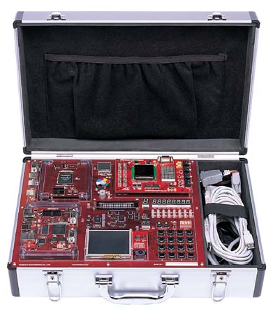
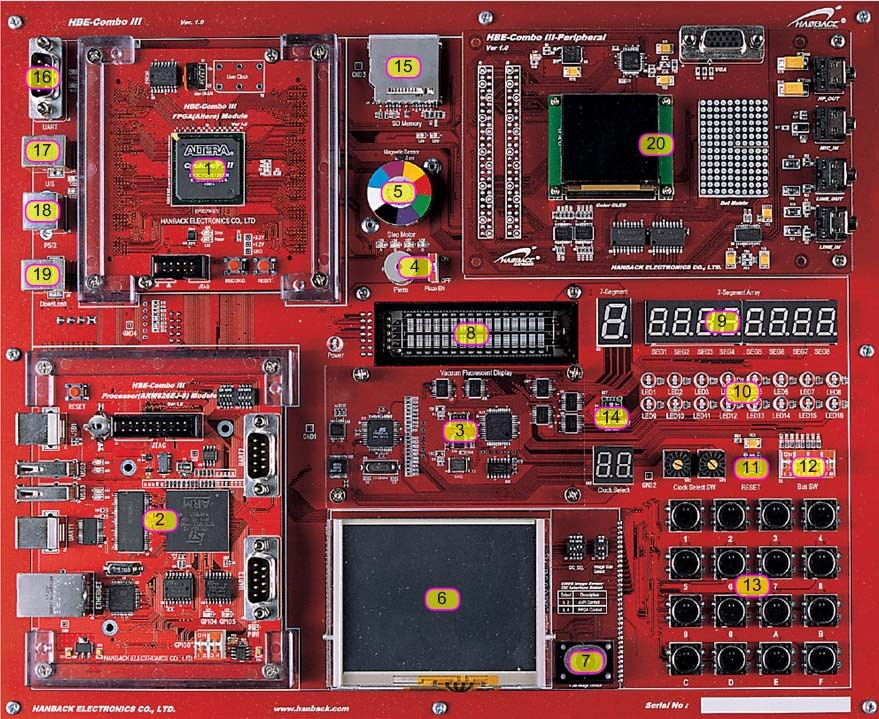
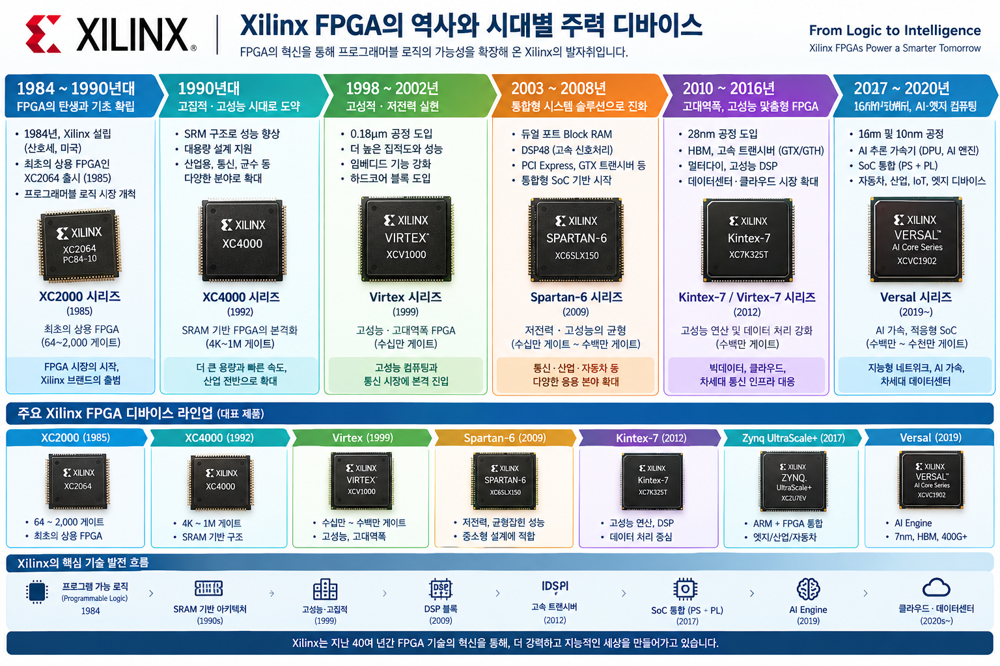
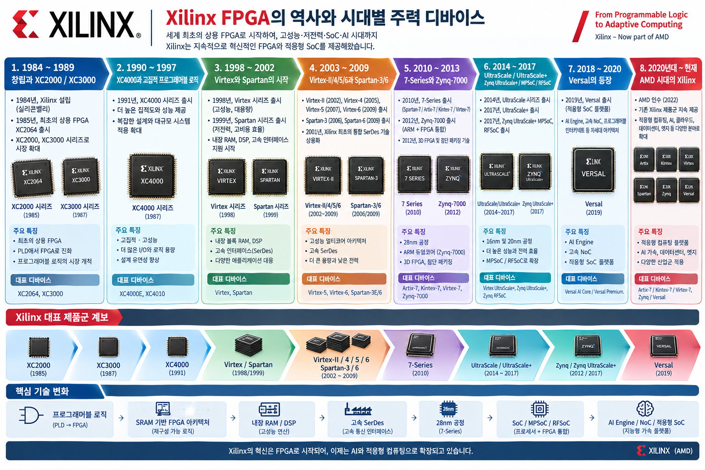

# HBE-COMBO III User's Guide 

  

  

* 보드: **HBE-COMBO III**
   * Altera(Quartus II)
   * Xilinx(ISE) FPGA 훈련용 콤보 보드
   * ARM

## 목차

| 장 | 파일 | 제목 | 내용 |
|----|------|------|------|
| 1 | [`HBE-Combo3_markdown/01_개요.md`](HBE-Combo3_markdown/01_개요.md) | 개요 | 제품 특징, 구성,  시스템 요구사항,  보드 구성 및 명칭, 규격 |
| 2 | [`HBE-Combo3_markdown/02_처음_사용하기.md`](HBE-Combo3_markdown/02_처음_사용하기.md) | 처음 사용하기 | Quartus II / Xilinx ISE 설치, 보드 설정 |
| 3 | [`HBE-Combo3_markdown/03_제품_사용하기.md`](HBE-Combo3_markdown/03_제품_사용하기.md) | 제품 사용하기 | Clock, Reset, VFD,  7-Segment, LED,  Dot matrix,  TFT LCD, OLED,  버튼/DIP, Piezo,  SRAM, Flash,  Step Motor, UART,  USB/Serial, VGA,  PS/2, Sensor,  SD, 확장 포트,  AMBA 등 23개 블록 |
| 4 | [`HBE-Combo3_markdown/04_설계SW_기본사용법.md`](HBE-Combo3_markdown/04_설계S_W_기본사용법.md) | 설계 S/W 기본 사용법 | Design Flow,  Quartus II / ISE 설계 |
| 5 | [`HBE-Combo3_markdown/05_부록.md`](HBE-Combo3_markdown/05_부록.md) | 부록 | 장비 사용 주의사항,  Unused Pin 설정,  **HBE-COMBO III Pin map**  (Altera / Xilinx 모듈별 27개 블록) |

## 원본

- `HBE-Combo3_User's_Guide.pdf` (9.5 MB)

