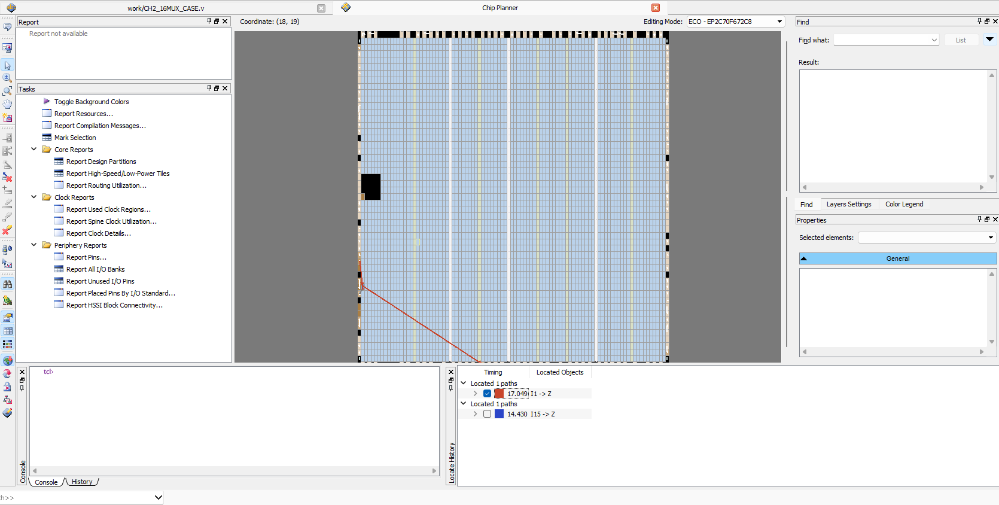
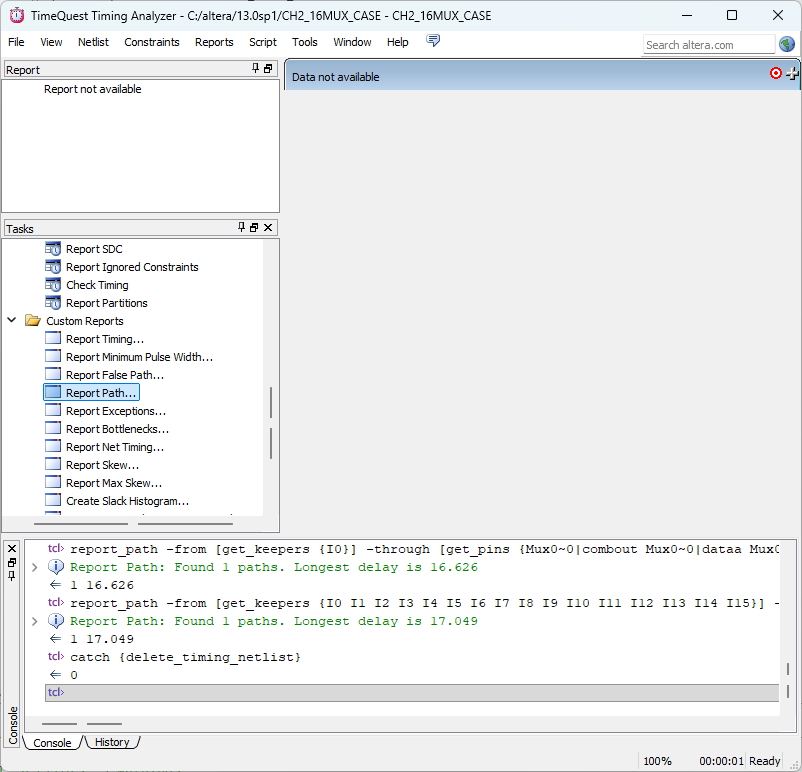
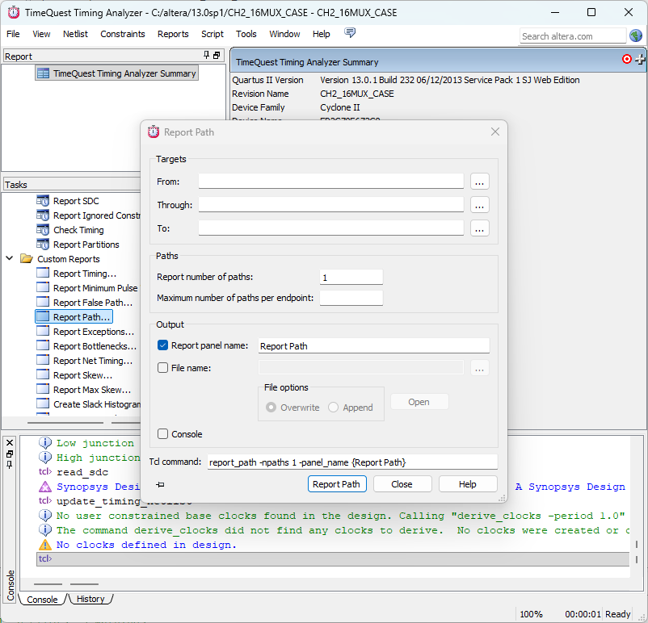
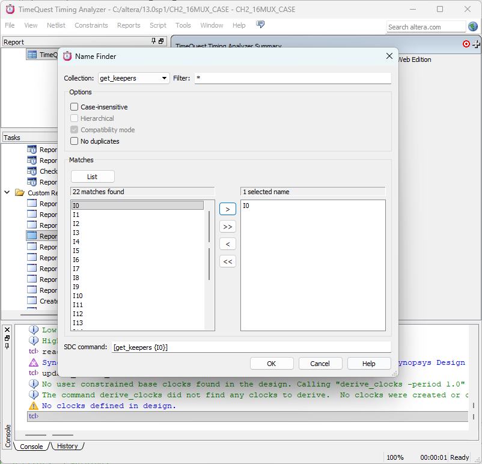
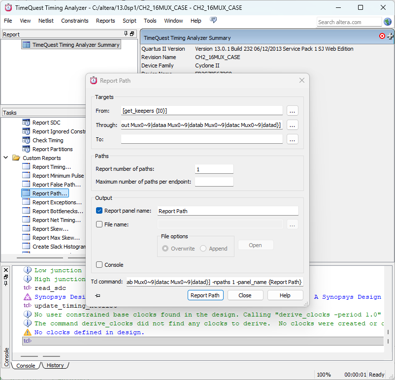
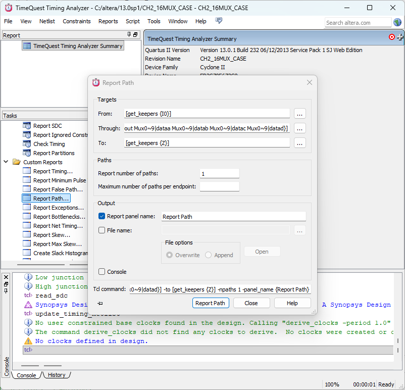

# Quartus II 13.0.1에서 16:1 MUX의 I15 → Z 라우팅 확인하기

## 1. 목적

Quartus II 13.0.1에서 Verilog로 작성한 16:1 MUX를 컴파일한 뒤, **입력 `I[15]`에서 출력 `Z`까지 실제 FPGA 내부에서 어떤 논리 자원과 배선 자원을 거치는지** 확인하는 절차를 정리한다.

핵심은 다음 세 가지 뷰를 구분하는 것이다.

| 도구 | 확인 대상 | 확인할 수 없는 것 |
|---|---|---|
| RTL Viewer | 작성한 RTL이 어떤 논리 구조로 해석되었는지 | 실제 배치·배선 결과 |
| Technology Map Viewer (Post-Mapping) | 합성 후 LUT/LE 등의 논리 매핑 결과 | 최종 Fitter 배선 |
| Technology Map Viewer (Post-Fitting), Chip Planner | 배치·배선 후 실제 구현된 논리 경로와 라우팅 자원 | PCB의 외부 배선 |

**실제 라우팅을 확인하려면 반드시 Fitter가 완료된 Post-Fitting 결과 또는 Chip Planner를 사용해야 한다.** RTL Viewer만으로는 I15에서 Z까지의 실제 물리 배선을 확인할 수 없다.

## 2. 예제 Verilog

아래 예제는 16비트 데이터 입력 `I`, 4비트 선택 입력 `S`, 1비트 출력 `Z`를 갖는 조합논리 16:1 MUX다.

파일명: `mux16.v`

```verilog
module mux16 (
    input  wire [15:0] I,
    input  wire [3:0]  S,
    output wire        Z
);

    assign Z = I[S];

endmodule
```

`S = 4'b1111`일 때 `Z = I[15]`가 된다.

> `I[15]`에서 `Z`로 이어지는 경로는 선택 신호 `S`가 15를 선택하는 조건에서 활성화되는 데이터 경로다. 합성기는 MUX를 LUT/LE 구조로 최적화할 수 있으므로, 내부에 반드시 15개의 개별 2:1 MUX가 직렬로 배치되는 것은 아니다.

## 3. 프로젝트 및 컴파일

1. Quartus II 13.0.1 실행
2. `File > New Project Wizard`에서 프로젝트 생성
3. `mux16.v`를 프로젝트에 추가
4. Top-Level Entity를 `mux16`으로 지정
5. 실제 사용할 FPGA 디바이스 선택
6. `Processing > Start Compilation` 실행
7. Compilation Report에서 Analysis & Synthesis 및 Fitter가 정상 완료되었는지 확인

라우팅은 선택한 FPGA 디바이스에 따라 달라진다. 같은 RTL이라도 디바이스 종류, 핀 배치, 제약 조건, 컴파일 옵션에 따라 물리 경로가 달라질 수 있다.

## 4. RTL 구조 확인

메뉴:

`Tools > Netlist Viewers > RTL Viewer`

확인할 내용:

- `I[15:0]` 입력 버스가 MUX 구조로 연결되었는지
- `S[3:0]`가 선택 신호로 사용되는지
- MUX 출력이 `Z`로 연결되는지

이 화면은 RTL을 논리적으로 해석한 결과다. 배치 위치나 실제 라우팅 트랙을 나타내는 화면은 아니다.

## 5. 합성 후 논리 매핑 확인

메뉴:

`Tools > Netlist Viewers > Technology Map Viewer (Post-Mapping)`

확인할 내용:

- MUX가 대상 디바이스의 LUT/LE 등 어떤 논리 자원으로 매핑되었는지
- `I[15]`와 선택 신호가 어떤 논리 셀의 입력으로 들어가는지
- 해당 논리 셀의 출력이 `Z` 방향으로 연결되는지

Post-Mapping은 합성 결과이며, 아직 Fitter의 최종 배치·배선 결과가 아니다.

## 6. Post-Fitting에서 I15 → Z 경로 확인

메뉴:

`Tools > Netlist Viewers > Technology Map Viewer (Post-Fitting)`

1. Post-Fitting 뷰어를 연다.
2. 노드 검색/노드 목록에서 `I[15]` 또는 `Z`를 찾는다.
3. 해당 노드를 선택한다.
4. 우클릭 메뉴의 `Locate` 또는 `Locate in Chip Planner` 계열 명령을 이용해 Chip Planner로 교차 이동한다. 메뉴 이름은 뷰어와 선택 대상에 따라 다를 수 있다.
5. Post-Fitting 뷰에서 I15와 Z를 잇는 논리 셀 및 연결을 살핀다.

**주의:** Post-Fitting Technology Map Viewer는 최종 논리 넷리스트를 보여주는 데 유용하지만, 상세 배선 자원은 Chip Planner의 라우팅 표시 기능으로 확인하는 편이 명확하다.

## 7. Chip Planner에서 실제 라우팅 표시

메뉴:

`Tools > Chip Planner`

권장 순서:

1. Fitter가 완료된 프로젝트 상태에서 Chip Planner를 연다.
2. Chip Planner의 노드/경로 선택 또는 Locate 기능으로 `I[15]`와 `Z` 관련 경로를 찾는다.
3. 가능하면 TimeQuest의 I15 → Z 타이밍 경로를 먼저 선택한 뒤 Chip Planner로 이동한다.
4. Chip Planner의 `Locate History` 창에서 해당 경로를 선택한다.
5. 경로를 우클릭하고 `Show Physical Routing` 또는 `Highlight Routing`에 해당하는 명령을 실행한다. Quartus II 13.0.1의 창 구성에 따라 메뉴 또는 툴바 아이콘으로 제공될 수 있다.
6. 필요하면 `Zoom to Selection`으로 경로 주변을 확대한다.
7. `Expand Connections` 및 `Show Delays` 기능이 제공되는 경우 연결 구성과 지연 정보를 확장해 확인한다.

확인할 내용:

- I15 입력 핀에서 FPGA 내부로 들어오는 경로
- 입력 핀에서 MUX를 구현한 논리 자원까지의 연결
- 논리 자원에서 Z 출력 핀까지의 연결
- 사용된 라우팅 자원 및 경로상의 지연 정보

`Highlight Routing`은 선택된 경로가 사용하는 라우팅 자원을 칩 평면에서 강조해 보여준다. 단순히 I15 또는 Z 노드 하나만 선택하면 노드 위치만 강조될 수 있으므로, **노드가 아니라 I15 → Z의 타이밍 경로 자체를 선택**하는 것이 중요하다.

## 8. TimeQuest에서 I15 → Z 타이밍 경로 만들기

조합논리 입력에서 출력까지의 경로를 타이밍 리포트에서 찾으려면 입력·출력 지연 제약을 지정하는 것이 좋다. 아래는 분석 방법을 보여주기 위한 간단한 예시다.

파일명: `mux16.sdc`

```tcl
# 분석용 가상 클럭
create_clock -name VCLK -period 10.000

# I[15] 입력 지연
set_input_delay  0.000 -clock VCLK [get_ports {I[15]}]

# Z 출력 지연
set_output_delay 0.000 -clock VCLK [get_ports {Z}]
```

> 위 0ns 값은 경로 분석을 위한 예시일 뿐, 실제 보드의 외부 지연을 의미하지 않는다. 실제 설계에서는 FPGA 외부 소자와 보드 타이밍을 고려해 입력·출력 지연값을 설정해야 한다. 프로젝트에 SDC 파일을 추가하고 컴파일/TimeQuest 분석에 반영한다.

TimeQuest Timing Analyzer에서 다음을 수행한다.

1. `Tools > TimeQuest Timing Analyzer` 실행
2. `Report Timing` 또는 타이밍 분석 리포트 생성
3. Start point를 `I[15]`, End point를 `Z`로 지정해 경로 확인
4. 결과에 I15 → Z 경로가 있는지 확인
5. 해당 경로 행에서 우클릭
6. `Locate Path > Locate in Chip Planner` 선택
7. Chip Planner에서 `Highlight Routing` 실행

Tcl Console을 사용할 경우, 프로젝트의 실제 포트 이름을 확인한 후 다음과 같은 형태로 경로를 조회할 수 있다.

```tcl
report_timing \
    -from [get_ports {I[15]}] \
    -to   [get_ports {Z}] \
    -npaths 10
```















Quartus/TimeQuest 버전 및 프로젝트의 포트·제약 상태에 따라 명령 옵션이나 노드 이름이 달라질 수 있다. 명령 실행 결과에 경로가 없으면 먼저 `get_ports *` 등으로 실제 포트 이름을 확인하고, SDC가 정상적으로 읽혔는지 확인한다.

## 9. I15 → Z 경로가 보이지 않을 때

| 증상 | 가능한 원인 | 확인/조치 |
|---|---|---|
| I15 또는 Z 노드를 찾을 수 없음 | 벡터 비트 표기 또는 내부 노드 이름 차이 | Node Finder에서 `I*`, `Z*` 검색 |
| Timing Report에 경로가 없음 | 입력/출력 타이밍 제약 누락 또는 경로 미분석 | SDC 적용 여부와 `get_ports` 결과 확인 |
| I15가 회로에서 사라짐 | 최적화, 미사용 신호, 잘못된 Top-Level 설정 | RTL 및 Post-Mapping 넷리스트 확인 |
| Chip Planner에서 노드만 보임 | 경로가 아닌 단일 노드를 Locate함 | TimeQuest에서 경로를 선택해 Chip Planner로 이동 |
| Highlight Routing이 비활성화됨 | Fitter 미완료, 경로 미선택, 지원되지 않는 선택 대상 | 전체 컴파일 완료 후 경로를 다시 Locate |
| Post-Mapping과 Post-Fitting 구조가 다름 | Fitter의 물리 최적화/재구성 | Post-Fitting 결과를 최종 구현 기준으로 확인 |

특히 `I[15]`가 최상위 입력 포트가 아니라 내부 신호이거나, 계층 이름이 붙어 있는 경우에는 실제 노드 이름이 `mux16|I[15]`와 같이 표시될 수 있다. Node Finder에서 실제 이름을 확인한다.

## 10. 시뮬레이션으로 I15 선택 기능 검증

라우팅 확인과 기능 검증은 별개다. 아래 테스트벤치로 `S=15`일 때 I15가 Z로 전달되는지 먼저 검증할 수 있다.

파일명: `tb_mux16.v`

```verilog
`timescale 1ns/1ps

module tb_mux16;

    reg  [15:0] I;
    reg  [3:0]  S;
    wire        Z;

    mux16 uut (
        .I(I),
        .S(S),
        .Z(Z)
    );

    initial begin
        I = 16'h8000;
        S = 4'd15;
        #10;
        if (Z !== 1'b1)
            $display("FAIL: I15 -> Z");
        else
            $display("PASS: I15 -> Z");

        I = 16'h0000;
        S = 4'd15;
        #10;
        if (Z !== 1'b0)
            $display("FAIL: I15 low -> Z");
        else
            $display("PASS: I15 low -> Z");

        $finish;
    end

endmodule
```

이 테스트는 논리 기능을 검증한다. 실제 FPGA 내부 라우팅을 증명하지는 않는다.

## 11. 권장 확인 순서 요약

```text
Verilog 16:1 MUX 작성
        |
        v
Analysis & Synthesis
        |
        v
RTL Viewer
(RTL 논리 구조 확인)
        |
        v
Technology Map Viewer (Post-Mapping)
(합성 논리 자원 확인)
        |
        v
Fitter 완료
(배치 및 라우팅)
        |
        v
TimeQuest Timing Analyzer
(I[15] -> Z 경로 조회)
        |
        v
Locate Path in Chip Planner
        |
        v
Highlight Routing
(실제 사용 라우팅 자원 확인)
```

## 12. 결론

`I[15]`에서 `Z`까지의 경로를 확인하려는 목적이라면 다음 조합을 권장한다.

- **RTL Viewer:** 16:1 MUX의 논리 연결 확인
- **Post-Mapping:** 합성기가 만든 논리 셀 구조 확인
- **TimeQuest:** I15 → Z 타이밍 경로 및 지연 확인
- **Chip Planner + Highlight Routing:** Fitter가 선택한 실제 FPGA 내부 라우팅 자원 확인

따라서 가장 중요한 절차는 **TimeQuest에서 I15 → Z 경로를 선택하고, Locate Path로 Chip Planner에 넘긴 뒤 Highlight Routing을 실행하는 것**이다.

## 참고 자료

1. Altera, *Quartus II Handbook Version 13.0, Volume 2: Design Implementation and Optimization*, Chapter 15, “Analyzing and Optimizing the Design Floorplan with the Chip Planner”. 특히 “Exploring Paths in the Chip Planner”, “Analyzing Connections for a Path” 절을 참고한다.
   - https://cdrdv2-public.intel.com/653795/quartusii_handbook_archive_130.pdf
2. Altera, *Quartus II Netlist Viewers User Manual*. RTL Viewer와 Technology Map Viewer의 차이 및 타이밍 경로 교차 탐색 참고.
   - https://manualzz.com/doc/9020372/altera-quartus-ii-netlist-viewers-user-manual

> 참고 자료의 일부 최신 Quartus 문서는 메뉴 명칭이 Quartus II 13.0.1과 다를 수 있다. 실제 작업에서는 Quartus II 13.0 Handbook의 절차를 우선 기준으로 삼고, 최신 문서는 기능 개념을 보충하는 용도로만 활용한다.
