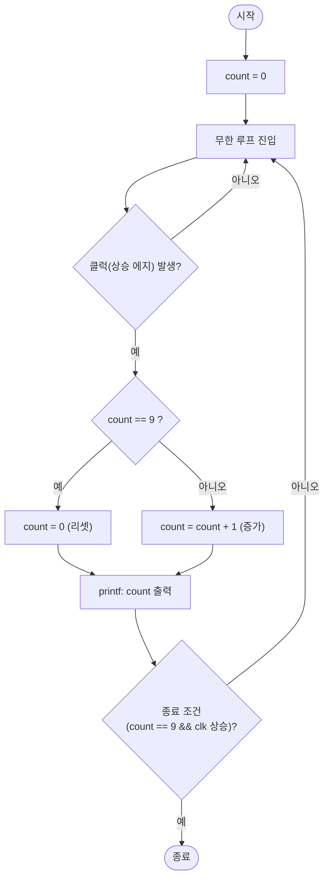
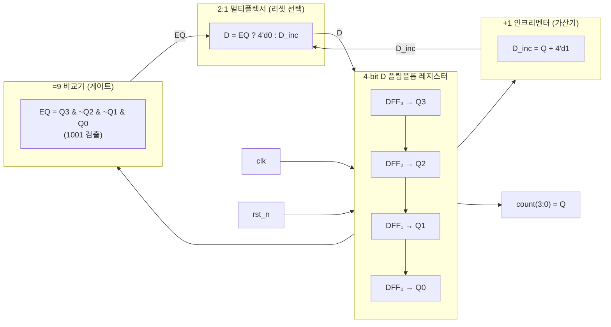
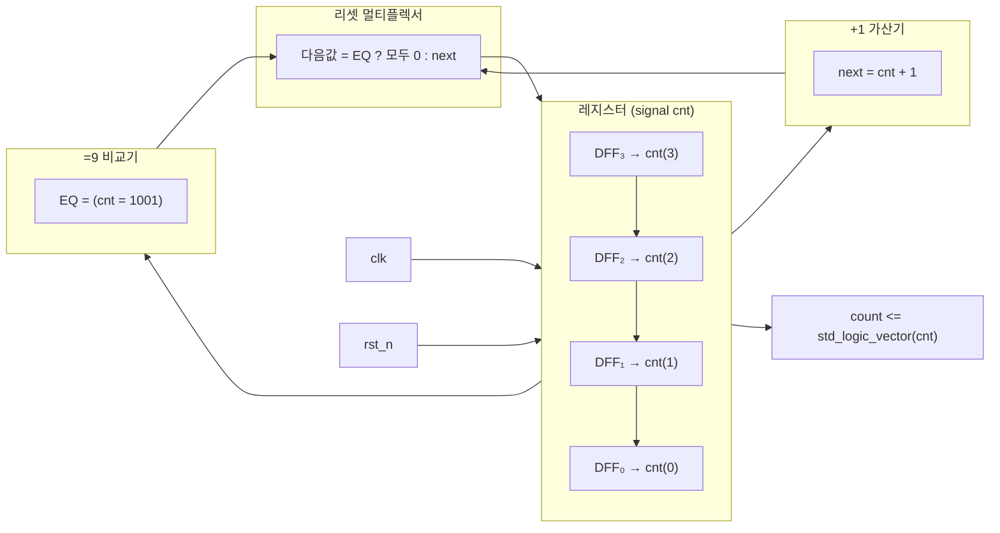

# 카운터 구현 비교: C / Verilog HDL / VHDL

동일한 동작(0~9를 세는 4비트 바이너리 카운터)을 C 언어, Verilog HDL, VHDL로 각각 구현하고,
세 코드 간의 **공통점과 차이점**을 비교한다.

---

## 1. C 언어 구현

### 1.1 C언어로서의 전형적인 구현 (순수 소프트웨어)

먼저 HDL과 전혀 관계없이, **C언어 소프트웨어로만** 카운터를 작성하면 다음과 같다.
클럭, 입출력 포트, 동시성이라는 개념이 필요 없다. `count`는 그저 메모리에 저장된 변수일 뿐이다.

```c
#include <stdio.h>

/* 0~9를 반복하는 카운터 (순수 소프트웨어) */
int main(void)
{
    int count = 0;

    while (1) {
        printf("count = %d\n", count);

        if (count == 9)
            count = 0;          /* 리셋 */
        else
            count = count + 1;  /* 증가 */
    }

    return 0;
}
```

> 여기까지가 **"소프트웨어로서의 C 코드"**다. 위에서 아래로 순서대로 실행되고
> 조건 분기가 있을 뿐, 시간(클럭)도 입출력 핀도 동시 실행도 없다.

---

### 1.2 하드웨어에서 클럭은 꼭 필요한가?

HDL에서 클럭(clk)이 **항상 필요한 것은 아니다.** 회로는 크게 셋으로 나뉜다.

| 구분 | 클럭 | 상태 저장 | 예시 |
|---|---|---|---|
| **조합 논리** | ❌ 필요 없음 | 없음 | AND/OR 게이트, 멀티플렉서, 가산기 |
| **동기식 순차 논리** | ✅ 공통 클럭 사용 | D-플립플롭 | 동기 카운터, 레지스터, FSM |
| **비동기식 순차 논리** | ⚠️ 공통 클럭 없음 | D-플립플롭 | 리플(비동기) 카운터, 비동기 리셋 |

- **조합 논리 (Combinational)**: 입력이 정해지면 즉시 출력이 결정된다. 시간(클럭) 개념 자체가 없다.
  - Verilog `always @(*)`, VHDL `process (입력 신호 목록)` — 이 블록에는 `clk`가 등장하지 않는다.
- **동기식 (Synchronous)**: 상태를 기억해야 하므로 **공통 클럭의 에지에서만** 상태가 변한다.
  - Verilog `posedge clk`, VHDL `rising_edge(clk)`가 바로 그것. 우리 예제(0~9 카운터)도 이 방식이며, 그래서 2·3장 코드에 `clk`와 `rst_n`이 등장한다.
- **비동기식 (Asynchronous)**:
  - (a) **공통 클럭을 아예 쓰지 않는** 경우 — 리플 카운터처럼 **앞 단 DFF의 출력이 뒤 단의 "클럭 신호처럼" 작용**해 연쇄적으로 상태가 토글된다.
  - (b) 클럭은 쓰되, 클럭과 무관하게 **즉시 반응하는 리셋**(비동기 리셋) — 예제의 `negedge rst_n`이 이에 해당한다.
  - 즉 "비동기"라고 시간 개념이 사라지는 것이 아니라, 클럭 대신 **이벤트/토글 신호에 의한 상태 변화**가 일어나는 것이다.

요약하면:

> **"클럭 없이 동작하는 회로(조합 논리)도 분명히 존재한다."** 하지만<br>
> "이전 상태를 기억하며 순서대로 센다"는 카운터처럼 **상태 저장이 본질인 회로는<br>
> 공통 클럭을 쓰는 동기식이 표준**이다. 비동기식(리플 카운터)으로도 만들 수는 있으나<br>
> 토글 지연이 누적되는 단점 때문에 실용적으로는 잘 쓰지 않는다.

이 개념을 C로 흉내 내면 HDL과 C의 대응은 다음과 같다. (다음 1.3 코드가 실제로 이렇게 구현한다.)

| HDL 개념 | C에서의 흉내 |
|---|---|
| 조합 논리 (클럭 없음) | 함수 호출 → 즉시 결과 반환 (클럭 불필요) |
| 클럭 신호 / 클럭 에지 | `clk` 변수의 0→1 변화 감지 |
| 동기식 상태 갱신 | 클럭 에지에서만 값을 갱신 |
| 순차 상태 저장 | 변수(`count`)로 유지 |
| 카운터 리셋 | 9 검사 후 0으로 되돌림 |

---

### 1.3 하드웨어(HDL)와 유사하게 표현한 구현

"이 카운터를 **하드웨어처럼** 다룬다면 어떨까?"라는 관점에서 C에서 흉내 내 보자.
아래 코드는 Verilog의 `module port`/`always`, VHDL의 `entity port`/`process` 구조를 C로 옮긴 형태다.

```c
#include <stdio.h>
#include <stdlib.h>   /* rand() 사용 */
#include <time.h>     /* clock() 사용 */

/* 0~9를 반복하는 카운터 모듈 */
int counter_next(int count)
{
    if (count == 9)
        return 0;     /* 리셋 */
    return count + 1; /* 증가 */
}

int main(void)
{
    int count = 0;    /* 카운터 변수 (메모리에 저장) */
    int clk = 0;

    while (1) {
        /* 클럭 에지 시뮬레이션: 매 10회마다 상승 에지 발생 */
        for (int i = 0; i < 10; i++) {
            clk = rand() % 2;
        }

        /* 상승 에지에서 카운트 증가 */
        count = counter_next(count);

        printf("count = %d\n", count);

        /* 100 사이클 후 종료 */
        if (count == 9 && clk == 1) break;
    }

    return 0;
}
```

> **HDL을 흉내 낸 부분을 짚어보면:**
> - `counter_next()` 함수 → **모듈 / always 블록** 단위 (값을 받아 다음 값을 돌려줌)
> - `clk` 변수 → **클럭 신호** (상승 에지 개념을 흉내 냄)
> - `count` 변수 → **상태 저장 레지스터** (HDL의 `reg`/`signal`)
> - 함수로 값을 넘기고 받는 방식 → HDL의 **포트(신호) 연결**과 유사
> - `if (count == 9)` 검사 후 리셋 → HDL의 `== 9` 비교 + 리셋과 동일한 로직
>
> 다만 이건 어디까지나 **은유(흉내)**다. C는 여전히 **순차 실행**이며,
> `posedge clk`/`rising_edge` 같은 진짜 클럭 에지나 **병렬 동시 실행**은
> 언어 차원에서 존재하지 않는다. 그러한 개념을 언어가 직접 다루려면
> 2장(Verilog), 3장(VHDL)처럼 HDL로 작성해야 한다.

---

## 2. Verilog HDL 구현

```verilog
module counter (
    input  wire       clk,   // 클럭
    input  wire       rst_n, // 비동기 리셋 (active low)
    output reg [3:0]  count  // 4비트 카운터 값
);

    // 0~9 카운터: 9에서 리셋
    always @(posedge clk or negedge rst_n) begin
        if (!rst_n)
            count <= 4'd0;
        else if (count == 4'd9)
            count <= 4'd0;
        else
            count <= count + 1'b1;
    end

endmodule
```

---

## 3. VHDL 구현

```vhdl
library ieee;
use ieee.std_logic_1164.all;
use ieee.numeric_std.all;

entity counter is
    port (
        clk   : in  std_logic;          -- 클럭
        rst_n : in  std_logic;          -- 비동기 리셋 (active low)
        count : out std_logic_vector(3 downto 0)  -- 4비트 카운터 값
    );
end entity counter;

architecture rtl of counter is
    signal cnt : unsigned(3 downto 0);  -- 내부 카운터 신호
begin

    process (clk, rst_n)
    begin
        if rst_n = '0' then             -- 리셋
            cnt <= (others => '0');
        elsif rising_edge(clk) then     -- 클럭 상승 에지
            if cnt = "1001" then        -- 9인 경우
                cnt <= (others => '0');
            else
                cnt <= cnt + 1;
            end if;
        end if;
    end process;

    count <= std_logic_vector(cnt);     -- unsigned -> std_logic_vector 변환

end architecture rtl;
```

---

## 4. 표현 방식 비교 (다이어그램)

같은 카운터를 **C는 플로우차트**, **Verilog/VHDL은 게이트 회로도**로 표현하면
서로 다른 관점이 드러난다.

### 4.1 C 언어 — 플로우차트 (Flowchart)

C 코드의 `main()` 동작을 순서도로 나타낸 것이다. 흐름의 **순서(위 → 아래)** 가 곧 실행 순서다.



> 플로우차트의 핵심 단위: **시작/종료(스타디움), 처리(사각형), 판단(다이아몬드), 흐름 화살표**.
> 다이아몬드마다 하나의 갈래만 선택되어 **순차 실행**됨을 보여준다.

---

### 4.2 Verilog HDL — 게이트 회로도 (합성 구조)

Verilog 코드가 합성되어 만들어지는 하드웨어 구조를 회로도로 그린 것이다.
`always` 블록은 실제로 **레지스터(DFF) + 가산기 + 비교기 + 멀티플렉서**가 서로 연결된 병렬 회로가 된다.



> 회로도의 핵심 단위: **레지스터(DFF), 가산기, 비교기, 멀티플렉서, 클럭**.
> 모든 게이트가 **동시에(on every clock edge) 병렬 동작**함을 보여준다.

---

### 4.3 VHDL — 게이트 회로도 (합성 구조)

VHDL도 동일한 하드웨어로 합성된다. 코드의 `cnt` 신호가 레지스터가 되고,
`rising_edge(clk)`는 DFF의 클럭 입력에, 리셋 조건은 DFF의 리셋 입력에 대응한다.
즉 **문법만 다를 뿐 합성 결과(게이트 회로)는 Verilog와 동일**하다.



> 회로도의 핵심 단위: **레지스터(DFF), 가산기, 비교기, 멀티플렉서, 클럭**.
> 모든 게이트가 **동시에(on every clock edge) 병렬 동작**함을 보여준다.

---

### 4.4 다이어그램 관점 비교

| 기준 | C — 플로우차트 | Verilog / VHDL — 게이트 회로도 |
|---|---|---|
| **기본 단위** | 시작/종료, 처리, 판단(다이아몬드) | 레지스터(DFF), 가산기, 비교기, 멀티플렉서 |
| **시간 표현** | 화살표 위치 = 코드 실행 순서 | 클럭 + DFF의 에지가 흐름을 결정 |
| **동시성** | 분기마다 **한 갈래만** 선택 (순차) | 모든 게이트가 **병렬로 동시 동작** |
| **모델링 대상** | 프로그램의 **동작/흐름** | 합성된 **하드웨어의 구조** |
| **수정 의미** | 흐름 추가/제거 | 게이트/신호 연결 변경 |

---

## 5. 공통점

| 항목 | 공통점 설명 |
|---|---|
| **동작 논리** | 세 언어 모두 "0부터 시작해 매 단계 1씩 증가, <br> 9에 도달하면 0으로 리셋"이라는 동일한 상태 판정 로직을 사용한다. <br> 상태 비교(`== 9`) 후 리셋하는 구조가 동일하다. |
| **상태 저장** | 모두 어떤 형태로든 "현재 값"을 유지한다. <br> C는 변수(`count`), Verilog는 `reg`, VHDL은 `signal`이 상태를 기억한다. |
| **폭 제한** | 4비트(0 ~ 15)가 아니라 0 ~ 9 범위로 제한하는 것은 세 코드 모두 동일하게 `== 9` 비교로 처리한다. |
| **리셋 처리** | 모두 초기/리셋 시 0으로 되돌아가는 동작을 정의한다. |
| **조건 분기** | 모두 if-else를 이용해 "리셋 조건 → 증가 조건"의 우선순위를 기술한다. |

---

## 6. 차이점

| 항목 | C 언어 | Verilog HDL | VHDL |
|---|---|---|---|
| **성격** | 순차 프로그래밍 언어 <br> (소프트웨어) | 하드웨어 기술 언어 (HDL) | 하드웨어 기술 언어 (HDL) |
| **실행 방식** | CPU가 <br> **명령을 순서대로 실행** | 시뮬레이터가 <br> **이벤트 기반**으로 동시에 실행 | 시뮬레이터가 <br> **이벤트 기반**으로 동시에 실행 |
| **시간 개념** | `clock()` 등 <br> 별도로 시간을 흉내냄 | `posedge clk`처럼 <br> 시간/이벤트가 언어에 내장 | `rising_edge(clk)`처럼 <br> 시간/이벤트가 언어에 내장 |
| **동시성** | 기본적으로 **순차 실행** <br> (한 번에 하나) | `always` 블록 = **병렬 동시 실행** | `process` 문 = **병렬 동시 실행** |
| **할당 방식** | 일반 대입 `count = ...` <br> (즉시 반영) | `<=`(비차단)으로 **클럭 끝에서 갱신** | `<=`(신호 대입)으로 프로세스 끝에서 갱신 |
| **데이터 타입** | `int` 등 소프트웨어 타입 | `reg`, `wire` (비트/벡터 기반) | `std_logic`, `signal`, `unsigned` |
| **리셋 표현** | 함수 호출/초기화로 처리 | `rst_n` 포트 + `if (!rst_n)` | `rst_n` 포트 + `if rst_n = '0'` |
| **모듈 경계** | 함수(`counter_next`)로 분리 | `module` / `endmodule` | `entity` + `architecture` (엔터티/구조 분리) |
| **포팅/합성** | 컴파일 후 CPU에서 실행 | RTL 합성 → 논리회로로 변환 가능 | RTL 합성 → 논리회로로 변환 가능 |
| **시뮬레이션** | printf 등으로 직접 확인 | 테스트벤치(Testbench) 필요 | 테스트벤치(Testbench) 필요 |
| **진입점** | `main()` 함수 | 포트(입출력 신호) 중심 | 포트(입출력 신호) 중심 |
| **대표 문법 차이** | `if (count == 9)` | `if (count == 4'd9)` — 비트 폭/진수 명시 | `if (cnt = "1001")` — 문자열 리터럴 사용 |

---

## 7. 요약

- **공통점**: 세 언어 모두 "비교 → 리셋 or 증가"라는 **동일한 카운터 알고리즘**을 표현한다.
- **핵심 차이점**: 
  - C는 **순차 실행**되는 소프트웨어이므로 클럭과 동시성을 직접 다루지 않는다.
  - Verilog와 VHDL은 **동시성(병렬) 기반 HDL**이므로 클럭 에지(`posedge clk`, `rising_edge`)와 이벤트를 명시적으로 기술하며, 이것이 회로 합성의 기반이 된다.

> 즉, **"무엇을 하는가(동작)"는 같고, "어떻게 표현하고 실행되는가(구조/모델)"가 다르다** — 이것이 하드웨어 기술 언어와 프로그래밍 언어의 가장 중요한 차이점이다.
